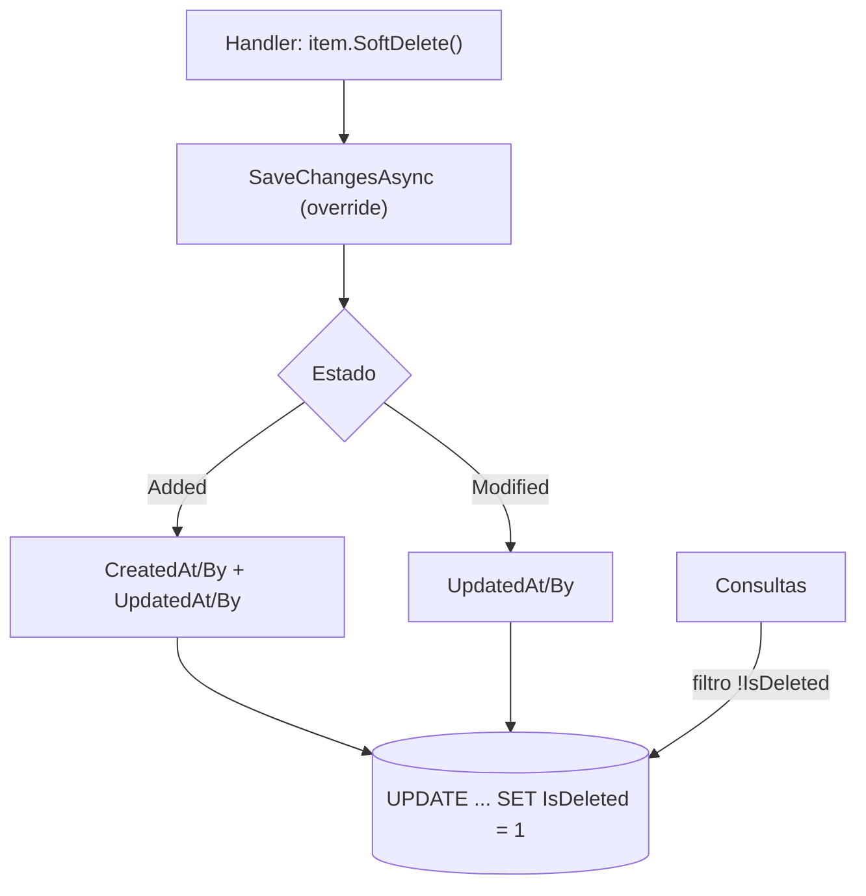

# Borrado lógico y auditoría

> Borrado lógico: marcar un registro como borrado (`IsDeleted`) en vez de eliminarlo. Auditoría: guardar quién y cuándo creó o cambió cada registro. En [[Itzamna.Dionisio]] ambas se aplican de forma central en el `AppDbContext`.

## Qué es y qué problema resuelve
- **Soft delete**: un `DELETE` físico es irreversible y rompe referencias (una versión publicada que apunta a una foto borrada). Marcar `IsDeleted = 1` + `DeletedAt` permite ocultar sin perder datos, y "deshacer" si hiciera falta.
- **Auditoría de columnas** (`CreatedAt/By`, `UpdatedAt/By`): responde "¿quién tocó esto y cuándo?" sin tablas extra. No es un historial completo de cambios.

## Cómo funciona por dentro
- **Entidad**: interfaz `ISoftDeletable` con `SoftDelete()`; base `Entity` con columnas de auditoría.
- **Ocultar**: filtro global `!x.IsDeleted` en el ORM (todas las consultas lo heredan).
- **Unicidad**: índices filtrados `WHERE [IsDeleted] = 0` para que un borrado no bloquee el slug/orden.
- **Auditoría**: interceptar `SaveChanges` y, según el estado en el change tracker (`Added`/`Modified`), rellenar fechas y usuario.



## Cuándo usarla y cuándo no
### Ventajas
- Datos recuperables; referencias históricas siguen válidas.
- Una sola regla central; los handlers solo llaman `SoftDelete()`.
- Auditoría básica gratis en todas las tablas.
### Desventajas
- Las tablas crecen; hace falta purga eventual.
- Unicidad más compleja (índices filtrados).
- Privacidad: "borrado" no es borrado (derecho al olvido requiere purga real).
- La auditoría de columnas guarda solo el último cambio, no el historial.

## Alternativas
| Alternativa | En qué se diferencia |
|---|---|
| Borrado físico | Simple; irreversible. |
| Tablas temporales de SQL Server | El motor guarda historial completo por fila. |
| Tabla de auditoría / event log | Registra cada cambio (quién, qué, antes/después). |
| `SaveChangesInterceptor` | Misma auditoría que el override, pero como componente aparte. |

## Cómo se usó en Itzamna
**Base** (`Itzamna.Dionisio/src/Itzamna.Dionisio.Core/Common/Entity.cs`): `Entity` trae `Id` (`Guid.CreateVersion7()`), `CreatedAt`, `CreatedBy`, `UpdatedAt`, `UpdatedBy`, `RowVersion`. `PortfolioItem : Entity, ISoftDeletable` trae `IsDeleted`, `DeletedAt` y `SoftDelete()`. `MediaAsset` también es borrable lógicamente.

**Tablas con borrado lógico**: `SocialProfiles`, `Metrics`, `ContentCategories`, `FeaturedContent`, `Services`, `Collaborations`, `Recommendations`, `MediaAssets`. Sin borrado lógico: `Creators`, `Portfolios`, `PortfolioSections`, `PortfolioThemeSettings`, `PortfolioSnapshots`, `SlugRedirects`.

**Auditoría** en `AppDbContext.SaveChangesAsync` (`Itzamna.Dionisio/src/Itzamna.Dionisio.Infrastructure/Persistence/AppDbContext.cs`):
```csharp
var now = DateTime.UtcNow;
var actor = user.Subject;
foreach (var entry in ChangeTracker.Entries<Entity>())
{
    if (entry.State == EntityState.Added)
    {
        entry.Entity.CreatedAt = now;
        entry.Entity.CreatedBy = actor;
        entry.Entity.UpdatedAt = now;
        entry.Entity.UpdatedBy = actor;
    }
    else if (entry.State == EntityState.Modified)
    {
        entry.Entity.UpdatedAt = now;
        entry.Entity.UpdatedBy = actor;
    }
}
```
`actor` es el `sub` del token ([[JWT y autenticación con Bearer]]); en `dotnet ef` es `"design-time"`.

**Caso de medios** (`Features/Media/MediaFeatures.cs`, `DeleteMediaHandler`): si el archivo se usa en el borrador → 409 con la lista de usos. Si no, `SoftDelete()` y se borra **solo el original privado** del almacenamiento: "si una versión publicada lo usa, sus variantes siguen disponibles" ([[Biblioteca de medios]], [[Snapshot inmutable versionado]]).

**Índices filtrados**: `(PortfolioId, Order)` en todas las colecciones y `(PortfolioId, Slug)` único en categorías, ambos `HasFilter("[IsDeleted] = 0")`.

Funcionalidad: [[Multi-tenant y aislamiento]]; colecciones en [[Redes sociales y métricas]], [[Contenido y categorías]], [[Servicios]], [[Colaboraciones]], [[Recomendaciones]].

> [!note] Pendiente de confirmar
> No hay purga ni "papelera" para restaurar elementos borrados; tampoco historial de cambios más allá de las columnas `UpdatedAt/By`. Las variantes públicas de un medio borrado nunca se eliminan (posible costo de almacenamiento a largo plazo).

## Errores comunes y buenas prácticas
- Usar `db.Remove(x)` en una entidad borrable lógicamente: hace `DELETE` físico. Siempre `SoftDelete()`.
- Índices únicos sin filtro: impiden recrear un nombre/slug borrado.
- Tomar el actor del body: aquí viene de `ICurrentUser` (token).
- `ExecuteUpdate/ExecuteDelete` se saltan el change tracker y, por tanto, la auditoría.

## Qué estudiar después
- [[Multi-tenancy]], [[Entity Framework Core]], [[Concurrencia optimista]]
- `SaveChangesInterceptor`, tablas temporales de SQL Server.

## Documentación oficial
- https://learn.microsoft.com/ef/core/querying/filters
- https://learn.microsoft.com/ef/core/logging-events-diagnostics/interceptors
- https://learn.microsoft.com/sql/relational-databases/tables/temporal-tables

## Autoevaluación

Contesta primero en voz alta o en papel; luego despliega la respuesta.

> [!question]- ¿Cómo garantizas unicidad de un `Slug` con borrado lógico?
> Con un índice único filtrado: `CREATE UNIQUE INDEX ... (PortfolioId, Slug) WHERE IsDeleted = 0`. Así un registro borrado no impide crear otro con el mismo slug.

> [!question]- Con Dapper y procedimientos (sin filtro global de EF), ¿cómo evitas olvidar `IsDeleted = 0` en las consultas?
> Centraliza las lecturas en vistas o funciones de tabla en línea que ya filtran (`portfolio.vSocialProfiles`), o usa [[Row-level security]] con un predicado de filtro. Y revisa en code review que ningún procedimiento lea la tabla base directamente.

> [!question]- ¿Qué atajo se salta la auditoría hecha en `SaveChanges` de EF Core?
> `ExecuteUpdate`/`ExecuteDelete` y el SQL directo: no pasan por el *change tracker*. Si la auditoría debe ser infalible, hazla en la base (columnas con `DEFAULT`, procedimientos o tablas temporales del sistema).

> [!question]- ¿El borrado lógico cumple con el derecho al olvido (borrar datos personales)?
> No: el dato sigue ahí. Necesitas un proceso de purga o anonimización real para los datos personales, además del borrado lógico.

