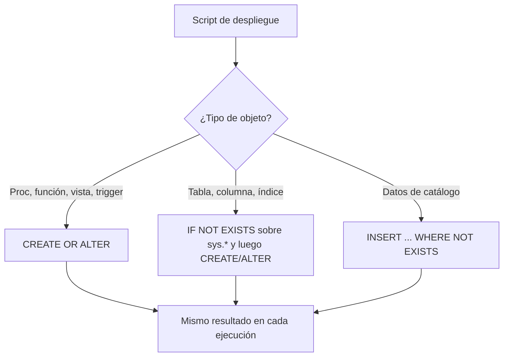

# CREATE OR ALTER y scripts idempotentes

Parte de: [[06-SQL-Server/02 Intermedio/_Índice Intermedio|Intermedio]]

> [!info] Cómo avanzar
> `progreso`: **pendiente** → **viendo** (estudiando) → **visto** (contestaste la autoevaluación sin abrir las respuestas) → **dominado** (hiciste el laboratorio o lo aplicaste de verdad).

## Contenido

### Qué es
Un **script idempotente** es uno que puedes ejecutar una, dos o diez veces y siempre deja la base en el mismo estado final, sin fallar la segunda vez. Es la base de cualquier despliegue automatizado: en Azure DevOps el mismo script corre en desarrollo, QA y producción, y a veces se reintenta tras un fallo a medias. Si el script truena porque "la columna ya existe", el pipeline se detiene y alguien tiene que entrar a mano.

`CREATE OR ALTER` es la herramienta de T-SQL para lograrlo con objetos programables: crea el objeto si no existe y lo modifica si ya existe, en una sola instrucción. Está disponible desde **SQL Server 2016 SP1** y en Azure SQL, y sirve para **procedimientos almacenados, funciones, vistas y triggers**. No existe para tablas, índices, tipos ni esquemas: para esos usas comprobaciones contra el catálogo.

### Cómo funciona
Hay dos familias de objetos y cada una se trata distinto:

1. **Objetos con código** (procedimientos, funciones, vistas, triggers): `CREATE OR ALTER`. El objeto conserva su `object_id`, sus permisos (`GRANT EXECUTE`) y sus dependencias. Con el viejo patrón `DROP` + `CREATE` pierdes los permisos y, entre ambas instrucciones, hay un instante en que el objeto no existe y las llamadas de la app fallan.
2. **Objetos de datos** (tablas, columnas, índices, restricciones, filas de catálogo): se protegen con una condición `IF NOT EXISTS` que consulta `sys.tables`, `sys.columns`, `sys.indexes`, o funciones como `OBJECT_ID()`, `COL_LENGTH()` e `INDEXPROPERTY()`. Desde SQL Server 2016 también tienes `DROP ... IF EXISTS` para eliminar sin fallar.
3. **Datos semilla**: `INSERT ... WHERE NOT EXISTS (...)` o un `MERGE` cuidadoso; nunca un `INSERT` a secas.



Un detalle clave es la **compilación por lote**: SQL Server compila todo el lote antes de ejecutarlo. Si en un lote agregas una columna y en el mismo lote haces un `UPDATE` que la usa, la compilación falla con "nombre de columna no válido" porque, al compilar, la columna aún no existe. La solución es separar con `GO` (ver [[Lotes con GO, sqlcmd e Invoke-Sqlcmd]]) o envolver el `UPDATE` en `EXEC sp_executesql`, que se compila más tarde.

### Ejemplo
Migración versionada para la base de [[Lab 1 - Base de práctica Tienda en SQL Server]], escrita para poder correrla varias veces:

```sql
-- 1) Columna nueva, solo si no existe
IF COL_LENGTH(N'ventas.Productos', N'Activo') IS NULL
    ALTER TABLE ventas.Productos
        ADD Activo bit NOT NULL CONSTRAINT DF_Productos_Activo DEFAULT (1);
GO
-- 2) Índice, solo si no existe
IF NOT EXISTS (SELECT 1 FROM sys.indexes
               WHERE name = N'IX_Pedidos_ClienteId_Fecha'
                 AND object_id = OBJECT_ID(N'ventas.Pedidos'))
    CREATE INDEX IX_Pedidos_ClienteId_Fecha ON ventas.Pedidos (ClienteId, Fecha);
GO
-- 3) Dato de catálogo
INSERT INTO ventas.Categorias (Nombre)
SELECT N'Audio'
WHERE NOT EXISTS (SELECT 1 FROM ventas.Categorias WHERE Nombre = N'Audio');
GO
-- 4) Procedimiento: conserva permisos y no hay ventana sin objeto
CREATE OR ALTER PROCEDURE ventas.Productos_Listar
AS
BEGIN
    SET NOCOUNT ON;
    SELECT ProductoId, Nombre, Categoria, Precio
    FROM   ventas.Productos
    WHERE  Activo = 1;
END;
GO
```

En un proyecto como [[Itzamna.Dionisio]], cada archivo `.sql` de procedimiento puede vivir en el repositorio empezando con `CREATE OR ALTER`; así el pipeline lo aplica siempre sin preguntar si ya existía.

### Cuándo usarlo y cuándo no
- **Úsalo** en todo script que vaya a un pipeline o que otra persona vaya a ejecutar, y en los archivos de procedimientos que mantienes en control de versiones.
- **No basta** para cambios destructivos o con transformación de datos (renombrar columnas, partir tablas): ahí necesitas una herramienta de migraciones que lleve registro de qué se aplicó, como en [[Migraciones de base de datos (scripts versionados, DACPAC, DbUp y Flyway)]].
- Para despliegues sin caída, combina la idempotencia con el patrón de [[Migraciones sin caídas (expand y contract)]].

### Errores comunes
- **Usar la columna recién creada en el mismo lote**: falla en compilación. Separa con `GO` o usa SQL dinámico.
- **`DROP PROCEDURE` + `CREATE PROCEDURE`**: pierdes los `GRANT` y provocas errores momentáneos en producción. Usa `CREATE OR ALTER`.
- **Comprobar solo el nombre del índice** sin filtrar por `object_id`: los nombres de índice son únicos por tabla, no por base, y podrías saltarte uno que no existe.
- **Restricciones sin nombre**: SQL Server inventa un nombre aleatorio (`DF__Producto__Activ__3B75D760`) y luego no puedes borrarlas de forma idempotente. Nómbralas siempre.
- **Semillas con `INSERT` simple**: la segunda ejecución duplica filas o viola el `UNIQUE`.

### Para profundizar
- [CREATE PROCEDURE (Transact-SQL)](https://learn.microsoft.com/en-us/sql/t-sql/statements/create-procedure-transact-sql)
- [DROP TABLE con IF EXISTS](https://learn.microsoft.com/en-us/sql/t-sql/statements/drop-table-transact-sql)
- [COL_LENGTH (Transact-SQL)](https://learn.microsoft.com/en-us/sql/t-sql/functions/col-length-transact-sql)

## Ejercicios

Resuélvelos en papel o en la herramienta; la solución está plegada.

> [!question]- Con la base Tienda ([[Lab 1 - Base de práctica Tienda en SQL Server]]): agrega de forma idempotente la columna `Activo bit NOT NULL DEFAULT 1` a `ventas.Productos`.
> ```sql
> IF COL_LENGTH('ventas.Productos', 'Activo') IS NULL
>     ALTER TABLE ventas.Productos
>       ADD Activo bit NOT NULL CONSTRAINT DF_Productos_Activo DEFAULT (1);
> GO
> ```

> [!question]- Crea de forma idempotente el índice `IX_Pedidos_ClienteId_Fecha` sobre `ventas.Pedidos(ClienteId, Fecha)`.
> ```sql
> IF NOT EXISTS (SELECT 1 FROM sys.indexes
>                WHERE name = 'IX_Pedidos_ClienteId_Fecha'
>                  AND object_id = OBJECT_ID('ventas.Pedidos'))
>     CREATE INDEX IX_Pedidos_ClienteId_Fecha ON ventas.Pedidos (ClienteId, Fecha);
> GO
> ```
> En SQL Server 2016+ también puedes usar `CREATE INDEX ... WITH (DROP_EXISTING = ON)` para recrearlo, pero falla si no existe.

> [!question]- Inserta de forma idempotente la categoría de catálogo `Audio` en una tabla `ventas.Categorias(Nombre nvarchar(50) UNIQUE)`.
> ```sql
> IF NOT EXISTS (SELECT 1 FROM ventas.Categorias WHERE Nombre = N'Audio')
>     INSERT INTO ventas.Categorias (Nombre) VALUES (N'Audio');
> ```
> Para catálogos completos: `MERGE` o `INSERT ... SELECT ... WHERE NOT EXISTS`.

> [!question]- Escribe la versión idempotente de un procedimiento `ventas.Productos_Listar`.
> ```sql
> CREATE OR ALTER PROCEDURE ventas.Productos_Listar
> AS
> BEGIN
>     SET NOCOUNT ON;
>     SELECT ProductoId, Nombre, Categoria, Precio FROM ventas.Productos;
> END
> GO
> ```

## Autoevaluación

Contesta primero en voz alta o en papel; luego despliega la respuesta.

> [!question]- ¿Qué es un script idempotente?
> Uno que puedes ejecutar una o muchas veces y deja la base en el mismo estado sin errores: crea lo que falta y no rompe lo que ya existe.

> [!question]- ¿Para qué objetos sirve `CREATE OR ALTER` y desde qué versión?
> Procedimientos, funciones, vistas y triggers, desde SQL Server 2016 SP1 (y en Azure SQL). **No** sirve para tablas, índices ni tipos: para eso se usan verificaciones (`OBJECT_ID`, `COL_LENGTH`, `sys.indexes`).

> [!question]- ¿Por qué `CREATE OR ALTER` es mejor que `DROP PROCEDURE` + `CREATE PROCEDURE`?
> Conserva los permisos asignados directamente al objeto y su `object_id`, y no deja un instante en que el procedimiento no existe (otras sesiones fallarían).

> [!question]- Error común: agregas una columna y en el **mismo lote** la usas en un `UPDATE`. ¿Qué pasa?
> Error 207 (columna inválida): el lote se compila antes de que la columna exista. Separa con `GO` o ejecuta el `UPDATE` con `EXEC sp_executesql`.

## Práctica

- [[Lab 4 - Stored procedure transaccional con TRY CATCH y XACT_ABORT]]
- [[Lab 9 - Script de migración idempotente con tabla de versiones]]

