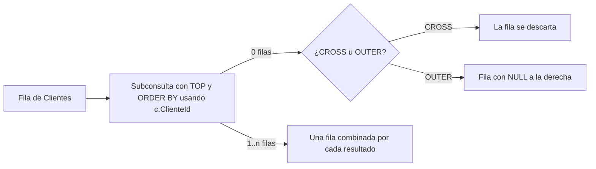

# CROSS APPLY y OUTER APPLY

Parte de: [[06-SQL-Server/02 Intermedio/_Índice Intermedio|Intermedio]]

> [!info] Cómo avanzar
> `progreso`: **pendiente** → **viendo** (estudiando) → **visto** (contestaste la autoevaluación sin abrir las respuestas) → **dominado** (hiciste el laboratorio o lo aplicaste de verdad).

## Contenido

### Qué es
`APPLY` es un operador de T-SQL que, **para cada fila de la tabla de la izquierda**, evalúa una expresión de tabla a la derecha que puede **referirse a columnas de esa fila**. Es lo que un `JOIN` normal no puede hacer: en un `JOIN`, la tabla de la derecha no "ve" la fila actual de la izquierda; en un `APPLY`, sí.

- `CROSS APPLY` devuelve la fila izquierda solo si la expresión derecha produce al menos una fila (se parece a un `INNER JOIN`).
- `OUTER APPLY` devuelve la fila izquierda siempre; si la derecha no produce nada, sus columnas salen en `NULL` (se parece a un `LEFT JOIN`).

### Cómo funciona
Lógicamente, el motor recorre la izquierda y "invoca" la derecha con los valores de la fila actual, como un `foreach`. En la práctica el optimizador suele convertirlo en un *Nested Loops* con búsqueda indexada en la tabla interna, así que el rendimiento depende de que exista un índice que haga esa búsqueda barata (ver [[Operadores de join (Nested Loops, Hash Match y Merge Join)]]).



Los usos típicos son tres:
1. **Top N por grupo**: "los 2 pedidos más caros de cada cliente". La derecha es un `SELECT TOP (2) ... WHERE x.ClienteId = c.ClienteId ORDER BY ...`.
2. **Llamar funciones de tabla por fila**: `CROSS APPLY STRING_SPLIT(t.Etiquetas, ',')` u `OPENJSON(t.Config)`, donde el argumento viene de la fila.
3. **Calcular columnas intermedias reutilizables**: `CROSS APPLY (SELECT d.Cantidad * d.PrecioUnitario AS Importe) AS calc` para no repetir la expresión en `SELECT`, `WHERE` y `ORDER BY`.

### Ejemplo
Con la base de [[Lab 1 - Base de práctica Tienda en SQL Server]]: el último pedido de cada cliente, incluyendo a los que no tienen pedidos.

```sql
SELECT c.ClienteId, c.Nombre, u.PedidoId, u.Fecha
FROM   ventas.Clientes AS c
OUTER APPLY (
    SELECT TOP (1) p.PedidoId, p.Fecha
    FROM   ventas.Pedidos AS p
    WHERE  p.ClienteId = c.ClienteId      -- referencia a la fila exterior
    ORDER  BY p.Fecha DESC, p.PedidoId DESC
) AS u;

-- Índice que convierte cada invocación en un Seek + lectura de 1 fila
CREATE INDEX IX_Pedidos_ClienteId_Fecha
    ON ventas.Pedidos (ClienteId, Fecha DESC) INCLUDE (PedidoId);
```

Con `CROSS APPLY` el cliente que nunca compró (Fernando Gil en los datos del laboratorio) desaparece; con `OUTER APPLY` aparece con `PedidoId` y `Fecha` en `NULL`. Esa es toda la diferencia.

Columna calculada reutilizable:

```sql
SELECT d.PedidoId, d.ProductoId, x.Importe
FROM   ventas.PedidoDetalle AS d
CROSS APPLY (SELECT d.Cantidad * d.PrecioUnitario AS Importe) AS x
WHERE  x.Importe > 1000
ORDER  BY x.Importe DESC;
```

### Cuándo usarlo y cuándo no
- **Usa `APPLY`** cuando la derecha depende de la fila izquierda: top N por grupo con `TOP`/`ORDER BY`, funciones de tabla con argumentos de columna, o desarmar JSON por fila.
- **Usa `JOIN`** cuando la relación es una igualdad simple entre tablas: es más claro y el optimizador tiene más libertad.
- Para top N por grupo también puedes usar [[ROW_NUMBER, RANK y DENSE_RANK]] con una CTE. Regla práctica: con pocos grupos y un buen índice `(ClienteId, Fecha)`, `APPLY` con `TOP` suele ganar; si vas a leer casi toda la tabla, `ROW_NUMBER` con un solo recorrido suele ser mejor. Compara planes en tu caso.
- Las [[Funciones escalares y de tabla]] en línea combinan muy bien con `APPLY`: se expanden en el plan como si escribieras la subconsulta.

### Errores comunes
- **Olvidar la correlación** (`WHERE p.ClienteId = c.ClienteId`): la derecha devuelve siempre la misma fila global y cada cliente sale con el mismo pedido.
- **`TOP` sin `ORDER BY` determinista**: si hay empates en `Fecha`, el "último" cambia entre ejecuciones. Agrega un desempate como `PedidoId`.
- **Usar `CROSS APPLY` cuando querías conservar todos los clientes**: pierdes filas silenciosamente; piensa si necesitas `OUTER`.
- **Sin índice de apoyo**: cada invocación hace un *scan* de `Pedidos` y el costo crece con clientes × pedidos.

### Para profundizar
- [FROM clause plus JOIN, APPLY, PIVOT](https://learn.microsoft.com/en-us/sql/t-sql/queries/from-transact-sql)
- [Operador APPLY en la referencia de consultas](https://learn.microsoft.com/en-us/sql/t-sql/queries/select-transact-sql)

## Ejercicios

Resuélvelos en papel o en la herramienta; la solución está plegada.

> [!question]- Con la base Tienda ([[Lab 1 - Base de práctica Tienda en SQL Server]]): para cada cliente, el producto en el que más ha gastado (cualquier estado), con `CROSS APPLY`.
> ```sql
> SELECT c.Nombre, x.Producto, x.Importe
> FROM   ventas.Clientes c
> CROSS  APPLY (
>     SELECT TOP (1) pr.Nombre AS Producto, SUM(d.Cantidad * d.PrecioUnitario) AS Importe
>     FROM   ventas.Pedidos p
>     JOIN   ventas.PedidoDetalle d ON d.PedidoId = p.PedidoId
>     JOIN   ventas.Productos pr    ON pr.ProductoId = d.ProductoId
>     WHERE  p.ClienteId = c.ClienteId
>     GROUP  BY pr.Nombre
>     ORDER  BY Importe DESC
> ) AS x;
> ```
> Ana: Monitor 27 (5200); Bruno: Laptop 14 (18500); Carla: Teclado mecánico (1200); Diego: Laptop 14 (18000); Elena: Monitor 27 (10000). Fernando no sale.

> [!question]- Cambia a `OUTER APPLY` y explica la diferencia en el resultado.
> Aparece además Fernando Gil con `Producto` e `Importe` en `NULL`, porque `OUTER APPLY` conserva las filas izquierdas sin resultado.

> [!question]- Los 2 pedidos de mayor importe de cada cliente.
> ```sql
> SELECT c.Nombre, t.PedidoId, t.Total
> FROM   ventas.Clientes c
> CROSS  APPLY (
>     SELECT TOP (2) d.PedidoId, SUM(d.Cantidad * d.PrecioUnitario) AS Total
>     FROM   ventas.Pedidos p JOIN ventas.PedidoDetalle d ON d.PedidoId = p.PedidoId
>     WHERE  p.ClienteId = c.ClienteId
>     GROUP  BY d.PedidoId
>     ORDER  BY Total DESC
> ) AS t;
> ```
> Ana: 3 (5650) y 1 (2100); Bruno: 2 (18500) y 6 (2600); Carla: 4; Diego: 5; Elena: 8.

## Autoevaluación

Contesta primero en voz alta o en papel; luego despliega la respuesta.

> [!question]- ¿Qué hace `CROSS APPLY`?
> Evalúa una expresión de tabla (subconsulta o función) **por cada fila** de la izquierda, pudiendo usar sus columnas. Devuelve solo las filas izquierdas que producen resultado; `OUTER APPLY` conserva todas (con `NULL`), como un `LEFT JOIN`.

> [!question]- ¿Cuándo usas `APPLY` en lugar de `JOIN`?
> Cuando la tabla derecha depende de la fila izquierda: «top N por grupo» (`TOP (n) ... ORDER BY`), llamar a una función de tabla con parámetros por fila, o desarmar JSON con `OPENJSON(columna)`.

> [!question]- ¿Qué índice ayuda a un `CROSS APPLY (SELECT TOP (1) ... WHERE x.ClienteId = c.ClienteId ORDER BY Fecha DESC)`?
> Uno en `(ClienteId, Fecha DESC)` (incluyendo las columnas que selecciona): cada aplicación es un *seek* que lee una sola fila.

## Práctica

- [[Lab 3 - CTE y funciones de ventana en Tienda]]

