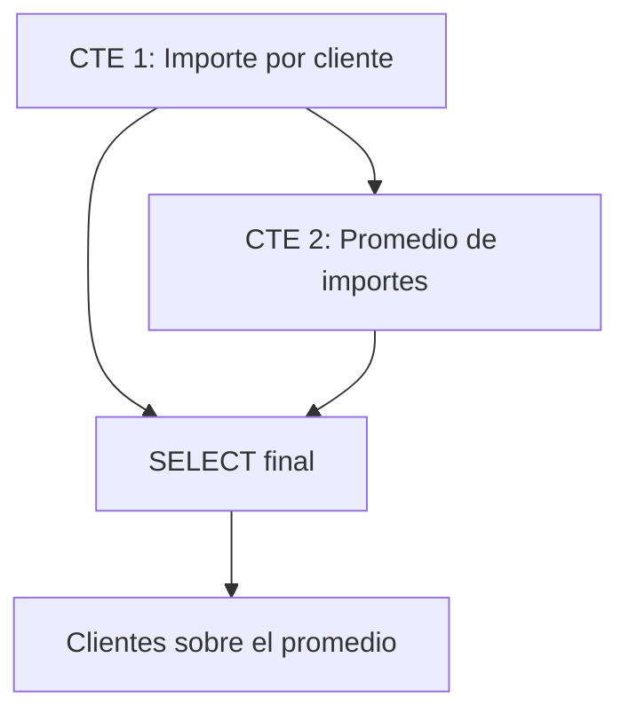

# CTE múltiples

Parte de: [[06-SQL-Server/02 Intermedio/_Índice Intermedio|Intermedio]]

> [!info] Cómo avanzar
> `progreso`: **pendiente** → **viendo** (estudiando) → **visto** (contestaste la autoevaluación sin abrir las respuestas) → **dominado** (hiciste el laboratorio o lo aplicaste de verdad).

## Contenido

### Qué es
Una sola cláusula `WITH` puede definir **varias CTE separadas por comas**, y cada una puede usar a las que se definieron antes. Así una consulta compleja se escribe como una serie de pasos con nombre: primero calculas importes por cliente, luego el promedio de esos importes, luego filtras. Se lee de arriba hacia abajo, como una receta, en lugar de anidar subconsultas de adentro hacia afuera. Si aún no dominas una sola CTE, empieza por [[CTE]].

### Cómo funciona
La sintaxis es `WITH A AS (...), B AS (... FROM A ...), C AS (...) SELECT ... FROM B JOIN C ...`. Reglas importantes:

1. Hay **un solo `WITH`**; las siguientes CTE van tras una coma, sin repetir `WITH`.
2. Cada CTE puede referirse a las **anteriores**, no a las posteriores.
3. Todas viven solo durante **la instrucción que sigue** (`SELECT`, `INSERT`, `UPDATE`, `DELETE` o `MERGE`). Si después del `;` escribes otra consulta, las CTE ya no existen. Si necesitas el resultado en dos instrucciones, guárdalo en una tabla temporal.
4. El optimizador **no materializa** las CTE: las expande en línea y optimiza la consulta completa como si fuera una sola. Si una CTE se referencia dos veces, su lógica se evalúa dos veces.



### Ejemplo
Con la base de [[Lab 1 - Base de práctica Tienda en SQL Server]]: clientes cuyo importe supera el promedio, y participación por categoría.

```sql
WITH ImportePorCliente AS (
    SELECT p.ClienteId, SUM(d.Cantidad * d.PrecioUnitario) AS Importe
    FROM   ventas.Pedidos p
    JOIN   ventas.PedidoDetalle d ON d.PedidoId = p.PedidoId
    WHERE  p.Estado <> 'Cancelado'
    GROUP  BY p.ClienteId
),
Promedio AS (
    SELECT AVG(Importe) AS ImportePromedio FROM ImportePorCliente
)
SELECT c.Nombre, i.Importe, pr.ImportePromedio
FROM   ImportePorCliente i
CROSS  JOIN Promedio pr
JOIN   ventas.Clientes c ON c.ClienteId = i.ClienteId
WHERE  i.Importe > pr.ImportePromedio
ORDER  BY i.Importe DESC;

-- Participación porcentual por categoría
WITH PorCategoria AS (
    SELECT pr.Categoria, SUM(d.Cantidad * d.PrecioUnitario) AS Importe
    FROM   ventas.PedidoDetalle d
    JOIN   ventas.Productos pr ON pr.ProductoId = d.ProductoId
    JOIN   ventas.Pedidos p    ON p.PedidoId    = d.PedidoId
    WHERE  p.Estado <> 'Cancelado'
    GROUP  BY pr.Categoria
),
Total AS (SELECT SUM(Importe) AS Gran FROM PorCategoria)
SELECT c.Categoria, c.Importe,
       CAST(100.0 * c.Importe / t.Gran AS decimal(5,2)) AS Porcentaje
FROM   PorCategoria c CROSS JOIN Total t
ORDER  BY c.Importe DESC;
```

Observa que `ImportePorCliente` se usa dos veces en la primera consulta (en `Promedio` y en el `SELECT` final): el motor calculará esa agregación dos veces. Con cuatro clientes no importa; con millones de filas, sí.

Desde Dapper, la consulta completa vive en su archivo `.sql` (por ejemplo `ClientesSobrePromedio.sql`) y se ejecuta con `QueryAsync<ClienteImporte>(sql)`; las CTE no requieren nada especial del lado de C#.

### Cuándo usarlo y cuándo no
- **Úsalas** para dividir una consulta analítica en pasos legibles, para reutilizar una expresión en varios pasos y para preparar datos antes de una [[Funciones de ventana|función de ventana]].
- **Una cadena larga se vuelve un problema de rendimiento** cuando: una CTE costosa se referencia varias veces (se recalcula), el optimizador recibe una consulta gigantesca y sus estimaciones de filas se degradan paso a paso, o necesitas indexar un resultado intermedio. En esos casos materializa pasos en una [[Tablas temporales y variables de tabla|tabla temporal]] `#`: tiene estadísticas, puedes indexarla y se calcula una sola vez.
- Si la misma lógica se reutiliza en muchas consultas, considera una [[Vistas|vista]] o una función de tabla en línea.

### Errores comunes
- **Repetir `WITH`** en cada CTE: es error de sintaxis; solo va al inicio.
- **Querer usar la CTE en la siguiente instrucción**: ya no existe después del `;`.
- **Olvidar el `;` de la instrucción anterior**: `WITH` también inicia otras cláusulas, y sin el terminador el parser se confunde.
- **Suponer que la CTE es una "tabla temporal barata"**: no lo es; es una consulta con nombre que se vuelve a evaluar.
- **Columnas sin alias** en una CTE: todas las columnas calculadas necesitan nombre.

### Para profundizar
- [WITH common_table_expression (Transact-SQL)](https://learn.microsoft.com/en-us/sql/t-sql/queries/with-common-table-expression-transact-sql)
- [SELECT (Transact-SQL)](https://learn.microsoft.com/en-us/sql/t-sql/queries/select-transact-sql)

## Ejercicios

Resuélvelos en papel o en la herramienta; la solución está plegada.

> [!question]- Con la base Tienda ([[Lab 1 - Base de práctica Tienda en SQL Server]]): con dos CTE (importe por cliente y promedio de esos importes), clientes por encima del promedio.
> ```sql
> WITH VentasCliente AS (
>     SELECT p.ClienteId, SUM(d.Cantidad * d.PrecioUnitario) AS Importe
>     FROM   ventas.Pedidos p
>     JOIN   ventas.PedidoDetalle d ON d.PedidoId = p.PedidoId
>     WHERE  p.Estado <> 'Cancelado'
>     GROUP  BY p.ClienteId
> ), Promedio AS (
>     SELECT AVG(Importe) AS Prom FROM VentasCliente
> )
> SELECT c.Nombre, v.Importe, pr.Prom
> FROM   VentasCliente v
> JOIN   ventas.Clientes c ON c.ClienteId = v.ClienteId
> CROSS  JOIN Promedio pr
> WHERE  v.Importe > pr.Prom;
> ```
> Promedio 14437.50: Bruno (21100) y Diego (18450).

> [!question]- Con CTE encadenadas: ventas por mes y, en la segunda, el mes con más ventas.
> ```sql
> WITH PorMes AS (
>     SELECT MONTH(p.Fecha) AS Mes, SUM(d.Cantidad * d.PrecioUnitario) AS Importe
>     FROM   ventas.Pedidos p JOIN ventas.PedidoDetalle d ON d.PedidoId = p.PedidoId
>     WHERE  p.Estado <> 'Cancelado'
>     GROUP  BY MONTH(p.Fecha)
> ), Maximo AS (
>     SELECT MAX(Importe) AS Mx FROM PorMes
> )
> SELECT m.Mes, m.Importe FROM PorMes m JOIN Maximo x ON m.Importe = x.Mx;
> ```
> Marzo (3) con 21500.

> [!question]- Por categoría: importe vendido (CTE 1), total general (CTE 2) y participación porcentual.
> ```sql
> WITH PorCat AS (
>     SELECT pr.Categoria, SUM(d.Cantidad * d.PrecioUnitario) AS Importe
>     FROM   ventas.PedidoDetalle d
>     JOIN   ventas.Productos pr ON pr.ProductoId = d.ProductoId
>     JOIN   ventas.Pedidos p ON p.PedidoId = d.PedidoId
>     WHERE  p.Estado <> 'Cancelado'
>     GROUP  BY pr.Categoria
> ), Total AS (SELECT SUM(Importe) AS T FROM PorCat)
> SELECT c.Categoria, c.Importe, CAST(100.0 * c.Importe / t.T AS decimal(5,1)) AS Pct
> FROM   PorCat c CROSS JOIN Total t
> ORDER  BY c.Importe DESC;
> ```
> Total 57750: Computadoras 63.2 %, Monitores 26.3 %, Periféricos 9.2 %, Accesorios 1.3 %.

## Autoevaluación

Contesta primero en voz alta o en papel; luego despliega la respuesta.

> [!question]- ¿Cómo se encadenan varias CTE?
> Con una sola palabra `WITH` y separándolas con comas: `WITH a AS (...), b AS (SELECT ... FROM a) SELECT ...`. Cada una puede usar las anteriores.

> [!question]- ¿Puedes usar una CTE en dos instrucciones seguidas?
> No: su alcance es solo la instrucción inmediata. Para reutilizarla, guárdala en una tabla temporal o repite la CTE.

> [!question]- ¿Cuándo una cadena larga de CTE se vuelve un problema de rendimiento?
> Como cada CTE se expande en línea, el optimizador recibe una sola consulta enorme y puede estimar mal; además las CTE referenciadas varias veces se recalculan. Partirla en tablas temporales con resultados intermedios suele estabilizar el plan.

## Práctica

- [[Lab 3 - CTE y funciones de ventana en Tienda]]

