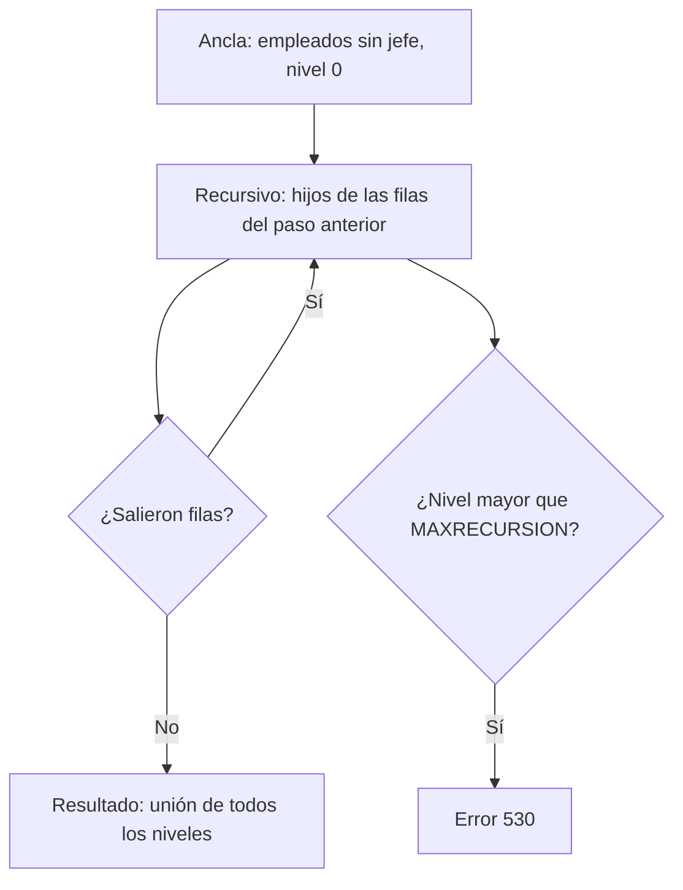

# CTE recursivas

Parte de: [[06-SQL-Server/02 Intermedio/_Índice Intermedio|Intermedio]]

> [!info] Cómo avanzar
> `progreso`: **pendiente** → **viendo** (estudiando) → **visto** (contestaste la autoevaluación sin abrir las respuestas) → **dominado** (hiciste el laboratorio o lo aplicaste de verdad).

## Contenido

### Qué es
Una **CTE recursiva** es una CTE que se referencia a sí misma. Sirve para recorrer **jerarquías** (organigramas, categorías con subcategorías, carpetas, listas de materiales) y para **generar series** (todos los días de un mes, números del 1 al N) sin tablas auxiliares. Es la forma estándar de SQL para expresar "repite este paso hasta que no salgan filas nuevas".

### Cómo funciona
Tiene tres partes:

1. **Miembro ancla**: un `SELECT` que no se refiere a la CTE; produce las filas iniciales (por ejemplo, la directora, que no tiene jefe).
2. **`UNION ALL`**: obligatorio entre ancla y parte recursiva.
3. **Miembro recursivo**: un `SELECT` que hace `JOIN` contra la propia CTE y produce el "siguiente nivel" a partir de las filas del nivel anterior.

El motor ejecuta el ancla, luego aplica el miembro recursivo a las filas recién producidas, luego otra vez a las nuevas, y así hasta que una iteración devuelve cero filas. El resultado es la unión de todas las iteraciones.



Dos protecciones a conocer:
- **`MAXRECURSION`**: por defecto SQL Server permite **100** niveles; si se superan, la consulta falla con el error 530. Lo cambias con `OPTION (MAXRECURSION n)` (hasta 32767) o `0` para sin límite.
- **Ciclos**: si los datos tienen A jefe de B y B jefe de A, la recursión nunca termina; con el límite por defecto truena al nivel 100, con `MAXRECURSION 0` se queda girando. Se evita guardando la ruta recorrida y descartando filas cuyo id ya aparece en ella.

**Tipos de datos**: las columnas del ancla y del recursivo deben tener **exactamente el mismo tipo y longitud**. Si en el ancla escribes `CAST(Nombre AS nvarchar(max))` y en el recursivo `Ruta + N' > ' + Nombre` mezclando tipos, obtienes el error 240 ("Types don't match between the anchor and the recursive part"). La solución es castear en **ambas** partes al mismo tipo.

### Ejemplo
Organigrama de `rh.Empleados` de [[Lab 1 - Base de práctica Tienda en SQL Server]] con nivel, ruta y protección contra ciclos:

```sql
WITH Org AS (
    SELECT EmpleadoId, Nombre, JefeId, 0 AS Nivel,
           CAST(Nombre AS nvarchar(1000)) AS Ruta,
           CAST(CONCAT(N'/', EmpleadoId, N'/') AS nvarchar(1000)) AS Ids
    FROM   rh.Empleados
    WHERE  JefeId IS NULL                       -- ancla
    UNION ALL
    SELECT e.EmpleadoId, e.Nombre, e.JefeId, o.Nivel + 1,
           CAST(o.Ruta + N' > ' + e.Nombre AS nvarchar(1000)),
           CAST(CONCAT(o.Ids, e.EmpleadoId, N'/') AS nvarchar(1000))
    FROM   rh.Empleados e
    JOIN   Org o ON e.JefeId = o.EmpleadoId     -- recursivo
    WHERE  o.Ids NOT LIKE CONCAT(N'%/', e.EmpleadoId, N'/%')  -- corta ciclos
)
SELECT Nivel, Ruta FROM Org ORDER BY Ruta;

-- Serie de fechas: todos los días de marzo de 2025 con su conteo de pedidos
WITH Dias AS (
    SELECT CAST('2025-03-01' AS date) AS Dia
    UNION ALL
    SELECT DATEADD(day, 1, Dia) FROM Dias WHERE Dia < '2025-03-31'
)
SELECT d.Dia, COUNT(p.PedidoId) AS Pedidos
FROM   Dias d
LEFT   JOIN ventas.Pedidos p ON p.Fecha = d.Dia
GROUP  BY d.Dia
ORDER  BY d.Dia
OPTION (MAXRECURSION 31);
```

`COUNT(p.PedidoId)` (no `COUNT(*)`) es lo que hace que los días sin pedidos salgan con 0.

Para obtener "todos los subordinados de X" cambias el ancla: en vez de `JefeId IS NULL`, `EmpleadoId = 2`. La parte recursiva es la misma.

### Cuándo usarlo y cuándo no
- **Úsala** para jerarquías de profundidad desconocida y series cortas.
- **Para series largas** (millones de números) es lenta: cada nivel es una iteración. En SQL Server 2022 existe `GENERATE_SERIES(inicio, fin)`, más eficiente (requiere nivel de compatibilidad 160). Otra opción es una tabla de números permanente.
- **Para jerarquías muy consultadas**, evalúa el tipo `hierarchyid` o guardar la ruta materializada; leer un árbol completo por recursión en cada petición puede salir caro.
- Ten un índice en `JefeId`: cada iteración busca hijos por esa columna.

### Errores comunes
- **Tipos distintos entre ancla y recursivo** (error 240): castea igual en ambas partes.
- **Error 530 por `MAXRECURSION`**: no lo "arregles" con `0` sin entender por qué hay más de 100 niveles; podría ser un ciclo.
- **Usar `UNION` en lugar de `UNION ALL`**: no está permitido en la recursión.
- **Agregaciones o `TOP` en el miembro recursivo**: no se permiten; agrega en el `SELECT` final.
- **Ordenar dentro de la CTE**: el orden del resultado solo lo garantiza el `ORDER BY` final.

### Para profundizar
- [WITH common_table_expression: recursive CTEs](https://learn.microsoft.com/en-us/sql/t-sql/queries/with-common-table-expression-transact-sql)
- [Query hints: MAXRECURSION](https://learn.microsoft.com/en-us/sql/t-sql/queries/hints-transact-sql-query)
- [GENERATE_SERIES (Transact-SQL)](https://learn.microsoft.com/en-us/sql/t-sql/functions/generate-series-transact-sql)

## Ejercicios

Resuélvelos en papel o en la herramienta; la solución está plegada.

> [!question]- Con la base Tienda ([[Lab 1 - Base de práctica Tienda en SQL Server]]): organigrama de `rh.Empleados` con nivel y ruta desde la directora.
> ```sql
> WITH Org AS (
>     SELECT EmpleadoId, Nombre, JefeId, 0 AS Nivel,
>            CAST(Nombre AS nvarchar(400)) AS Ruta
>     FROM   rh.Empleados
>     WHERE  JefeId IS NULL
>     UNION ALL
>     SELECT e.EmpleadoId, e.Nombre, e.JefeId, o.Nivel + 1,
>            CAST(o.Ruta + N' > ' + e.Nombre AS nvarchar(400))
>     FROM   rh.Empleados e
>     JOIN   Org o ON e.JefeId = o.EmpleadoId
> )
> SELECT Nivel, Ruta FROM Org ORDER BY Ruta;
> ```
> Nivel 0 Laura; 1 Mario y Sofía; 2 Iván, Paula, Raúl; 3 Tania (`Laura Torres > Mario Vega > Iván Cruz > Tania Flores`).

> [!question]- Todos los subordinados (directos e indirectos) de Mario Vega (id 2) y la suma de salarios de su área incluyéndolo.
> ```sql
> WITH Sub AS (
>     SELECT EmpleadoId, Salario FROM rh.Empleados WHERE EmpleadoId = 2
>     UNION ALL
>     SELECT e.EmpleadoId, e.Salario
>     FROM   rh.Empleados e JOIN Sub s ON e.JefeId = s.EmpleadoId
> )
> SELECT COUNT(*) - 1 AS Subordinados, SUM(Salario) AS NominaArea FROM Sub;
> ```
> 3 subordinados (Iván, Paula, Tania) y 157000.

> [!question]- Genera un calendario con todos los días de marzo de 2025 y cuenta los pedidos de cada día (0 si no hubo).
> ```sql
> WITH Dias AS (
>     SELECT CAST('2025-03-01' AS date) AS Dia
>     UNION ALL
>     SELECT DATEADD(day, 1, Dia) FROM Dias WHERE Dia < '2025-03-31'
> )
> SELECT d.Dia, COUNT(p.PedidoId) AS Pedidos
> FROM   Dias d
> LEFT   JOIN ventas.Pedidos p ON p.Fecha = d.Dia
> GROUP  BY d.Dia
> ORDER  BY d.Dia;
> ```
> 31 filas; 1 pedido el 1, el 15 y el 20 de marzo. Para más de 100 días agrega `OPTION (MAXRECURSION 400)`; para calendarios grandes conviene una tabla de fechas o `GENERATE_SERIES` (SQL Server 2022+).

## Autoevaluación

Contesta primero en voz alta o en papel; luego despliega la respuesta.

> [!question]- ¿Qué partes tiene una CTE recursiva?
> Un **miembro ancla** (el punto de partida, p. ej. el empleado sin jefe), `UNION ALL` y un **miembro recursivo** que se une con la propia CTE. Se repite hasta que el miembro recursivo no devuelve filas.

> [!question]- ¿Qué pasa si los datos tienen un ciclo (A es jefe de B y B de A)?
> La recursión no termina; SQL Server la corta al llegar a `MAXRECURSION` (100 por defecto) con el error 530. Puedes subirlo con `OPTION (MAXRECURSION 1000)` (0 = sin límite, peligroso) o detectar ciclos guardando la ruta.

> [!question]- Error común en T-SQL: la columna `Ruta` se arma con `CAST(Nombre ...)` en el ancla y `Ruta + ' > ' + Nombre` en el recursivo. ¿Qué error da?
> Error 240: los tipos del ancla y del recursivo no coinciden (`nvarchar(100)` vs. un `nvarchar` más largo). Convierte ambos al mismo tipo: `CAST(Nombre AS nvarchar(400))` y `CAST(o.Ruta + N' > ' + e.Nombre AS nvarchar(400))`.

## Práctica

- [[Lab 3 - CTE y funciones de ventana en Tienda]]

