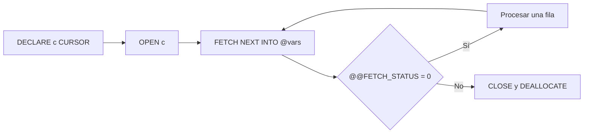

# Cursores y por qué evitarlos

Parte de: [[06-SQL-Server/02 Intermedio/_Índice Intermedio|Intermedio]]

> [!info] Cómo avanzar
> `progreso`: **pendiente** → **viendo** (estudiando) → **visto** (contestaste la autoevaluación sin abrir las respuestas) → **dominado** (hiciste el laboratorio o lo aplicaste de verdad).

## Contenido

### Qué es
Un **cursor** es un mecanismo de T-SQL para recorrer el resultado de una consulta **fila por fila**, como un `foreach` en C#: declaras el cursor, lo abres, haces `FETCH` de una fila, procesas, haces `FETCH` de la siguiente, y al final lo cierras y liberas. SQL Server, sin embargo, está diseñado para trabajar con **conjuntos**: una sola instrucción `UPDATE` que afecta 100 mil filas es muchísimo más eficiente que 100 mil `UPDATE` de una fila. Por eso la recomendación general es pensar en conjuntos y reservar los cursores para casos muy específicos.

### Cómo funciona
El ciclo de vida de un cursor es:



¿Por qué es lento? Porque cada iteración es una instrucción independiente: se ejecuta, se registra en el log, toma y suelta bloqueos y, si es una llamada a otro procedimiento, tiene su propio costo de invocación. El optimizador no puede aplicar sus estrategias de conjunto (hash, merge, paralelismo, lectura por lotes). Además, un cursor mal declarado es por defecto **global** y **actualizable**, lo que añade bloqueos y sobrecarga innecesarios.

Si de verdad necesitas uno, declara `LOCAL FAST_FORWARD` (solo hacia adelante y de solo lectura, la opción más ligera) o `LOCAL STATIC` (copia el resultado a tempdb y no se ve afectado por cambios en la tabla mientras lo recorres). `LOCAL` evita que el nombre choque con otros cursores de la sesión.

### Ejemplo
Proceso típico escrito con cursor: "subir 10 % los productos de Periféricos y 5 % los demás". Con la base de [[Lab 1 - Base de práctica Tienda en SQL Server]], la versión de conjunto es una sola instrucción:

```sql
-- Basado en conjuntos: una instrucción, un plan, una transacción
UPDATE ventas.Productos
SET    Precio = Precio * CASE WHEN Categoria = N'Periféricos' THEN 1.10 ELSE 1.05 END;

-- "Para cada cliente, guardar su número de pedidos" sin cursor
INSERT INTO ventas.ResumenCliente (ClienteId, Pedidos)
SELECT c.ClienteId, COUNT(p.PedidoId)
FROM   ventas.Clientes c
LEFT   JOIN ventas.Pedidos p ON p.ClienteId = c.ClienteId
GROUP  BY c.ClienteId;
```

El caso donde **sí** conviene iterar es el **borrado o actualización masiva por lotes**: borrar un millón de filas en una sola instrucción puede escalar bloqueos a nivel tabla, llenar el log de transacciones y bloquear a la aplicación por minutos. Se itera, pero por **bloques de filas**, no fila por fila, y sin cursor:

```sql
DECLARE @Lote int = 10000, @Filas int = 1;
WHILE @Filas > 0
BEGIN
    DELETE TOP (@Lote) FROM ventas.Movimientos
    WHERE  Fecha < '2024-01-01';
    SET @Filas = @@ROWCOUNT;
    -- Opcional: pequeña pausa para dejar respirar a otras sesiones
    -- WAITFOR DELAY '00:00:00.200';
END;
```

Cada lote es una transacción corta; con lotes menores a unas 5,000 filas por instrucción se reduce además la probabilidad de escalamiento de bloqueos a nivel tabla (el umbral documentado ronda esa cifra de bloqueos por objeto). Un índice en `Fecha` hace que cada `DELETE TOP` encuentre rápido sus filas.

Si te tienta un cursor para llamar un procedimiento por cada fila desde la aplicación, considera mejor enviar todas las filas juntas con [[Table-valued parameters]] o `OPENJSON` y hacer una sola operación de conjunto.

### Cuándo usarlo y cuándo no
Es razonable recorrer filas una por una cuando:
- Cada fila requiere una acción que **no tiene equivalente de conjunto**: ejecutar un procedimiento de sistema por base de datos, enviar un correo con Database Mail, ejecutar SQL dinámico distinto por tabla (tareas de administración).
- Haces mantenimiento por **lotes** para controlar bloqueos y log (con `WHILE` y `TOP`, como arriba).
- Calculas algo genuinamente secuencial que no se puede expresar con [[Funciones de ventana]]; aunque hoy casi todo lo "secuencial" (acumulados, diferencias contra la fila anterior) se resuelve con [[Totales acumulados con OVER]] o [[LAG y LEAD]].

En lógica de negocio de una API, casi nunca: escribe el `UPDATE`/`INSERT ... SELECT` de conjunto.

### Errores comunes
- **Cursores para lógica de negocio**: lentos y con transacciones largas; reescribe en conjuntos con `CASE`, `JOIN` y agregaciones.
- **Cursor sin `LOCAL FAST_FORWARD`**: por defecto es global y dinámico/actualizable, con sobrecarga innecesaria.
- **Olvidar `CLOSE` y `DEALLOCATE`**: un cursor global queda vivo en la sesión y el siguiente `DECLARE` falla.
- **Reemplazar el cursor por un `WHILE` fila por fila**: es el mismo problema con otro nombre.
- **Borrar millones de filas en una instrucción**: bloqueos y log enormes; hazlo por lotes.

### Para profundizar
- [DECLARE CURSOR (Transact-SQL)](https://learn.microsoft.com/en-us/sql/t-sql/language-elements/declare-cursor-transact-sql)
- [Cursors (motor de base de datos)](https://learn.microsoft.com/en-us/sql/relational-databases/cursors)
- [Lock escalation y guía de bloqueos](https://learn.microsoft.com/en-us/sql/relational-databases/sql-server-transaction-locking-and-row-versioning-guide)

## Ejercicios

Resuélvelos en papel o en la herramienta; la solución está plegada.

> [!question]- Con la base Tienda ([[Lab 1 - Base de práctica Tienda en SQL Server]]): reescribe sin cursor este proceso: «recorrer los productos y subir 10 % los de Periféricos y 5 % los demás».
> ```sql
> UPDATE ventas.Productos
> SET    Precio = Precio * CASE WHEN Categoria = N'Periféricos' THEN 1.10 ELSE 1.05 END;
> ```

> [!question]- Borra 1 millón de filas antiguas de `ventas.Movimientos` en lotes de 10 mil para no bloquear la tabla ni inflar el log.
> ```sql
> DECLARE @n int = 1;
> WHILE @n > 0
> BEGIN
>     DELETE TOP (10000) FROM ventas.Movimientos WHERE Fecha < '2024-01-01';
>     SET @n = @@ROWCOUNT;
> END
> ```
> Cada lote es su propia transacción corta (autocommit).

> [!question]- Reescribe sin cursor: «para cada cliente, guardar en `ventas.ResumenCliente(ClienteId, Pedidos)` su número de pedidos».
> ```sql
> INSERT INTO ventas.ResumenCliente (ClienteId, Pedidos)
> SELECT c.ClienteId, COUNT(p.PedidoId)
> FROM   ventas.Clientes c
> LEFT   JOIN ventas.Pedidos p ON p.ClienteId = c.ClienteId
> GROUP  BY c.ClienteId;
> ```

## Autoevaluación

Contesta primero en voz alta o en papel; luego despliega la respuesta.

> [!question]- ¿Por qué se recomienda evitar cursores?
> Procesan fila por fila (RBAR) mientras el motor está optimizado para conjuntos: una operación sobre 100 mil filas con cursor puede tardar minutos y la misma en un `UPDATE` con join, segundos.

> [!question]- Si necesitas un cursor, ¿qué opciones usar?
> `DECLARE c CURSOR LOCAL FAST_FORWARD FOR ...` (solo hacia adelante, solo lectura, local al lote). Y siempre `CLOSE` + `DEALLOCATE`.

> [!question]- ¿Cuándo es razonable recorrer filas una por una?
> Tareas administrativas (ejecutar algo por cada base o tabla), llamar a un procedimiento que solo acepta una fila, o procesar en **lotes** grandes con `WHILE` + `TOP (n)` para no bloquear la tabla mucho tiempo.

