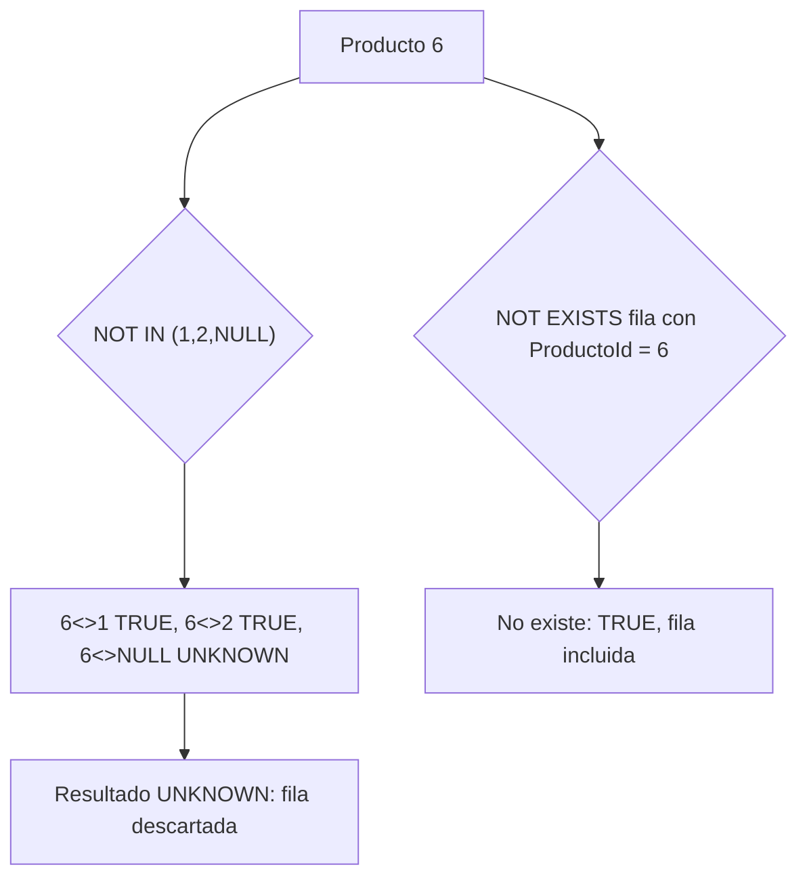

# EXISTS vs IN

Parte de: [[06-SQL-Server/02 Intermedio/_Índice Intermedio|Intermedio]]

> [!info] Cómo avanzar
> `progreso`: **pendiente** → **viendo** (estudiando) → **visto** (contestaste la autoevaluación sin abrir las respuestas) → **dominado** (hiciste el laboratorio o lo aplicaste de verdad).

## Contenido

### Qué es
`EXISTS` e `IN` son dos formas de filtrar filas según lo que haya en otra tabla, es decir, de hacer un **semi-join**: "dame los clientes que tienen al menos un pedido de la Laptop 14".

- `IN (subconsulta)` compara un valor contra la lista de valores que devuelve la subconsulta.
- `EXISTS (subconsulta)` pregunta si la subconsulta, normalmente correlacionada con la fila exterior, devuelve **al menos una fila**; no le importan los valores.

Sus negaciones, `NOT IN` y `NOT EXISTS`, hacen un **anti-semi-join**: "productos que nunca se han vendido". Aquí es donde aparece la diferencia que más importa.

### Cómo funciona
En las versiones afirmativas, el optimizador de SQL Server suele generar **el mismo plan** para `IN` y para `EXISTS` (un *Left Semi Join*), así que la elección es de estilo. `EXISTS` deja de evaluar en cuanto encuentra la primera coincidencia, y por eso **no importa qué pongas en su `SELECT`**: `SELECT 1`, `SELECT *` o `SELECT NULL` son equivalentes, porque las columnas nunca se leen.

En las negativas entra la [[NULL y lógica de tres valores|lógica de tres valores]]. `x NOT IN (1, 2, NULL)` equivale a `x <> 1 AND x <> 2 AND x <> NULL`. La última comparación es `UNKNOWN`, así que toda la expresión nunca es verdadera: **`NOT IN` devuelve cero filas si la subconsulta trae un solo `NULL`**. `NOT EXISTS` no tiene ese problema: solo pregunta si existe una fila que cumpla la condición, y una fila con `NULL` no cumple `d.ProductoId = p.ProductoId`.



Además, cuando la columna de la subconsulta acepta `NULL`, el plan de `NOT IN` es más complejo porque el motor tiene que comprobar la presencia de nulos.

### Ejemplo
Con la base de [[Lab 1 - Base de práctica Tienda en SQL Server]]:

```sql
-- Clientes que compraron la Laptop 14 (ProductoId = 4)
SELECT c.ClienteId, c.Nombre
FROM   ventas.Clientes c
WHERE  EXISTS (SELECT 1
               FROM   ventas.Pedidos p
               JOIN   ventas.PedidoDetalle d ON d.PedidoId = p.PedidoId
               WHERE  p.ClienteId = c.ClienteId AND d.ProductoId = 4);

-- Lo mismo con IN
SELECT c.ClienteId, c.Nombre
FROM   ventas.Clientes c
WHERE  c.ClienteId IN (SELECT p.ClienteId
                       FROM   ventas.Pedidos p
                       JOIN   ventas.PedidoDetalle d ON d.PedidoId = p.PedidoId
                       WHERE  d.ProductoId = 4);

-- Productos sin ventas: siempre NOT EXISTS
SELECT pr.ProductoId, pr.Nombre
FROM   ventas.Productos pr
WHERE  NOT EXISTS (SELECT 1 FROM ventas.PedidoDetalle d
                   WHERE d.ProductoId = pr.ProductoId);
```

En los datos del laboratorio, la última devuelve la Webcam HD. Si `PedidoDetalle.ProductoId` aceptara `NULL` y hubiera una fila con `NULL`, la versión con `NOT IN` devolvería vacío sin ningún error: un bug silencioso.

Con Dapper, `IN` aparece también con listas que vienen de la app: `WHERE ProductoId IN @Ids` con `new { Ids = new[] { 1, 3, 5 } }` hace que Dapper expanda la lista a parámetros individuales. Para listas grandes, mejor [[Table-valued parameters]] u `OPENJSON`, porque cada tamaño distinto de lista genera un plan distinto y hay un límite de unos 2,100 parámetros por comando.

### Cuándo usarlo y cuándo no
- **`IN` con lista literal o subconsulta simple** de una columna que no admite `NULL`: legible y eficiente.
- **`EXISTS`** cuando la condición involucra varias columnas o tablas, o cuando quieres dejar explícita la correlación.
- **`NOT EXISTS` siempre** para "los que no tienen": correcto con `NULL` y con buen plan. `LEFT JOIN ... WHERE x IS NULL` también funciona, pero a veces genera un plan menos eficiente y se lee peor.
- Si necesitas columnas de la otra tabla en el resultado, no es un semi-join: usa un `JOIN` (cuidando duplicados).

### Errores comunes
- **`NOT IN` sobre una columna que admite `NULL`**: resultados vacíos inesperados. Usa `NOT EXISTS` o filtra `WHERE col IS NOT NULL` en la subconsulta.
- **Usar `JOIN` para "los que tienen al menos uno"**: duplica filas si hay varias coincidencias y luego se tapa con `DISTINCT`. `EXISTS` no duplica.
- **Pensar que `SELECT *` en `EXISTS` lee todas las columnas**: no lo hace.
- **Subconsulta de `IN` que devuelve varias columnas**: error; `IN` compara contra una sola columna.

### Para profundizar
- [EXISTS (Transact-SQL)](https://learn.microsoft.com/en-us/sql/t-sql/language-elements/exists-transact-sql)
- [IN (Transact-SQL)](https://learn.microsoft.com/en-us/sql/t-sql/language-elements/in-transact-sql)
- [Dapper: listas en parámetros](https://github.com/DapperLib/Dapper)

## Ejercicios

Resuélvelos en papel o en la herramienta; la solución está plegada.

> [!question]- Con la base Tienda ([[Lab 1 - Base de práctica Tienda en SQL Server]]): clientes que han comprado la Laptop 14 (`ProductoId = 4`), con `EXISTS`.
> ```sql
> SELECT c.Nombre
> FROM   ventas.Clientes c
> WHERE  EXISTS (SELECT 1
>                FROM   ventas.Pedidos p
>                JOIN   ventas.PedidoDetalle d ON d.PedidoId = p.PedidoId
>                WHERE  p.ClienteId = c.ClienteId AND d.ProductoId = 4);
> ```
> Bruno Díaz y Diego Ruiz.

> [!question]- Lo mismo con `IN`.
> ```sql
> SELECT Nombre FROM ventas.Clientes
> WHERE  ClienteId IN (SELECT p.ClienteId
>                      FROM   ventas.Pedidos p
>                      JOIN   ventas.PedidoDetalle d ON d.PedidoId = p.PedidoId
>                      WHERE  d.ProductoId = 4);
> ```

> [!question]- Productos sin ventas con `NOT EXISTS`. Luego explica qué pasaría con `NOT IN` si `PedidoDetalle.ProductoId` aceptara `NULL` y hubiera uno.
> ```sql
> SELECT pr.Nombre FROM ventas.Productos pr
> WHERE NOT EXISTS (SELECT 1 FROM ventas.PedidoDetalle d WHERE d.ProductoId = pr.ProductoId);
> ```
> Webcam HD. Con `NOT IN (SELECT ProductoId ...)` y un `NULL` en la lista, la consulta no devolvería **ninguna** fila.

## Autoevaluación

Contesta primero en voz alta o en papel; luego despliega la respuesta.

> [!question]- ¿Qué diferencia hay entre `EXISTS` e `IN`?
> `IN` compara un valor con una lista; `EXISTS` pregunta si la subconsulta devuelve al menos una fila (se detiene en la primera). Con `IN`/`EXISTS` positivos el optimizador suele generar el mismo plan (semi-join).

> [!question]- ¿Por qué se recomienda `NOT EXISTS` sobre `NOT IN`?
> Porque `NOT IN` devuelve vacío si la subconsulta tiene algún `NULL` (lógica de tres valores). `NOT EXISTS` no tiene ese problema y además suele dar un *anti semi-join* eficiente.

> [!question]- ¿Importa qué pones en el `SELECT` de un `EXISTS`?
> No: `EXISTS (SELECT 1 ...)`, `SELECT *` o `SELECT NULL` son equivalentes; solo cuenta si hay filas.

