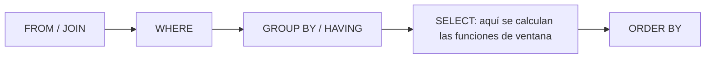

# Funciones de ventana

Parte de: [[06-SQL-Server/02 Intermedio/_Índice Intermedio|Intermedio]]

> [!info] Cómo avanzar
> `progreso`: **pendiente** → **viendo** (estudiando) → **visto** (contestaste la autoevaluación sin abrir las respuestas) → **dominado** (hiciste el laboratorio o lo aplicaste de verdad).

## Contenido

### Qué es
Una **función de ventana** calcula un valor para cada fila usando un conjunto de filas relacionadas ("la ventana"), **sin colapsarlas**. Es la gran diferencia con `GROUP BY`: un `GROUP BY` convierte muchas filas en una por grupo y pierdes el detalle; una función de ventana conserva todas las filas y les agrega una columna con el total del grupo, el ranking, el acumulado o el valor de la fila anterior. Se reconocen por la cláusula `OVER (...)`.

Las familias son tres:
- **Agregadas**: `SUM`, `AVG`, `COUNT`, `MIN`, `MAX` con `OVER`.
- **De ranking**: [[ROW_NUMBER, RANK y DENSE_RANK]] y `NTILE`.
- **De desplazamiento**: [[LAG y LEAD]], `FIRST_VALUE`, `LAST_VALUE`.

### Cómo funciona
La cláusula `OVER` tiene tres piezas opcionales:

1. **`PARTITION BY`**: divide las filas en grupos independientes (por cliente, por categoría). Sin ella, la ventana es todo el resultado.
2. **`ORDER BY`**: ordena las filas dentro de cada partición. Es obligatorio para rankings y desplazamientos, y en agregados convierte el cálculo en acumulado.
3. **Marco** (`ROWS` o `RANGE BETWEEN ... AND ...`): qué filas, alrededor de la actual, entran al cálculo. Por ejemplo `ROWS BETWEEN 2 PRECEDING AND CURRENT ROW` para un promedio móvil de 3. Se detalla en [[Totales acumulados con OVER]].



El diagrama explica por qué **no puedes escribir `WHERE ROW_NUMBER() OVER (...) = 1`**: las funciones de ventana se evalúan en la fase `SELECT`, después de `WHERE`, `GROUP BY` y `HAVING`. Cuando el `WHERE` se ejecuta, el número de fila todavía no existe. La solución es calcularlo en una [[CTE]] o tabla derivada y filtrar afuera. (Por la misma razón, sí puedes usar funciones de ventana *sobre* agregados: `SUM(SUM(x)) OVER ()` es válido después de un `GROUP BY`.)

### Ejemplo
Con la base de [[Lab 1 - Base de práctica Tienda en SQL Server]]:

```sql
-- Cada renglón con el total de su pedido y su porcentaje
SELECT d.PedidoId, d.ProductoId,
       d.Cantidad * d.PrecioUnitario                              AS Importe,
       SUM(d.Cantidad * d.PrecioUnitario) OVER (PARTITION BY d.PedidoId) AS TotalPedido,
       CAST(100.0 * d.Cantidad * d.PrecioUnitario
            / SUM(d.Cantidad * d.PrecioUnitario) OVER (PARTITION BY d.PedidoId)
            AS decimal(5,2))                                      AS Pct
FROM   ventas.PedidoDetalle d;

-- Clientes por importe con ranking y porcentaje del total (ventana sobre agregados)
SELECT p.ClienteId,
       SUM(d.Cantidad * d.PrecioUnitario)                                  AS Importe,
       RANK()       OVER (ORDER BY SUM(d.Cantidad * d.PrecioUnitario) DESC) AS Rk,
       DENSE_RANK() OVER (ORDER BY SUM(d.Cantidad * d.PrecioUnitario) DESC) AS DRk,
       CAST(100.0 * SUM(d.Cantidad * d.PrecioUnitario)
            / SUM(SUM(d.Cantidad * d.PrecioUnitario)) OVER () AS decimal(5,2)) AS PctTotal
FROM   ventas.Pedidos p
JOIN   ventas.PedidoDetalle d ON d.PedidoId = p.PedidoId
WHERE  p.Estado <> 'Cancelado'
GROUP  BY p.ClienteId;

-- Productos con el promedio de su categoría y la diferencia
SELECT Nombre, Categoria, Precio,
       AVG(Precio) OVER (PARTITION BY Categoria)          AS PromCategoria,
       Precio - AVG(Precio) OVER (PARTITION BY Categoria) AS Diferencia
FROM   ventas.Productos;
```

En reportes como los de Wee.Reporteria, este patrón evita la tentación de traer todas las filas a C# y calcular totales en memoria: el porcentaje ya llega calculado y Dapper solo mapea columnas.

### Cuándo usarlo y cuándo no
- **Úsalas** cuando necesitas detalle y agregado en la misma fila, rankings, top N por grupo, acumulados, comparaciones con la fila anterior o siguiente, o porcentajes del total.
- **Usa `GROUP BY`** cuando solo quieres una fila por grupo.
- Para rendimiento, un índice que coincida con `PARTITION BY` + `ORDER BY` (por ejemplo `(ClienteId, Fecha)`) evita un *Sort* costoso en el plan.
- Sustituyen a muchas [[Subconsultas correlacionadas]] y a casi todos los cursores.

### Errores comunes
- **Filtrar en `WHERE` por una función de ventana**: no se permite; envuelve en una CTE.
- **Olvidar `PARTITION BY`**: el total sale del resultado completo, no del grupo.
- **Acumulados con `ORDER BY` sin marco explícito**: usa `RANGE` por defecto, que trata empates como un bloque y es más lento; escribe `ROWS BETWEEN UNBOUNDED PRECEDING AND CURRENT ROW`.
- **División entera** en porcentajes: multiplica por `100.0` para forzar decimal.
- **`LAST_VALUE` que devuelve la fila actual**: por el marco por defecto; especifica `ROWS BETWEEN UNBOUNDED PRECEDING AND UNBOUNDED FOLLOWING`.

### Para profundizar
- [SELECT - OVER clause (Transact-SQL)](https://learn.microsoft.com/en-us/sql/t-sql/queries/select-over-clause-transact-sql)
- [Analytic functions (Transact-SQL)](https://learn.microsoft.com/en-us/sql/t-sql/functions/analytic-functions-transact-sql)
- [Ranking functions (Transact-SQL)](https://learn.microsoft.com/en-us/sql/t-sql/functions/ranking-functions-transact-sql)

## Ejercicios

Resuélvelos en papel o en la herramienta; la solución está plegada.

> [!question]- Con la base Tienda ([[Lab 1 - Base de práctica Tienda en SQL Server]]): clientes por importe (sin cancelados) con `RANK`, `DENSE_RANK` y porcentaje del total.
> ```sql
> WITH v AS (
>     SELECT c.Nombre, SUM(d.Cantidad * d.PrecioUnitario) AS Importe
>     FROM   ventas.Clientes c
>     JOIN   ventas.Pedidos p ON p.ClienteId = c.ClienteId
>     JOIN   ventas.PedidoDetalle d ON d.PedidoId = p.PedidoId
>     WHERE  p.Estado <> 'Cancelado'
>     GROUP  BY c.ClienteId, c.Nombre
> )
> SELECT Nombre, Importe,
>        RANK()       OVER (ORDER BY Importe DESC) AS Rk,
>        DENSE_RANK() OVER (ORDER BY Importe DESC) AS DRk,
>        CAST(100.0 * Importe / SUM(Importe) OVER () AS decimal(5,1)) AS Pct
> FROM   v
> ORDER  BY Importe DESC;
> ```
> Bruno 21100 (1, 36.5 %), Diego 18450 (2, 31.9 %), Elena 10000 (3, 17.3 %), Ana 8200 (4, 14.2 %).

> [!question]- Cada renglón de detalle con el total de su pedido y el porcentaje que representa el renglón.
> ```sql
> SELECT PedidoId, ProductoId, Cantidad * PrecioUnitario AS Importe,
>        SUM(Cantidad * PrecioUnitario) OVER (PARTITION BY PedidoId) AS TotalPedido,
>        CAST(100.0 * Cantidad * PrecioUnitario
>             / SUM(Cantidad * PrecioUnitario) OVER (PARTITION BY PedidoId) AS decimal(5,1)) AS Pct
> FROM   ventas.PedidoDetalle;
> ```
> Pedido 3: Monitor 5200 (92.0 %) y Cable 450 (8.0 %) de 5650.

> [!question]- Productos con el precio promedio de su categoría al lado y la diferencia.
> ```sql
> SELECT Nombre, Categoria, Precio,
>        AVG(Precio) OVER (PARTITION BY Categoria) AS PromCat,
>        Precio - AVG(Precio) OVER (PARTITION BY Categoria) AS Dif
> FROM   ventas.Productos;
> ```
> Periféricos (promedio 850): Teclado +350, Webcam +50, Mouse −400.

## Autoevaluación

Contesta primero en voz alta o en papel; luego despliega la respuesta.

> [!question]- ¿Qué diferencia hay entre una función de ventana y un `GROUP BY`?
> `GROUP BY` colapsa las filas en una por grupo; una función de ventana (`... OVER (...)`) calcula sobre un conjunto de filas relacionadas **sin** colapsarlas: cada fila conserva su detalle y gana una columna (ranking, total del grupo, acumulado).

> [!question]- ¿Qué significan `PARTITION BY`, `ORDER BY` y el marco (`ROWS BETWEEN ...`) dentro de `OVER`?
> `PARTITION BY` divide en grupos independientes; `ORDER BY` ordena dentro de cada grupo (necesario para rankings, `LAG` y acumulados); el marco define qué filas alrededor de la actual entran en el cálculo.

> [!question]- ¿Por qué no puedes escribir `WHERE ROW_NUMBER() OVER (...) = 1`?
> Las funciones de ventana se calculan en la fase del `SELECT`, después del `WHERE`. Envuelve la consulta en una CTE o subconsulta y filtra afuera.

## Práctica

- [[Lab 3 - CTE y funciones de ventana en Tienda]]

