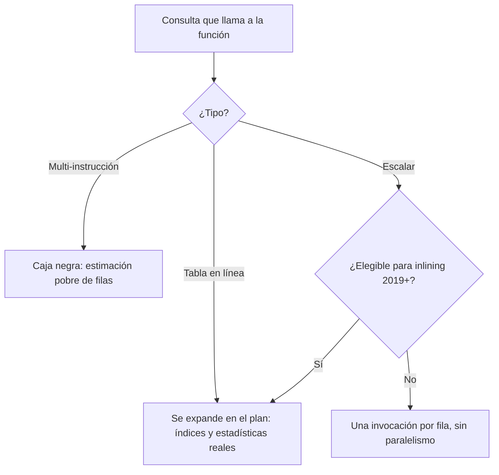

# Funciones escalares y de tabla

Parte de: [[06-SQL-Server/02 Intermedio/_Índice Intermedio|Intermedio]]

> [!info] Cómo avanzar
> `progreso`: **pendiente** → **viendo** (estudiando) → **visto** (contestaste la autoevaluación sin abrir las respuestas) → **dominado** (hiciste el laboratorio o lo aplicaste de verdad).

## Contenido

### Qué es
Las **funciones definidas por el usuario** (UDF) encapsulan lógica reutilizable que se invoca dentro de una consulta. SQL Server tiene tres tipos:

1. **Escalares**: reciben parámetros y devuelven **un valor** (`RETURNS decimal(10,2)`). Se usan como `SELECT dbo.PrecioConIva(Precio)`.
2. **De tabla en línea** (*inline table-valued function*, iTVF): su cuerpo es **un solo `SELECT`** con `RETURNS TABLE AS RETURN (...)`. Se usan en el `FROM` como una vista con parámetros.
3. **De tabla multi-instrucción** (MSTVF): declaran una variable de tabla de salida, la llenan con varias instrucciones y la devuelven.

### Cómo funciona
La diferencia de rendimiento entre los tipos viene de cómo los trata el optimizador:

- Una **función en línea** se **expande** en el plan de la consulta que la llama, igual que una vista. El optimizador ve las tablas reales, usa sus estadísticas e índices, y puede combinarla con el resto de la consulta. Es, en la práctica, gratis.
- Una **multi-instrucción** es una caja negra: el optimizador no ve su interior y, durante años, estimó que devolvía **1 fila** (100 en SQL Server 2014 a 2016). Con estimaciones así elige *Nested Loops* donde no conviene. Desde SQL Server 2017 (compatibilidad 140) la *ejecución intercalada* mejora esa estimación usando el número real de filas, pero sigue sin ver dentro.
- Una **escalar** clásica se ejecuta **una vez por fila**, como una llamada separada; además impedía el paralelismo de toda la consulta y su costo no aparecía bien en el plan. Por eso eran famosas por ser lentas: con un millón de filas eran un millón de invocaciones. Desde SQL Server 2019 (compatibilidad 150) existe la **incrustación de UDF escalares** (*scalar UDF inlining*), que convierte muchas funciones escalares en expresiones dentro del plan; tiene requisitos (no todas las funciones son elegibles, por ejemplo las que usan ciertas funciones dependientes del tiempo). Puedes ver si una función es elegible en `sys.sql_modules.is_inlineable`.



**Restricciones**: una función **no puede modificar datos** de tablas permanentes ni temporales (no `INSERT`/`UPDATE`/`DELETE` salvo sobre su propia variable de tabla), no puede ejecutar SQL dinámico ni procedimientos, no admite `TRY...CATCH` y debe ser determinista en cuanto a efectos: no puede tener efectos secundarios. Para modificar datos se usa un [[Stored procedures|procedimiento almacenado]].

### Ejemplo
Con la base de [[Lab 1 - Base de práctica Tienda en SQL Server]]:

```sql
-- Función de tabla en línea: "vista con parámetro"
CREATE OR ALTER FUNCTION ventas.fn_PedidosDeCliente (@ClienteId int)
RETURNS TABLE
AS
RETURN (
    SELECT p.PedidoId, p.Fecha, p.Estado,
           SUM(d.Cantidad * d.PrecioUnitario) AS Total
    FROM   ventas.Pedidos p
    JOIN   ventas.PedidoDetalle d ON d.PedidoId = p.PedidoId
    WHERE  p.ClienteId = @ClienteId
    GROUP  BY p.PedidoId, p.Fecha, p.Estado
);
GO
-- Uso directo y con APPLY por cada cliente
SELECT * FROM ventas.fn_PedidosDeCliente(1);

SELECT c.Nombre, f.PedidoId, f.Total
FROM   ventas.Clientes c
CROSS  APPLY ventas.fn_PedidosDeCliente(c.ClienteId) f;

-- Escalar: válida, pero prefiere la expresión en línea en consultas grandes
CREATE OR ALTER FUNCTION ventas.fn_ConIva (@Monto decimal(10,2))
RETURNS decimal(10,2)
AS
BEGIN
    RETURN @Monto * 1.16;
END;
```

La combinación iTVF + [[CROSS APPLY y OUTER APPLY|CROSS APPLY]] es el reemplazo natural de una escalar que hacía una consulta por fila.

Desde Dapper, una función de tabla se consulta como cualquier `SELECT`: `QueryAsync<PedidoResumen>("SELECT * FROM ventas.fn_PedidosDeCliente(@ClienteId)", new { ClienteId = 1 })`. No se llama con `CommandType.StoredProcedure`.

### Cuándo usarlo y cuándo no
- **Prefiere las de tabla en línea** para reutilizar lógica de consulta con parámetros.
- **Evita las multi-instrucción** salvo que la lógica no quepa en un `SELECT`; si las usas, que devuelvan pocas filas.
- **Escalares**: aceptables para cálculos simples sobre pocas filas o si son elegibles para inlining; en consultas sobre muchas filas, escribe la expresión directamente o usa una iTVF.
- Si necesitas modificar datos o manejar transacciones, usa un procedimiento.

### Errores comunes
- **Escalar que consulta tablas** dentro de un `SELECT` sobre millones de filas: una consulta por fila.
- **Usar una función escalar en `WHERE` sobre una columna**: rompe la [[SARGability]] y obliga a un scan.
- **Convertir una iTVF en multi-instrucción** "para poner un `IF`": pierdes la expansión en línea; muchas veces el `IF` se reescribe con `CASE` o `WHERE`.
- **Esperar que una función haga `INSERT`**: no se permite.

### Para profundizar
- [CREATE FUNCTION (Transact-SQL)](https://learn.microsoft.com/en-us/sql/t-sql/statements/create-function-transact-sql)
- [Scalar UDF inlining](https://learn.microsoft.com/en-us/sql/relational-databases/user-defined-functions/scalar-udf-inlining)
- [Intelligent query processing](https://learn.microsoft.com/en-us/sql/relational-databases/performance/intelligent-query-processing)

## Autoevaluación

Contesta primero en voz alta o en papel; luego despliega la respuesta.

> [!question]- ¿Qué tipos de funciones de usuario hay?
> **Escalares** (devuelven un valor), **de tabla en línea** (`RETURNS TABLE AS RETURN (SELECT ...)`, una sola consulta) y **de tabla multi-instrucción** (`RETURNS @t TABLE (...)` con varias instrucciones).

> [!question]- ¿Por qué las funciones escalares eran famosas por ser lentas?
> Se ejecutaban fila por fila e impedían paralelismo. SQL Server 2019 (compatibilidad 150) puede *inlinearlas* automáticamente si cumplen ciertas condiciones; aun así, una función de tabla en línea o la expresión directa suelen ser mejores.

> [!question]- ¿Por qué preferir funciones de tabla en línea a las multi-instrucción?
> La en línea se expande como una vista y el optimizador ve sus estadísticas reales. La multi-instrucción es una caja negra con estimación fija (antes 1 fila, desde 2014 100 filas, con mejoras en 2017+ por ejecución intercalada).

> [!question]- ¿Puede una función modificar datos?
> No: no puede hacer `INSERT`/`UPDATE`/`DELETE` sobre tablas permanentes ni usar SQL dinámico o `TRY/CATCH`. Para eso, un procedimiento.

