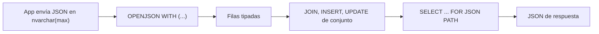

# JSON en SQL Server (OPENJSON y FOR JSON)

Parte de: [[06-SQL-Server/02 Intermedio/_Índice Intermedio|Intermedio]]

> [!info] Cómo avanzar
> `progreso`: **pendiente** → **viendo** (estudiando) → **visto** (contestaste la autoevaluación sin abrir las respuestas) → **dominado** (hiciste el laboratorio o lo aplicaste de verdad).

## Contenido

### Qué es
SQL Server permite **leer y producir JSON** desde T-SQL. Durante años no hubo un tipo de dato JSON: el JSON se guarda como texto en `nvarchar(max)` y se trabaja con funciones. SQL Server 2025 y Azure SQL añadieron un tipo nativo `json` (almacenamiento binario optimizado); si tu servidor es 2022 o anterior, todo se hace con `nvarchar`. Las herramientas principales son:

- `ISJSON(texto)`: valida que el texto sea JSON (útil en un `CHECK`).
- `JSON_VALUE(texto, ruta)`: extrae un **valor escalar** (texto, número, booleano).
- `JSON_QUERY(texto, ruta)`: extrae un **objeto o arreglo** como JSON.
- `JSON_MODIFY(texto, ruta, valor)`: devuelve el JSON con un valor cambiado.
- `OPENJSON(texto)`: convierte JSON en **filas** (es una función de tabla).
- `FOR JSON PATH` / `FOR JSON AUTO`: convierte el resultado de un `SELECT` en JSON.

### Cómo funciona
Las rutas usan la sintaxis `$.propiedad.subpropiedad` o `$[0]` para arreglos, y **distinguen mayúsculas de minúsculas**: `$.ProductoId` no encuentra `productoId`. Por defecto la ruta está en modo **`lax`**: si la propiedad no existe, devuelve `NULL` sin error. Con `strict $.ruta` obtienes un error, útil para detectar datos mal formados.

`OPENJSON` tiene dos modos:
1. **Sin `WITH`**: devuelve tres columnas genéricas, `key`, `value` y `type` (0 = null, 1 = string, 2 = número, 3 = booleano, 4 = arreglo, 5 = objeto). Sirve para explorar o para JSON de forma variable.
2. **Con `WITH (...)`**: defines columnas tipadas y su ruta; es lo que usas en la práctica. Para devolver un sub-objeto como JSON, declara la columna `nvarchar(max)` con `AS JSON`.



**Requisito**: `OPENJSON` exige que la base tenga **nivel de compatibilidad 130 o superior** (SQL Server 2016). Una base restaurada desde una versión vieja conserva su nivel antiguo y `OPENJSON` falla aunque el servidor sea moderno; ver [[Nivel de compatibilidad de la base]]. `JSON_VALUE` y compañía no tienen ese requisito.

### Ejemplo
Con la base de [[Lab 1 - Base de práctica Tienda en SQL Server]]:

```sql
-- Entrada de la app: líneas de un carrito
DECLARE @json nvarchar(max) =
  N'[{"productoId":1,"cantidad":2},{"productoId":5,"cantidad":1}]';

SELECT l.ProductoId, p.Nombre, l.Cantidad, l.Cantidad * p.Precio AS Importe
FROM   OPENJSON(@json)
       WITH (ProductoId int '$.productoId',   -- ruta en minúsculas, como viene
             Cantidad   int '$.cantidad') AS l
JOIN   ventas.Productos p ON p.ProductoId = l.ProductoId;

-- Salida: pedido 3 con sus líneas anidadas
SELECT p.PedidoId, p.Fecha, p.Estado,
       (SELECT d.ProductoId, d.Cantidad, d.PrecioUnitario
        FROM   ventas.PedidoDetalle d
        WHERE  d.PedidoId = p.PedidoId
        FOR JSON PATH) AS Lineas
FROM   ventas.Pedidos p
WHERE  p.PedidoId = 3
FOR JSON PATH, WITHOUT_ARRAY_WRAPPER;

-- Columna de configuración
DECLARE @Config nvarchar(max) = N'{"tema":{"color":"#336699"},"idioma":"es-MX"}';
SELECT JSON_VALUE(@Config, '$.tema.color') AS Color,   -- escalar
       JSON_QUERY(@Config, '$.tema')       AS Tema;    -- objeto completo
```

Desde Dapper, el JSON se manda como un parámetro de texto normal: `await conn.ExecuteAsync("ventas.Pedido_Crear", new { Lineas = JsonSerializer.Serialize(lineas) }, commandType: CommandType.StoredProcedure)`, con el parámetro declarado `@Lineas nvarchar(max)` en el procedimiento. Para respuestas `FOR JSON` largas, SQL Server parte el resultado en varias filas de unos 2,000 caracteres; concaténalas en C# o envuelve la consulta en un `SELECT (... FOR JSON PATH) AS Json` para recibir un solo valor.

### Cuándo usarlo y cuándo no
- **Úsalo** para recibir listas variables desde la API sin crear tipos tabla (alternativa a [[Table-valued parameters]]), para columnas de configuración o metadatos flexibles, y para devolver documentos anidados en una sola consulta.
- **No lo uses** para datos que filtras y relacionas a diario: si siempre consultas `JSON_VALUE(Config, '$.idioma')`, esa propiedad merece ser una columna real. Si necesitas indexarla, crea una columna calculada con `JSON_VALUE` y un índice sobre ella.
- Para documentos con esquema estable y relaciones, el modelo relacional sigue siendo mejor.

### Errores comunes
- **`NULL` en `OPENJSON WITH` aunque el dato existe**: la ruta no coincide en mayúsculas/minúsculas, o el nombre de la columna sin ruta explícita no coincide con la propiedad. Escribe la ruta exacta.
- **`JSON_VALUE` sobre un objeto o arreglo**: devuelve `NULL`; usa `JSON_QUERY`.
- **`JSON_VALUE` con textos de más de 4,000 caracteres**: en modo lax devuelve `NULL`; usa `OPENJSON WITH` con `nvarchar(max)`.
- **Base con compatibilidad < 130**: `OPENJSON` no se reconoce.
- **Guardar JSON en `varchar` con acentos y emojis**: usa `nvarchar` o una intercalación UTF-8.

### Para profundizar
- [JSON data in SQL Server](https://learn.microsoft.com/en-us/sql/relational-databases/json/json-data-sql-server)
- [OPENJSON (Transact-SQL)](https://learn.microsoft.com/en-us/sql/t-sql/functions/openjson-transact-sql)
- [Format query results as JSON with FOR JSON](https://learn.microsoft.com/en-us/sql/relational-databases/json/format-query-results-as-json-with-for-json-sql-server)
- [json data type](https://learn.microsoft.com/en-us/sql/t-sql/data-types/json-data-type)

## Ejercicios

Resuélvelos en papel o en la herramienta; la solución está plegada.

> [!question]- Con la base Tienda ([[Lab 1 - Base de práctica Tienda en SQL Server]]): recibes `@json = '[{"productoId":1,"cantidad":2},{"productoId":5,"cantidad":1}]'`. Devuélvelo como filas con el nombre del producto y el importe a precio de lista.
> ```sql
> DECLARE @json nvarchar(max) = N'[{"productoId":1,"cantidad":2},{"productoId":5,"cantidad":1}]';
>
> SELECT i.ProductoId, p.Nombre, i.Cantidad, i.Cantidad * p.Precio AS Importe
> FROM   OPENJSON(@json)
>        WITH (ProductoId int '$.productoId', Cantidad int '$.cantidad') AS i
> JOIN   ventas.Productos p ON p.ProductoId = i.ProductoId;
> ```
> Teclado mecánico ×2 = 2400; Cable HDMI ×1 = 150.

> [!question]- Genera el JSON del pedido 3 con sus líneas anidadas.
> ```sql
> SELECT p.PedidoId AS id, p.Fecha AS fecha,
>        (SELECT pr.Nombre AS producto, d.Cantidad AS cantidad
>         FROM   ventas.PedidoDetalle d
>         JOIN   ventas.Productos pr ON pr.ProductoId = d.ProductoId
>         WHERE  d.PedidoId = p.PedidoId
>         ORDER  BY pr.Nombre
>         FOR JSON PATH) AS lineas
> FROM   ventas.Pedidos p
> WHERE  p.PedidoId = 3
> FOR JSON PATH, WITHOUT_ARRAY_WRAPPER;
> ```
> `{"id":3,"fecha":"2025-02-10","lineas":[{"producto":"Cable HDMI","cantidad":3},{"producto":"Monitor 27","cantidad":1}]}`

> [!question]- De una columna `Config nvarchar(max)` con `{"tema":{"color":"#336699"},"idioma":"es-MX"}`, extrae el color y el objeto `tema` completo.
> ```sql
> SELECT JSON_VALUE(Config, '$.tema.color') AS Color,  -- #336699
>        JSON_QUERY(Config, '$.tema')       AS Tema    -- {"color":"#336699"}
> FROM   dbo.Ajustes
> WHERE  ISJSON(Config) = 1;
> ```
> `JSON_VALUE` sobre un objeto devuelve `NULL`; para objetos o arreglos usa `JSON_QUERY`.

## Autoevaluación

Contesta primero en voz alta o en papel; luego despliega la respuesta.

> [!question]- ¿Cómo guarda SQL Server los JSON y qué funciones tienes?
> Tradicionalmente como `nvarchar(max)`, con `ISJSON`, `JSON_VALUE` (escalar), `JSON_QUERY` (objeto/arreglo), `JSON_MODIFY`, `OPENJSON` (JSON → filas) y `FOR JSON` (filas → JSON). Azure SQL y SQL Server 2025 agregan un tipo `json` nativo (Pendiente de confirmar disponibilidad en tu versión).

> [!question]- ¿Qué diferencia hay entre `OPENJSON(@j)` sin y con `WITH (...)`?
> Sin `WITH` devuelve `key`, `value` y `type` de cada elemento. Con `WITH (Col tipo '$.ruta', ...)` devuelve columnas tipadas: lo normal para desarmar arreglos de objetos.

> [!question]- Error común: `OPENJSON` devuelve `NULL` en una columna aunque el dato viene en el JSON. ¿Por qué?
> Las rutas JSON distinguen mayúsculas: `'$.productoId'` no encuentra `ProductoId`. En modo `lax` (por defecto) no hay error, solo `NULL`; usa `'strict $.productoId'` para que falle si falta.

> [!question]- ¿Qué requisito de base tiene `OPENJSON`?
> Nivel de compatibilidad 130 o superior. En una base vieja restaurada con nivel 120, `OPENJSON` falla aunque el servidor sea moderno. Ver [[Nivel de compatibilidad de la base]].

