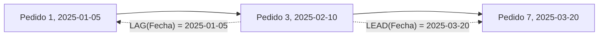

# LAG y LEAD

Parte de: [[06-SQL-Server/02 Intermedio/_Índice Intermedio|Intermedio]]

> [!info] Cómo avanzar
> `progreso`: **pendiente** → **viendo** (estudiando) → **visto** (contestaste la autoevaluación sin abrir las respuestas) → **dominado** (hiciste el laboratorio o lo aplicaste de verdad).

## Contenido

### Qué es
`LAG` y `LEAD` son [[Funciones de ventana|funciones de ventana]] de desplazamiento: desde la fila actual te dejan **leer un valor de otra fila** de la misma partición, sin `JOIN` ni subconsultas.

- `LAG(columna)` lee la fila **anterior** (según el orden que indiques).
- `LEAD(columna)` lee la fila **siguiente**.

Sirven para comparar cada registro con su vecino: días entre pedidos de un cliente, variación de ventas contra el mes anterior, detectar cambios de estado o huecos en una secuencia.

### Cómo funciona
La sintaxis completa es `LAG(expresión, desplazamiento, valor_por_defecto) OVER ([PARTITION BY ...] ORDER BY ...)`:

1. **expresión**: qué valor quieres de la otra fila.
2. **desplazamiento** (opcional, por defecto 1): cuántas filas hacia atrás (o adelante con `LEAD`). `LAG(Monto, 12)` en una serie mensual te da el mismo mes del año anterior.
3. **valor por defecto** (opcional, por defecto `NULL`): lo que devuelve cuando no existe esa fila, como en la primera fila de cada partición. Debe ser de un tipo compatible con la expresión.

El `ORDER BY` dentro de `OVER` es **obligatorio**: "la fila anterior" no tiene sentido sin un orden. `PARTITION BY` reinicia el cálculo por grupo; sin él, la primera fila del cliente B vería la última del cliente A.



Como cualquier función de ventana, se calcula en la fase `SELECT`; si quieres filtrar por el resultado ("pedidos con más de 30 días desde el anterior"), envuelve en una [[CTE]].

### Ejemplo
Con la base de [[Lab 1 - Base de práctica Tienda en SQL Server]]:

```sql
-- Días desde el pedido anterior del mismo cliente
SELECT p.ClienteId, p.PedidoId, p.Fecha,
       LAG(p.Fecha) OVER (PARTITION BY p.ClienteId ORDER BY p.Fecha, p.PedidoId) AS FechaAnterior,
       DATEDIFF(day,
                LAG(p.Fecha) OVER (PARTITION BY p.ClienteId ORDER BY p.Fecha, p.PedidoId),
                p.Fecha) AS DiasDesdeAnterior
FROM   ventas.Pedidos p
ORDER  BY p.ClienteId, p.Fecha;

-- Siguiente pedido de Ana o el texto 'último'
SELECT PedidoId, Fecha,
       COALESCE(CONVERT(varchar(10),
                LEAD(Fecha) OVER (ORDER BY Fecha, PedidoId), 23), 'último') AS Siguiente
FROM   ventas.Pedidos
WHERE  ClienteId = 1;

-- Ventas mensuales (sin cancelados) y diferencia contra el mes anterior
WITH Mensual AS (
    SELECT DATEFROMPARTS(YEAR(p.Fecha), MONTH(p.Fecha), 1) AS Mes,
           SUM(d.Cantidad * d.PrecioUnitario) AS Ventas
    FROM   ventas.Pedidos p
    JOIN   ventas.PedidoDetalle d ON d.PedidoId = p.PedidoId
    WHERE  p.Estado <> 'Cancelado'
    GROUP  BY DATEFROMPARTS(YEAR(p.Fecha), MONTH(p.Fecha), 1)
)
SELECT Mes, Ventas,
       Ventas - LAG(Ventas, 1, 0) OVER (ORDER BY Mes) AS DiferenciaVsAnterior
FROM   Mensual
ORDER  BY Mes;
```

Observa dos detalles. En el segundo ejemplo, `LEAD(Fecha)` devuelve `date`, así que para poner el texto "último" hay que convertir a texto antes del `COALESCE` (si no, SQL Server intenta convertir "último" a fecha y falla). En el tercero, `LAG(Ventas, 1, 0)` hace que el primer mes muestre su venta completa como diferencia; si prefieres que salga `NULL` ("no hay mes anterior"), omite el tercer argumento. Decide según lo que el reporte deba comunicar.

Un detalle del caso mensual: si un mes no tuvo ventas, no aparece en `Mensual` y `LAG` compararía contra dos meses atrás. Para series sin huecos, genera primero el calendario (por ejemplo con una [[CTE recursivas|CTE recursiva]]) y haz `LEFT JOIN`.

### Cuándo usarlo y cuándo no
- **Úsalas** para comparar con la fila vecina: variaciones, intervalos, detección de cambios ("el estado pasó de Enviado a Cancelado"), sesiones de usuario con huecos de inactividad.
- Reemplazan al antiguo self-join con `ROW_NUMBER` (`a.rn = b.rn - 1`) y a las [[Subconsultas correlacionadas]] del tipo "la fecha máxima menor que la actual", con un solo recorrido de la tabla.
- Si necesitas el primer o último valor de toda la partición, usa `FIRST_VALUE`/`LAST_VALUE`; si necesitas sumar todas las anteriores, es un [[Totales acumulados con OVER|total acumulado]].
- Un índice que siga `PARTITION BY` + `ORDER BY` (por ejemplo `(ClienteId, Fecha)`) evita el *Sort* en el plan.

### Errores comunes
- **Olvidar `PARTITION BY`**: la primera fila de un cliente compara contra la última del cliente anterior.
- **Orden no determinista**: con dos pedidos en la misma fecha, "el anterior" cambia entre ejecuciones; agrega un desempate (`PedidoId`).
- **Valor por defecto de tipo incompatible**: `LAG(Fecha, 1, 'ninguno')` falla por conversión; convierte la expresión o usa `COALESCE` afuera.
- **Usar `0` como defecto sin pensar**: puede hacer que la primera diferencia parezca un crecimiento enorme.
- **Huecos en la serie**: `LAG` toma la fila anterior que existe, no el periodo anterior del calendario.

### Para profundizar
- [LAG (Transact-SQL)](https://learn.microsoft.com/en-us/sql/t-sql/functions/lag-transact-sql)
- [LEAD (Transact-SQL)](https://learn.microsoft.com/en-us/sql/t-sql/functions/lead-transact-sql)
- [SELECT - OVER clause](https://learn.microsoft.com/en-us/sql/t-sql/queries/select-over-clause-transact-sql)

## Ejercicios

Resuélvelos en papel o en la herramienta; la solución está plegada.

> [!question]- Con la base Tienda ([[Lab 1 - Base de práctica Tienda en SQL Server]]): para cada pedido, la fecha del pedido anterior del mismo cliente y los días transcurridos.
> ```sql
> SELECT ClienteId, PedidoId, Fecha,
>        LAG(Fecha) OVER (PARTITION BY ClienteId ORDER BY Fecha) AS Anterior,
>        DATEDIFF(day, LAG(Fecha) OVER (PARTITION BY ClienteId ORDER BY Fecha), Fecha) AS Dias
> FROM   ventas.Pedidos
> ORDER  BY ClienteId, Fecha;
> ```
> Ana: `NULL`, 36, 38; Bruno: `NULL`, 56; el resto, un solo pedido (`NULL`).

> [!question]- Para cada pedido de Ana, la fecha del siguiente pedido con `LEAD` (o el texto «último» si no hay).
> ```sql
> SELECT PedidoId, Fecha,
>        COALESCE(CONVERT(varchar(10), LEAD(Fecha) OVER (ORDER BY Fecha), 23), 'último') AS Siguiente
> FROM   ventas.Pedidos
> WHERE  ClienteId = 1;
> ```
> 1 → 2025-02-10, 3 → 2025-03-20, 7 → último.

> [!question]- Ventas por mes (sin cancelados) y la diferencia contra el mes anterior.
> ```sql
> WITH m AS (
>     SELECT MONTH(p.Fecha) AS Mes, SUM(d.Cantidad * d.PrecioUnitario) AS Importe
>     FROM   ventas.Pedidos p JOIN ventas.PedidoDetalle d ON d.PedidoId = p.PedidoId
>     WHERE  p.Estado <> 'Cancelado'
>     GROUP  BY MONTH(p.Fecha)
> )
> SELECT Mes, Importe, Importe - LAG(Importe) OVER (ORDER BY Mes) AS VsAnterior
> FROM   m;
> ```
> Ene 20600 (`NULL`), Feb 5650 (−14950), Mar 21500 (+15850), Abr 10000 (−11500).

## Autoevaluación

Contesta primero en voz alta o en papel; luego despliega la respuesta.

> [!question]- ¿Qué hacen `LAG` y `LEAD`?
> Devuelven el valor de una fila anterior (`LAG`) o siguiente (`LEAD`) dentro de la partición, según el `ORDER BY`. Evitan self joins para comparar con «el registro anterior».

> [!question]- ¿Qué significan el segundo y tercer argumento de `LAG(Monto, 1, 0)`?
> El desplazamiento (cuántas filas atrás) y el valor por defecto cuando no existe esa fila (en vez de `NULL`).

> [!question]- ¿Puedes usar `LAG` sin `ORDER BY` en el `OVER`?
> No: `LAG`/`LEAD` exigen `ORDER BY`, porque «anterior» solo tiene sentido con un orden.

## Práctica

- [[Lab 3 - CTE y funciones de ventana en Tienda]]

