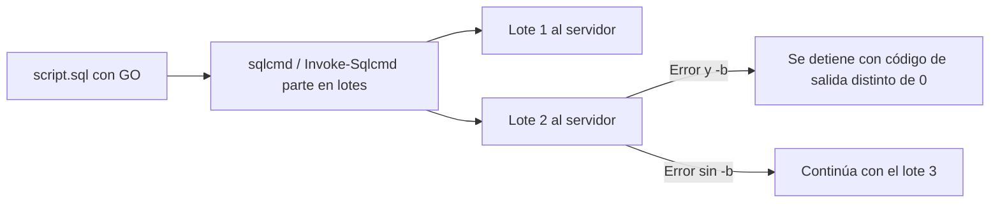

# Lotes con GO, sqlcmd e Invoke-Sqlcmd

Parte de: [[06-SQL-Server/02 Intermedio/_Índice Intermedio|Intermedio]]

> [!info] Cómo avanzar
> `progreso`: **pendiente** → **viendo** (estudiando) → **visto** (contestaste la autoevaluación sin abrir las respuestas) → **dominado** (hiciste el laboratorio o lo aplicaste de verdad).

## Contenido

### Qué es
Un **lote** (*batch*) es un grupo de instrucciones T-SQL que el cliente envía juntas al servidor y que SQL Server compila y ejecuta como una unidad. `GO` es el **separador de lotes**, pero **no es una instrucción de T-SQL**: el servidor nunca lo recibe. Lo interpretan las herramientas cliente, como SSMS, `sqlcmd`, Azure Data Studio, la extensión MSSQL de VS Code e `Invoke-Sqlcmd`, que parten el script en cada `GO` y mandan cada trozo por separado. Si envías un texto con `GO` desde Dapper o ADO.NET, el servidor lo ve como un identificador y da error de sintaxis.

`sqlcmd` es la herramienta de línea de comandos para ejecutar scripts (existe la versión clásica basada en ODBC y la versión moderna `go-sqlcmd`), e `Invoke-Sqlcmd` es el cmdlet de PowerShell del módulo `SqlServer`. Ambos son la forma habitual de aplicar scripts `.sql` en un pipeline de Azure DevOps.

### Cómo funciona
Separar en lotes tiene consecuencias concretas:

1. **Compilación independiente**: cada lote se compila completo antes de ejecutarse. Por eso, si agregas una columna y la usas en el mismo lote, falla; con un `GO` entre ambas, funciona (ver [[CREATE OR ALTER y scripts idempotentes]]).
2. **Variables locales**: una variable `DECLARE @x` muere al terminar el lote. Tras un `GO`, `@x` ya no existe.
3. **Instrucciones que deben ir solas**: `CREATE PROCEDURE`, `CREATE VIEW`, `CREATE FUNCTION`, `CREATE TRIGGER` y `CREATE SCHEMA` deben ser la primera (o única) instrucción de su lote.
4. **Errores**: un error de compilación anula todo su lote, pero los lotes siguientes **se siguen ejecutando** por defecto. Un script de 20 lotes puede fallar en el tercero y seguir con el cuarto, dejando la base a medias.
5. **Transacciones**: una transacción sí puede abarcar varios lotes en la misma conexión, aunque no es buena práctica.
6. `GO 5` ejecuta el lote anterior cinco veces (útil para generar datos de prueba).



### Ejemplo
Para que un pipeline **falle de verdad** cuando un lote falla, usa `-b` en `sqlcmd` (termina el lote con error y devuelve un código de salida distinto de cero que el agente de Azure DevOps detecta). Las variables se pasan con `-v` y se usan en el script como `$(Nombre)`:

```sql
-- 010_crear_esquema.sql
:on error exit            -- comando de sqlcmd: detenerse al primer error
USE [$(BaseDatos)];
GO
IF SCHEMA_ID(N'ventas') IS NULL
    EXEC (N'CREATE SCHEMA ventas');
GO
PRINT N'Desplegado en $(Ambiente)';
GO
```

```powershell
<# Línea de comandos (clásica o go-sqlcmd) #>
sqlcmd -S localhost -d master -E -b -i .\010_crear_esquema.sql -v BaseDatos=Tienda Ambiente=QA

<# PowerShell con el módulo SqlServer #>
Invoke-Sqlcmd -ServerInstance "localhost" -Database "master" `
    -InputFile ".\010_crear_esquema.sql" `
    -Variable "BaseDatos=Tienda", "Ambiente=QA" `
    -AbortOnError -TrustServerCertificate
```

`-E` usa autenticación de Windows; en un pipeline contra Azure SQL normalmente usarás una identidad administrada o un service principal, con el secreto en un grupo de variables o Key Vault, nunca en el repositorio. `-TrustServerCertificate` solo es aceptable contra un servidor local de desarrollo con certificado autofirmado.

Desde C#, si alguna vez necesitas ejecutar un script con `GO`, la herramienta de migraciones (DbUp, por ejemplo) lo parte por ti; con Dapper tendrías que dividirlo tú, por eso los archivos `.sql` de consultas de la app no deben llevar `GO`.

### Cuándo usarlo y cuándo no
- **Usa `GO`** en scripts de despliegue y migración que ejecuta una herramienta: para separar DDL, para crear procedimientos y para aislar compilaciones.
- **No uses `GO`** en el SQL que ejecuta la aplicación con Dapper: no es T-SQL.
- Usa `sqlcmd -b` o `:on error exit` en todo script automatizado; sin eso, un fallo pasa desapercibido.
- Para muchas migraciones con control de versiones, una herramienta dedicada es mejor que una colección de llamadas a `sqlcmd` (ver [[Migraciones de base de datos (scripts versionados, DACPAC, DbUp y Flyway)]]).

### Errores comunes
- **Mandar `GO` desde la aplicación**: error de sintaxis "Incorrect syntax near 'GO'".
- **Usar una variable después de `GO`**: "Must declare the scalar variable".
- **Pipeline en verde con errores**: faltó `-b` / `-AbortOnError`; el script falló en un lote y siguió.
- **`GO` dentro de un comentario de bloque o con texto en la misma línea**: algunas herramientas lo interpretan distinto; ponlo solo en su línea.
- **Variables de `sqlcmd` en SSMS**: `$(Var)` solo funciona si activas el modo SQLCMD (menú Consulta).

### Para profundizar
- [SQL Server utilities statements - GO](https://learn.microsoft.com/en-us/sql/t-sql/language-elements/sql-server-utilities-statements-go)
- [sqlcmd utility](https://learn.microsoft.com/en-us/sql/tools/sqlcmd/sqlcmd-utility)
- [Invoke-Sqlcmd (SqlServer module)](https://learn.microsoft.com/en-us/powershell/module/sqlserver/invoke-sqlcmd)

## Autoevaluación

Contesta primero en voz alta o en papel; luego despliega la respuesta.

> [!question]- ¿Qué es `GO` y es parte de T-SQL?
> No es T-SQL: es un separador de lotes que entienden SSMS, `sqlcmd` y otras herramientas. Cada lote se envía y compila por separado. `GO 5` repite el lote 5 veces.

> [!question]- ¿Qué consecuencias tiene separar en lotes?
> Las variables mueren al terminar el lote; `CREATE PROCEDURE/VIEW/FUNCTION/TRIGGER` debe ser la primera instrucción de su lote; un error de compilación en un lote no impide (por defecto) que corran los siguientes.

> [!question]- ¿Cómo haces que `sqlcmd` se detenga y devuelva código de error si un lote falla (para un pipeline)?
> `sqlcmd -S servidor -d Tienda -E -b -i script.sql`: `-b` termina con `ERRORLEVEL` distinto de 0 al primer error. Dentro del script también sirve `:on error exit`. Las versiones recientes cifran por defecto; en local quizá necesites `-C` (confiar en el certificado).

> [!question]- ¿Cómo pasas variables a un script con `sqlcmd` y con `Invoke-Sqlcmd`?
> En el script usas `$(Esquema)`. Con `sqlcmd -v Esquema="ventas"`; en PowerShell (módulo `SqlServer`): `Invoke-Sqlcmd -ServerInstance localhost -Database Tienda -InputFile .\V2.sql -Variable "Esquema=ventas"`.

## Práctica

- [[Lab 9 - Script de migración idempotente con tabla de versiones]]

