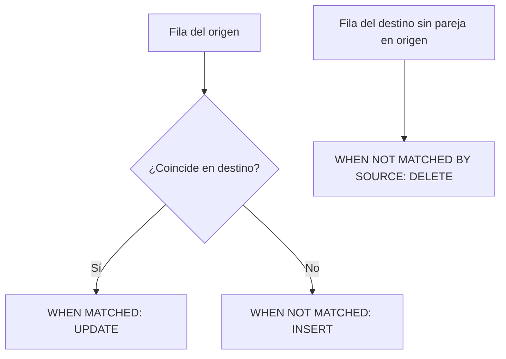

# MERGE

Parte de: [[06-SQL-Server/02 Intermedio/_Índice Intermedio|Intermedio]]

> [!info] Cómo avanzar
> `progreso`: **pendiente** → **viendo** (estudiando) → **visto** (contestaste la autoevaluación sin abrir las respuestas) → **dominado** (hiciste el laboratorio o lo aplicaste de verdad).

## Contenido

### Qué es
`MERGE` es una instrucción que **sincroniza** una tabla destino con un origen en una sola operación: para cada fila decide, según si hay coincidencia, si **actualiza**, **inserta** o **borra**. Es el famoso *upsert* (insertar o actualizar) y también sirve para sincronizar catálogos completos (por ejemplo, precios que llegan de un proveedor en una tabla de carga).

### Cómo funciona
La estructura es:

```sql
MERGE destino AS t
USING origen AS s ON <condición de coincidencia>
WHEN MATCHED [AND condición] THEN UPDATE SET ...
WHEN NOT MATCHED [BY TARGET] THEN INSERT (...) VALUES (...)
WHEN NOT MATCHED BY SOURCE [AND condición] THEN DELETE
OUTPUT $action, inserted.*, deleted.*;
```

1. `USING ... ON` empareja filas del origen con el destino (normalmente por clave).
2. `WHEN MATCHED`: la fila existe en ambos lados; típicamente se actualiza. Añadir `AND t.Precio <> s.Precio` evita actualizaciones inútiles.
3. `WHEN NOT MATCHED` (por destino): la fila está en el origen y no en el destino; se inserta.
4. `WHEN NOT MATCHED BY SOURCE`: la fila está en el destino y **no** en el origen. Con `THEN DELETE` borra **todas** las filas del destino que el origen no trae. Si tu origen solo tiene 3 productos y la tabla tiene 6, borra los otros 3 (o falla por las FK). Úsalo solo cuando el origen sea la lista completa.
5. `OUTPUT $action` devuelve `'INSERT'`, `'UPDATE'` o `'DELETE'` por fila; ver [[OUTPUT]].
6. `MERGE` **debe terminar en `;`**.



**Concurrencia**: `MERGE` **no** es seguro por sí mismo para un upsert concurrente. Dos sesiones pueden comprobar al mismo tiempo que la fila no existe y ambas intentan insertar: una falla con violación de clave o se crean duplicados si no hay clave única. Para evitarlo se usa la sugerencia `WITH (HOLDLOCK)` (equivale a `SERIALIZABLE` sobre esa tabla) en el destino, que bloquea el rango buscado hasta el final de la instrucción (ver [[SERIALIZABLE y bloqueos de rango]]).

### Ejemplo
Con la base de [[Lab 1 - Base de práctica Tienda en SQL Server]]:

```sql
CREATE TABLE #Precios (ProductoId int PRIMARY KEY, Precio decimal(10,2),
                       Nombre nvarchar(100) NULL, Categoria nvarchar(50) NULL);
INSERT INTO #Precios VALUES (1, 1250, NULL, NULL), (2, 450, NULL, NULL),
                            (7, 300, N'Hub USB-C', N'Accesorios');

MERGE ventas.Productos WITH (HOLDLOCK) AS t
USING #Precios AS s ON t.ProductoId = s.ProductoId
WHEN MATCHED AND t.Precio <> s.Precio THEN
    UPDATE SET t.Precio = s.Precio
WHEN NOT MATCHED BY TARGET THEN
    INSERT (Nombre, Categoria, Precio)          -- el IDENTITY genera el id nuevo
    VALUES (s.Nombre, s.Categoria, s.Precio)
OUTPUT $action AS Accion, inserted.ProductoId, deleted.Precio AS Antes, inserted.Precio AS Despues;
```

Muchos equipos prefieren el **upsert sin `MERGE`** para una sola fila, por ser más predecible:

```sql
-- Upsert por la clave de negocio (Nombre es UNIQUE)
CREATE OR ALTER PROCEDURE ventas.Producto_Upsert
    @Nombre nvarchar(100), @Categoria nvarchar(50), @Precio decimal(10,2)
AS
BEGIN
    SET NOCOUNT ON; SET XACT_ABORT ON;
    BEGIN TRAN;
        UPDATE ventas.Productos WITH (UPDLOCK, SERIALIZABLE)
        SET    Categoria = @Categoria, Precio = @Precio
        WHERE  Nombre = @Nombre;

        IF @@ROWCOUNT = 0
            INSERT INTO ventas.Productos (Nombre, Categoria, Precio)
            VALUES (@Nombre, @Categoria, @Precio);
    COMMIT;
END;
```

El `UPDLOCK, SERIALIZABLE` del `UPDATE` bloquea la clave (aunque no exista) hasta el `COMMIT`, así que una segunda sesión espera en lugar de insertar en paralelo. Desde Dapper: `await conn.ExecuteAsync("ventas.Producto_Upsert", dto, commandType: CommandType.StoredProcedure)`.

### Cuándo usarlo y cuándo no
- **`MERGE`** brilla en cargas por lotes y sincronización de tablas completas (ETL, catálogos, staging), donde una sola instrucción con `OUTPUT $action` es muy expresiva.
- **Upsert de una fila desde la API**: el patrón `UPDATE` + `IF @@ROWCOUNT = 0 INSERT` con las sugerencias de bloqueo es más simple de razonar.
- Si en realidad solo insertas lo que falta, `INSERT ... WHERE NOT EXISTS` basta.

### Errores comunes
- **`NOT MATCHED BY SOURCE THEN DELETE` con un origen parcial**: borra todo lo que no venía.
- **Sin `HOLDLOCK`** en upserts concurrentes: violaciones de clave o duplicados bajo carga.
- **Origen con claves duplicadas**: error 8672 ("intentó actualizar o eliminar la misma fila más de una vez"); deduplica el origen.
- **Olvidar el `;` final**: error de sintaxis.
- **Ignorar los cuidados extra**: `MERGE` ha tenido históricamente varios errores reportados con índices filtrados, vistas indizadas y triggers; los triggers de `INSERT`, `UPDATE` y `DELETE` se disparan todos. Prueba con tu modelo y mantén el servidor actualizado.

### Para profundizar
- [MERGE (Transact-SQL)](https://learn.microsoft.com/en-us/sql/t-sql/statements/merge-transact-sql)
- [Table hints: HOLDLOCK, UPDLOCK](https://learn.microsoft.com/en-us/sql/t-sql/queries/hints-transact-sql-table)

## Ejercicios

Resuélvelos en papel o en la herramienta; la solución está plegada.

> [!question]- Con la base Tienda ([[Lab 1 - Base de práctica Tienda en SQL Server]]): tienes `#Precios(ProductoId, Precio)` con (1, 1250), (2, 450) y (7, 300) junto con nombre/categoría para el 7. Actualiza los precios distintos e inserta los productos nuevos con `MERGE`, mostrando qué hizo con `OUTPUT $action`.
> ```sql
> CREATE TABLE #Precios (ProductoId int, Nombre nvarchar(100), Categoria nvarchar(50), Precio decimal(10,2));
> INSERT INTO #Precios VALUES (1, NULL, NULL, 1250), (2, NULL, NULL, 450), (7, N'Bocina BT', N'Audio', 300);
>
> SET IDENTITY_INSERT ventas.Productos ON;
> MERGE ventas.Productos WITH (HOLDLOCK) AS t
> USING #Precios AS s ON s.ProductoId = t.ProductoId
> WHEN MATCHED AND t.Precio <> s.Precio THEN
>     UPDATE SET t.Precio = s.Precio
> WHEN NOT MATCHED BY TARGET THEN
>     INSERT (ProductoId, Nombre, Categoria, Precio) VALUES (s.ProductoId, s.Nombre, s.Categoria, s.Precio)
> OUTPUT $action, inserted.ProductoId, deleted.Precio AS Antes, inserted.Precio AS Despues;
> SET IDENTITY_INSERT ventas.Productos OFF;
> ```
> `UPDATE` del 1 (1200 → 1250) e `INSERT` del 7. El 2 no cambia porque el precio es igual. (`IDENTITY_INSERT` solo porque aquí el id viene del origen.)

> [!question]- Reescribe el upsert de un solo producto sin `MERGE`, seguro ante concurrencia.
> ```sql
> BEGIN TRAN;
> UPDATE ventas.Productos WITH (UPDLOCK, SERIALIZABLE)
> SET    Precio = @Precio
> WHERE  ProductoId = @Id;
> IF @@ROWCOUNT = 0
>     INSERT INTO ventas.Productos (Nombre, Categoria, Precio) VALUES (@Nombre, @Categoria, @Precio);
> COMMIT;
> ```
> El bloqueo de rango impide que otra sesión inserte la misma clave entre el `UPDATE` y el `INSERT`.

> [!question]- ¿Qué hace `WHEN NOT MATCHED BY SOURCE THEN DELETE` si `#Precios` solo trae 3 productos?
> Borraría de `ventas.Productos` todos los productos que no están en `#Precios` (fallaría con FK los que tienen ventas). Solo úsalo cuando el origen es la lista **completa**.

## Autoevaluación

Contesta primero en voz alta o en papel; luego despliega la respuesta.

> [!question]- ¿Para qué sirve `MERGE`?
> Para sincronizar una tabla destino con un origen en una instrucción: `WHEN MATCHED THEN UPDATE`, `WHEN NOT MATCHED THEN INSERT`, `WHEN NOT MATCHED BY SOURCE THEN DELETE`.

> [!question]- ¿Es `MERGE` seguro ante concurrencia para un upsert?
> No por sí solo: dos sesiones pueden ver «no existe» e intentar insertar a la vez (error de clave duplicada). Se usa `MERGE dest WITH (HOLDLOCK) ...` o se prefiere `UPDATE` + `IF @@ROWCOUNT = 0 INSERT` dentro de una transacción con `UPDLOCK, HOLDLOCK`.

> [!question]- ¿Qué cuidados extra tiene `MERGE`?
> Debe terminar con `;`; `WHEN NOT MATCHED BY SOURCE THEN DELETE` borra todo lo que no venga en el origen (peligroso si el origen es parcial); ha tenido errores conocidos con índices filtrados y triggers. Muchos equipos lo limitan a cargas tipo ETL.

