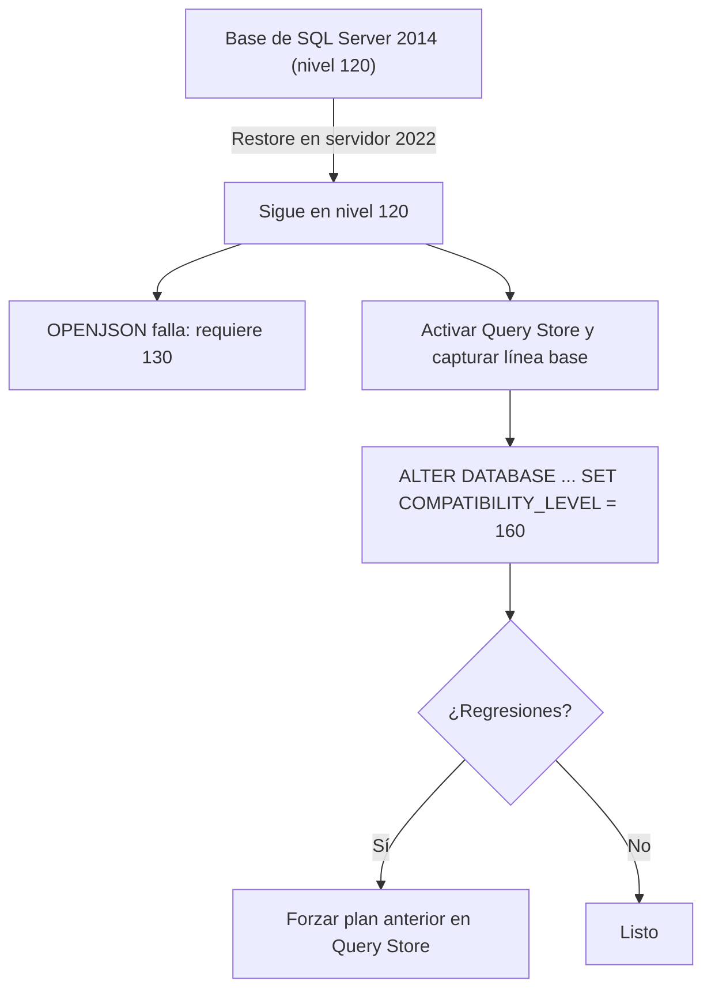

# Nivel de compatibilidad de la base

Parte de: [[06-SQL-Server/02 Intermedio/_Índice Intermedio|Intermedio]]

> [!info] Cómo avanzar
> `progreso`: **pendiente** → **viendo** (estudiando) → **visto** (contestaste la autoevaluación sin abrir las respuestas) → **dominado** (hiciste el laboratorio o lo aplicaste de verdad).

## Contenido

### Qué es
El **nivel de compatibilidad** (`compatibility_level`) es una propiedad de **cada base de datos** que indica con qué versión de SQL Server debe comportarse el motor para esa base: qué sintaxis acepta, qué funciones reconoce y, sobre todo, qué comportamiento tiene el optimizador de consultas. Permite que una base creada en SQL Server 2014 funcione en un servidor 2022 **como si** siguiera en 2014, y que la subas cuando estés listo.

Los valores corresponden a versiones: 100 (2008), 110 (2012), 120 (2014), 130 (2016), 140 (2017), 150 (2019), 160 (2022) y 170 (SQL Server 2025 y Azure SQL). Un servidor admite un rango: no puedes poner un nivel mayor que el de su versión, y las versiones nuevas dejan de aceptar los niveles más viejos.

### Cómo funciona
Cuando **restauras o adjuntas** una base en un servidor más nuevo, la base **conserva su nivel original** (siempre que el servidor lo soporte). Cuando **creas** una base nueva, toma el nivel de la base `model`, que por defecto es el de la versión del servidor.

Muchas funciones dependen del nivel:
- `OPENJSON` y `STRING_SPLIT` requieren **130** o más.
- La estimación de cardinalidad "nueva" se activa con **120**.
- Las funciones del procesamiento inteligente de consultas se activan por nivel: ejecución intercalada (140), incrustación de UDF escalares y compilación diferida de variables de tabla (150), optimización de planes sensibles a parámetros (160). Ver [[Funciones escalares y de tabla]] y [[Parameter sniffing]].
- `GENERATE_SERIES` y algunas funciones nuevas de 2022 requieren 160.



### Ejemplo
```sql
-- Consultar el nivel de todas las bases
SELECT name, compatibility_level
FROM   sys.databases
ORDER  BY name;

-- Ver la versión del servidor
SELECT SERVERPROPERTY('ProductVersion') AS Version,
       SERVERPROPERTY('ProductMajorVersion') AS Mayor;

-- Subir el nivel de Tienda (inmediato, sin reiniciar)
ALTER DATABASE Tienda SET COMPATIBILITY_LEVEL = 160;

-- Plan B granular: mantener el estimador viejo aunque subas el nivel
ALTER DATABASE SCOPED CONFIGURATION SET LEGACY_CARDINALITY_ESTIMATION = ON;
```

El caso típico: restauras en tu servidor 2022 una base que venía de un SQL Server 2014 y de pronto un procedimiento con `OPENJSON` da "Invalid object name 'OPENJSON'" o error de sintaxis. El servidor sí tiene la función, pero la base está en 120. Al subir el nivel a 130 o más, funciona.

### Cuándo usarlo y cuándo no
**Riesgo de subir el nivel**: lo que cambia no es solo la sintaxis, también el optimizador. La mayoría de las consultas mejoran o quedan igual, pero algunas pueden **elegir planes peores** (regresiones), sobre todo por el cambio de estimador de cardinalidad. Por eso el procedimiento recomendado es:

1. Activar [[Query Store]] en la base **con el nivel viejo** y dejarlo capturar la carga normal unos días (línea base de planes y tiempos).
2. Subir el nivel en un ambiente de pruebas primero, y luego en producción en una ventana tranquila.
3. Comparar en Query Store las consultas que empeoraron ("Regressed Queries") y **forzar el plan anterior** donde haga falta, o aplicar una configuración con alcance de base (`ALTER DATABASE SCOPED CONFIGURATION`) para un comportamiento específico.
4. Corregir de fondo las consultas problemáticas y quitar los planes forzados con el tiempo.

Bajar el nivel también es inmediato si algo sale muy mal, lo que hace que el cambio sea reversible.

Mantener una base en un nivel viejo durante años es deuda técnica: te pierdes mejoras del optimizador y funciones del lenguaje. En Azure SQL Database, las bases nuevas se crean con el nivel por defecto vigente del servicio; revísalo tras crear una base y no asumas que coincide con tu servidor local.

### Errores comunes
- **Confundir versión del servidor con nivel de la base**: `@@VERSION` dice 2022, pero la base puede estar en 110.
- **Subir el nivel sin línea base**: si algo se pone lento no tienes con qué comparar ni planes que forzar.
- **Subirlo en producción a mitad del día**: el cambio invalida planes en caché y provoca recompilaciones.
- **Creer que el nivel da compatibilidad hacia atrás total**: algunas características descontinuadas desaparecen sin importar el nivel.
- **Olvidar `model`**: si `model` tiene un nivel viejo, todas las bases nuevas nacen viejas.

### Para profundizar
- [ALTER DATABASE compatibility level](https://learn.microsoft.com/en-us/sql/t-sql/statements/alter-database-transact-sql-compatibility-level)
- [View or change the compatibility level of a database](https://learn.microsoft.com/en-us/sql/relational-databases/databases/view-or-change-the-compatibility-level-of-a-database)
- [ALTER DATABASE SCOPED CONFIGURATION](https://learn.microsoft.com/en-us/sql/t-sql/statements/alter-database-scoped-configuration-transact-sql)

## Autoevaluación

Contesta primero en voz alta o en papel; luego despliega la respuesta.

> [!question]- ¿Qué es el nivel de compatibilidad?
> Un ajuste por base (`compatibility_level`) que fija el comportamiento del motor y del optimizador a una versión: 130 = 2016, 140 = 2017, 150 = 2019, 160 = 2022. Permite correr una base vieja en un servidor nuevo con el comportamiento anterior.

> [!question]- ¿Cómo lo consultas y cambias?
> ```sql
> SELECT name, compatibility_level FROM sys.databases;
> ALTER DATABASE Tienda SET COMPATIBILITY_LEVEL = 160;
> ```

> [!question]- ¿Qué riesgo tiene subir el nivel y cómo lo mitigas?
> Cambia el estimador de cardinalidad y activa funciones del *Intelligent Query Processing*; algunas consultas pueden ir peor. Activa Query Store **antes**, sube el nivel, compara y fuerza planes anteriores si algo empeora. Ver [[Query Store]].

> [!question]- Restauraste una base de SQL Server 2014 en un servidor 2022 y `OPENJSON` falla. ¿Por qué?
> La base conserva el nivel 120; `OPENJSON` requiere 130+. Sube el nivel de compatibilidad.

## Práctica

- [[Lab 8 - Parameter sniffing y Query Store]]

