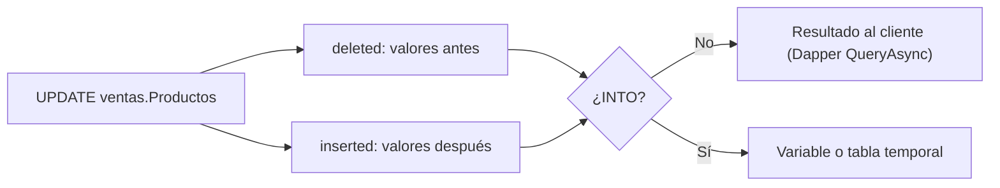

# OUTPUT

Parte de: [[06-SQL-Server/02 Intermedio/_Índice Intermedio|Intermedio]]

> [!info] Cómo avanzar
> `progreso`: **pendiente** → **viendo** (estudiando) → **visto** (contestaste la autoevaluación sin abrir las respuestas) → **dominado** (hiciste el laboratorio o lo aplicaste de verdad).

## Contenido

### Qué es
La cláusula `OUTPUT` permite que un `INSERT`, `UPDATE`, `DELETE` o `MERGE` **devuelva las filas que modificó**, con sus valores antes y después del cambio. Así obtienes en la misma instrucción los ids generados por `IDENTITY`, el `rowversion` nuevo, los valores anteriores para auditoría o la lista de lo borrado, sin hacer un `SELECT` adicional y sin riesgo de leer datos que otra sesión cambió entretanto.

### Cómo funciona
Dentro de `OUTPUT` tienes dos pseudo-tablas:

- `inserted`: las filas **después** del cambio (disponible en `INSERT`, `UPDATE` y `MERGE`).
- `deleted`: las filas **antes** del cambio (disponible en `DELETE`, `UPDATE` y `MERGE`).

En un `UPDATE` tienes ambas: `deleted.Precio` es el precio anterior e `inserted.Precio` el nuevo. En `MERGE` además está `$action`.

Hay dos formas de usarla:
1. **`OUTPUT ...` sin `INTO`**: las filas regresan al cliente como un conjunto de resultados, igual que un `SELECT`. Es lo que lees desde Dapper con `QueryAsync`.
2. **`OUTPUT ... INTO @tabla` o `#tabla`**: las filas se guardan en una variable de tabla o tabla temporal para usarlas después en el mismo lote (auditoría, encadenar inserciones).



**Restricción con triggers (error 334)**: si la tabla destino tiene **triggers habilitados**, no puedes usar `OUTPUT` sin `INTO`. SQL Server lo rechaza con el error 334 porque el trigger podría modificar las filas después de que `OUTPUT` las devolvió, y el cliente recibiría datos inconsistentes. La solución es `OUTPUT ... INTO @t` y luego `SELECT * FROM @t`. Es un error que también aparece con ORMs que generan `OUTPUT` automáticamente.

### Ejemplo
Con la base de [[Lab 1 - Base de práctica Tienda en SQL Server]]:

```sql
-- Insertar dos clientes y obtener sus ids
INSERT INTO ventas.Clientes (Nombre, Ciudad)
OUTPUT inserted.ClienteId, inserted.Nombre
VALUES (N'Gabriela Paz', N'Puebla'), (N'Hugo Lara', N'Mérida');

-- Subir 5 % los monitores mostrando antes y después
UPDATE ventas.Productos
SET    Precio = Precio * 1.05
OUTPUT inserted.ProductoId, deleted.Precio AS Antes, inserted.Precio AS Despues
WHERE  Categoria = N'Monitores';

-- Borrar cancelados guardando sus ids para auditar
DECLARE @Borrados table (PedidoId int);
DELETE FROM ventas.Pedidos
OUTPUT deleted.PedidoId INTO @Borrados
WHERE  Estado = 'Cancelado';
SELECT PedidoId FROM @Borrados;
```

**Concurrencia optimista** (ver [[Concurrencia optimista]]): cuando actualizas con la condición `WHERE RowVer = @RowVerOriginal`, el `rowversion` cambia automáticamente. Con `OUTPUT inserted.RowVer` lo devuelves en la misma instrucción para que la API lo mande al cliente y la siguiente edición use el valor nuevo:

```sql
-- archivo Pedido_ActualizarEstado.sql
UPDATE ventas.Pedidos
SET    Estado = @Estado
OUTPUT inserted.RowVer
WHERE  PedidoId = @PedidoId AND RowVer = @RowVer;
```

```csharp
// Dapper: si no regresa fila, otro usuario cambió el pedido
byte[]? nuevo = await conn.QuerySingleOrDefaultAsync<byte[]>(
    sql, new { PedidoId = id, Estado = "Enviado", RowVer = rowVer });
if (nuevo is null)
    return Results.Problem(statusCode: 409, extensions: new Dictionary<string, object?> { ["codigo"] = "PEDIDO_MODIFICADO" });
```

### Cuándo usarlo y cuándo no
- **Úsalo** para obtener ids generados en inserciones múltiples (mejor que `SCOPE_IDENTITY()`, que solo da el último), para devolver `rowversion` o valores calculados por `DEFAULT`, para auditoría antes/después y para mover filas (`DELETE ... OUTPUT deleted.* INTO Historico`).
- Para una sola fila, `SCOPE_IDENTITY()` funciona, pero `OUTPUT` es más uniforme.
- Si la tabla tiene triggers, usa siempre la forma con `INTO`.

### Errores comunes
- **Error 334 por triggers**: usa `OUTPUT ... INTO`.
- **Usar `@@IDENTITY`** en vez de `OUTPUT` o `SCOPE_IDENTITY()`: puede devolver el id generado por un trigger en otra tabla.
- **Suponer un orden** en las filas de `OUTPUT`: no está garantizado que coincida con el orden de `VALUES`; si necesitas emparejar, incluye una columna natural (como el nombre o una clave de negocio).
- **`OUTPUT INTO` una tabla con FK o triggers**: la tabla destino de `INTO` tiene restricciones propias; revisa la documentación.

### Para profundizar
- [OUTPUT clause (Transact-SQL)](https://learn.microsoft.com/en-us/sql/t-sql/queries/output-clause-transact-sql)
- [SCOPE_IDENTITY (Transact-SQL)](https://learn.microsoft.com/en-us/sql/t-sql/functions/scope-identity-transact-sql)
- [rowversion (Transact-SQL)](https://learn.microsoft.com/en-us/sql/t-sql/data-types/rowversion-transact-sql)

## Ejercicios

Resuélvelos en papel o en la herramienta; la solución está plegada.

> [!question]- Con la base Tienda ([[Lab 1 - Base de práctica Tienda en SQL Server]]): inserta dos clientes y obtén sus ids generados en una sola instrucción.
> ```sql
> INSERT INTO ventas.Clientes (Nombre, Ciudad, FechaAlta)
> OUTPUT inserted.ClienteId, inserted.Nombre
> VALUES (N'Hugo Lara', N'Puebla', '2025-07-01'), (N'Irma Peña', N'Mérida', '2025-07-02');
> ```

> [!question]- Sube 5 % el precio de Monitores y muestra precio anterior y nuevo.
> ```sql
> UPDATE ventas.Productos
> SET    Precio = Precio * 1.05
> OUTPUT inserted.ProductoId, deleted.Precio AS Antes, inserted.Precio AS Despues
> WHERE  Categoria = N'Monitores';
> ```
> Monitor 27: 5200.00 → 5460.00.

> [!question]- Borra los pedidos cancelados guardando sus ids en una variable de tabla para auditarlos.
> ```sql
> DECLARE @Borrados TABLE (PedidoId int, ClienteId int);
> DELETE FROM ventas.Pedidos
> OUTPUT deleted.PedidoId, deleted.ClienteId INTO @Borrados
> WHERE  Estado = 'Cancelado';
> SELECT * FROM @Borrados;  -- (4, 3)
> ```

## Autoevaluación

Contesta primero en voz alta o en papel; luego despliega la respuesta.

> [!question]- ¿Qué hace la cláusula `OUTPUT`?
> Devuelve filas afectadas por `INSERT`, `UPDATE`, `DELETE` o `MERGE` usando las tablas virtuales `inserted` (valores nuevos) y `deleted` (valores anteriores). Puede devolverlas al cliente o guardarlas con `OUTPUT ... INTO @tabla`.

> [!question]- ¿Para qué sirve `OUTPUT inserted.RowVer` en un `UPDATE` con concurrencia optimista?
> Para devolver en la misma instrucción el nuevo `rowversion` al cliente, sin un `SELECT` extra. Ver [[Concurrencia optimista]].

> [!question]- Error común: un `UPDATE ... OUTPUT inserted.*` falla con el error 334 en una tabla con triggers. ¿Por qué?
> SQL Server no permite `OUTPUT` sin `INTO` si la tabla destino tiene triggers habilitados. Usa `OUTPUT ... INTO @t` y luego `SELECT * FROM @t` (EF Core tiene una opción para esto en tablas con triggers).

## Práctica

- [[Lab 5 - Concurrencia optimista con rowversion en dos sesiones]]

