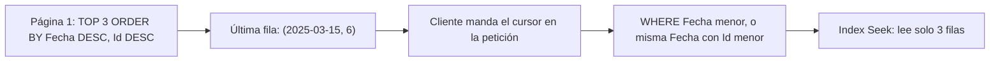

# Paginación eficiente

Parte de: [[06-SQL-Server/02 Intermedio/_Índice Intermedio|Intermedio]]

> [!info] Cómo avanzar
> `progreso`: **pendiente** → **viendo** (estudiando) → **visto** (contestaste la autoevaluación sin abrir las respuestas) → **dominado** (hiciste el laboratorio o lo aplicaste de verdad).

## Contenido

### Qué es
Paginar es devolver un resultado grande en trozos (páginas) para una API o una tabla en pantalla. En SQL Server hay dos técnicas principales:

- **Por desplazamiento** (`OFFSET ... FETCH`): "sáltate 40 filas y dame 20". Permite ir a cualquier página por número.
- **Por clave** (*keyset* o *seek*): "dame 20 filas que vengan **después** de la última que viste", usando los valores de esa última fila como marcador. Escala igual en la página 1 y en la 10,000.

### Cómo funciona
**`OFFSET`** es simple, pero el motor no puede "saltar" filas mágicamente: para darte las filas 100,001 a 100,020 tiene que **leer y descartar las primeras 100,000** en el orden pedido. Cada página profunda cuesta más que la anterior; un usuario o un bot que recorre todo el catálogo provoca un costo cuadrático. Además, si se insertan filas mientras alguien pagina, las páginas se recorren y aparecen filas repetidas o saltadas.

**Keyset** usa el orden de un índice. Si la página se ordena por `Fecha DESC, PedidoId DESC` y la última fila vista fue `(2025-03-15, 6)`, la siguiente página es "filas con fecha menor, o con la misma fecha y id menor". Con un índice sobre `(Fecha, PedidoId)` el motor hace un *seek* directo al punto de continuación y lee solo 20 filas, sin importar cuán profunda sea la página.

El orden **debe ser único** (determinista): por eso se agrega `PedidoId` como desempate. Si dos pedidos tienen la misma fecha y solo ordenas por fecha, el marcador sería ambiguo.



### Ejemplo
Con la base de [[Lab 1 - Base de práctica Tienda en SQL Server]]:

```sql
-- Índice que soporta el orden de la paginación
CREATE INDEX IX_Pedidos_Fecha_PedidoId ON ventas.Pedidos (Fecha DESC, PedidoId DESC)
    INCLUDE (ClienteId, Estado);

-- Keyset: página siguiente a partir de la última fila vista
DECLARE @UltFecha date = '2025-03-15', @UltId int = 6;
SELECT TOP (3) PedidoId, ClienteId, Fecha, Estado
FROM   ventas.Pedidos
WHERE  Fecha < @UltFecha
   OR (Fecha = @UltFecha AND PedidoId < @UltId)
ORDER  BY Fecha DESC, PedidoId DESC;

-- OFFSET: página 2 de tamaño 3, con el total en cada fila
DECLARE @Pagina int = 2, @Tam int = 3;
SELECT PedidoId, ClienteId, Fecha, Estado,
       COUNT(*) OVER () AS Total
FROM   ventas.Pedidos
ORDER  BY Fecha DESC, PedidoId DESC
OFFSET (@Pagina - 1) * @Tam ROWS FETCH NEXT @Tam ROWS ONLY;
```

En la API (vertical slice en ASP.NET Core), el marcador viaja como un *cursor* opaco: la respuesta incluye `siguiente = "2025-03-15|6"` codificado en Base64 y el cliente lo devuelve en la siguiente petición. Con Dapper:

```csharp
public sealed record PaginaPedidos(IReadOnlyList<PedidoFila> Filas, string? Siguiente);

var filas = (await conn.QueryAsync<PedidoFila>(sqlKeyset,
    new { UltFecha = cursor?.Fecha, UltId = cursor?.Id, Tam = 20 })).AsList();
```

Para la primera página, el archivo `.sql` puede tratar los parámetros nulos (`WHERE @UltFecha IS NULL OR ...`), aunque suele ser mejor tener dos archivos (primera página y siguientes) para que cada uno tenga un plan óptimo y SARGable.

**El total**: `COUNT(*) OVER ()` evita una segunda consulta, pero obliga a leer **todas** las filas que cumplen el filtro en cada página, justo lo que la paginación quería evitar. En tablas grandes conviene una consulta de conteo separada que se pida solo al inicio, un conteo aproximado, o no mostrar el total ("hay más resultados").

### Cuándo usarlo y cuándo no
- **Keyset** para listados grandes, *scroll* infinito, APIs públicas y exportaciones por lotes. Pierdes la posibilidad de saltar a "la página 37" directamente y de saber el número de página; solo vas adelante o atrás desde un punto conocido.
- **`OFFSET`** para tablas administrativas pequeñas o cuando el usuario realmente necesita saltar a una página por número y las páginas profundas son raras.
- En ambos casos, el `ORDER BY` debe ser determinista y estar respaldado por un índice.

### Errores comunes
- **`ORDER BY` no único**: filas repetidas o perdidas entre páginas; agrega la clave primaria como desempate.
- **Condición keyset mal escrita**: `WHERE Fecha <= @f AND PedidoId < @id` pierde filas; la forma correcta es "menor, o igual con desempate menor".
- **Índice que no coincide con el orden**: sin él, cada página hace un *Sort* completo.
- **`COUNT(*) OVER ()` en tablas enormes**: cada página lee todo.
- **Mezclar direcciones** (`Fecha DESC, PedidoId ASC`) sin ajustar la condición y el índice.

### Para profundizar
- [SELECT - ORDER BY clause: OFFSET y FETCH](https://learn.microsoft.com/en-us/sql/t-sql/queries/select-order-by-clause-transact-sql)
- [SQL Server index architecture and design guide](https://learn.microsoft.com/en-us/sql/relational-databases/sql-server-index-design-guide)

## Ejercicios

Resuélvelos en papel o en la herramienta; la solución está plegada.

> [!question]- Con la base Tienda ([[Lab 1 - Base de práctica Tienda en SQL Server]]): la página 1 (3 pedidos, `ORDER BY Fecha DESC, PedidoId DESC`) devolvió 8, 7 y 6; la última fila fue (2025-03-15, 6). Escribe la página 2 con keyset.
> ```sql
> DECLARE @UltFecha date = '2025-03-15', @UltId int = 6;
> SELECT TOP (3) PedidoId, Fecha
> FROM   ventas.Pedidos
> WHERE  Fecha < @UltFecha OR (Fecha = @UltFecha AND PedidoId < @UltId)
> ORDER  BY Fecha DESC, PedidoId DESC;
> ```
> Devuelve 5, 4 y 3. T-SQL no admite comparar tuplas `(Fecha, PedidoId) < (@f, @id)` (PostgreSQL sí), por eso se escribe con `OR`.

> [!question]- Con la misma consulta, ¿qué devuelve si la última fila vista fue (2025-03-01, 5)?
> 4, 3 y 2 (2025-02-14, 2025-02-10 y 2025-01-18).

> [!question]- Escribe el índice que hace eficiente la paginación anterior.
> ```sql
> CREATE INDEX IX_Pedidos_Fecha_Id ON ventas.Pedidos (Fecha DESC, PedidoId DESC) INCLUDE (ClienteId, Estado);
> ```
> SQL Server también puede recorrer un índice ascendente hacia atrás; lo importante es que las columnas del orden estén en la clave.

> [!question]- Página 2 (tamaño 3) con `OFFSET` y el total de pedidos en cada fila.
> ```sql
> SELECT PedidoId, Fecha, COUNT(*) OVER () AS Total
> FROM   ventas.Pedidos
> ORDER  BY Fecha DESC, PedidoId DESC
> OFFSET 3 ROWS FETCH NEXT 3 ROWS ONLY;
> ```
> 5, 4, 3 con `Total = 8`.

## Autoevaluación

Contesta primero en voz alta o en papel; luego despliega la respuesta.

> [!question]- ¿Por qué `OFFSET 100000 ROWS FETCH NEXT 20` es lento?
> SQL Server tiene que leer y descartar las 100,000 filas anteriores en cada página; el costo crece con el número de página.

> [!question]- ¿Qué es la paginación por clave (*keyset* o *seek*)?
> En vez de «salta n filas», pides «las siguientes después de la última que vi»: `WHERE (Fecha < @UltFecha) OR (Fecha = @UltFecha AND Id < @UltId) ORDER BY Fecha DESC, Id DESC`. Con un índice en `(Fecha, Id)` cada página cuesta lo mismo.

> [!question]- ¿Qué pierdes con keyset frente a `OFFSET`?
> No puedes saltar directo a la página 37 ni mostrar fácilmente «página 5 de 80»; sirve para «cargar más» o scroll infinito. Además, el orden debe ser estable y único.

> [!question]- ¿Cómo obtienes el total de filas junto con la página y qué cuesta?
> `COUNT(*) OVER ()` en la misma consulta o una consulta `COUNT(*)` aparte. Ambas recorren todas las filas que cumplen el filtro; en tablas grandes considera mostrar el total aproximado o calcularlo solo en la primera página.

