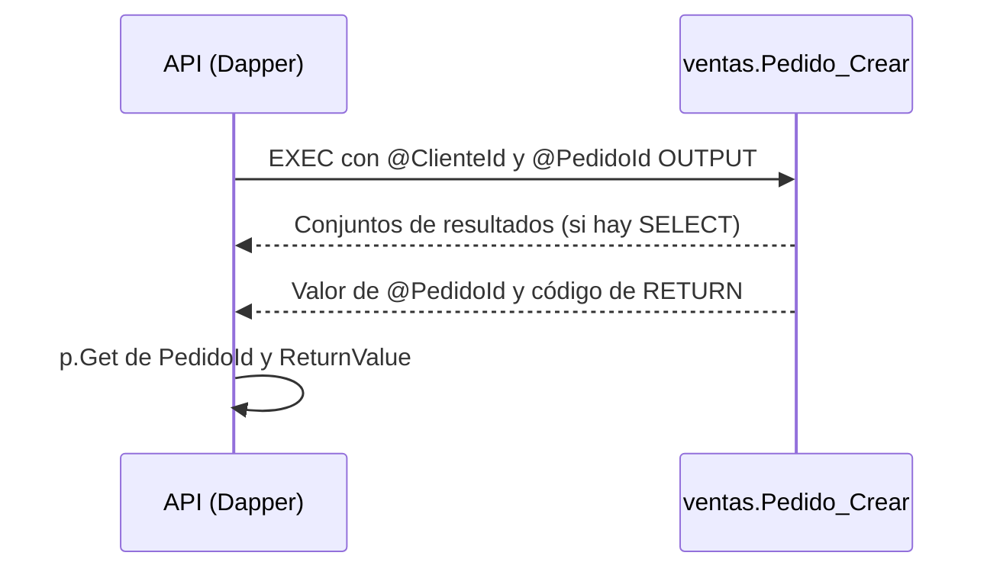

# Parámetros de salida y RETURN

Parte de: [[06-SQL-Server/02 Intermedio/_Índice Intermedio|Intermedio]]

> [!info] Cómo avanzar
> `progreso`: **pendiente** → **viendo** (estudiando) → **visto** (contestaste la autoevaluación sin abrir las respuestas) → **dominado** (hiciste el laboratorio o lo aplicaste de verdad).

## Contenido

### Qué es
Un [[Stored procedures|procedimiento almacenado]] tiene tres formas de devolver información a quien lo llama:

1. **Conjuntos de resultados**: cualquier `SELECT` que ejecute.
2. **Parámetros `OUTPUT`**: parámetros declarados con `OUTPUT` que el procedimiento asigna y el llamador lee al terminar. Puede haber varios y de cualquier tipo.
3. **`RETURN n`**: termina el procedimiento y devuelve **un solo entero**. Por convención, 0 significa éxito y otros valores, códigos de estado.

### Cómo funciona
- `RETURN` **solo admite `int`**. No puedes devolver texto, decimales ni `NULL` (si no se ejecuta `RETURN`, el valor es 0). Está pensado como código de estado, no como dato. Además, si el procedimiento termina por un error, el valor devuelto no es confiable.
- Un parámetro `OUTPUT` se declara en el procedimiento (`@NuevoId int OUTPUT`) **y** debe marcarse como de salida en la llamada (`EXEC proc @NuevoId = @x OUTPUT`). Si en la llamada olvidas `OUTPUT`, el procedimiento lo asigna pero el llamador no ve el valor. En realidad son de entrada/salida: pueden recibir un valor inicial.
- Los valores de salida y de retorno llegan al cliente **después** de que se leyeron todos los conjuntos de resultados. En ADO.NET o Dapper, si el procedimiento también hace `SELECT`, debes consumir (o cerrar) el lector antes de poder leer los parámetros.



### Ejemplo
Con la base de [[Lab 1 - Base de práctica Tienda en SQL Server]]:

```sql
CREATE OR ALTER PROCEDURE ventas.Pedido_Crear
    @ClienteId int,
    @PedidoId  int OUTPUT
AS
BEGIN
    SET NOCOUNT ON;
    IF NOT EXISTS (SELECT 1 FROM ventas.Clientes WHERE ClienteId = @ClienteId)
        RETURN 1;                         -- código: cliente inexistente

    INSERT INTO ventas.Pedidos (ClienteId, Fecha)
    VALUES (@ClienteId, CAST(SYSUTCDATETIME() AS date));

    SET @PedidoId = SCOPE_IDENTITY();
    RETURN 0;                             -- éxito
END;
GO
-- Prueba en SSMS
DECLARE @Id int, @rc int;
EXEC @rc = ventas.Pedido_Crear @ClienteId = 1, @PedidoId = @Id OUTPUT;
SELECT @rc AS Codigo, @Id AS PedidoId;
```

En Dapper se usan `DynamicParameters` con la dirección del parámetro:

```csharp
var p = new DynamicParameters();
p.Add("@ClienteId", clienteId);
p.Add("@PedidoId", dbType: DbType.Int32, direction: ParameterDirection.Output);
p.Add("@rc", dbType: DbType.Int32, direction: ParameterDirection.ReturnValue);

await conn.ExecuteAsync("ventas.Pedido_Crear", p, commandType: CommandType.StoredProcedure);

int codigo = p.Get<int>("@rc");
if (codigo == 1)
    return Results.Problem(statusCode: 404,
        extensions: new Dictionary<string, object?> { ["codigo"] = "CLIENTE_NO_EXISTE" });
int pedidoId = p.Get<int>("@PedidoId");
```

El nombre del parámetro de retorno en `DynamicParameters` es libre; lo que importa es `ParameterDirection.ReturnValue`. Para parámetros de salida de texto, indica `size` (por ejemplo `size: 100`); si no, ADO.NET puede truncar o fallar.

### Cuándo usarlo y cuándo no
- **`OUTPUT`** para pocos valores escalares que el llamador necesita: el id generado, un total, una bandera. Es eficiente y tipado.
- **`RETURN`** solo para códigos de estado simples. Para errores de negocio, muchos equipos prefieren lanzar un error con `THROW` y un número propio (ver [[TRY CATCH y THROW]]), que la API traduce a ProblemDetails con `codigo`.
- **Un `SELECT`** es mejor cuando devuelves varias columnas o varias filas, cuando quieres mapear directamente a un DTO con `QuerySingleAsync<T>`, o cuando el resultado podría crecer (hoy un valor, mañana un objeto). También es más natural con `OUTPUT inserted.*` de [[OUTPUT]].

### Errores comunes
- **Olvidar `OUTPUT` en la llamada**: el valor no regresa y llega `NULL`.
- **Leer el parámetro antes de consumir los resultados**: en ADO.NET el valor aún no llegó; termina de leer el lector o usa `ExecuteAsync`.
- **Usar `RETURN` para devolver datos** (un id grande, un monto): solo es `int` y se confunde con códigos de estado.
- **No especificar tamaño** en parámetros de salida `nvarchar`.
- **Asumir el código de retorno tras un error**: si hubo una excepción, maneja la excepción, no el `RETURN`.

### Para profundizar
- [Parameters de procedimientos almacenados](https://learn.microsoft.com/en-us/sql/relational-databases/stored-procedures/parameters)
- [RETURN (Transact-SQL)](https://learn.microsoft.com/en-us/sql/t-sql/language-elements/return-transact-sql)
- [Dapper en GitHub (DynamicParameters)](https://github.com/DapperLib/Dapper)

## Autoevaluación

Contesta primero en voz alta o en papel; luego despliega la respuesta.

> [!question]- ¿Qué diferencia hay entre `RETURN` y un parámetro `OUTPUT`?
> `RETURN` solo devuelve un `int` (convención: 0 = éxito) y termina el procedimiento. Un parámetro `OUTPUT` puede ser de cualquier tipo y puede haber varios (`@PedidoId int OUTPUT`).

> [!question]- ¿Cómo lees un parámetro de salida en Dapper?
> ```csharp
> var p = new DynamicParameters();
> p.Add("ClienteId", 6);
> p.Add("PedidoId", dbType: DbType.Int32, direction: ParameterDirection.Output);
> await cn.ExecuteAsync("ventas.Pedido_Crear", p, commandType: CommandType.StoredProcedure);
> int id = p.Get<int>("PedidoId");
> ```
> Para el valor de `RETURN`: `direction: ParameterDirection.ReturnValue`.

> [!question]- ¿Cuándo es mejor devolver un `SELECT` que parámetros de salida?
> Cuando devuelves varias filas o un objeto con muchos campos que Dapper puede mapear directo a un DTO. Los `OUTPUT` son cómodos para uno o dos valores (id generado, nueva versión). Ojo: los `OUTPUT` solo se leen después de consumir todos los resultados del lector.

## Práctica

- [[Lab 4 - Stored procedure transaccional con TRY CATCH y XACT_ABORT]]

