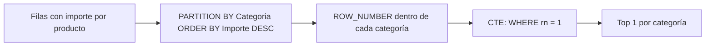

# ROW_NUMBER, RANK y DENSE_RANK

Parte de: [[06-SQL-Server/02 Intermedio/_Índice Intermedio|Intermedio]]

> [!info] Cómo avanzar
> `progreso`: **pendiente** → **viendo** (estudiando) → **visto** (contestaste la autoevaluación sin abrir las respuestas) → **dominado** (hiciste el laboratorio o lo aplicaste de verdad).

## Contenido

### Qué es
Son las **funciones de ranking** de SQL Server, un tipo de [[Funciones de ventana|función de ventana]] que asigna un número a cada fila según un orden, opcionalmente reiniciando por grupo:

- `ROW_NUMBER()`: numera 1, 2, 3... sin repetir, aunque haya empates.
- `RANK()`: los empates comparten número y **se salta** los siguientes (1, 1, 3).
- `DENSE_RANK()`: los empates comparten número y **no se salta** ninguno (1, 1, 2).
- `NTILE(n)`: reparte las filas en `n` grupos de tamaño lo más parecido posible y dice a cuál pertenece cada una (1 a n); `NTILE(4)` da cuartiles.

Con los valores 100, 100 y 90 ordenados de mayor a menor: `ROW_NUMBER` da 1, 2, 3; `RANK` da 1, 1, 3; `DENSE_RANK` da 1, 1, 2.

### Cómo funciona
La sintaxis es `FUNCION() OVER ([PARTITION BY grupo] ORDER BY criterio)`. El `ORDER BY` es obligatorio. `PARTITION BY` hace que la numeración empiece de nuevo en cada grupo (por cliente, por categoría).

**Determinismo**: `ROW_NUMBER() OVER (ORDER BY Fecha)` con dos filas en la misma fecha no define cuál es la 1 y cuál la 2. El motor elige según cómo leyó los datos, y eso puede cambiar entre ejecuciones (otro plan, paralelismo, nuevo índice). Si el número decide qué fila se queda o se borra, agrega un **desempate único** (`ORDER BY Fecha, PedidoId`).

Como todas las funciones de ventana, se calculan en la fase `SELECT`, así que para filtrar por el número ("quedarme con la fila 1 de cada grupo") se usa una [[CTE]] o tabla derivada.



### Ejemplo
Con la base de [[Lab 1 - Base de práctica Tienda en SQL Server]]:

```sql
-- Producto más vendido de cada categoría (por importe, sin cancelados)
WITH Ventas AS (
    SELECT pr.Categoria, pr.Nombre,
           SUM(d.Cantidad * d.PrecioUnitario) AS Importe
    FROM   ventas.PedidoDetalle d
    JOIN   ventas.Pedidos p    ON p.PedidoId    = d.PedidoId
    JOIN   ventas.Productos pr ON pr.ProductoId = d.ProductoId
    WHERE  p.Estado <> 'Cancelado'
    GROUP  BY pr.Categoria, pr.Nombre
),
Rankeado AS (
    SELECT *, ROW_NUMBER() OVER (PARTITION BY Categoria ORDER BY Importe DESC, Nombre) AS rn
    FROM   Ventas
)
SELECT Categoria, Nombre, Importe FROM Rankeado WHERE rn = 1;

-- Numerar los pedidos de cada cliente y marcar la primera compra
SELECT ClienteId, PedidoId, Fecha,
       ROW_NUMBER() OVER (PARTITION BY ClienteId ORDER BY Fecha, PedidoId) AS NumCompra,
       CASE WHEN ROW_NUMBER() OVER (PARTITION BY ClienteId ORDER BY Fecha, PedidoId) = 1
            THEN 1 ELSE 0 END AS EsPrimera
FROM   ventas.Pedidos;

-- Comparar las cuatro funciones sobre los mismos datos
SELECT Nombre, Precio,
       ROW_NUMBER() OVER (ORDER BY Precio DESC) AS RowNum,
       RANK()       OVER (ORDER BY Precio DESC) AS Rnk,
       DENSE_RANK() OVER (ORDER BY Precio DESC) AS DRnk,
       NTILE(2)     OVER (ORDER BY Precio DESC) AS Mitad
FROM   ventas.Productos;
```

¿Cuál elegir para "el más vendido por categoría"? Si hay empate en el primer lugar: `ROW_NUMBER` devuelve exactamente uno (el desempate decide), `RANK`/`DENSE_RANK` con `= 1` devuelven todos los empatados. Decide según la regla de negocio.

### Cuándo usarlo y cuándo no
- **`ROW_NUMBER`**: top N por grupo, deduplicar (borrar `rn > 1`), elegir "la versión más reciente" de cada registro, numerar renglones en un reporte.
- **`RANK`**: clasificaciones tipo competencia, donde dos primeros lugares hacen que no haya segundo.
- **`DENSE_RANK`**: niveles o categorías ("los 3 precios más altos distintos").
- **`NTILE`**: segmentar en cuartiles o deciles (clientes por gasto) para análisis.
- Para top N por grupo con pocos grupos y buen índice, compara contra [[CROSS APPLY y OUTER APPLY|CROSS APPLY]] con `TOP`.
- Para paginar, no uses `ROW_NUMBER ... WHERE rn BETWEEN`: hoy existen `OFFSET` y el keyset de [[Paginación eficiente]].

### Errores comunes
- **Orden no determinista** al deduplicar: cada ejecución borra filas diferentes; agrega desempate.
- **`WHERE ROW_NUMBER() ... = 1`**: no se permite; usa una CTE.
- **Usar `RANK` para top 1 y recibir varias filas** por empates (o `ROW_NUMBER` y perder empatados que sí querías).
- **Olvidar `PARTITION BY`**: numeras toda la tabla en lugar de cada grupo.
- **`NTILE` con grupos desiguales**: si las filas no se dividen exacto, los primeros grupos tienen una fila más; no es un percentil exacto.

### Para profundizar
- [ROW_NUMBER (Transact-SQL)](https://learn.microsoft.com/en-us/sql/t-sql/functions/row-number-transact-sql)
- [RANK (Transact-SQL)](https://learn.microsoft.com/en-us/sql/t-sql/functions/rank-transact-sql)
- [DENSE_RANK (Transact-SQL)](https://learn.microsoft.com/en-us/sql/t-sql/functions/dense-rank-transact-sql)
- [NTILE (Transact-SQL)](https://learn.microsoft.com/en-us/sql/t-sql/functions/ntile-transact-sql)

## Ejercicios

Resuélvelos en papel o en la herramienta; la solución está plegada.

> [!question]- Con la base Tienda ([[Lab 1 - Base de práctica Tienda en SQL Server]]): el producto más vendido (por importe, sin cancelados) de cada categoría.
> ```sql
> WITH v AS (
>     SELECT pr.Categoria, pr.Nombre, SUM(d.Cantidad * d.PrecioUnitario) AS Importe
>     FROM   ventas.PedidoDetalle d
>     JOIN   ventas.Productos pr ON pr.ProductoId = d.ProductoId
>     JOIN   ventas.Pedidos p ON p.PedidoId = d.PedidoId
>     WHERE  p.Estado <> 'Cancelado'
>     GROUP  BY pr.Categoria, pr.Nombre
> ), r AS (
>     SELECT *, ROW_NUMBER() OVER (PARTITION BY Categoria ORDER BY Importe DESC) AS rn
>     FROM   v
> )
> SELECT Categoria, Nombre, Importe FROM r WHERE rn = 1 ORDER BY Categoria;
> ```
> Accesorios: Cable HDMI 750; Computadoras: Laptop 14 36500; Monitores: Monitor 27 15200; Periféricos: Teclado mecánico 3500.

> [!question]- Los 2 pedidos de mayor importe de cada cliente con `ROW_NUMBER`.
> ```sql
> WITH t AS (
>     SELECT p.ClienteId, p.PedidoId, SUM(d.Cantidad * d.PrecioUnitario) AS Total,
>            ROW_NUMBER() OVER (PARTITION BY p.ClienteId
>                               ORDER BY SUM(d.Cantidad * d.PrecioUnitario) DESC) AS rn
>     FROM   ventas.Pedidos p JOIN ventas.PedidoDetalle d ON d.PedidoId = p.PedidoId
>     GROUP  BY p.ClienteId, p.PedidoId
> )
> SELECT ClienteId, PedidoId, Total FROM t WHERE rn <= 2 ORDER BY ClienteId, Total DESC;
> ```
> Mismo resultado que con `CROSS APPLY`: (1: 3, 1), (2: 2, 6), (3: 4), (4: 5), (5: 8). Las funciones de ventana pueden usar agregados del `GROUP BY`.

> [!question]- Numera los pedidos de cada cliente en orden cronológico (1 = primera compra) y marca cuáles son la primera compra.
> ```sql
> SELECT ClienteId, PedidoId, Fecha,
>        ROW_NUMBER() OVER (PARTITION BY ClienteId ORDER BY Fecha, PedidoId) AS NumCompra,
>        CASE WHEN ROW_NUMBER() OVER (PARTITION BY ClienteId ORDER BY Fecha, PedidoId) = 1
>             THEN 1 ELSE 0 END AS EsPrimera
> FROM   ventas.Pedidos;
> ```
> Ana: 1 (pedido 1), 2 (pedido 3), 3 (pedido 7).

## Autoevaluación

Contesta primero en voz alta o en papel; luego despliega la respuesta.

> [!question]- Con valores 100, 100 y 90 ordenados de mayor a menor, ¿qué dan `ROW_NUMBER`, `RANK` y `DENSE_RANK`?
> `ROW_NUMBER`: 1, 2, 3 (siempre único). `RANK`: 1, 1, 3 (empata y salta). `DENSE_RANK`: 1, 1, 2 (empata sin saltar).

> [!question]- ¿Por qué `ROW_NUMBER() OVER (ORDER BY Fecha)` puede dar números distintos en dos ejecuciones?
> Si hay empates en `Fecha`, el orden entre ellos no está definido. Agrega un desempate único (`ORDER BY Fecha, PedidoId`).

> [!question]- ¿Para qué sirve `NTILE(4)`?
> Reparte las filas ordenadas en 4 grupos de tamaño lo más parecido posible (cuartiles); útil para segmentar clientes por gasto.

## Práctica

- [[Lab 3 - CTE y funciones de ventana en Tienda]]

