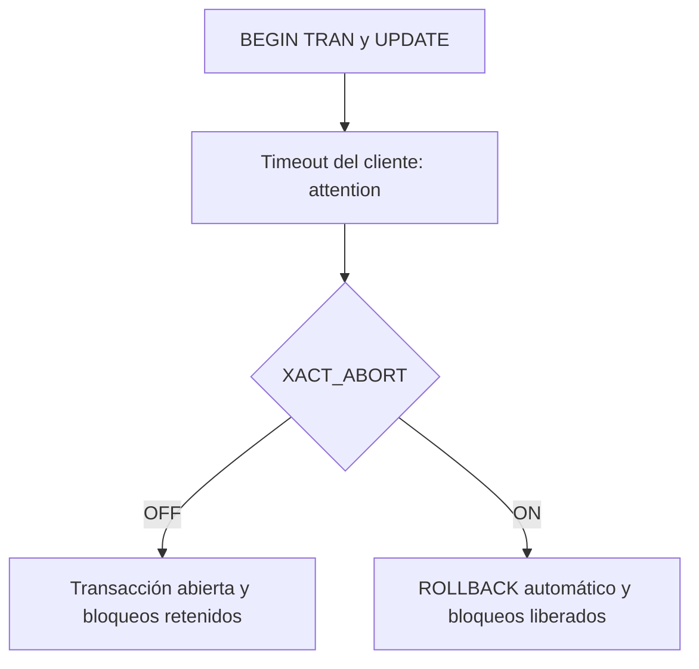

# SET NOCOUNT y SET XACT_ABORT

Parte de: [[06-SQL-Server/02 Intermedio/_Índice Intermedio|Intermedio]]

> [!info] Cómo avanzar
> `progreso`: **pendiente** → **viendo** (estudiando) → **visto** (contestaste la autoevaluación sin abrir las respuestas) → **dominado** (hiciste el laboratorio o lo aplicaste de verdad).

## Contenido

### Qué es
Son dos opciones de sesión que casi todo [[Stored procedures|procedimiento almacenado]] serio activa en su primera línea:

- `SET NOCOUNT ON` suprime los mensajes "(n rows affected)" que SQL Server envía al cliente después de cada instrucción.
- `SET XACT_ABORT ON` hace que **cualquier error en tiempo de ejecución revierta la transacción completa** y aborte el lote, en lugar de dejarla abierta o a medias.

Dentro de un procedimiento, ambas aplican solo mientras el procedimiento se ejecuta: al terminar, la sesión recupera sus valores anteriores.

### Cómo funciona
**`NOCOUNT`**: por cada instrucción, SQL Server manda al cliente un mensaje de conteo (un paquete `DONE_IN_PROC`). En un procedimiento con muchas instrucciones o con un ciclo, son muchos mensajes de red que la app no usa, y algunos clientes viejos los confunden con conjuntos de resultados. Con `NOCOUNT ON` no se envían. El efecto secundario: el cliente ya no sabe cuántas filas se afectaron, y en ADO.NET y Dapper `ExecuteAsync` devuelve **-1**. Si necesitas ese dato, devuélvelo tú con `SELECT @@ROWCOUNT` o un parámetro de salida. `@@ROWCOUNT` sigue funcionando dentro del procedimiento.

**`XACT_ABORT`**: con el valor por defecto (`OFF`), muchos errores (por ejemplo, una violación de FK o de `CHECK`) **solo cancelan la instrucción que falló** y el procedimiento sigue con la siguiente, con la transacción todavía abierta. Es fácil terminar con la mitad de los cambios hechos. Con `ON`, el primer error revierte todo y detiene el lote.

El caso más importante es el **timeout del cliente**. Cuando Dapper o ADO.NET alcanzan el `CommandTimeout`, el cliente envía una señal de *attention* y deja de esperar. Esa señal **no es un error que `TRY...CATCH` pueda atrapar**: el procedimiento simplemente se interrumpe.
- Con `XACT_ABORT OFF`, la transacción **queda abierta** en la conexión, con sus bloqueos. La conexión vuelve al pool y los bloqueos pueden seguir hasta que se reutilice y se reinicie, bloqueando a otras sesiones mientras tanto.
- Con `XACT_ABORT ON`, el servidor **revierte la transacción** en cuanto recibe la interrupción y libera los bloqueos.



**Dentro del `CATCH`**: con `XACT_ABORT ON`, cuando ocurre un error la transacción queda marcada como **no confirmable** (`XACT_STATE() = -1`). No puedes hacer `COMMIT`: solo `ROLLBACK`. Es justo lo que quieres; el patrón estándar del `CATCH` es "si hay transacción, revertir y relanzar" (ver [[TRY CATCH y THROW]]).

### Ejemplo
```sql
CREATE OR ALTER PROCEDURE ventas.Pedido_Cancelar
    @PedidoId int
AS
BEGIN
    SET NOCOUNT ON;
    SET XACT_ABORT ON;

    BEGIN TRY
        BEGIN TRAN;
            UPDATE ventas.Pedidos
            SET    Estado = 'Cancelado'
            WHERE  PedidoId = @PedidoId AND Estado <> 'Entregado';

            DECLARE @Filas int = @@ROWCOUNT;   -- capturar justo después
        COMMIT;
        SELECT @Filas AS FilasAfectadas;       -- la app sabe si hubo cambio
    END TRY
    BEGIN CATCH
        IF @@TRANCOUNT > 0 ROLLBACK;
        THROW;
    END CATCH
END;
```

```csharp
// Dapper: con NOCOUNT ON, ExecuteAsync devolvería -1; leemos el SELECT
int filas = await conn.QuerySingleAsync<int>(
    "ventas.Pedido_Cancelar", new { PedidoId = id },
    commandType: CommandType.StoredProcedure, commandTimeout: 30);
if (filas == 0)
    return Results.Problem(statusCode: 409,
        extensions: new Dictionary<string, object?> { ["codigo"] = "PEDIDO_NO_CANCELABLE" });
```

### Cuándo usarlo y cuándo no
- **Ponlas siempre** al inicio de los procedimientos que modifican datos. `NOCOUNT ON` también en los de solo lectura.
- `XACT_ABORT ON` es la recomendación general para procedimientos con transacciones explícitas; la principal excepción es cuando quieres manejar a propósito un error y **continuar** la misma transacción (poco común y frágil; para eso existen los savepoints de [[Transacciones anidadas y savepoints]]).
- Si la app depende del número de filas afectadas, devuélvelo explícitamente.

### Errores comunes
- **Confiar en el valor de `ExecuteAsync` con `NOCOUNT ON`**: siempre es -1.
- **Leer `@@ROWCOUNT` tarde**: cualquier instrucción intermedia (incluso un `SET` o un `IF`) lo reinicia; guárdalo en una variable justo después.
- **Dejar `XACT_ABORT OFF` con transacciones**: transacciones huérfanas tras un timeout y bloqueos misteriosos.
- **Intentar `COMMIT` en el `CATCH`**: error 3930, la transacción no es confirmable.

### Para profundizar
- [SET NOCOUNT (Transact-SQL)](https://learn.microsoft.com/en-us/sql/t-sql/statements/set-nocount-transact-sql)
- [SET XACT_ABORT (Transact-SQL)](https://learn.microsoft.com/en-us/sql/t-sql/statements/set-xact-abort-transact-sql)
- [XACT_STATE (Transact-SQL)](https://learn.microsoft.com/en-us/sql/t-sql/functions/xact-state-transact-sql)

## Autoevaluación

Contesta primero en voz alta o en papel; luego despliega la respuesta.

> [!question]- ¿Qué hace `SET NOCOUNT ON`?
> Suprime los mensajes «(n rows affected)» que se envían al cliente por cada instrucción; reduce tráfico y evita que algunos clientes confundan esos mensajes con resultados. `@@ROWCOUNT` sigue funcionando. Efecto en ADO.NET/Dapper: `ExecuteNonQuery`/`Execute` devuelve -1.

> [!question]- ¿Qué hace `SET XACT_ABORT ON`?
> Ante un error en tiempo de ejecución, revierte **toda** la transacción y aborta el lote. Con `OFF` (por defecto) muchos errores (FK, `CHECK`, clave duplicada) solo cancelan la instrucción que falló y la transacción sigue abierta.

> [!question]- Caso: la app hace un *timeout* de comando a mitad de una transacción de un procedimiento. ¿Qué pasa con `XACT_ABORT OFF` y con `ON`?
> El cliente cancela el lote, pero con `OFF` la transacción **queda abierta** en la conexión (con sus bloqueos) y vuelve al pool así. Con `ON`, la cancelación revierte la transacción. Por eso todo procedimiento con transacción debe empezar con `SET XACT_ABORT ON`.

> [!question]- Dentro de un `CATCH` con `XACT_ABORT ON`, ¿puedes hacer `COMMIT`?
> No: la transacción queda «no confirmable» (`XACT_STATE() = -1`); solo puedes hacer `ROLLBACK`. El patrón es `IF @@TRANCOUNT > 0 ROLLBACK; THROW;`.

## Práctica

- [[Lab 4 - Stored procedure transaccional con TRY CATCH y XACT_ABORT]]

