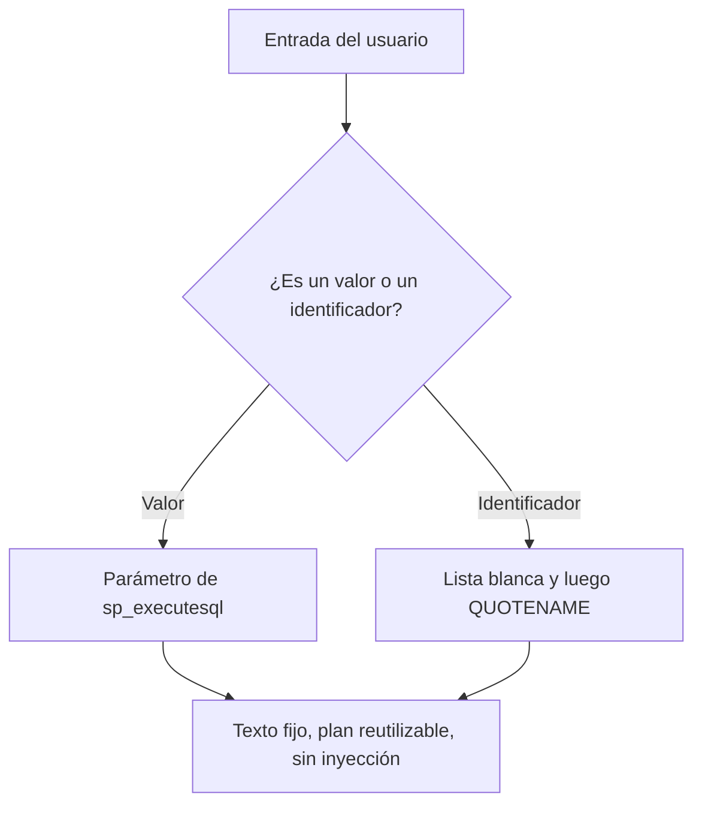

# SQL dinámico y sp_executesql

Parte de: [[06-SQL-Server/02 Intermedio/_Índice Intermedio|Intermedio]]

> [!info] Cómo avanzar
> `progreso`: **pendiente** → **viendo** (estudiando) → **visto** (contestaste la autoevaluación sin abrir las respuestas) → **dominado** (hiciste el laboratorio o lo aplicaste de verdad).

## Contenido

### Qué es
**SQL dinámico** es construir el texto de una consulta en tiempo de ejecución, dentro de una variable, y luego ejecutarlo. Sirve para lo que el SQL estático no puede expresar bien: filtros opcionales que cambian la forma de la consulta, nombres de columna u orden elegidos por el usuario, operaciones sobre muchas tablas en tareas de administración o un [[PIVOT y UNPIVOT|PIVOT]] con columnas variables.

Hay dos formas de ejecutarlo:
- `EXEC (@sql)`: ejecuta el texto tal cual. No admite parámetros.
- `EXEC sp_executesql @sql, N'@p1 tipo, ...', @p1 = valor`: ejecuta el texto con **parámetros tipados**, igual que una consulta parametrizada desde Dapper.

### Cómo funciona
El gran riesgo es la **inyección de SQL**. Si concatenas un valor del usuario dentro del texto, ese valor se vuelve código:

```sql
-- MAL: @Nombre = N'x'' OR 1=1 --'
EXEC (N'SELECT * FROM ventas.Clientes WHERE Nombre = ''' + @Nombre + N'''');
-- El servidor ejecuta: ... WHERE Nombre = 'x' OR 1=1 --'   -> devuelve TODOS los clientes
```

La comilla del valor cierra la cadena, `OR 1=1` hace verdadera la condición y `--` comenta el resto. Con un valor más malicioso podría ser `; DROP TABLE ...`.

`sp_executesql` lo evita porque el **valor viaja como parámetro**, separado del código: el texto contiene `@Nombre` y el motor nunca lo interpreta como SQL. Además, como el texto es el mismo para distintos valores, SQL Server **reutiliza el plan** en caché; con `EXEC` concatenado, cada valor distinto genera un texto distinto y un plan nuevo, llenando la caché.

Los parámetros solo sirven para **valores**, no para **identificadores** (nombres de tabla, columna u orden). Para esos hay dos defensas que se combinan:
1. **Lista blanca**: aceptar solo valores conocidos (`IF @OrdenarPor NOT IN (N'Nombre', N'Precio', N'Categoria') THROW ...`), o mejor, traducir con un `CASE` a un nombre fijo.
2. **`QUOTENAME()`**: envuelve el identificador en corchetes y escapa los `]` internos, de modo que no pueda romper la sintaxis.



**Permisos**: el SQL dinámico se ejecuta en **su propio ámbito**, y el encadenamiento de propiedad (*ownership chaining*) que permite a un usuario con solo `EXECUTE` sobre el procedimiento leer las tablas **no aplica** dentro de él. El usuario necesitará permisos directos (`SELECT`) sobre las tablas que toca el SQL dinámico, o el procedimiento debe usar `EXECUTE AS` o firmarse con un certificado. Ver [[Roles y permisos]].

### Ejemplo
Búsqueda con filtros opcionales y orden seguro sobre la base de [[Lab 1 - Base de práctica Tienda en SQL Server]]:

```sql
CREATE OR ALTER PROCEDURE ventas.Clientes_Buscar
    @Ciudad nvarchar(60) = NULL,
    @Nombre nvarchar(100) = NULL,
    @OrdenarPor sysname = N'Nombre'
AS
BEGIN
    SET NOCOUNT ON;
    IF @OrdenarPor NOT IN (N'Nombre', N'Ciudad', N'FechaAlta')
        THROW 50400, N'Orden no permitido.', 1;

    DECLARE @sql nvarchar(max) = N'SELECT ClienteId, Nombre, Ciudad, FechaAlta
FROM ventas.Clientes WHERE 1 = 1';
    IF @Ciudad IS NOT NULL SET @sql += N' AND Ciudad = @Ciudad';
    IF @Nombre IS NOT NULL SET @sql += N' AND Nombre LIKE @Nombre + N''%''';
    SET @sql += N' ORDER BY ' + QUOTENAME(@OrdenarPor) + N';';

    EXEC sp_executesql @sql,
         N'@Ciudad nvarchar(60), @Nombre nvarchar(100)',
         @Ciudad = @Ciudad, @Nombre = @Nombre;
END;
```

Cada combinación de filtros produce un texto distinto (como máximo cuatro aquí), y cada uno tiene su propio plan óptimo y SARGable. Es mejor que el clásico `WHERE (@Ciudad IS NULL OR Ciudad = @Ciudad)`, que obliga a un plan genérico. Desde Dapper se llama como cualquier procedimiento: `QueryAsync<Cliente>("ventas.Clientes_Buscar", new { Ciudad = "CDMX", OrdenarPor = "Nombre" }, commandType: CommandType.StoredProcedure)`.

### Cuándo usarlo y cuándo no
- **Úsalo** para búsquedas con muchos filtros opcionales, ordenamientos elegidos por el usuario, PIVOT dinámico y scripts de administración.
- **Evítalo** cuando una consulta estática basta: el SQL dinámico es más difícil de leer, de probar y de revisar en seguridad.
- Alternativa para filtros opcionales: la consulta estática con `OPTION (RECOMPILE)`, que compila un plan para los valores concretos en cada ejecución (con costo de CPU).
- En la aplicación, Dapper ya parametriza; nunca construyas SQL en C# concatenando valores.

### Errores comunes
- **Concatenar valores**: inyección de SQL y caché de planes inflada.
- **`QUOTENAME` sobre valores**: es para identificadores; los valores van como parámetros.
- **Variables declaradas fuera del texto**: el SQL dinámico no ve las variables del procedimiento; pásalas como parámetros.
- **`nvarchar(4000)` que trunca el texto**: usa `nvarchar(max)` y cuida que todas las partes concatenadas sean `nvarchar`.
- **Sorpresas de permisos**: falla con "SELECT permission denied" aunque el usuario tenga `EXECUTE`.

### Para profundizar
- [sp_executesql (Transact-SQL)](https://learn.microsoft.com/en-us/sql/relational-databases/system-stored-procedures/sp-executesql-transact-sql)
- [SQL injection](https://learn.microsoft.com/en-us/sql/relational-databases/security/sql-injection)
- [QUOTENAME (Transact-SQL)](https://learn.microsoft.com/en-us/sql/t-sql/functions/quotename-transact-sql)

## Ejercicios

Resuélvelos en papel o en la herramienta; la solución está plegada.

> [!question]- Con la base Tienda ([[Lab 1 - Base de práctica Tienda en SQL Server]]): búsqueda opcional por ciudad y nombre con `sp_executesql` (solo agrega los filtros que vienen).
> ```sql
> DECLARE @Ciudad nvarchar(60) = N'CDMX', @Nombre nvarchar(100) = NULL;
> DECLARE @sql nvarchar(max) = N'SELECT ClienteId, Nombre, Ciudad FROM ventas.Clientes WHERE 1 = 1';
> IF @Ciudad IS NOT NULL SET @sql += N' AND Ciudad = @Ciudad';
> IF @Nombre IS NOT NULL SET @sql += N' AND Nombre LIKE @Nombre + N''%''';
> EXEC sp_executesql @sql, N'@Ciudad nvarchar(60), @Nombre nvarchar(100)', @Ciudad, @Nombre;
> ```
> Diego Ruiz y Fernando Gil. Los valores viajan como parámetros, nunca concatenados.

> [!question]- Orden dinámico seguro: `@OrdenarPor` puede ser `Nombre`, `Precio` o `Categoria`.
> ```sql
> DECLARE @OrdenarPor sysname = N'Precio';
> IF @OrdenarPor NOT IN (N'Nombre', N'Precio', N'Categoria')
>     THROW 50400, N'Columna de orden no permitida.', 1;
> DECLARE @sql nvarchar(max) =
>     N'SELECT Nombre, Precio, Categoria FROM ventas.Productos ORDER BY ' + QUOTENAME(@OrdenarPor) + N';';
> EXEC sp_executesql @sql;
> ```

> [!question]- ¿Qué tiene de malo `EXEC('SELECT * FROM ventas.Clientes WHERE Nombre = ''' + @Nombre + '''')` si `@Nombre = N'x'' OR 1=1 --'`?
> Se ejecuta `... WHERE Nombre = 'x' OR 1=1 --'` y devuelve todos los clientes: inyección SQL. Con `sp_executesql` y `@Nombre` como parámetro, el valor se trata como dato.

## Autoevaluación

Contesta primero en voz alta o en papel; luego despliega la respuesta.

> [!question]- ¿Por qué usar `sp_executesql` en lugar de `EXEC(@sql)`?
> `sp_executesql` acepta **parámetros** tipados: evita inyección SQL en los valores y permite reutilizar el plan. `EXEC(@sql)` con valores concatenados es vulnerable y genera un plan por cada valor distinto.

> [!question]- Los parámetros no sirven para nombres de tabla o columna. ¿Cómo los incluyes con seguridad?
> Valida contra una lista blanca (o `sys.columns`) y usa `QUOTENAME(@col)` para escaparlos. Nunca concatenes texto del usuario directamente.

> [!question]- ¿Qué pasa con los permisos dentro de SQL dinámico en un procedimiento?
> Se rompe el encadenamiento de propiedad: el SQL dinámico se ejecuta con los permisos del **llamador**, así que la app necesitaría permisos sobre las tablas. Se resuelve con `EXECUTE AS` o firmando el procedimiento con certificado.

## Práctica

- [[Lab 10 - Usuario de aplicación con permisos mínimos por esquema]]

