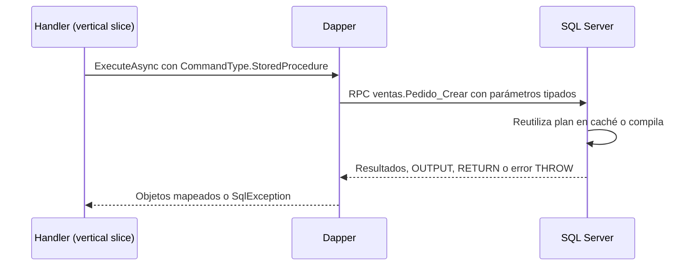

# Stored procedures

Parte de: [[06-SQL-Server/02 Intermedio/_Índice Intermedio|Intermedio]]

> [!info] Cómo avanzar
> `progreso`: **pendiente** → **viendo** (estudiando) → **visto** (contestaste la autoevaluación sin abrir las respuestas) → **dominado** (hiciste el laboratorio o lo aplicaste de verdad).

## Contenido

### Qué es
Un **procedimiento almacenado** (*stored procedure*) es un bloque de T-SQL con nombre, guardado en la base, que acepta parámetros, puede ejecutar varias instrucciones (consultas, modificaciones, transacciones, manejo de errores) y devolver resultados. En una aplicación con Dapper como [[Itzamna.Dionisio]], los procedimientos son la frontera entre la API y los datos: la API llama `ventas.Pedido_Crear` con parámetros tipados y no necesita conocer los detalles de las tablas.

### Cómo funciona
1. Se crea con `CREATE OR ALTER PROCEDURE esquema.Nombre @param tipo [= defecto] [OUTPUT] AS BEGIN ... END` (ver [[CREATE OR ALTER y scripts idempotentes]]).
2. La primera vez que se ejecuta, SQL Server **compila un plan** usando los valores de los parámetros de esa llamada y lo guarda en caché; las siguientes ejecuciones lo reutilizan. Esto ahorra compilaciones, pero también es la causa del [[Parameter sniffing]].
3. Devuelve información con conjuntos de resultados (`SELECT`), parámetros de salida y `RETURN` (ver [[Parámetros de salida y RETURN]]).
4. Los permisos se conceden sobre el procedimiento: `GRANT EXECUTE ON SCHEMA::ventas TO app_api`. Gracias al encadenamiento de propiedad, el usuario de la app no necesita `SELECT` ni `UPDATE` directos sobre las tablas.



**Ventajas en una app con Dapper**:
- **Seguridad**: parámetros tipados (sin inyección) y permisos mínimos (solo `EXECUTE`).
- **Encapsulación**: la lógica de datos y las transacciones viven junto a los datos; la API cambia menos cuando el esquema cambia.
- **Menos viajes de red**: varias instrucciones en una llamada.
- **Planes reutilizados** y visibles por nombre en [[Query Store]] y en las DMVs.
- **Revisión**: los archivos `.sql` en el repo se versionan y despliegan con el pipeline.

**Prefijo `sp_`**: no lo uses. SQL Server reserva `sp_` para procedimientos del sistema y, al ver ese prefijo, **busca primero en `master`**. Eso añade una búsqueda extra y, si algún día Microsoft agrega un procedimiento de sistema con el mismo nombre, se ejecutará el de sistema en lugar del tuyo. Usa nombres como `ventas.Pedido_Crear` o `ventas.usp_PedidoCrear`.

### Ejemplo
```sql
CREATE OR ALTER PROCEDURE ventas.Producto_ActualizarPrecio
    @ProductoId int,
    @Precio     decimal(10,2)
AS
BEGIN
    SET NOCOUNT ON;
    SET XACT_ABORT ON;

    UPDATE ventas.Productos
    SET    Precio = @Precio
    WHERE  ProductoId = @ProductoId;

    SELECT @@ROWCOUNT AS Filas;   -- con NOCOUNT ON, la app no recibe el conteo de otra forma
END;
```

```csharp
public sealed class ActualizarPrecioHandler(IDbConnectionFactory db)
{
    public async Task<IResult> Handle(int id, decimal precio, CancellationToken ct)
    {
        await using var conn = await db.OpenAsync(ct);
        var filas = await conn.QuerySingleAsync<int>(new CommandDefinition(
            "ventas.Producto_ActualizarPrecio",
            new { ProductoId = id, Precio = precio },
            commandType: CommandType.StoredProcedure,
            cancellationToken: ct));

        return filas == 0
            ? Results.Problem(statusCode: 404,
                extensions: new Dictionary<string, object?> { ["codigo"] = "PRODUCTO_NO_EXISTE" })
            : Results.NoContent();
    }
}
```

**El caso del -1**: con `SET NOCOUNT ON`, el servidor no envía conteos de filas, así que `ExecuteAsync` de Dapper devuelve **-1** aunque el `UPDATE` haya modificado una fila. Para saber si afectó filas, devuelve `@@ROWCOUNT` en un `SELECT` (como arriba, leído con `QuerySingleAsync<int>`) o en un parámetro `OUTPUT`, capturándolo inmediatamente después del `UPDATE`.

Con Dapper, los nombres de las propiedades del objeto anónimo deben coincidir con los parámetros del procedimiento (sin `@`). Si mandas propiedades de más, Dapper las envía y SQL Server falla con "has too many arguments specified".

### Cuándo usarlo y cuándo no
- **Úsalos** para operaciones con transacción, reglas de datos, búsquedas complejas y todo lo que la API expone de forma estable.
- **Consultas simples** en archivos `.sql` ejecutados como texto parametrizado también son válidas; el plan se cachea igual. Muchos equipos combinan ambos: lecturas en `.sql`, escrituras en procedimientos.
- **No metas lógica de negocio compleja** (reglas que cambian seguido, llamadas a servicios externos) en T-SQL: es difícil de probar; déjala en C# con FluentValidation y el dominio.

### Errores comunes
- **Prefijo `sp_`**: búsqueda en `master` y posibles colisiones.
- **Olvidar `CommandType.StoredProcedure`**: Dapper envía el nombre como texto y, si hay parámetros, falla o no los asocia.
- **Confiar en el valor de `ExecuteAsync` con `NOCOUNT ON`**: siempre -1.
- **Un procedimiento "navaja suiza"** con `@Accion` que hace diez cosas distintas: planes malos y difícil de mantener; mejor uno por caso de uso, como la regla de una interfaz por consulta.
- **Sin `XACT_ABORT` ni manejo de errores** en procedimientos con transacción (ver [[TRY CATCH y THROW]]).

### Para profundizar
- [Parameters de procedimientos almacenados](https://learn.microsoft.com/en-us/sql/relational-databases/stored-procedures/parameters)
- [CREATE PROCEDURE (Transact-SQL)](https://learn.microsoft.com/en-us/sql/t-sql/statements/create-procedure-transact-sql)
- [Dapper en GitHub](https://github.com/DapperLib/Dapper)

## Autoevaluación

Contesta primero en voz alta o en papel; luego despliega la respuesta.

> [!question]- ¿Qué ventajas tienen los stored procedures en una app con Dapper?
> Permisos mínimos (la app solo tiene `EXECUTE`), reutilización de planes, lógica transaccional cerca de los datos (validar + escribir en una transacción) y un contrato estable entre app y base.

> [!question]- ¿Cómo llamas un procedimiento desde Dapper?
> ```csharp
> var pedidos = await cn.QueryAsync<PedidoDto>(
>     "ventas.Pedidos_PorCliente",
>     new { ClienteId = id },
>     commandType: CommandType.StoredProcedure);
> ```
> Siempre con el nombre calificado por esquema.

> [!question]- ¿Por qué no nombrar tus procedimientos con prefijo `sp_`?
> SQL Server busca primero los `sp_` en `master` (procedimientos del sistema); cuesta una búsqueda extra y puedes chocar con uno del sistema. Usa nombres como `ventas.Pedido_Crear`.

> [!question]- Caso: con `SET NOCOUNT ON` en el procedimiento, `ExecuteAsync` de Dapper devuelve -1. ¿Cómo sabes si el `UPDATE` afectó filas?
> Revisa `@@ROWCOUNT` **dentro** del procedimiento y actúa ahí: `THROW 50409` si fue 0 por conflicto, o devuélvelo con un parámetro de salida o un `SELECT`. Así no dependes del conteo que llega al cliente.

## Práctica

- [[Lab 4 - Stored procedure transaccional con TRY CATCH y XACT_ABORT]]
- [[Lab 5 - Concurrencia optimista con rowversion en dos sesiones]]
- [[Lab 10 - Usuario de aplicación con permisos mínimos por esquema]]

