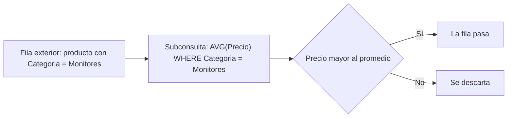

# Subconsultas correlacionadas

Parte de: [[06-SQL-Server/02 Intermedio/_Índice Intermedio|Intermedio]]

> [!info] Cómo avanzar
> `progreso`: **pendiente** → **viendo** (estudiando) → **visto** (contestaste la autoevaluación sin abrir las respuestas) → **dominado** (hiciste el laboratorio o lo aplicaste de verdad).

## Contenido

### Qué es
Una **subconsulta correlacionada** es una subconsulta que **hace referencia a columnas de la consulta exterior**. A diferencia de una subconsulta normal, que se puede evaluar una sola vez porque no depende de nada, la correlacionada depende de "la fila actual": "el promedio de precio **de la categoría de este producto**" o "el número de pedidos **de este cliente**". Si aún no conoces las subconsultas en general, empieza por [[Subconsultas]].

### Cómo funciona
**Lógicamente**, la subconsulta se evalúa una vez por cada fila de la consulta exterior, sustituyendo el valor de la columna correlacionada. Esa es la forma de razonar sobre su resultado.

**Físicamente**, no necesariamente se ejecuta una vez por fila. El optimizador de SQL Server suele **desanidar** (*decorrelate*) la subconsulta y convertirla en un `JOIN` o un *semi-join* con una agregación, de modo que el plan final puede ser un *Hash Match* que recorre cada tabla una sola vez. Cuando no puede transformarla, o cuando estima que conviene, usa *Nested Loops*: entonces sí hay una búsqueda en la tabla interna por cada fila exterior, que es barata con un índice adecuado y carísima sin él. La única forma de saber qué pasó es mirar el [[Planes de ejecución|plan de ejecución]].

Se pueden poner en tres lugares:
1. **`WHERE`**: comparar contra un valor calculado del grupo de la fila (`Precio > (SELECT AVG ... WHERE c.Categoria = p.Categoria)`), o en `EXISTS`.
2. **`SELECT`**: como columna calculada (`(SELECT COUNT(*) FROM Pedidos WHERE ClienteId = c.ClienteId) AS NumPedidos`). Debe devolver un solo valor.
3. **`FROM`** con `APPLY` (ver [[CROSS APPLY y OUTER APPLY]]).



### Ejemplo
Con la base de [[Lab 1 - Base de práctica Tienda en SQL Server]]:

```sql
-- Productos con precio mayor al promedio de su categoría
SELECT p.Nombre, p.Categoria, p.Precio
FROM   ventas.Productos p
WHERE  p.Precio > (SELECT AVG(x.Precio)
                   FROM   ventas.Productos x
                   WHERE  x.Categoria = p.Categoria);   -- correlación

-- Pedido más reciente de cada cliente
SELECT p.ClienteId, p.PedidoId, p.Fecha
FROM   ventas.Pedidos p
WHERE  p.Fecha = (SELECT MAX(x.Fecha)
                  FROM   ventas.Pedidos x
                  WHERE  x.ClienteId = p.ClienteId);

-- Número de pedidos como columna calculada (incluye clientes con 0)
SELECT c.Nombre,
       (SELECT COUNT(*) FROM ventas.Pedidos x WHERE x.ClienteId = c.ClienteId) AS NumPedidos
FROM   ventas.Clientes c;
```

En la segunda consulta, si un cliente tiene dos pedidos en la misma fecha máxima, salen ambos: "el más reciente" por fecha no es único. Si necesitas exactamente uno, las alternativas de abajo lo resuelven con un desempate.

**Alternativas para "el último por grupo"**:

```sql
-- 1) ROW_NUMBER: un recorrido, desempate explícito
WITH r AS (
    SELECT p.*, ROW_NUMBER() OVER (PARTITION BY ClienteId ORDER BY Fecha DESC, PedidoId DESC) AS rn
    FROM   ventas.Pedidos p
)
SELECT ClienteId, PedidoId, Fecha FROM r WHERE rn = 1;

-- 2) CROSS APPLY con TOP (1): ideal con índice (ClienteId, Fecha DESC)
SELECT c.ClienteId, u.PedidoId, u.Fecha
FROM   ventas.Clientes c
CROSS APPLY (SELECT TOP (1) PedidoId, Fecha FROM ventas.Pedidos x
             WHERE x.ClienteId = c.ClienteId ORDER BY Fecha DESC, PedidoId DESC) u;

-- 3) Para promedios por grupo: función de ventana en vez de subconsulta
SELECT Nombre, Categoria, Precio
FROM  (SELECT *, AVG(Precio) OVER (PARTITION BY Categoria) AS Prom FROM ventas.Productos) t
WHERE  Precio > Prom;
```

### Cuándo usarlo y cuándo no
- **Úsala** cuando expresa la pregunta de forma natural y el plan es bueno: comparaciones contra un agregado del propio grupo, `EXISTS`/`NOT EXISTS`, conteos sencillos en el `SELECT`.
- **Prefiere [[Funciones de ventana]]** cuando necesitas varios agregados del grupo o el top N: un solo recorrido en vez de una búsqueda por fila.
- **Prefiere un `JOIN` con tabla derivada agregada** cuando varias columnas calculadas en el `SELECT` repiten la misma subconsulta con agregados distintos: cada una es una búsqueda separada.
- Asegura índices sobre las columnas de correlación (`Pedidos.ClienteId`, `Productos.Categoria`).

### Errores comunes
- **Olvidar la correlación**: sin `WHERE x.Categoria = p.Categoria`, comparas contra el promedio global.
- **Alias ambiguos**: usar el mismo alias dentro y fuera, o ninguno, hace que la columna se resuelva contra la tabla interna y la "correlación" compare la tabla consigo misma. Usa alias distintos siempre.
- **Subconsulta escalar que devuelve varias filas**: error 512.
- **Varias subconsultas en el `SELECT`** sobre la misma tabla: el plan puede tener N búsquedas por fila.

### Para profundizar
- [Subqueries (SQL Server)](https://learn.microsoft.com/en-us/sql/relational-databases/performance/subqueries)
- [SELECT - OVER clause](https://learn.microsoft.com/en-us/sql/t-sql/queries/select-over-clause-transact-sql)

## Ejercicios

Resuélvelos en papel o en la herramienta; la solución está plegada.

> [!question]- Con la base Tienda ([[Lab 1 - Base de práctica Tienda en SQL Server]]): productos con precio mayor al promedio **de su categoría**.
> ```sql
> SELECT p.Nombre, p.Categoria, p.Precio
> FROM   ventas.Productos p
> WHERE  p.Precio > (SELECT AVG(x.Precio) FROM ventas.Productos x
>                    WHERE x.Categoria = p.Categoria);
> ```
> Promedio de Periféricos = 850: Teclado mecánico (1200) y Webcam HD (900). Las otras categorías tienen un solo producto.

> [!question]- El pedido más reciente de cada cliente con subconsulta correlacionada.
> ```sql
> SELECT p.ClienteId, p.PedidoId, p.Fecha
> FROM   ventas.Pedidos p
> WHERE  p.Fecha = (SELECT MAX(x.Fecha) FROM ventas.Pedidos x WHERE x.ClienteId = p.ClienteId);
> ```
> Cliente 1 → pedido 7, 2 → 6, 3 → 4, 4 → 5, 5 → 8. Si un cliente tuviera dos pedidos el mismo día saldrían ambos.

> [!question]- Cada cliente con su número de pedidos como columna calculada (subconsulta en el `SELECT`).
> ```sql
> SELECT c.Nombre,
>        (SELECT COUNT(*) FROM ventas.Pedidos p WHERE p.ClienteId = c.ClienteId) AS Pedidos
> FROM   ventas.Clientes c;
> ```
> Ana 3, Bruno 2, Carla 1, Diego 1, Elena 1, Fernando 0 (aquí `COUNT` da 0, no `NULL`).

## Autoevaluación

Contesta primero en voz alta o en papel; luego despliega la respuesta.

> [!question]- ¿Qué es una subconsulta correlacionada?
> Una subconsulta que usa columnas de la consulta externa (`WHERE x.Categoria = p.Categoria`); conceptualmente se evalúa una vez por cada fila externa.

> [!question]- ¿Se ejecuta realmente una vez por fila?
> Lógicamente sí, pero el optimizador suele reescribirla como join o semi-join. Si no puede (p. ej. con funciones o `TOP` complejos), sí verás *Nested Loops* que repiten la subconsulta: revisa el plan.

> [!question]- ¿Qué alternativas hay a una subconsulta correlacionada para «el último por grupo»?
> Funciones de ventana (`ROW_NUMBER() OVER (PARTITION BY ... ORDER BY ... DESC)`) o `CROSS APPLY (SELECT TOP (1) ...)`, que suelen ser más claras y eficientes con un índice adecuado.

