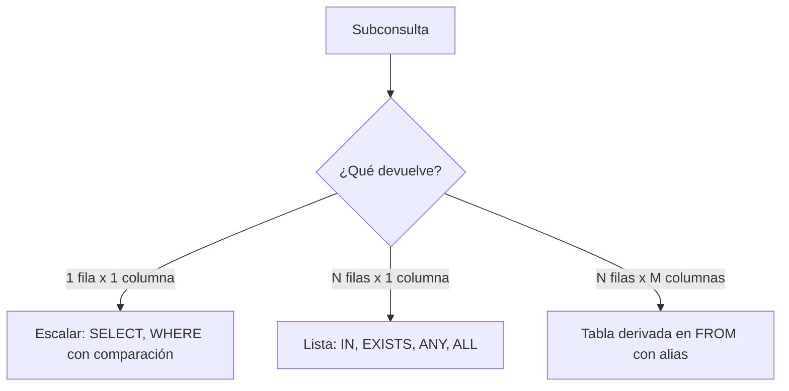

# Subconsultas

Parte de: [[06-SQL-Server/02 Intermedio/_Índice Intermedio|Intermedio]]

> [!info] Cómo avanzar
> `progreso`: **pendiente** → **viendo** (estudiando) → **visto** (contestaste la autoevaluación sin abrir las respuestas) → **dominado** (hiciste el laboratorio o lo aplicaste de verdad).

## Contenido

### Qué es
Una **subconsulta** es un `SELECT` escrito dentro de otra instrucción, entre paréntesis. Permite usar el resultado de una consulta como valor, como lista o como tabla dentro de otra: "productos con precio mayor **al promedio del catálogo**", "clientes **que están en esta lista**", "a partir de **esta tabla de importes por cliente**, filtra los mayores a 10,000".

### Cómo funciona
Se clasifican por lo que devuelven, y eso determina dónde puedes usarlas:

1. **Escalar**: una fila y una columna. Se usa donde va un valor: en `SELECT`, `WHERE` con `=`, `>`, etc., o en un `SET`. Si en tiempo de ejecución devuelve más de una fila, falla con el **error 512** ("Subquery returned more than 1 value. This is not permitted when the subquery follows =, !=, <, <=, >, >= or when the subquery is used as an expression"). Si no devuelve filas, su valor es `NULL`.
2. **De lista** (una columna, varias filas): se usa con `IN`, `NOT IN`, `ANY`, `ALL` o dentro de `EXISTS` (ver [[EXISTS vs IN]]).
3. **De tabla** (varias columnas y filas): va en el `FROM` con un alias obligatorio y se llama **tabla derivada**. Es equivalente a una [[CTE]] escrita en línea.

Además, una subconsulta puede ser **independiente** (se evalúa sin mirar la consulta exterior) o **correlacionada** (usa columnas de la fila exterior; ver [[Subconsultas correlacionadas]]).



**¿Son más lentas que un `JOIN`?** No necesariamente. El optimizador de SQL Server no ejecuta la consulta "como está escrita": la transforma. Una subconsulta con `IN` o `EXISTS` se convierte en un *semi-join*; una tabla derivada se expande en el plan; una escalar independiente se evalúa una vez. Muchas veces el plan es **idéntico** al del `JOIN` equivalente. Hay casos donde una forma gana (por ejemplo, un `JOIN` que duplica filas y luego necesita `DISTINCT` es peor que un `EXISTS`), así que la regla es: escribe la forma más clara para la pregunta y compara planes cuando el rendimiento importe.

### Ejemplo
Con la base de [[Lab 1 - Base de práctica Tienda en SQL Server]]:

```sql
-- Escalar: productos con precio mayor al promedio del catálogo
SELECT Nombre, Precio
FROM   ventas.Productos
WHERE  Precio > (SELECT AVG(Precio) FROM ventas.Productos);

-- Tabla derivada: clientes con importe (sin cancelados) mayor a 10,000
SELECT c.Nombre, t.Importe
FROM  (SELECT p.ClienteId, SUM(d.Cantidad * d.PrecioUnitario) AS Importe
       FROM   ventas.Pedidos p
       JOIN   ventas.PedidoDetalle d ON d.PedidoId = p.PedidoId
       WHERE  p.Estado <> 'Cancelado'
       GROUP  BY p.ClienteId) AS t
JOIN   ventas.Clientes c ON c.ClienteId = t.ClienteId
WHERE  t.Importe > 10000;

-- Escalar en el SELECT: porcentaje respecto al producto más caro
SELECT Nombre, Precio,
       CAST(100.0 * Precio / (SELECT MAX(Precio) FROM ventas.Productos) AS decimal(5,2)) AS PctDelMax
FROM   ventas.Productos;

-- Error 512 provocado a propósito: hay varios productos de Monitores
-- SELECT * FROM ventas.Productos WHERE Precio = (SELECT Precio FROM ventas.Productos WHERE Categoria = N'Monitores');
```

Para corregir un error 512, decide qué querías decir: si cualquiera de los valores sirve, usa `IN`; si querías uno en particular, agrega una condición que lo haga único o usa una agregación (`MAX`, `MIN`) o `TOP (1)` con `ORDER BY`.

En una API con Dapper, la subconsulta va dentro del archivo `.sql` como parte normal de la consulta; los parámetros (`@Minimo`) pueden usarse tanto dentro como fuera de ella.

### Cuándo usarlo y cuándo no
- **Escalar**: para comparar contra un valor global (promedio, máximo) o mostrar un dato puntual.
- **Lista con `IN`/`EXISTS`**: para filtrar por pertenencia sin duplicar filas.
- **Tabla derivada o CTE**: para agregar primero y filtrar o unir después. Si la vas a reutilizar o encadenar, la CTE se lee mejor.
- **`JOIN`**: cuando necesitas columnas de ambas tablas en el resultado.
- Si necesitas el agregado junto al detalle de cada fila, considera [[Funciones de ventana]] en lugar de una subconsulta en el `SELECT`.

### Errores comunes
- **Error 512**: una subconsulta escalar devolvió varias filas; suele aparecer solo con ciertos datos, en producción. Asegúrate de que sea única por diseño.
- **`NOT IN` con `NULL`** en la subconsulta: devuelve vacío; usa `NOT EXISTS`.
- **Tabla derivada sin alias**: error de sintaxis.
- **Columnas calculadas sin nombre** dentro de la tabla derivada: cada columna necesita alias.
- **`ORDER BY` dentro de la subconsulta** sin `TOP`/`OFFSET`: no se permite y no ordenaría el resultado final.

### Para profundizar
- [Subqueries (SQL Server)](https://learn.microsoft.com/en-us/sql/relational-databases/performance/subqueries)
- [FROM clause: derived tables](https://learn.microsoft.com/en-us/sql/t-sql/queries/from-transact-sql)

## Ejercicios

Resuélvelos en papel o en la herramienta; la solución está plegada.

> [!question]- Con la base Tienda ([[Lab 1 - Base de práctica Tienda en SQL Server]]): productos con precio mayor al promedio del catálogo.
> ```sql
> SELECT Nombre, Precio
> FROM   ventas.Productos
> WHERE  Precio > (SELECT AVG(Precio) FROM ventas.Productos);
> ```
> Promedio 4400: Monitor 27 (5200) y Laptop 14 (18500).

> [!question]- Con una tabla derivada: clientes cuyo importe total (sin cancelados) supera 10,000.
> ```sql
> SELECT c.Nombre, t.Importe
> FROM  (SELECT p.ClienteId, SUM(d.Cantidad * d.PrecioUnitario) AS Importe
>        FROM   ventas.Pedidos p
>        JOIN   ventas.PedidoDetalle d ON d.PedidoId = p.PedidoId
>        WHERE  p.Estado <> 'Cancelado'
>        GROUP  BY p.ClienteId) AS t
> JOIN   ventas.Clientes c ON c.ClienteId = t.ClienteId
> WHERE  t.Importe > 10000;
> ```
> Bruno Díaz (21100) y Diego Ruiz (18450). Elena (10000) no, porque no es mayor.

> [!question]- Cada producto con su precio y el porcentaje que representa del producto más caro.
> ```sql
> SELECT Nombre, Precio,
>        CAST(100.0 * Precio / (SELECT MAX(Precio) FROM ventas.Productos) AS decimal(5,1)) AS PctDelMax
> FROM   ventas.Productos;
> ```
> Laptop 100.0, Monitor 28.1, Teclado 6.5, Webcam 4.9, Mouse 2.4, Cable 0.8.

## Autoevaluación

Contesta primero en voz alta o en papel; luego despliega la respuesta.

> [!question]- ¿Qué tipos de subconsulta hay según lo que devuelven?
> **Escalar** (un valor: `(SELECT AVG(Precio) FROM ...)`), **de lista** (una columna, para `IN`/`EXISTS`) y **de tabla** (tabla derivada en el `FROM`, que necesita alias).

> [!question]- ¿Qué significa el error 512 «Subquery returned more than 1 value»?
> Usaste una subconsulta como escalar (`= (SELECT ...)`) y devolvió varias filas. Corrige el filtro, usa `IN`/`EXISTS` o agrega `TOP (1)` con `ORDER BY` si de verdad quieres una.

> [!question]- ¿Una subconsulta es siempre más lenta que un `JOIN`?
> No necesariamente: el optimizador suele transformar ambas formas en el mismo plan (semi-join, join). Escribe la forma más clara y compara planes si hay problema.

