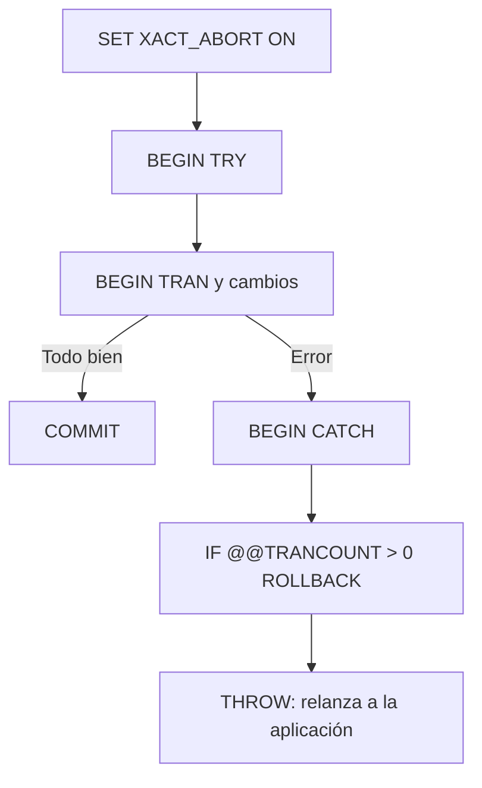

# TRY CATCH y THROW

Parte de: [[06-SQL-Server/02 Intermedio/_Índice Intermedio|Intermedio]]

> [!info] Cómo avanzar
> `progreso`: **pendiente** → **viendo** (estudiando) → **visto** (contestaste la autoevaluación sin abrir las respuestas) → **dominado** (hiciste el laboratorio o lo aplicaste de verdad).

## Contenido

### Qué es
`TRY...CATCH` es el mecanismo de T-SQL para **atrapar errores**: si una instrucción dentro de `BEGIN TRY ... END TRY` falla, la ejecución salta a `BEGIN CATCH ... END CATCH`, donde puedes revertir la transacción, registrar el error y relanzarlo. `THROW` **lanza** un error: con argumentos, uno propio (por ejemplo, una regla de negocio violada); sin argumentos y dentro de un `CATCH`, **relanza** el error original intacto.

### Cómo funciona
Dentro del `CATCH` tienes funciones que describen el error: `ERROR_NUMBER()`, `ERROR_MESSAGE()`, `ERROR_SEVERITY()`, `ERROR_STATE()`, `ERROR_LINE()` y `ERROR_PROCEDURE()`. Fuera del `CATCH` devuelven `NULL`.

El **patrón estándar** para un procedimiento con transacción combina tres piezas: `SET XACT_ABORT ON` (ver [[SET NOCOUNT y SET XACT_ABORT]]), la transacción dentro del `TRY`, y en el `CATCH` revertir si hay una transacción abierta y relanzar con `THROW`:



**`THROW` frente a `RAISERROR`**:
- `THROW` (desde SQL Server 2012) es la forma moderna. Sin parámetros relanza el error original con su número, mensaje y línea. Con parámetros (`THROW 50409, N'mensaje', 1`) el número debe ser **50000 o mayor**, la severidad es siempre **16** y no necesita que el mensaje exista en `sys.messages`. **Termina el lote** y respeta `XACT_ABORT`. La instrucción anterior debe terminar en `;`.
- `RAISERROR` es la forma antigua: permite elegir severidad y formatear el mensaje con `%s` y `%d`, pero **no relanza** el error original (crea uno nuevo, típicamente 50000, perdiendo el número real) y no detiene la ejecución por sí solo. Para código nuevo, usa `THROW`.

**Errores que `TRY...CATCH` no atrapa**:
1. **Errores de compilación** del mismo lote (sintaxis) y errores de **resolución de nombres diferida** en el mismo nivel (una tabla que no existe), porque ocurren antes de ejecutar o abortan el ámbito. Sí se atrapan si ocurren en un nivel inferior (un procedimiento llamado dentro del `TRY`, o `sp_executesql`).
2. **Mensajes de severidad 10 o menor**: son advertencias o información, no errores.
3. **Errores de severidad 20 o mayor** que cortan la conexión.
4. **Interrupciones del cliente** (*attention*): timeout del comando o cancelación. Por eso `XACT_ABORT ON` es indispensable: el `CATCH` nunca se ejecuta en un timeout.
5. Una sesión terminada con `KILL`.

### Ejemplo
```sql
CREATE OR ALTER PROCEDURE ventas.Pedido_CambiarEstado
    @PedidoId int, @Estado varchar(20), @RowVer binary(8)  -- valor de rowversion leído antes
AS
BEGIN
    SET NOCOUNT ON;
    SET XACT_ABORT ON;
    BEGIN TRY
        BEGIN TRAN;
            UPDATE ventas.Pedidos
            SET    Estado = @Estado
            WHERE  PedidoId = @PedidoId AND RowVer = @RowVer;

            IF @@ROWCOUNT = 0
                THROW 50409, N'El pedido fue modificado por otro usuario.', 1;
        COMMIT;
    END TRY
    BEGIN CATCH
        IF @@TRANCOUNT > 0 ROLLBACK;
        THROW;   -- relanza: el número 50409 (o el error real) llega a la app
    END CATCH
END;
```

En C#, Dapper deja pasar la `SqlException` de `Microsoft.Data.SqlClient`; su propiedad `Number` trae el número del error, así que la API lo traduce a ProblemDetails:

```csharp
try
{
    await conn.ExecuteAsync("ventas.Pedido_CambiarEstado",
        new { PedidoId = id, Estado = "Enviado", RowVer = rowVer },
        commandType: CommandType.StoredProcedure);
    return Results.NoContent();
}
catch (SqlException ex) when (ex.Number == 50409)
{
    return Results.Problem(statusCode: 409, title: "Conflicto de concurrencia",
        extensions: new Dictionary<string, object?> { ["codigo"] = "PEDIDO_MODIFICADO" });
}
```

Reserva un rango de números para tu aplicación (por ejemplo, 50400–50499 para errores que mapean a HTTP 4xx) y documéntalo, para que el *middleware* de excepciones pueda traducirlos de forma uniforme.

### Cuándo usarlo y cuándo no
- **Úsalo** en todo procedimiento con transacción explícita, con el patrón de arriba.
- **`THROW` con número propio** para reglas de negocio que la base es la única capaz de verificar con seguridad (concurrencia, unicidad bajo carga). Para validaciones de entrada, valida antes en C# con FluentValidation.
- **No te tragues errores**: un `CATCH` que solo hace `PRINT` o `SELECT ERROR_MESSAGE()` sin relanzar hace que la app crea que todo salió bien.
- Si quieres registrar el error en una tabla de log, hazlo **después** del `ROLLBACK` (si no, el rollback borra también el registro) y antes del `THROW`.

### Errores comunes
- **`COMMIT` en el `CATCH`**: con `XACT_ABORT ON` la transacción es no confirmable (error 3930).
- **Olvidar el `;` antes de `THROW`**: el parser lo toma como alias de la instrucción anterior.
- **Usar `RAISERROR` para relanzar**: pierdes el número original y la API no puede distinguir errores.
- **Esperar que el `CATCH` atrape un timeout**: no lo hace; la defensa es `XACT_ABORT ON`.
- **`ROLLBACK` sin comprobar `@@TRANCOUNT`**: si no hay transacción, el `ROLLBACK` mismo da error y oculta el original.

### Para profundizar
- [TRY...CATCH (Transact-SQL)](https://learn.microsoft.com/en-us/sql/t-sql/language-elements/try-catch-transact-sql)
- [THROW (Transact-SQL)](https://learn.microsoft.com/en-us/sql/t-sql/language-elements/throw-transact-sql)
- [SqlException.Number](https://learn.microsoft.com/en-us/dotnet/api/microsoft.data.sqlclient.sqlexception.number)

## Autoevaluación

Contesta primero en voz alta o en papel; luego despliega la respuesta.

> [!question]- ¿Cuál es el patrón estándar de manejo de errores en un procedimiento con transacción?
> ```sql
> SET NOCOUNT ON; SET XACT_ABORT ON;
> BEGIN TRY
>     BEGIN TRANSACTION;
>     -- trabajo
>     COMMIT TRANSACTION;
> END TRY
> BEGIN CATCH
>     IF @@TRANCOUNT > 0 ROLLBACK TRANSACTION;
>     THROW;  -- relanza el error original
> END CATCH
> ```

> [!question]- ¿Qué diferencia hay entre `THROW` y `RAISERROR`?
> `THROW` (2012+) relanza el error original sin argumentos, o lanza uno propio (`THROW 50409, N'mensaje', 1;`) con número ≥ 50000 y severidad 16; siempre interrumpe. `RAISERROR` es el antiguo: admite formato y severidades, pero no aborta por sí mismo. La instrucción anterior a `THROW` debe terminar en `;`.

> [!question]- ¿Cómo distingues en C# un conflicto de concurrencia lanzado con `THROW 50409`?
> ```csharp
> catch (SqlException ex) when (ex.Number == 50409)
> {
>     return Results.Conflict(new ProblemDetails { Title = ex.Message });
> }
> ```
> Otros números útiles: 2627/2601 (clave duplicada → 409), 547 (FK/CHECK), 1205 (deadlock → reintentar).

> [!question]- ¿Qué errores **no** atrapa un `TRY/CATCH`?
> Errores de compilación o de resolución de nombres en el mismo nivel (objeto inexistente en el lote), errores de severidad ≥ 20 que cierran la conexión, y avisos de severidad ≤ 10. La cancelación por timeout del cliente tampoco entra al `CATCH`.

## Práctica

- [[Lab 4 - Stored procedure transaccional con TRY CATCH y XACT_ABORT]]
- [[Lab 5 - Concurrencia optimista con rowversion en dos sesiones]]

