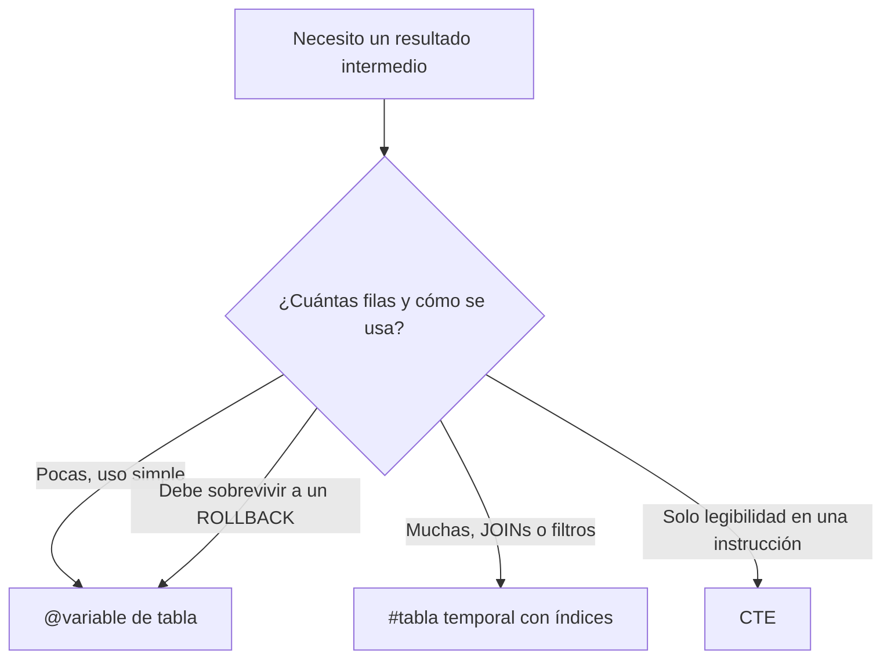

# Tablas temporales y variables de tabla

Parte de: [[06-SQL-Server/02 Intermedio/_Índice Intermedio|Intermedio]]

> [!info] Cómo avanzar
> `progreso`: **pendiente** → **viendo** (estudiando) → **visto** (contestaste la autoevaluación sin abrir las respuestas) → **dominado** (hiciste el laboratorio o lo aplicaste de verdad).

## Contenido

### Qué es
SQL Server ofrece tres formas de guardar resultados intermedios mientras trabajas:

- **Tabla temporal local** `#Tabla`: una tabla real en `tempdb`, visible solo para tu sesión (y para los procedimientos que llames). Se borra al cerrar la sesión o al terminar el procedimiento que la creó.
- **Tabla temporal global** `##Tabla`: también en `tempdb`, pero **visible para todas las sesiones**. Se borra cuando la sesión que la creó termina y ninguna otra la está usando. Se usa poco y con cuidado, porque dos ejecuciones simultáneas chocan por el nombre.
- **Variable de tabla** `@Tabla`: se declara con `DECLARE @t table (...)`, vive solo durante el **lote** o procedimiento y su alcance es como el de cualquier variable.

### Cómo funciona
Las tres usan `tempdb` (la idea de que las variables de tabla "viven en memoria" es un mito: ambas usan páginas de `tempdb` y ambas pueden estar en memoria si son pequeñas). Las diferencias que importan son:

| Aspecto | `#Temporal` | `@Variable` |
|---|---|---|
| Estadísticas | **Sí**, automáticas | **No** (solo el número de filas, y no siempre) |
| Índices | Cualquiera, también después de crearla | Solo los declarados en línea (PK, UNIQUE, `INDEX` en la definición) |
| Afectada por `ROLLBACK` | Sí | **No** |
| Recompilaciones | Puede provocarlas al cambiar mucho | Menos |
| Alcance | Sesión o procedimiento y sus hijos | Lote o procedimiento actual |

**Estadísticas**: el optimizador usa estadísticas para estimar cuántas filas saldrán de cada paso y elegir el plan (ver [[Estadísticas]]). Con una `#tabla` de 50 mil filas, las estimaciones son buenas. Con una `@tabla`, históricamente el optimizador **estimaba 1 fila**, y elegía *Nested Loops* y otras estrategias pensadas para pocas filas que se vuelven lentísimas con miles. Desde SQL Server 2019 (compatibilidad 150), la *compilación diferida de variables de tabla* usa el número real de filas en la primera compilación, lo que mejora mucho las estimaciones, pero sigue sin haber distribución de valores: los filtros sobre sus columnas se estiman a ciegas.

**`ROLLBACK`**: una variable de tabla **no participa en la transacción**. Si insertas en `@t` y luego haces `ROLLBACK`, las filas siguen ahí. Esto es útil: puedes guardar en una variable de tabla lo que pasó (por ejemplo, con [[OUTPUT]]) y conservarlo para registrar el error después de revertir.



### Ejemplo
```sql
-- Tabla temporal: materializar un paso caro y reutilizarlo
SELECT p.ClienteId, SUM(d.Cantidad * d.PrecioUnitario) AS Importe
INTO   #Importes
FROM   ventas.Pedidos p
JOIN   ventas.PedidoDetalle d ON d.PedidoId = p.PedidoId
WHERE  p.Estado <> 'Cancelado'
GROUP  BY p.ClienteId;

CREATE CLUSTERED INDEX IX ON #Importes (ClienteId);   -- índice después de llenarla

SELECT c.Nombre, i.Importe FROM #Importes i JOIN ventas.Clientes c ON c.ClienteId = i.ClienteId;
SELECT AVG(Importe) FROM #Importes;                     -- se reutiliza sin recalcular
DROP TABLE IF EXISTS #Importes;

-- Variable de tabla: sobrevive al ROLLBACK
DECLARE @Log table (PedidoId int, Estado varchar(20));
BEGIN TRAN;
    UPDATE ventas.Pedidos SET Estado = 'Enviado'
    OUTPUT inserted.PedidoId, inserted.Estado INTO @Log
    WHERE  PedidoId = 1;
ROLLBACK;
SELECT * FROM @Log;   -- la fila sigue aquí aunque el UPDATE se revirtió
```

Desde Dapper, ten en cuenta que una `#tabla` creada en un comando sigue existiendo para los siguientes comandos **en la misma conexión abierta**; si Dapper abre y cierra la conexión en cada llamada, la tabla desaparece entre llamadas. Lo normal es que la tabla temporal viva dentro de un procedimiento y la app ni se entere.

### Cuándo usarlo y cuándo no
- **`#tabla`** para resultados intermedios grandes, que se unen o filtran, que se reutilizan varias veces o que se benefician de índices. También para dividir una consulta gigantesca en pasos con buenas estimaciones (ver [[CTE múltiples]]).
- **`@tabla`** para pocas filas (decenas o cientos), para parámetros de funciones, para datos que deben sobrevivir a un `ROLLBACK` y dentro de funciones (donde las `#tablas` no se permiten).
- **CTE** cuando solo quieres legibilidad dentro de una instrucción.
- **`##tabla`** casi nunca en código de aplicación.

### Errores comunes
- **Variable de tabla con miles de filas** en un `JOIN`: estimaciones pobres y planes malos.
- **Creer que `@tabla` es "en memoria"**: usa `tempdb` igual.
- **Esperar que `ROLLBACK` limpie la variable de tabla**.
- **`##tabla` en procedimientos concurrentes**: dos ejecuciones comparten la misma tabla.
- **Abusar de `SELECT INTO #t`** en procedimientos muy frecuentes: presión sobre `tempdb`; reutiliza o simplifica.

### Para profundizar
- [CREATE TABLE: temporary tables](https://learn.microsoft.com/en-us/sql/t-sql/statements/create-table-transact-sql)
- [table data type (Transact-SQL)](https://learn.microsoft.com/en-us/sql/t-sql/data-types/table-transact-sql)
- [Intelligent query processing: table variable deferred compilation](https://learn.microsoft.com/en-us/sql/relational-databases/performance/intelligent-query-processing-details)

## Autoevaluación

Contesta primero en voz alta o en papel; luego despliega la respuesta.

> [!question]- ¿Qué diferencia hay entre `#tabla`, `##tabla` y `@tabla`?
> `#t`: temporal local, visible en tu sesión (y en procedimientos que llames), vive en tempdb. `##t`: temporal global, visible para todas las sesiones. `@t`: variable de tabla, con alcance del lote o procedimiento.

> [!question]- ¿Cuál tiene estadísticas y por qué importa?
> Las `#temporales` tienen estadísticas e índices como una tabla normal, así que el optimizador estima bien con muchas filas. Las `@variables` no tienen estadísticas de columnas; desde SQL Server 2019 (compatibilidad 150) al menos se conoce su número de filas (*deferred compilation*). Regla práctica: pocas filas → `@t`; muchas o con joins → `#t`.

> [!question]- ¿Qué pasa con una variable de tabla si haces `ROLLBACK`?
> Sus datos **no** se revierten (no participa en la transacción). Útil para guardar un log de errores dentro de un `CATCH` antes de revertir.

