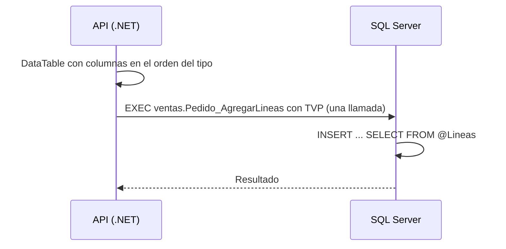

# Table-valued parameters

Parte de: [[06-SQL-Server/02 Intermedio/_Índice Intermedio|Intermedio]]

> [!info] Cómo avanzar
> `progreso`: **pendiente** → **viendo** (estudiando) → **visto** (contestaste la autoevaluación sin abrir las respuestas) → **dominado** (hiciste el laboratorio o lo aplicaste de verdad).

## Contenido

### Qué es
Un **parámetro con valor de tabla** (*table-valued parameter*, TVP) permite enviar **muchas filas en un solo parámetro** a un procedimiento o consulta: las líneas de un pedido, una lista de ids, un lote de precios. En lugar de llamar 50 veces a un procedimiento (50 viajes de red, 50 transacciones), la API manda una sola llamada con una tabla de 50 filas y el procedimiento hace un `INSERT ... SELECT` de conjunto.

### Cómo funciona
1. Primero se crea un **tipo de tabla definido por el usuario** con `CREATE TYPE ... AS TABLE`, con sus columnas, tipos y, opcionalmente, clave primaria o restricciones.
2. El procedimiento declara un parámetro de ese tipo, **obligatoriamente `READONLY`**: dentro del procedimiento puedes leerlo como una tabla, pero no modificarlo.
3. La aplicación arma las filas (en .NET, un `DataTable`, un `IEnumerable<SqlDataRecord>` o un `DbDataReader`) y las envía como parámetro de tipo `Structured`.
4. El usuario de la aplicación necesita permiso `EXECUTE` sobre el **tipo** además de sobre el procedimiento (`GRANT EXECUTE ON TYPE::ventas.LineaPedido TO app_api`).



**No hay `ALTER TYPE`** para tipos tabla: no puedes agregar ni cambiar columnas. Para modificar el tipo tienes que **borrarlo y volver a crearlo**, y SQL Server no te deja borrarlo mientras haya procedimientos o funciones que lo usen. El proceso de despliegue es: crear un tipo nuevo con otro nombre (`LineaPedido_v2`), cambiar los procedimientos para usarlo y, cuando nadie use el viejo, eliminarlo. Tenlo presente al diseñar: versionar el nombre del tipo desde el inicio facilita la evolución.

### Ejemplo
```sql
CREATE TYPE ventas.LineaPedido AS TABLE (
    ProductoId int NOT NULL PRIMARY KEY,
    Cantidad   int NOT NULL CHECK (Cantidad BETWEEN 1 AND 100)
);
GO
CREATE OR ALTER PROCEDURE ventas.Pedido_AgregarLineas
    @PedidoId int,
    @Lineas   ventas.LineaPedido READONLY
AS
BEGIN
    SET NOCOUNT ON; SET XACT_ABORT ON;
    INSERT INTO ventas.PedidoDetalle (PedidoId, ProductoId, Cantidad, PrecioUnitario)
    SELECT @PedidoId, l.ProductoId, l.Cantidad, p.Precio     -- precio vigente
    FROM   @Lineas l
    JOIN   ventas.Productos p ON p.ProductoId = l.ProductoId;
END;
```

Desde Dapper se usa la extensión `AsTableValuedParameter`, indicando el nombre del tipo:

```csharp
var tabla = new DataTable();
tabla.Columns.Add("ProductoId", typeof(int));   // mismo orden que el tipo
tabla.Columns.Add("Cantidad", typeof(int));
foreach (var l in comando.Lineas)
    tabla.Rows.Add(l.ProductoId, l.Cantidad);

await conn.ExecuteAsync("ventas.Pedido_AgregarLineas",
    new { PedidoId = pedidoId, Lineas = tabla.AsTableValuedParameter("ventas.LineaPedido") },
    commandType: CommandType.StoredProcedure);
```

Las columnas se asocian **por posición**, no por nombre: el orden del `DataTable` debe coincidir con el del tipo.

### Cuándo usarlo y cuándo no
**TVP**:
- Tipado fuerte y validado por el motor (tipos, `NOT NULL`, `CHECK`, PK que evita duplicados).
- Muy eficiente para cientos o miles de filas; el tipo puede tener índices.
- Requiere crear y versionar el tipo, permisos sobre él y código de armado en C#.

**`OPENJSON`** (ver [[JSON en SQL Server (OPENJSON y FOR JSON)]]) es preferible cuando:
- La forma de los datos cambia seguido y no quieres lidiar con el "no hay `ALTER TYPE`".
- Los datos ya llegan como JSON del front (React) y solo los reenvías.
- Los datos tienen anidamiento (un pedido con líneas y cada línea con opciones).
- Quieres evitar dependencias de tipos en el esquema o el cliente no soporta TVP fácilmente.

A cambio, con JSON la validación de tipos es tuya y el texto ocupa más. Para cargas masivas de decenas de miles de filas o más, `SqlBulkCopy` hacia una tabla de staging es aún más rápido que ambos.

### Errores comunes
- **Olvidar `READONLY`**: el procedimiento no compila.
- **Columnas del `DataTable` en otro orden**: los datos se cruzan o falla la conversión.
- **Sin permiso `EXECUTE` sobre el tipo**: error de permisos aunque el procedimiento tenga `EXECUTE`.
- **Intentar `ALTER TYPE`**: no existe; planea la versión nueva del tipo.
- **Usar TVP para 1 o 2 filas**: añade complejidad sin beneficio; parámetros normales bastan.

### Para profundizar
- [Use table-valued parameters (Database Engine)](https://learn.microsoft.com/en-us/sql/relational-databases/tables/use-table-valued-parameters-database-engine)
- [Table-valued parameters en ADO.NET](https://learn.microsoft.com/en-us/dotnet/framework/data/adonet/sql/table-valued-parameters)
- [CREATE TYPE (Transact-SQL)](https://learn.microsoft.com/en-us/sql/t-sql/statements/create-type-transact-sql)

## Autoevaluación

Contesta primero en voz alta o en papel; luego despliega la respuesta.

> [!question]- ¿Qué es un TVP y cómo se declara?
> Un parámetro de tipo tabla para enviar muchas filas a un procedimiento en una llamada:
> ```sql
> CREATE TYPE ventas.PedidoItem AS TABLE (
>     ProductoId int NOT NULL PRIMARY KEY,
>     Cantidad   int NOT NULL CHECK (Cantidad > 0)
> );
> -- en el procedimiento:
> @Items ventas.PedidoItem READONLY
> ```

> [!question]- ¿Cómo envías un TVP desde Dapper?
> Con un `DataTable` (columnas en el mismo orden que el tipo) y `.AsTableValuedParameter("ventas.PedidoItem")`:
> ```csharp
> var dt = new DataTable();
> dt.Columns.Add("ProductoId", typeof(int));
> dt.Columns.Add("Cantidad", typeof(int));
> dt.Rows.Add(1, 2);
> await cn.ExecuteAsync("ventas.Pedido_Crear",
>     new { ClienteId = 6, Items = dt.AsTableValuedParameter("ventas.PedidoItem") },
>     commandType: CommandType.StoredProcedure);
> ```

> [!question]- ¿Por qué no puedes hacer `ALTER TYPE` para agregar una columna a un tipo tabla?
> Los tipos de tabla no se pueden alterar: hay que borrarlo y recrearlo, y antes quitar (o modificar) los procedimientos que lo usan. En scripts versionados se suele crear un tipo nuevo (`PedidoItemV2`) y migrar los procedimientos.

> [!question]- ¿Cuándo preferirías `OPENJSON` a un TVP?
> Cuando el cliente ya tiene JSON, quieres evitar mantener tipos en la base o el cliente no soporta TVP (p. ej. otras plataformas). El TVP da tipado fuerte y suele ser más eficiente para muchas filas.

## Práctica

- [[Lab 4 - Stored procedure transaccional con TRY CATCH y XACT_ABORT]]

