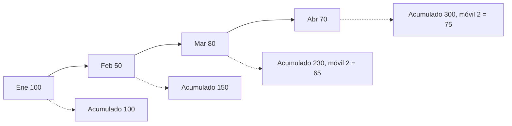

# Totales acumulados con OVER

Parte de: [[06-SQL-Server/02 Intermedio/_Índice Intermedio|Intermedio]]

> [!info] Cómo avanzar
> `progreso`: **pendiente** → **viendo** (estudiando) → **visto** (contestaste la autoevaluación sin abrir las respuestas) → **dominado** (hiciste el laboratorio o lo aplicaste de verdad).

## Contenido

### Qué es
Un **total acumulado** (*running total*) suma, para cada fila, su valor más todos los anteriores según un orden: ventas acumuladas del año mes a mes, saldo de un cliente pedido a pedido. Un **promedio móvil** promedia la fila actual con las N anteriores, para suavizar una serie. Ambos se calculan con funciones agregadas de ventana (`SUM`, `AVG`) más `ORDER BY` y un **marco** dentro de `OVER`. Es una aplicación directa de las [[Funciones de ventana]].

### Cómo funciona
`SUM(x) OVER (PARTITION BY grupo ORDER BY orden ROWS BETWEEN inicio AND fin)`:

- `PARTITION BY` reinicia el acumulado en cada grupo (por cliente, por año).
- `ORDER BY` define qué es "anterior".
- El **marco** define qué filas entran en la suma de la fila actual:
  - `ROWS BETWEEN UNBOUNDED PRECEDING AND CURRENT ROW`: desde la primera fila de la partición hasta la actual. Es el acumulado clásico.
  - `ROWS BETWEEN 2 PRECEDING AND CURRENT ROW`: la actual y las 2 anteriores: un promedio móvil de **3** periodos.
  - `ROWS BETWEEN 1 PRECEDING AND 1 FOLLOWING`: ventana centrada.

**El marco por defecto**: si escribes `SUM(x) OVER (ORDER BY Fecha)` **sin** especificar marco, SQL Server usa `RANGE BETWEEN UNBOUNDED PRECEDING AND CURRENT ROW`. La diferencia con `ROWS` aparece con **empates**: `RANGE` trata todas las filas con el mismo valor de `ORDER BY` como un bloque, así que dos pedidos del mismo día reciben **el mismo acumulado** (la suma incluyendo a ambos), en lugar de ir sumando uno por uno. Además, `RANGE` se implementa con una tabla de trabajo en disco (*worktable* en `tempdb`) y es notablemente más lento que `ROWS`, que puede calcularse en memoria. Por eso la recomendación es **escribir siempre `ROWS` explícito**.



### Ejemplo
Con la base de [[Lab 1 - Base de práctica Tienda en SQL Server]]:

```sql
-- Ventas por mes (sin cancelados) con acumulado del año y promedio móvil de 2 meses
WITH Mensual AS (
    SELECT DATEFROMPARTS(YEAR(p.Fecha), MONTH(p.Fecha), 1) AS Mes,
           SUM(d.Cantidad * d.PrecioUnitario) AS Ventas
    FROM   ventas.Pedidos p
    JOIN   ventas.PedidoDetalle d ON d.PedidoId = p.PedidoId
    WHERE  p.Estado <> 'Cancelado'
    GROUP  BY DATEFROMPARTS(YEAR(p.Fecha), MONTH(p.Fecha), 1)
)
SELECT Mes, Ventas,
       SUM(Ventas) OVER (PARTITION BY YEAR(Mes) ORDER BY Mes
                         ROWS BETWEEN UNBOUNDED PRECEDING AND CURRENT ROW) AS AcumuladoAnio,
       AVG(Ventas) OVER (ORDER BY Mes
                         ROWS BETWEEN 1 PRECEDING AND CURRENT ROW)         AS Movil2
FROM   Mensual
ORDER  BY Mes;

-- Saldo acumulado de compras por cliente, pedido a pedido
WITH TotPedido AS (
    SELECT p.ClienteId, p.PedidoId, p.Fecha, SUM(d.Cantidad * d.PrecioUnitario) AS Total
    FROM   ventas.Pedidos p
    JOIN   ventas.PedidoDetalle d ON d.PedidoId = p.PedidoId
    GROUP  BY p.ClienteId, p.PedidoId, p.Fecha
)
SELECT ClienteId, PedidoId, Fecha, Total,
       SUM(Total) OVER (PARTITION BY ClienteId ORDER BY Fecha, PedidoId
                        ROWS BETWEEN UNBOUNDED PRECEDING AND CURRENT ROW) AS Saldo
FROM   TotPedido
ORDER  BY ClienteId, Fecha, PedidoId;
```

Con los valores del diagrama (100, 50, 80, 70), el acumulado es 100, 150, 230, 300, y el promedio móvil de 2 meses es 100, 75, 65, 75: el primer mes solo tiene una fila en su ventana, así que su "promedio" es él mismo. Si para el reporte un promedio con menos periodos de los pedidos no tiene sentido, ponlo en `NULL` con un `CASE` sobre `COUNT(*) OVER (mismo marco)`.

Un caso real es un reporte de Wee.Reporteria con columnas "venta del mes" y "acumulado anual": la consulta devuelve ambas ya calculadas, y el código C# solo vuelca filas a Excel, sin lógica de acumulación.

### Cuándo usarlo y cuándo no
- **Úsalo** para acumulados, saldos, promedios y sumas móviles, porcentajes acumulados (análisis de Pareto) y conteos acumulados.
- Antes de las funciones de ventana (SQL Server 2012), esto se hacía con self-joins triangulares o cursores, ambos con costo que crece con el cuadrado de las filas. Si ves ese código viejo, reescríbelo.
- Un índice que coincida con `PARTITION BY` + `ORDER BY` evita el *Sort*.
- Si la serie tiene huecos (meses sin ventas), el "promedio de 3 periodos" con `ROWS` toma 3 **filas**, no 3 meses de calendario; rellena el calendario primero.

### Errores comunes
- **Omitir el marco**: usa `RANGE` por defecto, con valores repetidos en empates y peor rendimiento.
- **`ORDER BY` no único**: con empates, el acumulado entre filas empatadas depende del plan; agrega un desempate.
- **Olvidar `PARTITION BY`**: el saldo de un cliente arrastra el de los anteriores.
- **Promedio móvil de 3 escrito como `3 PRECEDING`**: eso son 4 filas (3 anteriores más la actual).
- **Promedios con enteros**: `AVG` de una columna `int` devuelve `int`; convierte a decimal.

### Para profundizar
- [SELECT - OVER clause: ROWS y RANGE](https://learn.microsoft.com/en-us/sql/t-sql/queries/select-over-clause-transact-sql)
- [SUM (Transact-SQL)](https://learn.microsoft.com/en-us/sql/t-sql/functions/sum-transact-sql)

## Ejercicios

Resuélvelos en papel o en la herramienta; la solución está plegada.

> [!question]- Con la base Tienda ([[Lab 1 - Base de práctica Tienda en SQL Server]]): ventas por mes (sin cancelados) con el acumulado del año.
> ```sql
> WITH m AS (
>     SELECT MONTH(p.Fecha) AS Mes, SUM(d.Cantidad * d.PrecioUnitario) AS Importe
>     FROM   ventas.Pedidos p JOIN ventas.PedidoDetalle d ON d.PedidoId = p.PedidoId
>     WHERE  p.Estado <> 'Cancelado'
>     GROUP  BY MONTH(p.Fecha)
> )
> SELECT Mes, Importe,
>        SUM(Importe) OVER (ORDER BY Mes ROWS BETWEEN UNBOUNDED PRECEDING AND CURRENT ROW) AS Acumulado
> FROM   m;
> ```
> 20600, 26250, 47750, 57750.

> [!question]- Saldo acumulado de compras por cliente, pedido a pedido (todos los estados).
> ```sql
> WITH t AS (
>     SELECT p.ClienteId, p.PedidoId, p.Fecha, SUM(d.Cantidad * d.PrecioUnitario) AS Total
>     FROM   ventas.Pedidos p JOIN ventas.PedidoDetalle d ON d.PedidoId = p.PedidoId
>     GROUP  BY p.ClienteId, p.PedidoId, p.Fecha
> )
> SELECT ClienteId, PedidoId, Total,
>        SUM(Total) OVER (PARTITION BY ClienteId ORDER BY Fecha, PedidoId
>                         ROWS UNBOUNDED PRECEDING) AS Acumulado
> FROM   t;
> ```
> Ana: 2100, 7750, 8200. Bruno: 18500, 21100.

> [!question]- Promedio móvil de 2 meses de las ventas mensuales.
> ```sql
> -- con la CTE m del ejercicio 1
> SELECT Mes, Importe,
>        AVG(Importe) OVER (ORDER BY Mes ROWS BETWEEN 1 PRECEDING AND CURRENT ROW) AS Movil2
> FROM   m;
> ```
> Ene 20600, Feb 13125, Mar 13575, Abr 15750.

## Autoevaluación

Contesta primero en voz alta o en papel; luego despliega la respuesta.

> [!question]- ¿Cómo calculas un total acumulado?
> `SUM(x) OVER (ORDER BY Fecha ROWS BETWEEN UNBOUNDED PRECEDING AND CURRENT ROW)` (o con `PARTITION BY` para acumular por grupo).

> [!question]- ¿Qué marco usa SQL Server si escribes `SUM(x) OVER (ORDER BY Fecha)` sin `ROWS`?
> `RANGE BETWEEN UNBOUNDED PRECEDING AND CURRENT ROW`: las filas empatadas en `Fecha` se suman juntas (el acumulado «salta») y además suele ser más lento (usa una *spool* en disco). Escribe `ROWS` explícitamente.

> [!question]- ¿Cómo calculas un promedio móvil de 3 periodos?
> `AVG(x) OVER (ORDER BY Mes ROWS BETWEEN 2 PRECEDING AND CURRENT ROW)`. En las primeras filas promedia las que haya (1 o 2).

## Práctica

- [[Lab 3 - CTE y funciones de ventana en Tienda]]

