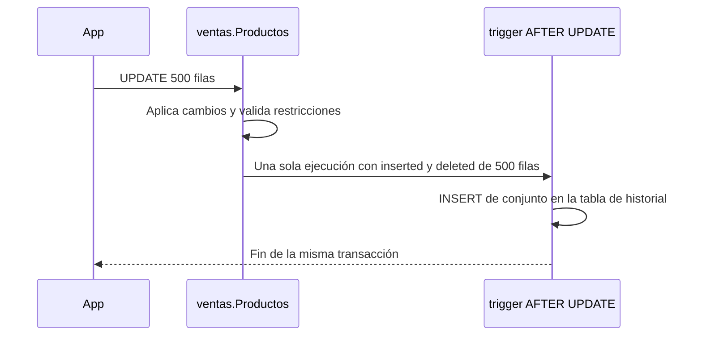

# Triggers

Parte de: [[06-SQL-Server/02 Intermedio/_Índice Intermedio|Intermedio]]

> [!info] Cómo avanzar
> `progreso`: **pendiente** → **viendo** (estudiando) → **visto** (contestaste la autoevaluación sin abrir las respuestas) → **dominado** (hiciste el laboratorio o lo aplicaste de verdad).

## Contenido

### Qué es
Un **trigger** (desencadenador) es código T-SQL que SQL Server ejecuta **automáticamente** cuando ocurre un evento sobre una tabla o vista. Los más comunes son los **triggers DML**, que reaccionan a `INSERT`, `UPDATE` o `DELETE`. También existen triggers **DDL** (reaccionan a `CREATE`, `ALTER`, `DROP` en la base o el servidor, útiles para auditar cambios de esquema) y triggers de **inicio de sesión** (`LOGON`).

### Cómo funciona
**Frecuencia**: un trigger DML se ejecuta **una vez por instrucción**, no una vez por fila. Si un `UPDATE` modifica 500 filas, el trigger `AFTER UPDATE` corre una sola vez y ve las 500. Si la instrucción no afecta ninguna fila, el trigger **igual se ejecuta**, con cero filas. Esto es lo más importante de entender, porque el error clásico es escribir el trigger como si hubiera una sola fila.

Dentro del trigger tienes dos pseudo-tablas:
- `inserted`: las filas nuevas (en `INSERT`) o los valores después del cambio (en `UPDATE`).
- `deleted`: las filas borradas (en `DELETE`) o los valores antes del cambio (en `UPDATE`).

Tipos según el momento:
- **`AFTER`** (o `FOR`): se ejecuta **después** de que la instrucción hizo su trabajo y pasaron las restricciones (FK, `CHECK`). Si el trigger hace `ROLLBACK` o lanza un error, se revierte todo, incluida la instrucción original. Solo en tablas.
- **`INSTEAD OF`**: se ejecuta **en lugar de** la instrucción; la modificación original no ocurre a menos que el trigger la haga. Se usa sobre todo en **vistas** para hacer actualizables vistas que unen varias tablas, o para implementar un borrado lógico ("en vez de borrar, marca `IsDeleted = 1`").

El trigger corre **dentro de la misma transacción** que la instrucción que lo disparó: su tiempo se suma al de esa instrucción y sus bloqueos también.



### Ejemplo
Historial de cambios de precio, escrito para **varias filas**:

```sql
CREATE TABLE ventas.HistorialPrecios (
    Id          int IDENTITY PRIMARY KEY,
    ProductoId  int NOT NULL,
    PrecioAntes decimal(10,2) NOT NULL,
    PrecioNuevo decimal(10,2) NOT NULL,
    Fecha       datetime2(0) NOT NULL DEFAULT SYSUTCDATETIME()
);
GO
CREATE OR ALTER TRIGGER ventas.trg_Productos_HistorialPrecio
ON ventas.Productos
AFTER UPDATE
AS
BEGIN
    SET NOCOUNT ON;
    IF NOT UPDATE(Precio) RETURN;          -- la columna no estaba en el SET

    INSERT INTO ventas.HistorialPrecios (ProductoId, PrecioAntes, PrecioNuevo)
    SELECT d.ProductoId, d.Precio, i.Precio
    FROM   deleted d
    JOIN   inserted i ON i.ProductoId = d.ProductoId
    WHERE  d.Precio <> i.Precio;           -- solo cambios reales
END;
```

`UPDATE(Precio)` indica si la columna aparecía en el `SET`, no si su valor cambió; por eso el `WHERE d.Precio <> i.Precio`.

**Efecto en la aplicación**: una tabla con triggers no admite `UPDATE ... OUTPUT` sin `INTO` (error 334, ver [[OUTPUT]]), y los conteos de filas que recibe la app pueden incluir los del trigger si este no pone `SET NOCOUNT ON`.

### Cuándo usarlo y cuándo no
**Por qué muchos equipos los evitan**:
- **Lógica oculta**: quien lee el procedimiento o el handler de C# no ve que un `UPDATE` también inserta en otra tabla, envía algo o modifica otra fila. Depurar es difícil.
- **Rendimiento y bloqueos**: alargan cada transacción y pueden encadenarse (triggers que disparan otros triggers, recursión).
- **Errores sutiles** por suponer una fila, y efectos con `MERGE`, cargas masivas (`BULK INSERT` no los dispara por defecto) y replicación.
- **Pruebas**: la lógica de negocio en triggers es difícil de probar de forma aislada.

**Cuándo sí tienen sentido**: auditoría que debe capturar **todo** cambio sin importar quién lo haga (incluso un DBA desde SSMS), mantener una restricción que no se puede expresar con `CHECK` ni FK, o `INSTEAD OF` en vistas de compatibilidad durante una migración.

**Alternativas**: [[Tablas temporales del sistema (temporal tables)]] para historial completo sin código, [[Auditoría (CDC y Change Tracking)]] para capturar cambios, columnas de auditoría llenadas por la aplicación (como en [[Borrado lógico y auditoría]]), o la lógica explícita en el procedimiento almacenado.

### Errores comunes
- **Asumir una fila**: `DECLARE @Id int = (SELECT ProductoId FROM inserted)` falla con varias filas o toma una al azar.
- **Olvidar `SET NOCOUNT ON`**: los conteos del trigger confunden al cliente.
- **Lógica pesada o llamadas externas** dentro del trigger: alargan la transacción del usuario.
- **No considerar cero filas**: el trigger corre igual; escribe código de conjunto que funcione con 0.
- **Recursión inesperada**: un trigger que actualiza su propia tabla puede volver a dispararse si `RECURSIVE_TRIGGERS` está activo.

### Para profundizar
- [CREATE TRIGGER (Transact-SQL)](https://learn.microsoft.com/en-us/sql/t-sql/statements/create-trigger-transact-sql)
- [Use the inserted and deleted tables](https://learn.microsoft.com/en-us/sql/relational-databases/triggers/use-the-inserted-and-deleted-tables)
- [DML triggers](https://learn.microsoft.com/en-us/sql/relational-databases/triggers/dml-triggers)

## Autoevaluación

Contesta primero en voz alta o en papel; luego despliega la respuesta.

> [!question]- ¿Cada cuánto se ejecuta un trigger `AFTER UPDATE`?
> Una vez **por instrucción**, no por fila. Si el `UPDATE` cambia 500 filas, `inserted` y `deleted` tienen 500 filas; un trigger que asume una sola fila (`SELECT @Id = Id FROM inserted`) es un error clásico.

> [!question]- ¿Qué diferencia hay entre `AFTER` e `INSTEAD OF`?
> `AFTER` corre después de que la instrucción se aplicó (dentro de la misma transacción; puede hacer `ROLLBACK`). `INSTEAD OF` reemplaza la instrucción; se usa sobre todo en vistas para hacerlas actualizables.

> [!question]- ¿Por qué muchos equipos evitan triggers?
> Son lógica oculta: un `UPDATE` sencillo dispara trabajo que nadie ve en el código, alargan transacciones, complican depuración y restringen funciones como `OUTPUT` sin `INTO`. Para auditoría hoy hay alternativas: tablas temporales del sistema, CDC o la capa de aplicación.

