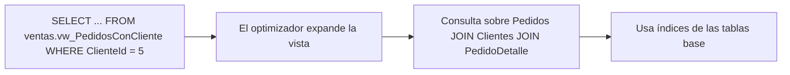

# Vistas

Parte de: [[06-SQL-Server/02 Intermedio/_Índice Intermedio|Intermedio]]

> [!info] Cómo avanzar
> `progreso`: **pendiente** → **viendo** (estudiando) → **visto** (contestaste la autoevaluación sin abrir las respuestas) → **dominado** (hiciste el laboratorio o lo aplicaste de verdad).

## Contenido

### Qué es
Una **vista** es un `SELECT` guardado con nombre que puedes consultar como si fuera una tabla. **No guarda datos**: cada vez que la consultas, SQL Server sustituye la vista por su definición y ejecuta la consulta sobre las tablas reales. Sirve para simplificar consultas repetidas (un `JOIN` de cuatro tablas que todos usan), para exponer solo ciertas columnas o filas por seguridad, y para mantener un contrato estable mientras las tablas de abajo cambian.

La excepción son las **vistas indizadas**: si creas un índice clustered único sobre una vista, SQL Server **sí materializa** su resultado y lo mantiene actualizado en cada cambio de las tablas base.

### Cómo funciona
1. `CREATE OR ALTER VIEW esquema.Nombre AS SELECT ...`.
2. Al consultarla, el optimizador **expande** la definición dentro de tu consulta y optimiza todo junto; por eso filtrar una vista (`WHERE ClienteId = 5`) aprovecha los índices de las tablas base.
3. Los metadatos de columnas se fijan **al crear la vista**.

**`WITH SCHEMABINDING`** amarra la vista al esquema de las tablas que usa: no puedes borrar ni modificar esas tablas o columnas de forma que afecte a la vista sin antes cambiar la vista. Exige nombres de dos partes (`ventas.Pedidos`) y prohíbe `SELECT *`. Sirve para **proteger** la vista de cambios accidentales y es **requisito para crear una vista indizada** (y también se usa en funciones para que el optimizador las trate como deterministas).

**El orden**: una vista representa un conjunto, y los conjuntos no tienen orden. SQL Server no permite `ORDER BY` en una vista salvo con `TOP`, `OFFSET` o `FOR XML`. El viejo truco `SELECT TOP 100 PERCENT ... ORDER BY` "funciona" para compilar, pero el optimizador **descarta** ese ordenamiento porque `TOP 100 PERCENT` no filtra nada, así que el resultado sale en el orden que salga. El `ORDER BY` debe ir en la consulta que usa la vista.

**`SELECT *` y columnas nuevas**: como los metadatos se fijan al crearla, si la vista es `SELECT * FROM ventas.Clientes` y luego agregas una columna a la tabla, la vista **no la muestra**. Peor: si borras o reordenas columnas, la vista puede devolver datos bajo el nombre de columna equivocado o fallar. Hay que ejecutar `sp_refreshview` (o volver a crearla), y lo mejor es no usar `SELECT *` en vistas.



### Ejemplo
```sql
CREATE OR ALTER VIEW ventas.vw_PedidosConCliente
WITH SCHEMABINDING
AS
SELECT p.PedidoId, p.Fecha, p.Estado,
       c.ClienteId, c.Nombre AS Cliente, c.Ciudad
FROM   ventas.Pedidos  AS p
JOIN   ventas.Clientes AS c ON c.ClienteId = p.ClienteId;
GO
-- El orden se pide al consultar, no en la vista
SELECT PedidoId, Fecha, Cliente
FROM   ventas.vw_PedidosConCliente
WHERE  Ciudad = N'Guadalajara'
ORDER  BY Fecha DESC;

-- Si una vista vieja usa SELECT *, refresca sus metadatos tras cambiar la tabla
EXEC sp_refreshview N'dbo.vw_ClientesTodo';
```

Desde Dapper una vista se consulta como una tabla: `QueryAsync<PedidoCliente>("SELECT ... FROM ventas.vw_PedidosConCliente WHERE ClienteId = @Id", new { Id })`. Para seguridad, puedes conceder `SELECT` sobre la vista y no sobre las tablas, aunque en una API con procedimientos lo habitual es conceder solo `EXECUTE`.

### Cuándo usarlo y cuándo no
- **Úsalas** para encapsular joins comunes, exponer datos a herramientas de reporte (Power BI, Excel) con nombres amigables, restringir columnas sensibles y dar compatibilidad durante migraciones (la vista conserva el nombre viejo mientras la tabla cambia, ver [[Migraciones sin caídas (expand y contract)]]).
- **Vistas indizadas** para agregaciones muy consultadas y poco actualizadas; cuestan en cada escritura y tienen muchos requisitos (`SCHEMABINDING`, `COUNT_BIG(*)` si hay `GROUP BY`, opciones `SET` específicas).
- **Evita vistas sobre vistas sobre vistas**: el optimizador acaba con consultas enormes, con joins innecesarios a tablas que no usas, y los planes se degradan.
- Si necesitas parámetros, una [[Funciones escalares y de tabla|función de tabla en línea]] es una "vista con parámetros".

### Errores comunes
- **`ORDER BY` con `TOP 100 PERCENT`** esperando orden: no se garantiza.
- **`SELECT *`** en la vista: columnas nuevas invisibles y riesgo de desfase tras cambios.
- **Pensar que la vista guarda datos** o que "es más rápida": es la misma consulta.
- **Anidar vistas** profundamente: planes complejos y difíciles de optimizar.
- **Modificar a través de una vista** que une varias tablas: solo puedes afectar una tabla base por instrucción.

### Para profundizar
- [CREATE VIEW (Transact-SQL)](https://learn.microsoft.com/en-us/sql/t-sql/statements/create-view-transact-sql)
- [Create indexed views](https://learn.microsoft.com/en-us/sql/relational-databases/views/create-indexed-views)
- [sp_refreshview (Transact-SQL)](https://learn.microsoft.com/en-us/sql/relational-databases/system-stored-procedures/sp-refreshview-transact-sql)

## Autoevaluación

Contesta primero en voz alta o en papel; luego despliega la respuesta.

> [!question]- ¿Qué es una vista y guarda datos?
> Una consulta con nombre que se usa como tabla. **No** guarda datos (salvo una vista indexada): cada vez se expande en la consulta que la usa.

> [!question]- ¿Para qué sirve `WITH SCHEMABINDING`?
> Impide cambiar o borrar las tablas/columnas de las que depende la vista; es obligatorio para vistas indexadas y para algunas optimizaciones en funciones.

> [!question]- ¿Por qué un `ORDER BY` dentro de una vista (con `TOP 100 PERCENT`) no garantiza el orden?
> El orden solo se garantiza en el `ORDER BY` de la consulta externa; el optimizador ignora el de la vista. Ordena al consultar.

> [!question]- Creaste una vista con `SELECT *` y luego agregaste columnas a la tabla. ¿Qué pasa?
> La vista conserva los metadatos viejos y no muestra las columnas nuevas (o las desplaza) hasta `EXEC sp_refreshview 'esquema.Vista'`. Lista siempre las columnas.

## Práctica

- [[Lab 3 - CTE y funciones de ventana en Tienda]]

