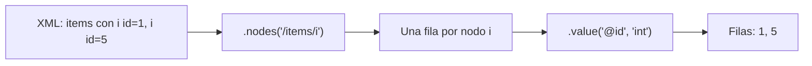

# XML en SQL Server

Parte de: [[06-SQL-Server/02 Intermedio/_Índice Intermedio|Intermedio]]

> [!info] Cómo avanzar
> `progreso`: **pendiente** → **viendo** (estudiando) → **visto** (contestaste la autoevaluación sin abrir las respuestas) → **dominado** (hiciste el laboratorio o lo aplicaste de verdad).

## Contenido

### Qué es
SQL Server tiene soporte nativo para XML desde hace muchas versiones: un **tipo de dato `xml`**, consultas con **XQuery** sobre ese tipo, la cláusula **`FOR XML`** para convertir resultados en XML e índices XML. Hoy, para intercambio de datos con aplicaciones, JSON es más común (ver [[JSON en SQL Server (OPENJSON y FOR JSON)]]), pero el XML sigue presente en integraciones con sistemas gubernamentales y bancarios (en México, por ejemplo, los CFDI son XML), en planes de ejecución, en eventos de [[Extended Events]] y en código T-SQL antiguo.

### Cómo funciona
Las herramientas principales son:

1. **Tipo `xml`**: guarda el documento en un formato interno ya analizado (no como texto), valida que esté bien formado y opcionalmente contra un esquema (`XML SCHEMA COLLECTION`).
2. **Métodos del tipo `xml`** (con XQuery/XPath):
   - `.value('ruta', 'tipo')`: extrae un valor escalar.
   - `.query('ruta')`: devuelve un fragmento XML.
   - `.exist('ruta')`: devuelve 1 si la ruta existe (útil en `WHERE`).
   - `.nodes('ruta')`: parte el documento en filas, una por cada nodo que coincide; se usa con `CROSS APPLY`.
   - `.modify('...')`: modifica el XML en sitio (XML DML).
3. **`FOR XML RAW | AUTO | PATH | EXPLICIT`**: convierte un `SELECT` en XML. `PATH` es el más flexible y el más usado.
4. **`OPENXML`** con `sp_xml_preparedocument`: la forma antigua de leer XML; consume memoria hasta que llamas `sp_xml_removedocument`. En código nuevo, usa `.nodes()`.
5. **Índices XML** (primario y secundarios) para consultas frecuentes sobre columnas `xml` grandes.

En las rutas, `@id` se refiere a un **atributo** y `text()` al texto de un elemento; `(ruta)[1]` es necesario en `.value()` porque debe garantizarse un solo valor.



**El truco de `FOR XML PATH('')`**: antes de que existiera `STRING_AGG` (SQL Server 2017), la forma de concatenar valores de varias filas era generar XML **sin elemento raíz ni nombres de fila** con `FOR XML PATH('')` y quitar el primer separador con `STUFF`. Al pedir `PATH('')` y una columna sin nombre, el "XML" resultante es simplemente el texto concatenado. Agregar `, TYPE).value('.', 'nvarchar(max)')` evita que caracteres como `&` o `<` salgan escapados como `&amp;` y `&lt;`.

### Ejemplo
```sql
-- Convertir atributos XML en filas
DECLARE @x xml = N'<items><i id="1"/><i id="5"/></items>';
SELECT n.value('@id', 'int') AS ProductoId
FROM   @x.nodes('/items/i') AS t(n);

-- Unir con productos de la base Tienda
SELECT p.ProductoId, p.Nombre
FROM   @x.nodes('/items/i') AS t(n)
JOIN   ventas.Productos p ON p.ProductoId = n.value('@id', 'int');

-- Concatenación al estilo antiguo (pre-2017) y su equivalente moderno
SELECT STUFF((SELECT N', ' + Nombre
              FROM   ventas.Productos
              ORDER  BY Nombre
              FOR XML PATH(''), TYPE).value('.', 'nvarchar(max)'), 1, 2, N'') AS Lista;

SELECT STRING_AGG(Nombre, N', ') WITHIN GROUP (ORDER BY Nombre) AS Lista
FROM   ventas.Productos;

-- Producir XML con FOR XML PATH
SELECT ProductoId AS '@id', Nombre AS 'nombre', Precio AS 'precio'
FROM   ventas.Productos
FOR XML PATH('producto'), ROOT('catalogo');
```

Desde Dapper, un parámetro XML se puede enviar como `string` (SQL Server lo convierte al tipo `xml` del parámetro del procedimiento), y una columna `xml` se lee como `string` o `XDocument` tras convertirla en C#.

### Cuándo usarlo y cuándo no
- **Úsalo** cuando el formato de intercambio es XML por obligación (facturación electrónica, servicios SOAP, archivos de configuración heredados) o cuando lees planes de ejecución y eventos XE con T-SQL.
- **Prefiere JSON** para APIs modernas y datos que vienen de un front React: es más ligero y más natural para .NET y JavaScript.
- **Prefiere `STRING_AGG`** para concatenar en SQL Server 2017 o posterior.
- Si consultas a diario un valor dentro del XML, extráelo a una columna relacional.

### Errores comunes
- **Olvidar `[1]`** en `.value()`: error "requires a singleton".
- **Caracteres escapados** en la concatenación con `FOR XML PATH('')`: agrega `, TYPE).value(...)`.
- **Rutas sensibles a mayúsculas**: XML distingue `Item` de `item`.
- **Espacios de nombres**: si el documento declara `xmlns`, necesitas `WITH XMLNAMESPACES` o la ruta no encuentra nada.
- **`OPENXML` sin `sp_xml_removedocument`**: fuga de memoria del servidor.

### Para profundizar
- [XML data (SQL Server)](https://learn.microsoft.com/en-us/sql/relational-databases/xml/xml-data-sql-server)
- [nodes() method (xml data type)](https://learn.microsoft.com/en-us/sql/t-sql/xml/nodes-method-xml-data-type)
- [FOR XML (SQL Server)](https://learn.microsoft.com/en-us/sql/relational-databases/xml/for-xml-sql-server)

## Autoevaluación

Contesta primero en voz alta o en papel; luego despliega la respuesta.

> [!question]- ¿Qué herramientas tiene SQL Server para XML?
> El tipo `xml` (opcionalmente validado con un *schema collection*), `FOR XML` para generarlo, los métodos `.value()`, `.query()`, `.exist()`, `.nodes()` y `.modify()` para leer o cambiar, e índices XML.

> [!question]- ¿Por qué ves `FOR XML PATH('')` en código viejo para concatenar textos?
> Era el truco para concatenar filas antes de `STRING_AGG` (2017): `STUFF((SELECT ',' + Nombre FROM ... FOR XML PATH('')), 1, 1, '')`. En versiones modernas usa `STRING_AGG`.

> [!question]- ¿Cómo conviertes `<items><i id="1"/><i id="5"/></items>` en filas?
> ```sql
> DECLARE @x xml = N'<items><i id="1"/><i id="5"/></items>';
> SELECT n.value('@id', 'int') AS ProductoId
> FROM   @x.nodes('/items/i') AS t(n);
> ```
> Devuelve 1 y 5. Hoy, para datos nuevos, JSON suele ser más cómodo.

