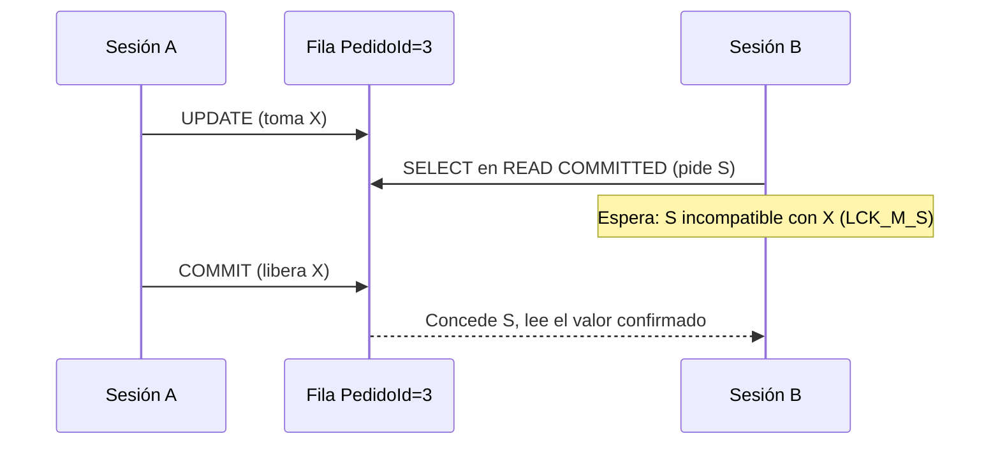

# Bloqueos (locks)

Parte de: [[06-SQL-Server/03 Transacciones y concurrencia/_Índice Transacciones y concurrencia|Transacciones y concurrencia]]

> [!info] Cómo avanzar
> `progreso`: **pendiente** → **viendo** (estudiando) → **visto** (contestaste la autoevaluación sin abrir las respuestas) → **dominado** (hiciste el laboratorio o lo aplicaste de verdad).

## Contenido

### Qué es
Un **bloqueo** (*lock*) es la marca que SQL Server pone sobre un recurso (fila, página, tabla) para controlar cómo lo usan varias transacciones a la vez. Es el mecanismo principal del **aislamiento** en ACID: impide, por ejemplo, que dos sesiones modifiquen la misma fila al mismo tiempo o que alguien lea un dato a medio cambiar. El precio es la **espera**: cuando una sesión necesita un recurso que otra tiene bloqueado de forma incompatible, se queda esperando (*blocking*).

### Cómo funciona
**Modos más comunes**:

| Modo | Para qué | Compatible con |
|---|---|---|
| **S** (*Shared*) | Lectura | Otros S y U |
| **U** (*Update*) | "Voy a leer para luego modificar"; evita un tipo clásico de deadlock | S, pero no otro U ni X |
| **X** (*Exclusive*) | Modificación | Nada |
| **IS / IX / SIX** (*Intent*) | En niveles superiores (página, tabla) avisan que hay S o X más abajo | Permiten detectar conflictos sin revisar cada fila |
| **Sch-S / Sch-M** (*Schema*) | Compilar/usar un objeto / cambiar su estructura (DDL) | Sch-M es incompatible con todo |
| **Key-range** | Rangos de índice en SERIALIZABLE | Ver [[SERIALIZABLE y bloqueos de rango]] |

**Granularidad**: el motor bloquea en el nivel más fino razonable (fila o clave de índice, *RID/KEY*), y pone bloqueos de intención en la página y la tabla.

**Duración**: los **X** se mantienen **hasta el final de la transacción**. Los **S**, en READ COMMITTED con bloqueos, se liberan en cuanto se termina de leer la fila; en REPEATABLE READ y SERIALIZABLE duran hasta el final (ver [[Niveles de aislamiento]]).

**Escalamiento de bloqueos** (*lock escalation*): mantener millones de bloqueos de fila consume memoria. Cuando una instrucción acumula aproximadamente **5,000 bloqueos sobre un mismo objeto**, o hay presión de memoria, SQL Server intenta reemplazarlos por **un solo bloqueo de tabla** (o de partición, si la tabla tiene `LOCK_ESCALATION = AUTO`). Ahorra memoria, pero ese bloqueo de tabla puede detener a todos los demás usuarios. Por eso los `UPDATE`/`DELETE` masivos se hacen en lotes menores a ese umbral.

**Bloqueo vs deadlock**:

- **Blocking**: A tiene un recurso y B espera. Es normal y se resuelve solo cuando A termina. Es un problema si A tarda mucho.
- **Deadlock**: A espera algo que tiene B **y** B espera algo que tiene A. Nadie puede avanzar; SQL Server lo detecta y mata a una de las dos. Ver [[Deadlocks]].

**Optimized locking**: en Azure SQL Database (siempre activo) y en SQL Server 2025 (se activa por base, requiere ADR), el motor bloquea el **id de la transacción** en lugar de mantener muchos bloqueos de fila hasta el final, y con RCSI evalúa los filtros sin bloquear (*lock after qualification*). Reduce mucho el bloqueo y el escalamiento.



### Ejemplo
**¿Quién bloquea a quién?**

```sql
-- Sesiones esperando y quién las bloquea
SELECT r.session_id, r.blocking_session_id, r.wait_type, r.wait_time AS espera_ms,
       DB_NAME(r.database_id) AS base, t.text AS sql_actual
FROM   sys.dm_exec_requests AS r
CROSS  APPLY sys.dm_exec_sql_text(r.sql_handle) AS t
WHERE  r.blocking_session_id <> 0;

-- Qué bloqueos tiene o espera cada sesión
SELECT request_session_id, resource_type, resource_description,
       request_mode, request_status          -- GRANT o WAIT
FROM   sys.dm_tran_locks
WHERE  resource_database_id = DB_ID();

-- La cabeza de la cadena puede estar "dormida" con una transacción abierta
SELECT s.session_id, s.status, s.open_transaction_count, s.host_name, s.program_name
FROM   sys.dm_exec_sessions s
WHERE  s.open_transaction_count > 0;
```

La herramienta comunitaria `sp_WhoIsActive` resume todo esto en una sola llamada. Para límites de espera desde el código: `SET LOCK_TIMEOUT 5000;` hace que una espera de más de 5 s falle con el error 1222 en lugar de esperar para siempre. En la API, el `CommandTimeout` de Dapper (30 s por defecto en SqlClient) cancela el comando del lado del cliente.

Borrado por lotes para evitar el escalamiento:

```sql
WHILE 1 = 1
BEGIN
    DELETE TOP (4000) FROM bitacora.Eventos WHERE FechaUtc < '2025-01-01';
    IF @@ROWCOUNT = 0 BREAK;
END;
```

El [[Lab 6 - Bloqueos, niveles de aislamiento y deadlock en dos sesiones]] lo practica con dos ventanas de SSMS.

### Cuándo usarlo y cuándo no
- No "usas" bloqueos directamente: el motor los toma solo. Lo que sí decides es **cuánto duran** (transacciones cortas), **cuántos** se toman (índices que permiten tocar pocas filas, lotes) y el **nivel de aislamiento**.
- **Pistas** como `UPDLOCK`, `HOLDLOCK`, `ROWLOCK` o `TABLOCK` se usan en casos concretos (upserts, cargas masivas), no como costumbre.
- Para reducir el bloqueo entre lectores y escritores, considera [[Snapshot y RCSI]] antes que `NOLOCK`.

### Errores comunes
1. **Transacciones largas o abiertas** (un `BEGIN TRAN` olvidado): cadenas de bloqueo.
2. **Actualizaciones sin índice** en el filtro: el motor revisa (y bloquea) muchas más filas de las que modifica.
3. **Operaciones masivas en un solo golpe**: escalamiento a bloqueo de tabla.
4. **"Arreglar" bloqueos con `NOLOCK`** en todas partes: lecturas incorrectas (ver [[READ UNCOMMITTED y NOLOCK]]).
5. **Confundir blocking con deadlock**: el primero se espera, el segundo se mata.

### Para profundizar
- [Guía de bloqueo y control de versiones de filas de transacciones](https://learn.microsoft.com/sql/relational-databases/sql-server-transaction-locking-and-row-versioning-guide)
- [sys.dm_tran_locks](https://learn.microsoft.com/sql/relational-databases/system-dynamic-management-views/sys-dm-tran-locks-transact-sql)
- [Optimized locking](https://learn.microsoft.com/sql/relational-databases/performance/optimized-locking)

## Autoevaluación

Contesta primero en voz alta o en papel; luego despliega la respuesta.

> [!question]- ¿Qué modos de bloqueo son los más comunes?
> **S** (compartido, lecturas), **X** (exclusivo, escrituras), **U** (actualización: «voy a modificar», evita deadlocks de conversión) y los de **intención** IS/IX/SIX en niveles superiores (página, tabla) para señalar que hay bloqueos más abajo.

> [!question]- ¿Qué es el escalamiento de bloqueos?
> Cuando una instrucción acumula muchos bloqueos (umbral aproximado de 5,000 en un mismo objeto), SQL Server los reemplaza por uno de tabla para ahorrar memoria. Por eso los `UPDATE` masivos pueden bloquear la tabla entera; procesa en lotes.

> [!question]- ¿Cómo encuentras quién bloquea a quién?
> ```sql
> SELECT r.session_id, r.blocking_session_id, r.wait_type, r.wait_time, t.text
> FROM   sys.dm_exec_requests r
> CROSS  APPLY sys.dm_exec_sql_text(r.sql_handle) t
> WHERE  r.blocking_session_id <> 0;
> ```
> Y `sys.dm_tran_locks` para ver los bloqueos concretos.

> [!question]- ¿Qué diferencia hay entre bloqueo (*blocking*) y deadlock?
> Un bloqueo es una espera normal que termina cuando el otro confirma. Un deadlock es una espera circular que nunca terminaría: SQL Server lo detecta y mata a una víctima. Ver [[Deadlocks]].

## Práctica

- [[Lab 6 - Bloqueos, niveles de aislamiento y deadlock en dos sesiones]]

