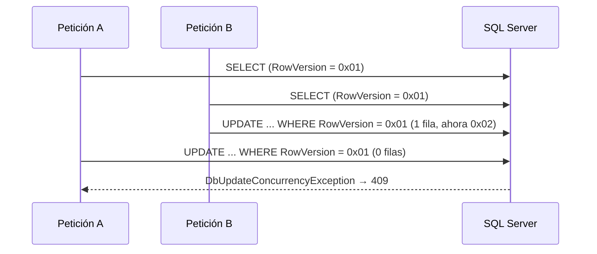

# Concurrencia optimista

> En lugar de bloquear un registro mientras se edita, se guarda con la condición "solo si nadie lo cambió desde que lo leí"; si alguien lo cambió, se rechaza. [[Itzamna.Dionisio]] tiene una columna `RowVersion` en todas las tablas y traduce el conflicto a un 409.

## Qué es y qué problema resuelve
El problema es la **actualización perdida**: A y B leen la misma fila, ambos editan y el último en guardar pisa al primero sin saberlo.
- **Pesimista**: bloquear la fila al leer (`SELECT ... WITH (UPDLOCK)`); seguro pero con esperas y bloqueos.
- **Optimista**: no bloquear; cada fila tiene un **token de versión** y el `UPDATE` incluye `WHERE Version = @leida`. Si afecta 0 filas, hubo conflicto.

## Cómo funciona por dentro
- SQL Server: columna `rowversion` (8 bytes) que el motor incrementa en cada `UPDATE`.
- EF Core: `IsRowVersion()` la marca como token de concurrencia y la agrega al `WHERE` de `UPDATE/DELETE`. Si las filas afectadas no coinciden → `DbUpdateConcurrencyException`.
- El valor "original" que EF compara es el que **cargó** en esa instancia del `DbContext`. Para cubrir una edición larga (formulario abierto minutos), el cliente debe devolver la versión que leyó y el servidor ponerla como `OriginalValue` (o usar `ETag` / `If-Match` en HTTP).



## Cuándo usarla y cuándo no
### Ventajas
- Sin bloqueos ni esperas; escala bien con pocas colisiones.
- Soporte nativo en SQL Server y EF Core.
### Desventajas
- El usuario que pierde debe recargar o fusionar.
- Para cubrir ediciones entre peticiones, el token tiene que viajar al cliente y volver.
- Con colisiones frecuentes, muchos reintentos.

## Alternativas
| Alternativa | En qué se diferencia |
|---|---|
| Bloqueo pesimista | Bloquea al leer; evita conflictos pero serializa. |
| "Gana el último" | Sin control; lo que pasa si no se envía token. |
| `ETag` + `If-Match` (HTTP) | El mismo concepto expresado en HTTP; responde 412. |
| Fusión por campo / CRDT | Combina cambios en vez de rechazarlos. |

## Cómo se usó en Itzamna

- Todas las entidades heredan `byte[] RowVersion` de `Entity` (`Core/Common/Entity.cs`) y `EntityDefaults.Base` lo configura con `IsRowVersion()` (`Infrastructure/Persistence/Configurations/EntityConfigurations.cs`); la migración crea columnas `rowversion`.
- `AppExceptionHandler` lo traduce (`Itzamna.Dionisio/src/Itzamna.Dionisio.API/Errors/AppExceptionHandler.cs`):
```csharp
DbUpdateConcurrencyException => new ProblemDetails
{
    Status = StatusCodes.Status409Conflict,
    Title = "Este contenido cambió en otra pestaña. Recarga para ver la versión más reciente."
},
```
- Los handlers siguen el patrón "cargar → modificar → `SaveChangesAsync`" en la misma petición ([[CQRS y mediador]]).

**Qué protege hoy, con honestidad**: los DTOs de Contracts y el Studio **no** envían ni reciben `RowVersion` (no aparece en `Itzamna.Dionisio.Contracts` ni en `clio/apps`). EF compara contra la versión que cargó *en esa misma petición*, así que el 409 solo salta si otra petición modifica la fila entre la lectura y el guardado (milisegundos). Dos pestañas que editan el mismo módulo con minutos de diferencia hacen "gana el último".

Funcionalidades donde importaría: [[Módulos del portfolio]] (dos pestañas del Studio), [[Publicación y versiones]] (`Portfolio.MarkPublished`).

> [!note] Pendiente de confirmar
> El mensaje "cambió en otra pestaña" sugiere protección entre pestañas, pero sin enviar `RowVersion` al cliente eso no ocurre. Falta decidir si se expone la versión (DTO o `ETag`) o si se acepta "gana el último".
> Dos publicaciones simultáneas calculan el mismo `Version`; las frena el índice único `(PortfolioId, Version)` de `PortfolioSnapshots` y/o el `RowVersion` del portfolio. Si gana el índice, la `DbUpdateException` no está mapeada en `AppExceptionHandler` y respondería 500. No está probado.


## Errores comunes y buenas prácticas
- Creer que tener `rowversion` basta: hay que enviar la versión leída al cliente y comparar contra ella.
- Responder 500 ante `DbUpdateConcurrencyException`: aquí se responde 409 con un mensaje útil.
- Reintentar automáticamente un conflicto sin volver a leer: pisa igual.
- Mezclar con auditoría: `UpdatedAt` no sirve como token (resolución de reloj, se puede escribir a mano).

## Qué estudiar después
- [[Entity Framework Core]], [[SQL Server]], [[ProblemDetails]]
- `ETag`/`If-Match` y 412 Precondition Failed; [[Idempotencia]].

## Documentación oficial
- https://learn.microsoft.com/ef/core/saving/concurrency
- https://learn.microsoft.com/sql/t-sql/data-types/rowversion-transact-sql
- https://www.rfc-editor.org/rfc/rfc9110#name-if-match

## Autoevaluación

Contesta primero en voz alta o en papel; luego despliega la respuesta.

> [!question]- ¿Cómo se implementa la concurrencia optimista en un procedimiento con `rowversion`?
> ```sql
> UPDATE ventas.Pedidos SET Estado = @Estado
> WHERE  PedidoId = @PedidoId AND RowVer = @RowVer;
> IF @@ROWCOUNT = 0
>     THROW 50409, N'El registro cambió desde que lo leíste. Recarga.', 1;
> ```
> El cliente envía el `RowVer` que leyó; si otro lo cambió, el `UPDATE` afecta 0 filas.

> [!question]- ¿Cómo distingues «no existe» de «conflicto» cuando `@@ROWCOUNT = 0`?
> Consulta si la fila existe: si existe, es conflicto (50409 → HTTP 409); si no, 50404 → 404.

> [!question]- ¿Qué tipo usas en C# y en el parámetro del procedimiento para `rowversion`?
> `byte[]` en C# y `binary(8)` (o `rowversion`) en el parámetro. Para enviarlo a un cliente web se suele convertir a Base64 (o usarlo como `ETag`).

> [!question]- ¿Por qué no usar `UpdatedAt` como token de concurrencia?
> La resolución del reloj puede repetir valores, se puede escribir a mano y dos servidores con relojes distintos lo hacen poco fiable. `rowversion` lo genera el motor y cambia en cada `UPDATE`.

## Práctica

- [[Lab 5 - Concurrencia optimista con rowversion en dos sesiones]]

