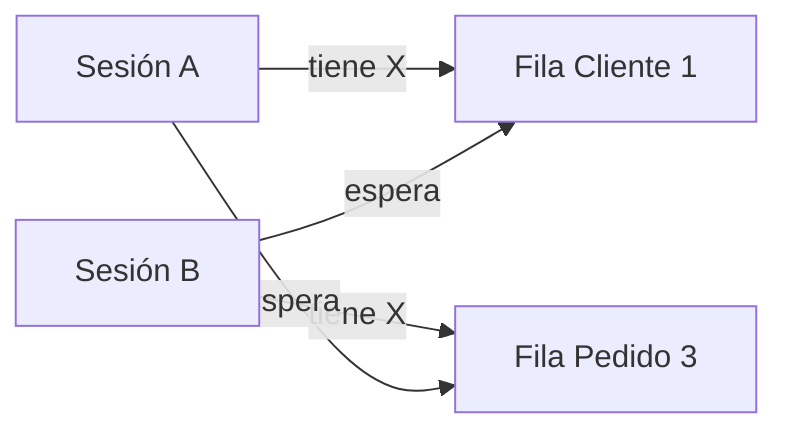

# Deadlocks

Parte de: [[06-SQL-Server/03 Transacciones y concurrencia/_Índice Transacciones y concurrencia|Transacciones y concurrencia]]

> [!info] Cómo avanzar
> `progreso`: **pendiente** → **viendo** (estudiando) → **visto** (contestaste la autoevaluación sin abrir las respuestas) → **dominado** (hiciste el laboratorio o lo aplicaste de verdad).

## Contenido

### Qué es
Un **deadlock** (interbloqueo) ocurre cuando dos o más sesiones se bloquean **mutuamente**: A tiene un recurso que B necesita y B tiene uno que A necesita. Ninguna puede avanzar y la espera sería eterna. SQL Server lo detecta automáticamente, elige una **víctima**, revierte su transacción y le devuelve el **error 1205**; la otra sesión continúa. A diferencia del bloqueo normal ([[Bloqueos (locks)]]), un deadlock no se resuelve esperando.

### Cómo funciona
**Detección**: un proceso del motor (*lock monitor*) revisa periódicamente las cadenas de espera buscando ciclos; por defecto cada **5 segundos**, y con más frecuencia si viene encontrando deadlocks. Al hallar un ciclo:

1. Elige la víctima: la de **menor `DEADLOCK_PRIORITY`**; con igual prioridad, la que sea **más barata de revertir** (menos log generado).
2. Revierte su transacción completa.
3. Envía el error **1205** ("Transaction (Process ID n) was deadlocked on lock resources with another process and has been chosen as the deadlock victim. Rerun the transaction.").

**Patrones típicos**:

- **Orden inverso**: A actualiza Clientes y luego Pedidos; B actualiza Pedidos y luego Clientes.
- **Conversión de bloqueo**: dos sesiones leen la misma fila con S (en REPEATABLE READ o SERIALIZABLE) y luego ambas quieren X para actualizarla. Cada una espera a que la otra suelte su S. Ver [[REPEATABLE READ]].
- **Índices**: un `UPDATE` bloquea la fila en el índice clustered y luego necesita una clave de un índice nonclustered, mientras un `SELECT` hizo el camino inverso (*key lookup*).
- **Rangos** en SERIALIZABLE con el patrón "si no existe, insértalo".



**Obtener el grafo de un deadlock que ya ocurrió**: la sesión de Extended Events **`system_health`**, que viene activa por defecto, registra el evento `xml_deadlock_report` con el grafo completo (procesos, instrucciones, recursos y quién fue la víctima). En SSMS: *Management → Extended Events → Sessions → system_health → package0.event_file*, filtrar por `xml_deadlock_report` y abrir la pestaña *Deadlock* para verlo gráfico. También puedes crear tu propia sesión de [[Extended Events]] para deadlocks. En **Azure SQL Database** no tienes la sesión `system_health` del servidor: creas una sesión de eventos a nivel base (`CREATE EVENT SESSION ... ON DATABASE`) con el evento `sqlserver.database_xml_deadlock_report` y destino `ring_buffer` o archivo en Azure Storage; el XML guardado como `.xdl` se abre gráfico en SSMS.

**Prevención** (no se pueden eliminar del todo, pero sí hacerlos raros):

1. **Mismo orden de acceso** a las tablas y filas en todos los procedimientos (por ejemplo, siempre padre antes que hijo, y por id ascendente).
2. **Transacciones cortas** y sin interacción externa.
3. **Índices adecuados** para que cada instrucción toque pocas filas (menos bloqueos, menos *lookups*).
4. **Pedir el bloqueo correcto desde el inicio**: en "leer y luego actualizar", lee con `UPDLOCK` para que la segunda sesión espere en la lectura en lugar de formar el ciclo; o haz la lectura y la escritura en una sola instrucción (`UPDATE ... WHERE Stock >= @n`).
5. **RCSI o SNAPSHOT** para que los lectores no tomen bloqueos S (ver [[Snapshot y RCSI]]).
6. Evitar niveles más estrictos de lo necesario.

### Ejemplo
Patrón con riesgo de deadlock por conversión y su corrección:

```sql
-- Riesgoso en REPEATABLE READ: dos sesiones leen con S y luego ambas piden X
SET TRANSACTION ISOLATION LEVEL REPEATABLE READ;
BEGIN TRAN;
    SELECT Piezas FROM inventario.Existencias WHERE ProductoId = 1 AND AlmacenId = 1;
    -- ... cálculo ...
    UPDATE inventario.Existencias SET Piezas = Piezas - 1 WHERE ProductoId = 1 AND AlmacenId = 1;
COMMIT;

-- Corregido: UPDLOCK en la lectura (solo uno puede tenerlo) o una sola instrucción
BEGIN TRAN;
    SELECT Piezas FROM inventario.Existencias WITH (UPDLOCK)
    WHERE  ProductoId = 1 AND AlmacenId = 1;
    UPDATE inventario.Existencias SET Piezas = Piezas - 1 WHERE ProductoId = 1 AND AlmacenId = 1;
COMMIT;
```

**Qué hace la aplicación ante el 1205**: la transacción de la víctima ya se revirtió por completo, así que lo correcto es **reintentar toda la transacción** desde el principio, pocas veces y con una espera aleatoria corta. Para que sea seguro, la operación debe ser idempotente o estar entera dentro de la transacción reintentada.

```csharp
// Reintento acotado ante deadlock (1205) desde la capa de datos
for (var intento = 1; ; intento++)
{
    try
    {
        await using var cn = new SqlConnection(cadena);
        await cn.ExecuteAsync("inventario.Transferir", parametros, commandType: CommandType.StoredProcedure);
        break;
    }
    catch (SqlException ex) when (ex.Number == 1205 && intento < 3)
    {
        await Task.Delay(Random.Shared.Next(50, 250) * intento, ct);
    }
}
```

Bibliotecas como Polly simplifican estas políticas. Si los deadlocks son frecuentes, el reintento es solo un paliativo: analiza el grafo y corrige el orden de acceso o los índices. Practícalo en [[Lab 6 - Bloqueos, niveles de aislamiento y deadlock en dos sesiones]].

### Cuándo usarlo y cuándo no
- **Asume que ocurrirán** en cualquier sistema concurrente y diseña el reintento desde el inicio.
- **`SET DEADLOCK_PRIORITY LOW`** en procesos batch que prefieres que pierdan frente a las transacciones de usuarios.
- **No silencies el 1205** ni lo conviertas en un 500 genérico sin reintentar.

### Errores comunes
1. **Acceder a las tablas en distinto orden** en distintos procedimientos.
2. **No capturar el 1205** y mostrar un error al usuario por algo que un reintento resolvía.
3. **Reintentar solo la instrucción** que falló en lugar de la transacción completa (ya se revirtió todo).
4. **Usar `NOLOCK` para "evitar deadlocks"**: cambia lecturas correctas por lecturas sucias y no evita deadlocks entre escritores.
5. **No revisar `system_health`**: el grafo ya estaba registrado.

### Para profundizar
- [Guía de interbloqueos](https://learn.microsoft.com/sql/relational-databases/sql-server-deadlocks-guide)
- [Usar la sesión system_health](https://learn.microsoft.com/sql/relational-databases/extended-events/use-the-system-health-session)
- [SET DEADLOCK_PRIORITY](https://learn.microsoft.com/sql/t-sql/statements/set-deadlock-priority-transact-sql)
- [Analizar y prevenir interbloqueos en Azure SQL Database](https://learn.microsoft.com/azure/azure-sql/database/analyze-prevent-deadlocks)

## Autoevaluación

Contesta primero en voz alta o en papel; luego despliega la respuesta.

> [!question]- ¿Qué hace SQL Server cuando detecta un deadlock?
> El monitor de deadlocks elige una víctima (la más barata de revertir, o según `SET DEADLOCK_PRIORITY`), revierte su transacción y le devuelve el error **1205**; la otra continúa.

> [!question]- ¿Cómo obtienes el grafo de un deadlock que ya ocurrió?
> La sesión `system_health` de Extended Events guarda `xml_deadlock_report`:
> ```sql
> SELECT CAST(event_data AS xml) AS Grafo
> FROM   sys.fn_xe_file_target_read_file('system_health*.xel', NULL, NULL, NULL)
> WHERE  object_name = 'xml_deadlock_report';
> ```
> En SSMS puedes abrir el XML como `.xdl` para verlo gráfico.

> [!question]- ¿Cómo se previenen los deadlocks?
> Acceder a las tablas siempre en el mismo orden, transacciones cortas, índices que eviten recorridos (menos filas bloqueadas), `UPDLOCK` al leer lo que vas a modificar y RCSI para que lectores y escritores no se bloqueen.

> [!question]- ¿Qué debe hacer la aplicación ante el error 1205?
> Reintentar la transacción completa (unas pocas veces, con espera breve), porque fue revertida. Con Dapper: atrapar `SqlException` con `Number == 1205` y repetir (p. ej. con Polly).

## Práctica

- [[Lab 6 - Bloqueos, niveles de aislamiento y deadlock en dos sesiones]]

