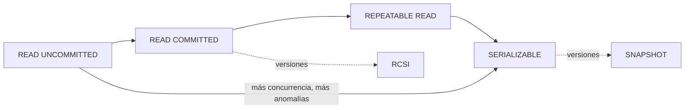

# Niveles de aislamiento

Parte de: [[06-SQL-Server/03 Transacciones y concurrencia/_Índice Transacciones y concurrencia|Transacciones y concurrencia]]

> [!info] Cómo avanzar
> `progreso`: **pendiente** → **viendo** (estudiando) → **visto** (contestaste la autoevaluación sin abrir las respuestas) → **dominado** (hiciste el laboratorio o lo aplicaste de verdad).

## Contenido

### Qué es
El **nivel de aislamiento** define qué tanto ve una transacción de los cambios que otras transacciones están haciendo al mismo tiempo. Es la "I" de [[Propiedades ACID]] hecha configurable: a más aislamiento, menos anomalías de concurrencia, pero más bloqueos, esperas o costo de versiones. Elegir bien el nivel es decidir qué fenómenos aceptas a cambio de concurrencia.

### Cómo funciona
**Los fenómenos (anomalías) que se quieren evitar**:

- **Lectura sucia** (*dirty read*): lees un cambio que otra transacción aún no confirma y que podría revertir.
- **Lectura no repetible** (*non-repeatable read*): lees una fila, otra transacción la modifica y confirma, y al volver a leerla en tu misma transacción obtienes otro valor.
- **Fantasma** (*phantom*): repites una consulta por rango y aparecen (o desaparecen) filas porque otra transacción insertó o borró en ese rango.
- **Actualización perdida** (*lost update*): dos transacciones leen el mismo valor, calculan y escriben; la segunda escritura pisa a la primera.

**Niveles de SQL Server y qué permiten**:

| Nivel | Lectura sucia | No repetible | Fantasma | Mecanismo |
|---|---|---|---|---|
| [[READ UNCOMMITTED y NOLOCK]] | Sí | Sí | Sí | Lee sin bloqueos S |
| [[READ COMMITTED (nivel por defecto)]] | No | Sí | Sí | Bloqueos S cortos, o versiones si RCSI |
| [[REPEATABLE READ]] | No | No | Sí | Bloqueos S hasta el final |
| [[SERIALIZABLE y bloqueos de rango]] | No | No | No | Bloqueos de rango hasta el final |
| SNAPSHOT | No | No | No | Versiones de fila; conflicto al escribir (error 3960) |

READ COMMITTED con la opción **RCSI** usa versiones por instrucción en lugar de bloqueos S. SNAPSHOT y RCSI se explican en [[Snapshot y RCSI]].

**Valores predeterminados**: SQL Server usa **READ COMMITTED con bloqueos** (RCSI apagado). **Azure SQL Database** usa READ COMMITTED **con RCSI activado** por defecto (y además optimized locking). Esto significa que el mismo código puede bloquear en tu servidor local y no bloquear en Azure; prueba con la misma configuración que producción.

**Cambiar el nivel**:

- Para la sesión: `SET TRANSACTION ISOLATION LEVEL SERIALIZABLE;` Vale hasta que lo cambies o se cierre la sesión. Dentro de un procedimiento, el nivel vuelve al anterior al salir.
- Para una tabla en una consulta: pistas como `WITH (HOLDLOCK)` (= SERIALIZABLE), `WITH (REPEATABLEREAD)`, `WITH (READCOMMITTEDLOCK)`, `WITH (NOLOCK)`.
- En .NET: `conexion.BeginTransaction(IsolationLevel.Serializable)`. Ojo con el *connection pooling*: en versiones antiguas del proveedor el nivel podía "heredarse" a la siguiente sesión que reutilizaba la conexión; restablécelo explícitamente si lo cambias.
- Consultar el nivel actual: `DBCC USEROPTIONS;` o `sys.dm_exec_sessions.transaction_isolation_level`.



### Ejemplo
**Caso 1: reporte de saldos que no cuadra.** Un reporte suma el saldo de todas las cuentas mientras se hacen transferencias. En READ COMMITTED con bloqueos, el `SUM` recorre la tabla: puede leer la cuenta A *antes* de que una transferencia le reste y la cuenta B *después* de que le sume, y el total aparece con dinero de más. Lo que necesitas es una **foto consistente** de toda la tabla en un instante: **SNAPSHOT** (o RCSI, que da consistencia por instrucción, suficiente si el reporte es un solo `SELECT`). SERIALIZABLE también lo resuelve, pero bloquea las transferencias mientras dura el reporte.

```sql
ALTER DATABASE Banco SET ALLOW_SNAPSHOT_ISOLATION ON;

SET TRANSACTION ISOLATION LEVEL SNAPSHOT;
BEGIN TRAN;
    SELECT SUM(Saldo) AS Total FROM finanzas.Cuentas;      -- foto al inicio de la transacción
    SELECT COUNT(*) FROM finanzas.Cuentas WHERE Saldo < 0; -- misma foto
COMMIT;
```

**Caso 2: correos duplicados.** Dos sesiones ejecutan "si no existe el correo, insértalo" al mismo tiempo; ambas ven que no existe e insertan. Ningún nivel por debajo de SERIALIZABLE lo impide, porque el problema es un **fantasma** (la fila que aún no existe). Soluciones, de mejor a peor:

1. Un **`UNIQUE`** sobre el correo: la base rechaza el segundo `INSERT` (error 2627) y la API responde 409. Es la defensa que siempre debe existir.
2. Bloquear el rango durante la verificación: `WITH (UPDLOCK, HOLDLOCK)` en la lectura (ver [[SERIALIZABLE y bloqueos de rango]]).

```sql
BEGIN TRAN;
IF NOT EXISTS (SELECT 1 FROM seguridad.Usuarios WITH (UPDLOCK, HOLDLOCK) WHERE Correo = @Correo)
    INSERT INTO seguridad.Usuarios (Correo, Nombre) VALUES (@Correo, @Nombre);
COMMIT;
```

En Xolotl.Hecate, el registro de usuarios combina ambas: el `UNIQUE` garantiza la regla y el patrón de bloqueo evita el error en el caso común.

### Cuándo usarlo y cuándo no
- **READ COMMITTED (idealmente con RCSI)** para la gran mayoría de operaciones OLTP.
- **SNAPSHOT** para reportes o lecturas largas que necesitan una foto consistente sin bloquear a los escritores.
- **SERIALIZABLE** (o sus pistas) solo en la sección concreta que lo necesita (upserts, reservar folios), con transacciones muy cortas.
- **REPEATABLE READ** rara vez es la mejor opción en SQL Server.
- **READ UNCOMMITTED** solo para consultas de diagnóstico aproximadas.
- Para evitar actualizaciones perdidas entre peticiones HTTP (el usuario edita durante minutos), ningún nivel sirve: usa [[Concurrencia optimista]] con `rowversion`.

### Errores comunes
1. **Subir el nivel "para estar seguros"**: más bloqueos y [[Deadlocks]].
2. **Bajar a `NOLOCK` para "ir más rápido"**: datos incorrectos.
3. **Olvidar que el nivel aplica a la sesión** y dejarlo cambiado para el resto del código.
4. **Probar en local con bloqueos y desplegar en Azure con RCSI** (o al revés) sin notar la diferencia.
5. **Usar niveles de aislamiento en lugar de restricciones** (`UNIQUE`) para reglas de unicidad.

### Para profundizar
- [SET TRANSACTION ISOLATION LEVEL](https://learn.microsoft.com/sql/t-sql/statements/set-transaction-isolation-level-transact-sql)
- [Guía de bloqueo y control de versiones de filas](https://learn.microsoft.com/sql/relational-databases/sql-server-transaction-locking-and-row-versioning-guide)

## Subtemas

- [[READ UNCOMMITTED y NOLOCK]]
- [[READ COMMITTED (nivel por defecto)]]
- [[REPEATABLE READ]]
- [[SERIALIZABLE y bloqueos de rango]]

## Ejercicios

Resuélvelos en papel o en la herramienta; la solución está plegada.

> [!question]- Completa la tabla: ¿qué fenómeno permite cada nivel? (lectura sucia / no repetible / fantasma)
> | Nivel | Sucia | No repetible | Fantasma |
> |---|---|---|---|
> | READ UNCOMMITTED | Sí | Sí | Sí |
> | READ COMMITTED | No | Sí | Sí |
> | REPEATABLE READ | No | No | Sí |
> | SERIALIZABLE | No | No | No |
> | SNAPSHOT | No | No | No (ve una foto; los conflictos de escritura fallan con 3960) |

> [!question]- Un reporte suma el saldo de todas las cuentas mientras se hacen transferencias; a veces el total no cuadra. ¿Qué nivel elegirías?
> `SNAPSHOT` (o RCSI si basta la coherencia por instrucción y es una sola consulta): lee una foto consistente sin bloquear a las transferencias. `SERIALIZABLE` también daría un total correcto, pero bloquearía las escrituras.

> [!question]- Dos sesiones ejecutan «si no existe el correo, insértalo». A veces se crean duplicados. ¿Qué haces?
> Primero, un índice `UNIQUE` (la defensa definitiva). Luego, en la verificación, `SERIALIZABLE` o `WITH (UPDLOCK, HOLDLOCK)` para bloquear el rango de la clave entre el `SELECT` y el `INSERT`.

## Autoevaluación

Contesta primero en voz alta o en papel; luego despliega la respuesta.

> [!question]- ¿Qué fenómenos de concurrencia evitan los niveles de aislamiento?
> **Lectura sucia** (leer datos no confirmados), **lectura no repetible** (leer dos veces la misma fila y obtener valores distintos) y **fantasmas** (repetir una consulta de rango y que aparezcan filas nuevas). Además, la actualización perdida.

> [!question]- ¿Qué nivel usa SQL Server por defecto y cuál Azure SQL Database?
> `READ COMMITTED` en ambos, pero Azure SQL Database lo implementa con versiones (RCSI activado por defecto) y SQL Server local con bloqueos (RCSI desactivado por defecto). Ver [[Snapshot y RCSI]].

> [!question]- ¿Cómo cambias el nivel para una sesión?
> `SET TRANSACTION ISOLATION LEVEL REPEATABLE READ;` (vale para la sesión hasta que lo cambies; dentro de un procedimiento se restaura al salir). Por tabla se usan *hints*: `WITH (UPDLOCK, HOLDLOCK)`.

## Práctica

- [[Lab 6 - Bloqueos, niveles de aislamiento y deadlock en dos sesiones]]

## Progreso de los subtemas

```base
filters:
  and:
    - file.inFolder("06-SQL-Server/03 Transacciones y concurrencia/Niveles de aislamiento")
    - file.name != "Niveles de aislamiento"
views:
  - type: table
    name: Progreso
    order:
      - file.name
      - progreso
      - nivel
```
