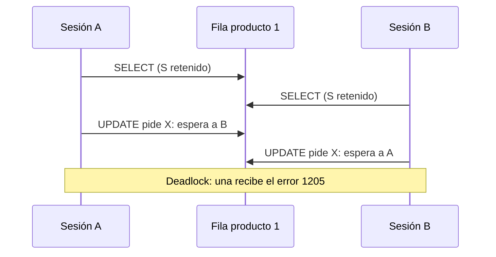

# REPEATABLE READ

Parte de: [[Niveles de aislamiento]]

> [!info] Cómo avanzar
> `progreso`: **pendiente** → **viendo** (estudiando) → **visto** (contestaste la autoevaluación sin abrir las respuestas) → **dominado** (hiciste el laboratorio o lo aplicaste de verdad).

## Contenido

### Qué es
`REPEATABLE READ` es el nivel de aislamiento que garantiza que, si lees una fila dentro de una transacción, **seguirá teniendo el mismo valor** si la vuelves a leer antes de terminar. Lo logra manteniendo los bloqueos compartidos (S) de todo lo leído **hasta el final de la transacción**. Agrega esa garantía sobre [[READ COMMITTED (nivel por defecto)]], pero todavía permite **fantasmas**.

### Cómo funciona
1. Al leer una fila, la transacción toma un bloqueo **S** (como en READ COMMITTED).
2. A diferencia de READ COMMITTED, **no lo suelta** al terminar de leer: lo mantiene hasta `COMMIT` o `ROLLBACK`.
3. Otra transacción que quiera **modificar** esa fila necesita un **X**, incompatible con el S, así que espera.
4. Resultado: las filas que leíste no cambian mientras dure tu transacción (no hay lecturas no repetibles), y tampoco hay lecturas sucias.

**Qué sigue permitiendo**: solo bloquea las filas **que existen y leíste**. Si otra transacción **inserta** una fila nueva que cumple tu filtro, nada la detiene; al repetir tu consulta por rango aparece una fila "fantasma". Por ejemplo, cuentas los pedidos de un cliente, otra sesión inserta uno nuevo y al contar de nuevo obtienes uno más. Para evitar fantasmas se necesita bloquear el **rango**, lo que hace [[SERIALIZABLE y bloqueos de rango]].

**Costo**: muchos bloqueos S mantenidos más tiempo significan más bloqueo para los escritores, más memoria y más probabilidad de escalamiento.

**Por qué provoca deadlocks en "leer y luego actualizar"**: es el clásico **deadlock por conversión**:

1. La sesión A lee la fila del producto 1 → S (se mantiene).
2. La sesión B lee la misma fila → otro S (compatible con el de A).
3. A quiere actualizarla → necesita X, pero B tiene S: **A espera a B**.
4. B quiere actualizarla → necesita X, pero A tiene S: **B espera a A**.
5. Ciclo: SQL Server mata a una con el error 1205 (ver [[Deadlocks]]).

En READ COMMITTED este patrón no forma deadlock (los S se sueltan enseguida), pero sí produce **actualizaciones perdidas**. En REPEATABLE READ ya no hay actualización perdida, pero a cambio hay deadlock. La solución en ambos casos es pedir desde la lectura un bloqueo **U** con `WITH (UPDLOCK)`: los U son incompatibles entre sí, así que B espera en la **lectura** y no se forma el ciclo.



### Ejemplo
```sql
-- Sesión A
SET TRANSACTION ISOLATION LEVEL REPEATABLE READ;
BEGIN TRAN;
    SELECT Precio FROM ventas.Productos WHERE ProductoId = 1;   -- 1200, S retenido
    -- (en otra ventana, la sesión B intenta: UPDATE ventas.Productos SET Precio = 1300 WHERE ProductoId = 1;
    --  y se queda esperando)
    SELECT Precio FROM ventas.Productos WHERE ProductoId = 1;   -- sigue en 1200: lectura repetible

    -- Pero los fantasmas sí aparecen:
    SELECT COUNT(*) FROM ventas.Productos WHERE Categoria = N'Periféricos';
    -- (sesión B: INSERT INTO ventas.Productos (Nombre, Categoria, Precio) VALUES (N'Pad', N'Periféricos', 200); no espera)
    SELECT COUNT(*) FROM ventas.Productos WHERE Categoria = N'Periféricos';  -- uno más
COMMIT;   -- ahora se liberan los S y el UPDATE de B continúa

-- Patrón leer-y-actualizar sin deadlock por conversión
BEGIN TRAN;
    SELECT Piezas FROM inventario.Existencias WITH (UPDLOCK, ROWLOCK)
    WHERE  ProductoId = 1 AND AlmacenId = 1;
    UPDATE inventario.Existencias SET Piezas = Piezas - 1
    WHERE  ProductoId = 1 AND AlmacenId = 1;
COMMIT;
```

Puedes observar los bloqueos retenidos con `sys.dm_tran_locks` mientras la transacción de A sigue abierta (ver [[Bloqueos (locks)]]). El [[Lab 6 - Bloqueos, niveles de aislamiento y deadlock en dos sesiones]] reproduce este escenario.

### Cuándo usarlo y cuándo no
- **Pocas veces es la mejor opción en SQL Server.** Si necesitas que varias lecturas vean datos estables, **SNAPSHOT** da una foto consistente (incluso sin fantasmas) sin bloquear a los escritores.
- Si necesitas "leer y luego actualizar" con seguridad, usa `UPDLOCK` en READ COMMITTED o una sola instrucción atómica.
- Puede tener sentido en una transacción corta que valida varias filas existentes y no debe permitir que cambien antes de terminar, cuando no puedes usar SNAPSHOT.

### Errores comunes
1. **Creer que evita fantasmas**: solo protege filas ya leídas.
2. **Usarlo para "leer y actualizar"** sin `UPDLOCK`: deadlocks por conversión.
3. **Transacciones largas** en REPEATABLE READ: bloquean a todos los escritores de las filas leídas.
4. **Leer mucho más de lo necesario** (escaneos) y retener bloqueos S sobre miles de filas, provocando escalamiento a bloqueo de tabla.

### Para profundizar
- [SET TRANSACTION ISOLATION LEVEL](https://learn.microsoft.com/sql/t-sql/statements/set-transaction-isolation-level-transact-sql)
- [Guía de bloqueo y control de versiones de filas](https://learn.microsoft.com/sql/relational-databases/sql-server-transaction-locking-and-row-versioning-guide)
- [Sugerencias de tabla: UPDLOCK y REPEATABLEREAD](https://learn.microsoft.com/sql/t-sql/queries/hints-transact-sql-table)

## Autoevaluación

Contesta primero en voz alta o en papel; luego despliega la respuesta.

> [!question]- ¿Qué agrega `REPEATABLE READ` sobre READ COMMITTED?
> Mantiene los bloqueos compartidos de lo leído hasta el final de la transacción: nadie puede modificar esas filas, así que relecturas dan el mismo valor.

> [!question]- ¿Qué sigue permitiendo?
> Fantasmas: otra sesión puede **insertar** filas nuevas que cumplan tu filtro, porque solo están bloqueadas las filas existentes, no el rango.

> [!question]- ¿Por qué `REPEATABLE READ` provoca deadlocks en el patrón «leer y luego actualizar»?
> Dos sesiones leen la misma fila (ambas obtienen bloqueo S) y luego ambas intentan convertirlo en X: cada una espera a la otra → deadlock. Lee con `UPDLOCK` para pedir desde el inicio un bloqueo de actualización (U), que es incompatible entre sí.

## Práctica

- [[Lab 6 - Bloqueos, niveles de aislamiento y deadlock en dos sesiones]]

