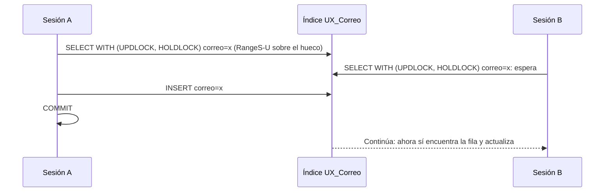

# SERIALIZABLE y bloqueos de rango

Parte de: [[Niveles de aislamiento]]

> [!info] Cómo avanzar
> `progreso`: **pendiente** → **viendo** (estudiando) → **visto** (contestaste la autoevaluación sin abrir las respuestas) → **dominado** (hiciste el laboratorio o lo aplicaste de verdad).

## Contenido

### Qué es
`SERIALIZABLE` es el nivel de aislamiento más estricto basado en bloqueos. Garantiza que el resultado de transacciones concurrentes sea **equivalente a haberlas ejecutado una después de otra**, en algún orden. Además de impedir lecturas sucias y no repetibles (como [[REPEATABLE READ]]), impide los **fantasmas**: nadie puede insertar, borrar ni modificar filas que caigan en el **rango** que tu transacción leyó, hasta que termine. Lo logra con **bloqueos de rango de claves** (*key-range locks*).

### Cómo funciona
1. Cuando la transacción lee con un filtro (`WHERE Correo = @c` o `WHERE Fecha >= @a AND Fecha < @b`), SQL Server bloquea no solo las filas encontradas, sino también **los huecos** del índice entre ellas y alrededor de ellas: modos `RangeS-S`, `RangeS-U`, `RangeX-X`, `RangeI-N`, etc.
2. Si otra transacción intenta insertar una fila cuya clave caería dentro de ese rango, necesita un bloqueo de inserción de rango incompatible y **espera**.
3. Los bloqueos se mantienen **hasta el final de la transacción**.
4. Así, si repites la consulta, obtienes exactamente las mismas filas: ni nuevas ni faltantes.

**Lo que necesita SQL Server para bloquear un rango de forma eficiente**: un **índice sobre las columnas del filtro**. Los bloqueos de rango se ponen sobre **claves de índice**: con un índice en `Correo`, el motor bloquea solo la clave buscada (o el hueco donde estaría) y sus vecinas. **Sin índice adecuado**, no tiene forma de delimitar el rango y termina bloqueando mucho más: todo lo que recorre en el escaneo, a menudo la **tabla completa**. Eso convierte un upsert inocente en un cuello de botella para todos los usuarios.

**Activarlo**:

- Para la sesión: `SET TRANSACTION ISOLATION LEVEL SERIALIZABLE;`
- Solo para una tabla de una consulta: pista **`WITH (HOLDLOCK)`** (equivale a `SERIALIZABLE` para esa tabla). Es la forma más común, porque limita el costo a la instrucción que lo necesita.

**El uso típico de `WITH (UPDLOCK, HOLDLOCK)`: el upsert seguro**. El patrón "si existe, actualiza; si no, inserta" tiene una condición de carrera: dos sesiones verifican al mismo tiempo, ninguna encuentra la fila y ambas insertan (duplicado o error de `UNIQUE`). Con:

- `HOLDLOCK`: bloquea el **rango** aunque la fila **no exista** (impide que otra inserte en ese hueco).
- `UPDLOCK`: toma el bloqueo en modo **U** en lugar de S, que es incompatible consigo mismo; la segunda sesión **espera en la verificación** en lugar de formar un deadlock por conversión al intentar insertar.



### Ejemplo
Upsert de preferencias de usuario en Itzamna.Dionisio:

```sql
CREATE OR ALTER PROCEDURE api.Preferencia_Guardar
    @UsuarioId int, @Clave varchar(50), @Valor nvarchar(400)
AS
SET NOCOUNT ON;
SET XACT_ABORT ON;
BEGIN TRAN;
    UPDATE cfg.Preferencias WITH (UPDLOCK, HOLDLOCK)
    SET    Valor = @Valor, ActualizadoUtc = SYSUTCDATETIME()
    WHERE  UsuarioId = @UsuarioId AND Clave = @Clave;

    IF @@ROWCOUNT = 0
        INSERT INTO cfg.Preferencias (UsuarioId, Clave, Valor, ActualizadoUtc)
        VALUES (@UsuarioId, @Clave, @Valor, SYSUTCDATETIME());
COMMIT;
GO
-- Requisito: índice (aquí la PK) sobre las columnas del filtro
-- CONSTRAINT PK_Preferencias PRIMARY KEY (UsuarioId, Clave)
```

Hacer el `UPDATE` primero (con las pistas) en lugar de un `IF EXISTS` + `UPDATE` ahorra una lectura en el caso más frecuente. Con un `MERGE` aplican las mismas pistas (`MERGE cfg.Preferencias WITH (HOLDLOCK) ...`), ver [[MERGE]].

Reserva de un rango (por ejemplo, evitar que se traslapen citas):

```sql
SET TRANSACTION ISOLATION LEVEL SERIALIZABLE;
BEGIN TRAN;
IF NOT EXISTS (SELECT 1 FROM agenda.Citas
               WHERE SalaId = @Sala AND Inicio < @Fin AND Fin > @Inicio)
    INSERT INTO agenda.Citas (SalaId, Inicio, Fin) VALUES (@Sala, @Inicio, @Fin);
COMMIT;
-- Necesita un índice en (SalaId, Inicio) para no bloquear toda la tabla
```

### Cuándo usarlo y cuándo no
- **Úsalo de forma puntual** (pistas en una tabla y transacción corta) para upserts, verificaciones de "no existe" y reservas de rangos.
- **No lo pongas como nivel general** de la aplicación: bloqueos masivos y deadlocks.
- **Combínalo siempre con restricciones** (`UNIQUE`): la restricción garantiza la regla y el bloqueo evita el error en la concurrencia normal.
- **SNAPSHOT** también evita fantasmas en lecturas, pero no impide que dos transacciones inserten filas que, juntas, violan una regla (*write skew*); para eso hace falta SERIALIZABLE o una restricción.

### Errores comunes
1. **Sin índice sobre el filtro**: el bloqueo de rango se vuelve bloqueo de tabla.
2. **`HOLDLOCK` sin `UPDLOCK`** en upserts: dos sesiones toman `RangeS-S` y ambas intentan insertar, formando un deadlock.
3. **Transacciones largas en SERIALIZABLE**: todo el rango leído queda congelado.
4. **Olvidar que el nivel aplica a la sesión** después del procedimiento si lo cambias en el lote del cliente.

### Para profundizar
- [SET TRANSACTION ISOLATION LEVEL](https://learn.microsoft.com/sql/t-sql/statements/set-transaction-isolation-level-transact-sql)
- [Guía de bloqueo: bloqueo de intervalos de claves](https://learn.microsoft.com/sql/relational-databases/sql-server-transaction-locking-and-row-versioning-guide)
- [Sugerencias de tabla: HOLDLOCK y UPDLOCK](https://learn.microsoft.com/sql/t-sql/queries/hints-transact-sql-table)

## Autoevaluación

Contesta primero en voz alta o en papel; luego despliega la respuesta.

> [!question]- ¿Qué garantiza `SERIALIZABLE`?
> Que el resultado equivale a ejecutar las transacciones una tras otra: además de lo de REPEATABLE READ, bloquea los **rangos** de clave leídos para impedir fantasmas. `HOLDLOCK` es el *hint* equivalente por tabla.

> [!question]- ¿Qué necesita SQL Server para bloquear un rango de forma eficiente?
> Un índice sobre las columnas del filtro: así bloquea solo el intervalo de claves (*key-range locks*). Sin índice, puede terminar bloqueando toda la tabla.

> [!question]- ¿Cuál es el uso típico de `WITH (UPDLOCK, HOLDLOCK)`?
> El «verificar y luego insertar» (upsert) seguro: el bloqueo de rango sobre la clave inexistente impide que otra sesión la inserte entre tu verificación y tu `INSERT`.

## Práctica

- [[Lab 6 - Bloqueos, niveles de aislamiento y deadlock en dos sesiones]]

