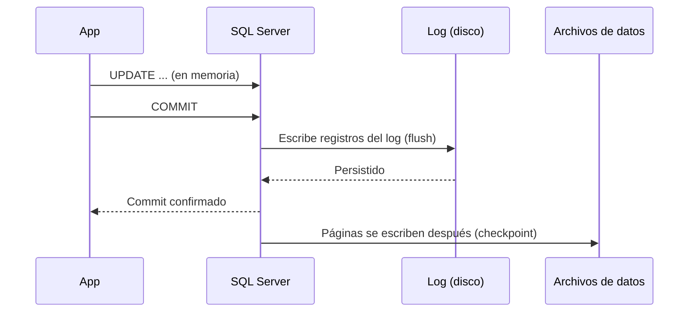

# Propiedades ACID

Parte de: [[06-SQL-Server/03 Transacciones y concurrencia/_Índice Transacciones y concurrencia|Transacciones y concurrencia]]

> [!info] Cómo avanzar
> `progreso`: **pendiente** → **viendo** (estudiando) → **visto** (contestaste la autoevaluación sin abrir las respuestas) → **dominado** (hiciste el laboratorio o lo aplicaste de verdad).

## Contenido

### Qué es
**ACID** son las cuatro garantías que da una base de datos transaccional para que un grupo de operaciones se comporte como una unidad confiable aunque haya fallas o muchos usuarios a la vez:

- **A**tomicidad: todo o nada.
- **C**onsistencia: la transacción lleva la base de un estado válido a otro estado válido.
- **I**solation (aislamiento): las transacciones concurrentes no se estorban de formas inesperadas.
- **D**urabilidad: lo confirmado sobrevive a una caída.

Son la razón por la que una transferencia entre cuentas no deja dinero "a medias" y por la que puedes confiar en un `COMMIT`.

### Cómo funciona
**Atomicidad**: si una transacción hace tres `UPDATE` y el tercero falla, los dos primeros se deshacen con `ROLLBACK`. SQL Server lo logra registrando cada cambio en el **log de transacciones** con la información necesaria para revertirlo. Ojo: en T-SQL, por defecto, **un error no siempre revierte toda la transacción** (algunos errores solo abortan la instrucción); por eso se usa `SET XACT_ABORT ON` y `TRY...CATCH` (ver [[Transacciones (BEGIN, COMMIT y ROLLBACK)]] y [[SET NOCOUNT y SET XACT_ABORT]]).

**Consistencia**: es una responsabilidad **compartida**. La base garantiza lo que tú declaras: PK, FK, `UNIQUE`, `CHECK`, tipos ([[UNIQUE, CHECK y DEFAULT]]). Pero reglas como "el saldo nunca queda negativo" o "un pedido entregado no se puede cancelar" solo se cumplen si las declaras como restricciones o si tu código (procedimientos, API) las verifica dentro de la transacción. Una transacción atómica y aislada que guarda un dato de negocio incorrecto deja la base "consistente" para el motor, pero incorrecta para el negocio.

**Aislamiento**: el motor controla qué ve cada transacción de los cambios de otras, con **bloqueos** o con **versiones de fila**. El grado se ajusta con los [[Niveles de aislamiento]]; más aislamiento significa menos anomalías, pero más espera o más costo.

**Durabilidad**: SQL Server usa **write-ahead logging (WAL)**:

1. Los cambios se hacen en páginas en memoria (buffer pool).
2. Los registros del log que describen el cambio se escriben a disco **antes** que las páginas de datos.
3. Al hacer `COMMIT`, el motor espera a que el log de esa transacción esté **físicamente en disco** (*log flush*) y solo entonces confirma al cliente.
4. Las páginas de datos se escriben después (checkpoint, lazy writer).
5. Si el servidor cae, al arrancar la **recuperación** lee el log: rehace lo confirmado que no llegó a los archivos de datos y deshace lo no confirmado.



**Delayed durability** (SQL Server 2014+): permite que el `COMMIT` regrese **antes** de que el log se escriba a disco; los registros se acumulan en memoria y se escriben en bloques. Mejora mucho la latencia cuando hay muchas transacciones pequeñas y el disco del log es lento. El riesgo: si el servidor cae, se pierden las últimas transacciones que la aplicación creía confirmadas. Se activa con `ALTER DATABASE ... SET DELAYED_DURABILITY = ALLOWED` (y `COMMIT WITH (DELAYED_DURABILITY = ON)` por transacción) o `FORCED`; `sys.sp_flush_log` fuerza la escritura pendiente.

### Ejemplo
Transferencia de existencias entre almacenes que respeta ACID:

```sql
CREATE OR ALTER PROCEDURE inventario.Transferir
    @ProductoId int, @Origen int, @Destino int, @Cantidad int
AS
SET NOCOUNT ON;
SET XACT_ABORT ON;                      -- atomicidad: cualquier error revierte todo
BEGIN TRY
    BEGIN TRAN;

    UPDATE inventario.Existencias
    SET    Piezas = Piezas - @Cantidad
    WHERE  ProductoId = @ProductoId AND AlmacenId = @Origen
      AND  Piezas >= @Cantidad;         -- consistencia: regla de negocio en la misma instrucción

    IF @@ROWCOUNT = 0
        THROW 50001, N'Existencias insuficientes en el almacén de origen.', 1;

    UPDATE inventario.Existencias
    SET    Piezas = Piezas + @Cantidad
    WHERE  ProductoId = @ProductoId AND AlmacenId = @Destino;

    COMMIT;                             -- durabilidad: regresa cuando el log está en disco
END TRY
BEGIN CATCH
    IF @@TRANCOUNT > 0 ROLLBACK;
    THROW;
END CATCH;
```

Además, un `CHECK (Piezas >= 0)` en la tabla da una segunda red de seguridad declarativa.

### Cuándo usarlo y cuándo no
- **ACID completo** es lo que quieres para dinero, inventario, identidad (Xolotl.Hecate) y cualquier dato que no se pueda perder ni quedar a medias.
- **Delayed durability** solo donde perder unos segundos de datos sea aceptable (telemetría, bitácoras de bajo valor) y nunca para operaciones financieras.
- Entre sistemas distintos (base + cola de mensajes + API externa) no hay ACID: se usan patrones como *outbox* y operaciones idempotentes.

### Errores comunes
1. **Creer que la base asegura toda la consistencia**: sin restricciones ni validaciones, solo asegura lo declarado.
2. **No usar `XACT_ABORT ON`**: algunos errores dejan la transacción abierta con la mitad de los cambios.
3. **Activar delayed durability para "ganar rendimiento"** sin entender que se pueden perder confirmaciones.
4. **Pensar que un `COMMIT` exitoso en la app** garantiza algo si la conexión falló justo después: la app debe tolerar el "no sé si se confirmó" (reintentos idempotentes).

### Para profundizar
- [Transacciones (Transact-SQL)](https://learn.microsoft.com/sql/t-sql/language-elements/transactions-transact-sql)
- [Guía de arquitectura y administración del registro de transacciones](https://learn.microsoft.com/sql/relational-databases/sql-server-transaction-log-architecture-and-management-guide)
- [sys.sp_flush_log y durabilidad diferida](https://learn.microsoft.com/sql/relational-databases/system-stored-procedures/sys-sp-flush-log-transact-sql)

## Autoevaluación

Contesta primero en voz alta o en papel; luego despliega la respuesta.

> [!question]- ¿Qué significa cada letra de ACID?
> **Atomicidad**: todo o nada. **Consistencia**: la transacción lleva la base de un estado válido a otro (respeta restricciones). **Aislamiento** (*Isolation*): las transacciones concurrentes no se pisan más de lo que permite el nivel de aislamiento. **Durabilidad**: lo confirmado sobrevive a una caída.

> [!question]- ¿Cómo garantiza SQL Server la durabilidad?
> Con el registro de transacciones (*write-ahead log*): antes de confirmar, los cambios se escriben en el log en disco; si el servidor cae, al arrancar rehace lo confirmado y deshace lo que quedó a medias.

> [!question]- ¿La «C» de ACID la garantiza solo la base?
> Solo las reglas que declaras (PK, FK, `CHECK`, `UNIQUE`). Las reglas de negocio que no están en restricciones (p. ej. «el saldo no puede quedar negativo» si no hay `CHECK`) dependen de que tu código las valide dentro de la transacción.

> [!question]- ¿Qué es *delayed durability* y qué riesgo tiene?
> Una opción que confirma antes de escribir el log a disco para ganar velocidad; si el servidor cae, puedes perder las últimas transacciones confirmadas. Solo para datos que puedes reconstruir.

## Práctica

- [[Lab 4 - Stored procedure transaccional con TRY CATCH y XACT_ABORT]]

