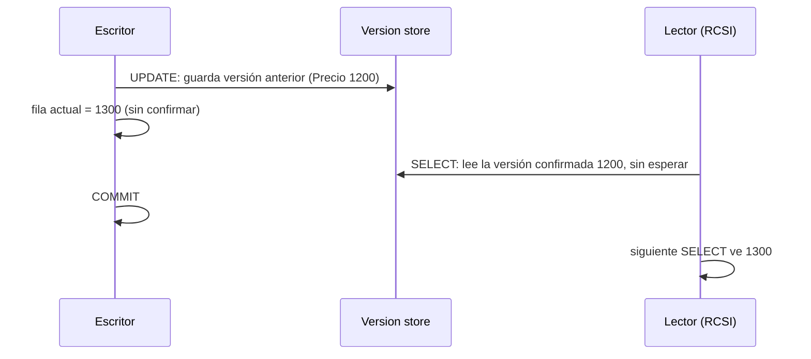

# Snapshot y RCSI

Parte de: [[06-SQL-Server/03 Transacciones y concurrencia/_Índice Transacciones y concurrencia|Transacciones y concurrencia]]

> [!info] Cómo avanzar
> `progreso`: **pendiente** → **viendo** (estudiando) → **visto** (contestaste la autoevaluación sin abrir las respuestas) → **dominado** (hiciste el laboratorio o lo aplicaste de verdad).

## Contenido

### Qué es
**SNAPSHOT** y **RCSI** (*Read Committed Snapshot Isolation*) son dos formas de aislamiento basadas en **versiones de fila** en lugar de bloqueos compartidos. Cuando alguien modifica una fila, SQL Server guarda la versión anterior; los lectores leen esa versión confirmada en lugar de esperar. Así, **los lectores no bloquean a los escritores ni los escritores a los lectores**. Es la alternativa correcta a `NOLOCK` (ver [[READ UNCOMMITTED y NOLOCK]]).

### Cómo funciona
**Versiones de fila**: con cualquiera de las dos opciones activa, cada `UPDATE` o `DELETE` copia la versión anterior de la fila al **version store** (en `tempdb`, o en el *persistent version store* dentro de la propia base cuando está activo ADR, *Accelerated Database Recovery*). Cada fila modificada lleva además **14 bytes** extra con el puntero a su versión anterior y el número de transacción.

**Diferencias**:

| | RCSI | SNAPSHOT |
|---|---|---|
| Qué es | Una forma de implementar **READ COMMITTED** | Un **nivel de aislamiento** distinto |
| Cómo se activa | `ALTER DATABASE ... SET READ_COMMITTED_SNAPSHOT ON` y aplica a todo el código en READ COMMITTED, sin cambiarlo | `ALTER DATABASE ... SET ALLOW_SNAPSHOT_ISOLATION ON` y luego cada sesión pide `SET TRANSACTION ISOLATION LEVEL SNAPSHOT` |
| Foto consistente | Por **instrucción** (cada `SELECT` ve los datos confirmados al iniciar esa instrucción) | Por **transacción** (todas las lecturas ven los datos confirmados al iniciar la transacción) |
| Lecturas no repetibles y fantasmas | Posibles entre instrucciones | No ocurren |
| Escrituras | Se bloquean entre sí como siempre | Si otra transacción modificó y confirmó la misma fila después de que tu transacción inició, tu `UPDATE` falla con el **error 3960** (*update conflict*) |

**El error 3960** en SNAPSHOT: "Snapshot isolation transaction aborted due to update conflict...". La transacción se revierte; la aplicación debe **reintentar** con datos frescos o informar el conflicto. Es concurrencia optimista hecha por el motor.

**Costos de las versiones**:

1. Espacio y E/S en `tempdb` (o en la base con ADR) para el version store, que crece con transacciones largas: una transacción SNAPSHOT abierta durante horas obliga a conservar todas las versiones desde que empezó.
2. 14 bytes adicionales por fila modificada, que pueden causar *page splits* la primera vez.
3. Algo más de CPU en escrituras y en lecturas que recorren cadenas de versiones.
4. Cambios de comportamiento: código que dependía de que el lector **esperara** al escritor (por ejemplo, "leo el saldo y confío en que nadie lo cambia") ahora lee el valor anterior.

Vigílalo con `sys.dm_tran_version_store_space_usage` y `sys.dm_tran_active_snapshot_database_transactions`.

**Activación en Tienda**:

```sql
-- RCSI: requiere ser la única conexión activa en la base (o expulsar a las demás)
ALTER DATABASE Tienda SET READ_COMMITTED_SNAPSHOT ON WITH ROLLBACK IMMEDIATE;

-- SNAPSHOT: se puede activar con usuarios conectados
ALTER DATABASE Tienda SET ALLOW_SNAPSHOT_ISOLATION ON;

SELECT name, is_read_committed_snapshot_on, snapshot_isolation_state_desc
FROM   sys.databases WHERE name = N'Tienda';
```

En **Azure SQL Database**, RCSI viene activado por defecto.



### Ejemplo
Reporte consistente de varias consultas con SNAPSHOT y conflicto de escritura:

```sql
-- Sesión A: reporte con foto única
SET TRANSACTION ISOLATION LEVEL SNAPSHOT;
BEGIN TRAN;
    SELECT COUNT(*) AS Pedidos FROM ventas.Pedidos;
    SELECT SUM(Cantidad * PrecioUnitario) AS Importe FROM ventas.PedidoDetalle;
    -- Aunque otros inserten pedidos entre ambas consultas, las dos ven la misma foto
COMMIT;

-- Conflicto de escritura (3960)
-- Sesión A
SET TRANSACTION ISOLATION LEVEL SNAPSHOT;
BEGIN TRAN;
    SELECT Precio FROM ventas.Productos WHERE ProductoId = 1;          -- 1200
-- Sesión B (autocommit): UPDATE ventas.Productos SET Precio = 1250 WHERE ProductoId = 1;
-- Sesión A
    UPDATE ventas.Productos SET Precio = 1300 WHERE ProductoId = 1;    -- error 3960, se revierte
```

En la API, trata el 3960 igual que un conflicto de concurrencia: reintenta la transacción completa o responde 409 con un `codigo` como `CONCURRENCIA_CONFLICTO`. Si la edición abarca varias peticiones HTTP, combina esto con [[Concurrencia optimista]] y `rowversion`.

### Cuándo usarlo y cuándo no
- **RCSI** como opción general en sistemas OLTP con contención entre lecturas y escrituras: es el comportamiento de Azure SQL y suele eliminar la mayoría de los bloqueos de lectura sin tocar el código. Antes de activarlo en una base existente, revisa el código que depende de que el lector espere, y mide `tempdb`.
- **SNAPSHOT** para reportes, exportaciones (Wee.Reporteria) o validaciones que necesitan varias lecturas coherentes entre sí sin bloquear.
- **No uses SNAPSHOT** para transacciones de escritura con alta contención sobre las mismas filas: tendrás muchos errores 3960.
- Ninguno impide el *write skew* (dos transacciones que leen lo mismo y escriben filas distintas violando una regla conjunta); para eso, restricciones o [[SERIALIZABLE y bloqueos de rango]].

### Errores comunes
1. **Confundir RCSI con SNAPSHOT**: RCSI no da consistencia entre varias instrucciones.
2. **Transacciones SNAPSHOT largas**: el version store crece sin control.
3. **No manejar el 3960** en la aplicación.
4. **Activar RCSI con conexiones abiertas** sin `WITH ROLLBACK IMMEDIATE`: el `ALTER DATABASE` se queda esperando.
5. **Asumir que RCSI evita conflictos entre escritores**: siguen bloqueándose.

### Para profundizar
- [Guía de bloqueo y control de versiones de filas](https://learn.microsoft.com/sql/relational-databases/sql-server-transaction-locking-and-row-versioning-guide)
- [Aislamiento de instantáneas en SQL Server (ADO.NET)](https://learn.microsoft.com/dotnet/framework/data/adonet/sql/snapshot-isolation-in-sql-server)
- [Recuperación acelerada de bases de datos](https://learn.microsoft.com/sql/relational-databases/accelerated-database-recovery-concepts)

## Autoevaluación

Contesta primero en voz alta o en papel; luego despliega la respuesta.

> [!question]- ¿Qué diferencia hay entre `SNAPSHOT` y RCSI?
> **RCSI** (`READ_COMMITTED_SNAPSHOT ON`) cambia el comportamiento de READ COMMITTED: cada **instrucción** ve los datos confirmados al empezar. **SNAPSHOT** (requiere `ALLOW_SNAPSHOT_ISOLATION ON` y `SET TRANSACTION ISOLATION LEVEL SNAPSHOT`) da una foto de toda la **transacción**.

> [!question]- ¿Qué error aparece en SNAPSHOT si dos transacciones modifican la misma fila?
> La que intenta escribir una fila que otra cambió después de iniciada su foto recibe el error **3960** (conflicto de actualización) y se revierte. RCSI no tiene ese error: el escritor espera y luego escribe.

> [!question]- ¿Qué costo tienen las versiones de fila?
> Se guardan en tempdb (o en la base con *Accelerated Database Recovery*), agregan 14 bytes por fila modificada y las transacciones largas impiden limpiarlas. Vigila el tamaño de tempdb.

> [!question]- ¿Cómo activas RCSI en la base Tienda?
> ```sql
> ALTER DATABASE Tienda SET READ_COMMITTED_SNAPSHOT ON WITH ROLLBACK IMMEDIATE;
> SELECT name, is_read_committed_snapshot_on FROM sys.databases WHERE name = 'Tienda';
> ```
> `WITH ROLLBACK IMMEDIATE` desconecta las transacciones abiertas para poder cambiarlo.

## Práctica

- [[Lab 6 - Bloqueos, niveles de aislamiento y deadlock en dos sesiones]]

