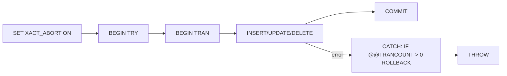

# Transacciones (BEGIN, COMMIT y ROLLBACK)

Parte de: [[06-SQL-Server/03 Transacciones y concurrencia/_Índice Transacciones y concurrencia|Transacciones y concurrencia]]

> [!info] Cómo avanzar
> `progreso`: **pendiente** → **viendo** (estudiando) → **visto** (contestaste la autoevaluación sin abrir las respuestas) → **dominado** (hiciste el laboratorio o lo aplicaste de verdad).

## Contenido

### Qué es
Una **transacción** agrupa varias instrucciones para que se confirmen todas juntas o no se confirme ninguna (ver [[Propiedades ACID]]). En T-SQL se controla con `BEGIN TRAN` (inicia), `COMMIT` (confirma) y `ROLLBACK` (deshace). Es lo que hace posible "crear el pedido y sus renglones y descontar inventario" como una sola operación.

### Cómo funciona
**Modos de transacción en SQL Server**:

- **Autocommit** (predeterminado): cada instrucción individual es su propia transacción. Un `UPDATE` que afecta 1,000 filas se confirma completo o nada, pero dos `UPDATE` seguidos son independientes: si el segundo falla, el primero ya quedó.
- **Explícita**: tú la abres con `BEGIN TRAN` y la cierras con `COMMIT` o `ROLLBACK`.
- **Implícita** (`SET IMPLICIT_TRANSACTIONS ON`): la primera instrucción abre una transacción que debes cerrar tú. Es el comportamiento de algunos drivers y herramientas; casi nunca se usa a propósito en SQL Server.

**`@@TRANCOUNT`** indica cuántos `BEGIN TRAN` están abiertos en la sesión:

- `BEGIN TRAN` suma 1.
- `COMMIT` resta 1; **solo el que lo lleva a 0 confirma de verdad**.
- `ROLLBACK` (sin nombre de savepoint) **deshace todo y lo deja en 0**, sin importar cuántos niveles había.

Por ejemplo: `BEGIN TRAN` → 1; `BEGIN TRAN` → 2; `COMMIT` → 1 (nada confirmado aún); `ROLLBACK` → 0 (se deshizo todo, incluido lo "confirmado" en el nivel interno). Los detalles están en [[Transacciones anidadas y savepoints]].

**Manejo de errores**: por defecto, muchos errores en T-SQL solo abortan la **instrucción** que falló y la transacción sigue abierta. Por eso el patrón estándar es:

1. `SET XACT_ABORT ON`: cualquier error de ejecución revierte toda la transacción y aborta el lote.
2. `BEGIN TRY ... BEGIN TRAN ... COMMIT ... END TRY`.
3. En el `CATCH`: `IF @@TRANCOUNT > 0 ROLLBACK;` y `THROW;` para que el error llegue a la aplicación.

Ver [[TRY CATCH y THROW]] y [[SET NOCOUNT y SET XACT_ABORT]].

**¿Qué pasa si se olvida el `COMMIT`?** La transacción queda **abierta** mientras viva la sesión. Sus bloqueos exclusivos siguen tomados, así que otras sesiones que quieran leer (en READ COMMITTED con bloqueos) o escribir esas filas **se quedan esperando** indefinidamente; además el log no se puede truncar más allá de esa transacción y crece. Si la conexión se cierra, SQL Server hace `ROLLBACK` automático. En SSMS es un error muy común: ejecutas un `BEGIN TRAN; UPDATE ...` "para probar" y te vas a comer. `DBCC OPENTRAN` muestra la transacción activa más antigua.

**Las transacciones deben ser cortas** porque mientras están abiertas retienen bloqueos (bloqueando a otros), mantienen versiones en el *version store* si hay [[Snapshot y RCSI]], impiden truncar el log y aumentan la probabilidad de [[Deadlocks]]. Regla práctica: **nunca** esperes una acción del usuario, una llamada HTTP o un envío de correo dentro de una transacción. Prepara todo antes, entra, escribe, confirma.



### Ejemplo
Procedimiento que crea un pedido con un renglón:

```sql
CREATE OR ALTER PROCEDURE api.Pedido_Crear
    @ClienteId int, @ProductoId int, @Cantidad int
AS
SET NOCOUNT ON;
SET XACT_ABORT ON;
BEGIN TRY
    BEGIN TRAN;
        DECLARE @PedidoId int;
        INSERT INTO ventas.Pedidos (ClienteId, Fecha) VALUES (@ClienteId, CAST(SYSUTCDATETIME() AS date));
        SET @PedidoId = SCOPE_IDENTITY();

        INSERT INTO ventas.PedidoDetalle (PedidoId, ProductoId, Cantidad, PrecioUnitario)
        SELECT @PedidoId, ProductoId, @Cantidad, Precio
        FROM   ventas.Productos WHERE ProductoId = @ProductoId;

        IF @@ROWCOUNT = 0 THROW 50002, N'Producto inexistente.', 1;
    COMMIT;
    SELECT @PedidoId AS PedidoId;
END TRY
BEGIN CATCH
    IF @@TRANCOUNT > 0 ROLLBACK;
    THROW;
END CATCH;
```

**Con Dapper**, cuando la transacción abarca varias llamadas desde C#, abre la conexión, inicia la transacción y **pásala a cada comando** (si no, Microsoft.Data.SqlClient lanza un error indicando que el comando requiere la transacción de la conexión):

```csharp
await using var conexion = new SqlConnection(cadena);
await conexion.OpenAsync(ct);
await using var tx = await conexion.BeginTransactionAsync(ct);
try
{
    var pedidoId = await conexion.ExecuteScalarAsync<int>(
        sqlInsertarPedido, new { ClienteId = clienteId }, transaction: tx);

    await conexion.ExecuteAsync(
        sqlInsertarRenglon, renglones.Select(r => new { PedidoId = pedidoId, r.ProductoId, r.Cantidad }),
        transaction: tx);   // Dapper ejecuta el comando una vez por elemento

    await tx.CommitAsync(ct);
}
catch
{
    await tx.RollbackAsync(ct);
    throw;
}
```

Si toda la lógica cabe en un procedimiento, es preferible que la transacción viva **dentro** del procedimiento: menos viajes de red y transacción más corta.

### Cuándo usarlo y cuándo no
- **Úsala** siempre que dos o más escrituras deban quedar juntas.
- **Autocommit basta** para una sola instrucción (un `UPDATE` ya es atómico).
- **No metas lecturas largas** ni reportes en transacciones explícitas sin necesidad.
- Para operaciones que cruzan sistemas, la transacción de base no alcanza; ver patrones de idempotencia y outbox.

### Errores comunes
1. **Olvidar `COMMIT`** en SSMS o en un camino de código: bloqueos que nadie entiende.
2. **No usar `XACT_ABORT ON`**: errores que dejan la transacción a medias.
3. **`ROLLBACK` en el `CATCH` sin revisar `@@TRANCOUNT`**: error 3903 si ya no hay transacción.
4. **Transacciones largas** que esperan llamadas externas o interacción del usuario.
5. **En Dapper, no pasar `transaction: tx`** a cada comando.

### Para profundizar
- [BEGIN TRANSACTION (Transact-SQL)](https://learn.microsoft.com/sql/t-sql/language-elements/begin-transaction-transact-sql)
- [COMMIT TRANSACTION](https://learn.microsoft.com/sql/t-sql/language-elements/commit-transaction-transact-sql)
- [ROLLBACK TRANSACTION](https://learn.microsoft.com/sql/t-sql/language-elements/rollback-transaction-transact-sql)
- [@@TRANCOUNT](https://learn.microsoft.com/sql/t-sql/functions/trancount-transact-sql)

## Ejercicios

Resuélvelos en papel o en la herramienta; la solución está plegada.

> [!question]- Con la base Tienda ([[Lab 1 - Base de práctica Tienda en SQL Server]]): en una transacción, mueve 1 unidad del Cable HDMI (`ProductoId = 5`) del pedido 3 al pedido 7 (que no lo tiene) y revierte todo si algo falla.
> ```sql
> SET XACT_ABORT ON;
> BEGIN TRY
>     BEGIN TRANSACTION;
>     UPDATE ventas.PedidoDetalle SET Cantidad = Cantidad - 1
>     WHERE  PedidoId = 3 AND ProductoId = 5;            -- 3 -> 2
>     IF EXISTS (SELECT 1 FROM ventas.PedidoDetalle WHERE PedidoId = 7 AND ProductoId = 5)
>         UPDATE ventas.PedidoDetalle SET Cantidad = Cantidad + 1
>         WHERE  PedidoId = 7 AND ProductoId = 5;
>     ELSE
>         INSERT INTO ventas.PedidoDetalle (PedidoId, ProductoId, Cantidad, PrecioUnitario)
>         VALUES (7, 5, 1, 150);
>     COMMIT TRANSACTION;
> END TRY
> BEGIN CATCH
>     IF @@TRANCOUNT > 0 ROLLBACK TRANSACTION;
>     THROW;
> END CATCH
> ```
> Pedido 3 queda con 2 cables y el 7 con 1. Si intentaras mover del pedido 1 su único teclado, el `UPDATE` lo dejaría en 0, violaría `CHECK (Cantidad BETWEEN 1 AND 100)` y se revertiría **todo**.

> [!question]- Predice `@@TRANCOUNT` después de cada línea: `BEGIN TRAN; BEGIN TRAN; COMMIT; ROLLBACK;`
> 1, 2, 1, 0. El `ROLLBACK` revierte **todo**, incluido lo que «confirmó» el `COMMIT` interno.

> [!question]- ¿Qué pasa si una sesión hace `BEGIN TRAN; UPDATE ...` y se olvida del `COMMIT`?
> La transacción queda abierta con sus bloqueos: otras sesiones que toquen esas filas se quedan esperando. Detéctalo con `DBCC OPENTRAN` o `sys.dm_tran_session_transactions` y ciérrala (o mata la sesión con `KILL`).

## Autoevaluación

Contesta primero en voz alta o en papel; luego despliega la respuesta.

> [!question]- ¿Qué es el modo *autocommit*?
> El predeterminado en SQL Server: cada instrucción es su propia transacción y se confirma sola. Para agrupar varias necesitas `BEGIN TRANSACTION` ... `COMMIT`.

> [!question]- ¿Qué indica `@@TRANCOUNT`?
> Cuántos `BEGIN TRANSACTION` están abiertos en la sesión. 0 = no hay transacción. Útil en el `CATCH`: `IF @@TRANCOUNT > 0 ROLLBACK`.

> [!question]- ¿Por qué las transacciones deben ser cortas?
> Mientras están abiertas mantienen bloqueos (y en RCSI, versiones en tempdb) e impiden truncar el log. Nunca esperes una entrada del usuario o una llamada HTTP dentro de una transacción.

> [!question]- ¿Cómo usas una transacción con Dapper?
> ```csharp
> await using var tx = await cn.BeginTransactionAsync();
> await cn.ExecuteAsync(sql1, p1, tx);
> await cn.ExecuteAsync(sql2, p2, tx);
> await tx.CommitAsync();   // si hay excepción, Dispose hace rollback
> ```
> Cada comando debe recibir `transaction: tx`; si no, SqlClient lanza una excepción. Si toda la lógica está en un procedimiento, mejor la transacción adentro.

## Práctica

- [[Lab 4 - Stored procedure transaccional con TRY CATCH y XACT_ABORT]]
- [[Lab 6 - Bloqueos, niveles de aislamiento y deadlock en dos sesiones]]

