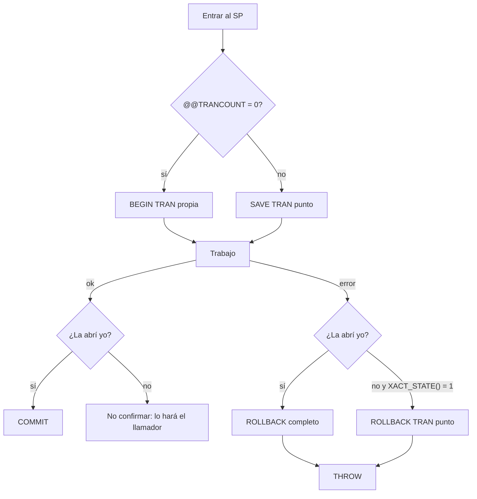

# Transacciones anidadas y savepoints

Parte de: [[06-SQL-Server/03 Transacciones y concurrencia/_Índice Transacciones y concurrencia|Transacciones y concurrencia]]

> [!info] Cómo avanzar
> `progreso`: **pendiente** → **viendo** (estudiando) → **visto** (contestaste la autoevaluación sin abrir las respuestas) → **dominado** (hiciste el laboratorio o lo aplicaste de verdad).

## Contenido

### Qué es
En SQL Server puedes escribir `BEGIN TRAN` dentro de otra transacción, pero **no existen transacciones anidadas reales**: solo hay **una** transacción física por sesión y los `BEGIN TRAN` internos únicamente incrementan un contador (`@@TRANCOUNT`). Para deshacer **solo una parte** del trabajo existe otra herramienta: el **savepoint** (`SAVE TRAN nombre`), un punto intermedio al que puedes regresar sin perder lo anterior.

### Cómo funciona
**"Anidación" con `@@TRANCOUNT`**:

| Instrucción | Efecto | `@@TRANCOUNT` |
|---|---|---|
| `BEGIN TRAN` | Abre la transacción | 1 |
| `BEGIN TRAN` | Solo suma | 2 |
| `COMMIT` | Solo resta; no confirma nada | 1 |
| `COMMIT` | Llega a 0: **ahora sí confirma** | 0 |
| `ROLLBACK` (en cualquier nivel) | Deshace **todo** | 0 |

Por eso un procedimiento interno que hace `ROLLBACK` deshace también el trabajo del procedimiento que lo llamó.

**Savepoints**:

- `SAVE TRAN punto;` marca un punto dentro de la transacción actual.
- `ROLLBACK TRAN punto;` deshace solo lo hecho **después** de ese punto. **No cambia `@@TRANCOUNT`** y la transacción sigue abierta; después todavía hay que hacer `COMMIT` o `ROLLBACK`.
- Ejemplo: `BEGIN TRAN; SAVE TRAN a; BEGIN TRAN; ROLLBACK TRAN a;` deja `@@TRANCOUNT = 2`: el `BEGIN TRAN` interno sumó 1 y el rollback a un savepoint no resta.
- **Limitación importante**: si el error "condena" la transacción (`XACT_STATE() = -1`, lo que ocurre siempre con `XACT_ABORT ON` y con ciertos errores graves), no puedes volver a un savepoint: solo queda el `ROLLBACK` completo. Por eso los savepoints se usan con `XACT_ABORT OFF` y revisando `XACT_STATE()`. Tampoco se admiten en transacciones distribuidas.

**Error 266** ("Transaction count after EXECUTE indicates a mismatching number of BEGIN and COMMIT statements"): SQL Server compara `@@TRANCOUNT` al entrar y al salir de un procedimiento; si no coincide, lanza este error. Pasa típicamente cuando un procedimiento interno hace `ROLLBACK` (deja el contador en 0, aunque entró con 1) o abre una transacción y no la cierra.

**Patrón para procedimientos que funcionan solos o dentro de una transacción del llamador**:

1. Al entrar, guarda si ya había transacción (`@TranExterna = @@TRANCOUNT`).
2. Si no había, abre una (`BEGIN TRAN`); si había, crea un savepoint.
3. Al terminar bien, haz `COMMIT` solo si la abriste tú.
4. En el `CATCH`: si la abriste tú, `ROLLBACK` completo; si era externa y la transacción sigue siendo confirmable (`XACT_STATE() = 1`), regresa al savepoint; en cualquier caso, `THROW` para que el llamador decida.



### Ejemplo
```sql
CREATE OR ALTER PROCEDURE ventas.Renglon_Agregar
    @PedidoId int, @ProductoId int, @Cantidad int
AS
SET NOCOUNT ON;
SET XACT_ABORT OFF;                      -- necesario para poder usar el savepoint
DECLARE @TranExterna bit = IIF(@@TRANCOUNT > 0, 1, 0);

IF @TranExterna = 0 BEGIN TRAN;
ELSE SAVE TRAN RenglonAgregar;

BEGIN TRY
    INSERT INTO ventas.PedidoDetalle (PedidoId, ProductoId, Cantidad, PrecioUnitario)
    SELECT @PedidoId, ProductoId, @Cantidad, Precio
    FROM   ventas.Productos WHERE ProductoId = @ProductoId;

    IF @TranExterna = 0 COMMIT;
END TRY
BEGIN CATCH
    IF @TranExterna = 0
    BEGIN
        IF @@TRANCOUNT > 0 ROLLBACK;
    END
    ELSE IF XACT_STATE() = 1
        ROLLBACK TRAN RenglonAgregar;    -- deshace solo este renglón
    THROW;
END CATCH;
```

Uso: el llamador inserta el pedido y varios renglones; si un renglón falla (por ejemplo, viola el `CHECK` de cantidad), lo captura, decide conservar el pedido y los demás renglones, y al final hace su propio `COMMIT`.

```sql
BEGIN TRAN;
INSERT INTO ventas.Pedidos (ClienteId, Fecha) VALUES (2, '2025-05-10');
DECLARE @Id int = SCOPE_IDENTITY();
EXEC ventas.Renglon_Agregar @Id, 1, 2;
BEGIN TRY
    EXEC ventas.Renglon_Agregar @Id, 2, 500;   -- falla el CHECK (1..100)
END TRY
BEGIN CATCH
    PRINT N'Renglón rechazado: ' + ERROR_MESSAGE();
END CATCH;
SELECT @@TRANCOUNT AS Nivel;                   -- 1: el pedido y el primer renglón siguen
COMMIT;
```

En .NET, `SqlTransaction.Save("nombre")` y `Rollback("nombre")` ofrecen lo mismo desde C#, y con Dapper pasas la misma transacción a cada comando.

### Cuándo usarlo y cuándo no
- **Savepoints** para lotes donde algunos elementos pueden fallar y el resto debe conservarse (importaciones, procesamiento de renglones).
- **El patrón de "transacción propia o del llamador"** en procedimientos reutilizables que a veces se llaman solos y a veces dentro de un flujo mayor.
- **Mantén `XACT_ABORT ON`** en la mayoría de los procedimientos que no necesitan recuperación parcial: es más simple y más seguro.
- Si necesitas confirmar algo pase lo que pase (una bitácora de errores), una transacción "anidada" no sirve: escribe la bitácora **después** del `ROLLBACK`, o guárdala en una variable de tabla (que no se revierte) y luego insértala.

### Errores comunes
1. **Creer que el `COMMIT` interno confirma** el trabajo del procedimiento interno.
2. **`ROLLBACK` en un procedimiento interno** que deshace todo y provoca el error 266 en el llamador.
3. **Usar savepoints con `XACT_ABORT ON`**: la transacción queda condenada y el rollback parcial falla.
4. **No revisar `XACT_STATE()`** antes de volver al savepoint.
5. **Confundir `ROLLBACK TRAN nombre_de_transaccion`** con un savepoint: el nombre de un `BEGIN TRAN` externo hace rollback de todo.

### Para profundizar
- [SAVE TRANSACTION (Transact-SQL)](https://learn.microsoft.com/sql/t-sql/language-elements/save-transaction-transact-sql)
- [XACT_STATE (Transact-SQL)](https://learn.microsoft.com/sql/t-sql/functions/xact-state-transact-sql)
- [@@TRANCOUNT (Transact-SQL)](https://learn.microsoft.com/sql/t-sql/functions/trancount-transact-sql)

## Ejercicios

Resuélvelos en papel o en la herramienta; la solución está plegada.

> [!question]- Con la base Tienda ([[Lab 1 - Base de práctica Tienda en SQL Server]]): inserta un pedido y dos renglones; si el segundo renglón falla, conserva el pedido y el primero usando un savepoint (con `XACT_ABORT OFF`).
> ```sql
> SET XACT_ABORT OFF;
> BEGIN TRAN;
> INSERT INTO ventas.Pedidos (ClienteId, Fecha) VALUES (6, '2025-06-01');
> DECLARE @id int = SCOPE_IDENTITY();
> INSERT INTO ventas.PedidoDetalle VALUES (@id, 1, 1, 1200);
> SAVE TRANSACTION antes_segundo;
> BEGIN TRY
>     INSERT INTO ventas.PedidoDetalle VALUES (@id, 2, 500, 450);  -- viola el CHECK de Cantidad
> END TRY
> BEGIN CATCH
>     IF XACT_STATE() = 1 ROLLBACK TRANSACTION antes_segundo;
> END CATCH
> COMMIT;
> ```
> Quedan el pedido y el renglón del teclado. Con `XACT_ABORT ON` la transacción quedaría no confirmable y el savepoint no serviría.

> [!question]- `BEGIN TRAN; SAVE TRAN a; BEGIN TRAN; ROLLBACK TRAN a;` ¿Cuánto vale `@@TRANCOUNT`?
> 2: el `ROLLBACK` a un savepoint no cambia `@@TRANCOUNT`.

> [!question]- Escribe el esqueleto de un procedimiento que funcione tanto solo como dentro de una transacción del llamador.
> ```sql
> DECLARE @tc int = @@TRANCOUNT;
> IF @tc = 0 BEGIN TRANSACTION; ELSE SAVE TRANSACTION sp_paso;
> BEGIN TRY
>     -- trabajo
>     IF @tc = 0 COMMIT TRANSACTION;
> END TRY
> BEGIN CATCH
>     IF XACT_STATE() = -1 ROLLBACK TRANSACTION;
>     ELSE IF XACT_STATE() = 1 AND @tc = 0 ROLLBACK TRANSACTION;
>     ELSE IF XACT_STATE() = 1 ROLLBACK TRANSACTION sp_paso;
>     THROW;
> END CATCH
> ```

## Autoevaluación

Contesta primero en voz alta o en papel; luego despliega la respuesta.

> [!question]- ¿Existen transacciones anidadas reales en SQL Server?
> No: un `BEGIN TRAN` interno solo incrementa `@@TRANCOUNT`; el `COMMIT` interno solo lo decrementa. Lo único que confirma es el `COMMIT` que lo deja en 0, y cualquier `ROLLBACK` (sin nombre de savepoint) revierte todo.

> [!question]- ¿Qué es un savepoint?
> Un punto dentro de la transacción al que puedes volver sin revertir todo: `SAVE TRANSACTION antes_detalle;` ... `ROLLBACK TRANSACTION antes_detalle;`. La transacción sigue abierta. No funciona si la transacción quedó no confirmable (`XACT_STATE() = -1`).

> [!question]- ¿Qué significa el error 266 («Transaction count after EXECUTE indicates a mismatching number...»)?
> Un procedimiento terminó con un `@@TRANCOUNT` distinto al que tenía al entrar (p. ej. hizo `ROLLBACK` de la transacción del llamador). Patrón: el procedimiento solo hace `BEGIN TRAN` si `@@TRANCOUNT = 0` o usa un savepoint cuando ya hay una transacción externa.

