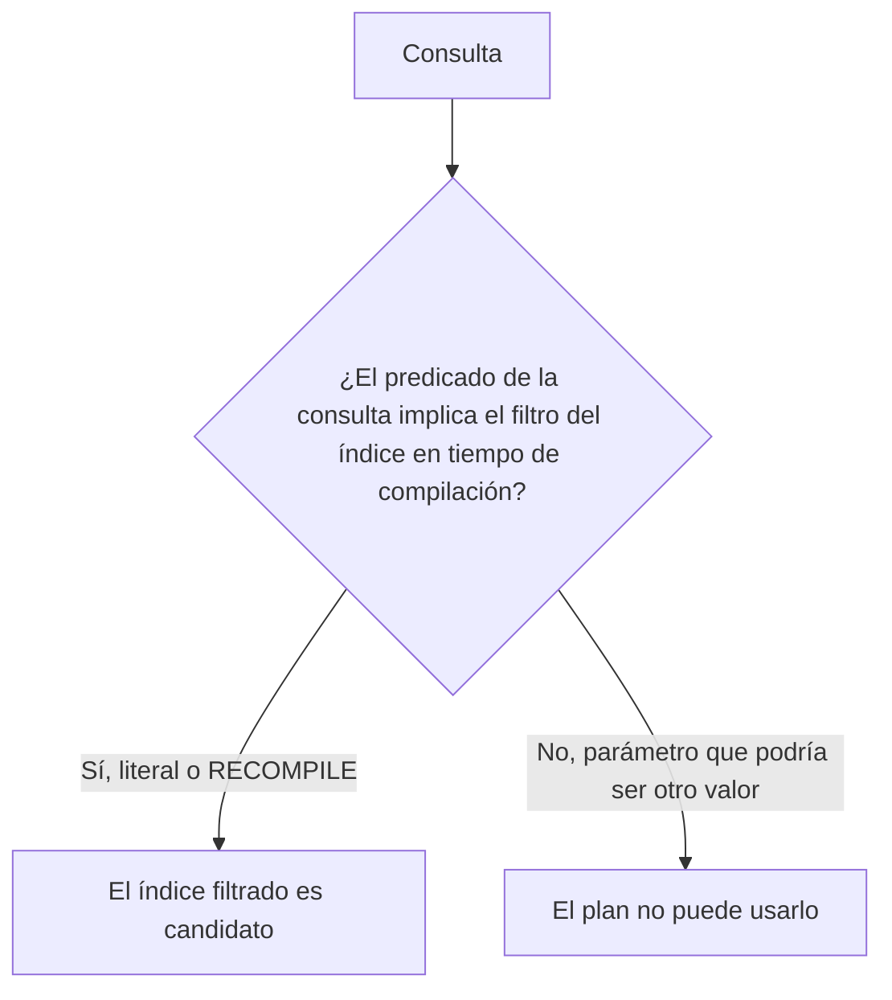

# Columnas incluidas y filtered indexes

Parte de: [[06-SQL-Server/04 Rendimiento/_Índice Rendimiento|Rendimiento]]

> [!info] Cómo avanzar
> `progreso`: **pendiente** → **viendo** (estudiando) → **visto** (contestaste la autoevaluación sin abrir las respuestas) → **dominado** (hiciste el laboratorio o lo aplicaste de verdad).

## Contenido

### Qué es
Son dos opciones de los [[Índice nonclustered|índices nonclustered]] que permiten hacerlos más útiles y más baratos:

- **Columnas incluidas** (`INCLUDE`): columnas que se guardan **solo en el nivel hoja** del índice, sin formar parte de la clave. Sirven para que el índice "cubra" una consulta (tenga todas las columnas que pide) y así evitar el *Key Lookup* a la tabla.
- **Índice filtrado** (`WHERE` en el `CREATE INDEX`): un índice que solo contiene las filas que cumplen una condición. Es más pequeño, más barato de mantener y tiene estadísticas más precisas para ese subconjunto.

### Cómo funciona
**Clave frente a `INCLUDE`**. Las columnas de la **clave** están ordenadas y presentes en todos los niveles del árbol B: sirven para **buscar** (*seek*), filtrar por rangos y ordenar. Las columnas `INCLUDE` están solo en las hojas y **no están ordenadas**: no sirven para buscar ni ordenar, solo para **devolver** el valor sin ir a la tabla. Ventajas de `INCLUDE`:
- No cuentan para el límite de tamaño de la clave (900 bytes para clustered, 1,700 para nonclustered) ni para el número máximo de columnas clave.
- Pueden ser de tipos que no se permiten como clave, como `nvarchar(max)`.
- Mantienen el árbol más compacto en los niveles intermedios.

Regla práctica: lo que va en `WHERE` (igualdades y rangos), `JOIN` y `ORDER BY` va en la clave; lo que solo aparece en el `SELECT` va en `INCLUDE`.

**Índice filtrado**. Solo incluye las filas que cumplen el predicado, que debe ser simple (comparaciones, `IN`, `IS NULL`/`IS NOT NULL`, combinadas con `AND`). Casos típicos:
- **Borrado lógico**: la aplicación casi siempre consulta `IsDeleted = 0`; un índice con `WHERE IsDeleted = 0` ignora las filas borradas (ver [[Borrado lógico y auditoría]]).
- **Unicidad parcial**: un índice `UNIQUE` con `WHERE IsDeleted = 0` permite repetir el slug de un registro borrado, o `WHERE Email IS NOT NULL` permite muchos `NULL` pero emails únicos.
- **Estados minoritarios**: `WHERE Estado = 'Pendiente'` cuando el 98 % de los pedidos están entregados y la cola de trabajo solo busca pendientes.



**El problema de los parámetros**. El optimizador solo puede usar un índice filtrado si, **al compilar**, puede demostrar que todas las filas que pide la consulta están dentro del filtro. Con `WHERE IsDeleted = @Borrado`, el plan se guarda en caché y debe servir para cualquier valor de `@Borrado`, incluido 1. Como el índice no tiene las filas con `IsDeleted = 1`, el plan no puede depender de él, y no lo usa. Soluciones: escribir el valor literal (`WHERE IsDeleted = 0`), que es lo natural si la consulta siempre pide activos; usar `OPTION (RECOMPILE)` para compilar con el valor concreto; o separar en dos consultas.

Otro requisito: las sesiones que modifican la tabla deben tener las opciones `SET` correctas (`ANSI_NULLS`, `QUOTED_IDENTIFIER` y otras en `ON`, que es lo que usan ADO.NET y SSMS por defecto); si no, los `INSERT` fallan.

### Ejemplo
```sql
-- Consulta frecuente de la API: pedidos de un cliente, recientes primero
-- SELECT PedidoId, Fecha, Estado FROM ventas.Pedidos WHERE ClienteId = @Id ORDER BY Fecha DESC;
CREATE INDEX IX_Pedidos_Cliente_Fecha
    ON ventas.Pedidos (ClienteId, Fecha DESC)   -- clave: búsqueda y orden
    INCLUDE (Estado);                            -- solo para devolverla; PedidoId ya viene por ser la clave clustered

-- Cola de trabajo: solo los pendientes
CREATE INDEX IX_Pedidos_Pendientes
    ON ventas.Pedidos (Fecha)
    INCLUDE (ClienteId)
    WHERE Estado = 'Pendiente';

-- Unicidad solo entre registros vivos (si la tabla tuviera borrado lógico con IsDeleted)
CREATE UNIQUE INDEX UX_Productos_Nombre_Activos
    ON ventas.Productos (Nombre)
    WHERE IsDeleted = 0;
```

En el archivo `.sql` de la cola de trabajo, escribe `WHERE Estado = 'Pendiente'` como literal en lugar de `@Estado`: la consulta siempre pide pendientes y así el índice filtrado se puede usar.

### Cuándo usarlo y cuándo no
- **`INCLUDE`** cuando una consulta frecuente hace *Key Lookup* por pocas columnas. No incluyas "todas las columnas por si acaso": el índice se vuelve una copia de la tabla y cada escritura lo actualiza.
- **Filtrado** cuando las consultas se concentran en un subconjunto pequeño y estable de filas, o para unicidad condicional.
- **No uses filtrado** si las consultas llegan con el valor del filtro como parámetro y no puedes cambiarlas.
- Revisa el uso real con las [[DMVs]] (`sys.dm_db_index_usage_stats`) tras desplegar.

### Errores comunes
- **Poner en `INCLUDE` una columna por la que filtras o ordenas**: no sirve para el *seek*.
- **Índice filtrado con consultas parametrizadas** sobre la columna del filtro: no se usa.
- **Incluir columnas muy anchas o muchas**: índices enormes y escrituras lentas.
- **Olvidar que la clave clustered ya está** en cada índice nonclustered: no hace falta incluirla.
- **Opciones `SET` incorrectas** en scripts viejos: fallan los `INSERT` en tablas con índices filtrados.

### Para profundizar
- [Create indexes with included columns](https://learn.microsoft.com/en-us/sql/relational-databases/indexes/create-indexes-with-included-columns)
- [Create filtered indexes](https://learn.microsoft.com/en-us/sql/relational-databases/indexes/create-filtered-indexes)
- [SQL Server index architecture and design guide](https://learn.microsoft.com/en-us/sql/relational-databases/sql-server-index-design-guide)

## Autoevaluación

Contesta primero en voz alta o en papel; luego despliega la respuesta.

> [!question]- ¿Qué diferencia hay entre una columna de la clave y una columna `INCLUDE`?
> La clave está ordenada y sirve para buscar y ordenar; la incluida solo se guarda en las hojas para **cubrir** la consulta (evitar el Key Lookup). Incluidas no cuentan para el límite de tamaño de la clave.

> [!question]- ¿Qué es un índice filtrado y un caso típico?
> Un índice con `WHERE` que solo contiene parte de las filas: `CREATE INDEX IX_Items_Vivos ON portfolio.Items(PortfolioId, [Order]) WHERE IsDeleted = 0;` Es más pequeño y permite unicidad parcial (borrado lógico).

> [!question]- ¿Por qué una consulta con `WHERE IsDeleted = @Borrado` no usa tu índice filtrado `WHERE IsDeleted = 0`?
> Con parámetro, el plan debe servir para cualquier valor, así que no puede usar un índice que solo contiene `0`. Escribe el literal (`WHERE IsDeleted = 0`) o usa `OPTION (RECOMPILE)`. Además las sesiones deben tener opciones SET correctas (`ANSI_NULLS`, `QUOTED_IDENTIFIER` en ON).

## Práctica

- [[Lab 7 - Índices y planes de ejecución antes y después]]

