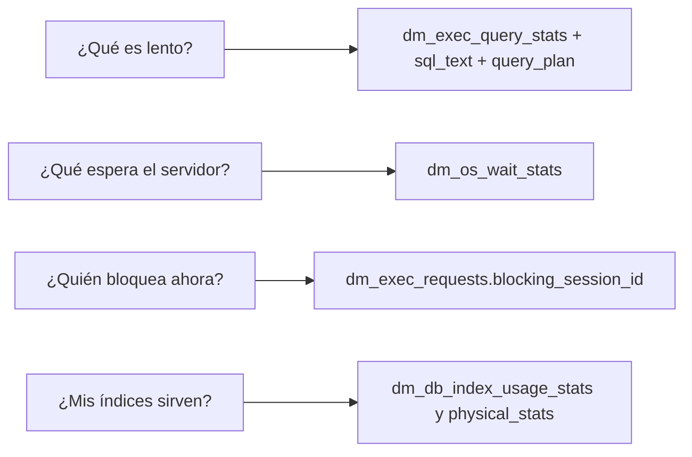

# DMVs

Parte de: [[06-SQL-Server/04 Rendimiento/_Índice Rendimiento|Rendimiento]]

> [!info] Cómo avanzar
> `progreso`: **pendiente** → **viendo** (estudiando) → **visto** (contestaste la autoevaluación sin abrir las respuestas) → **dominado** (hiciste el laboratorio o lo aplicaste de verdad).

## Contenido

### Qué es
Las **DMVs** (*dynamic management views*) y **DMFs** (funciones de administración dinámica) son vistas y funciones del sistema que exponen el **estado interno** de SQL Server: qué consultas están en caché y cuánto han consumido, qué está esperando el servidor, qué sesiones están bloqueadas, qué índices se usan, qué tan fragmentados están, qué índices "faltan". Todas viven en el esquema `sys` y empiezan con `dm_`. Son la herramienta principal de diagnóstico de rendimiento, junto con [[Query Store]] y [[Extended Events]].

### Cómo funciona
Se agrupan por prefijo:
- `sys.dm_exec_*`: ejecución. `dm_exec_requests` (lo que corre ahora), `dm_exec_sessions`, `dm_exec_query_stats` (estadísticas acumuladas por consulta en caché), `dm_exec_sql_text(handle)` y `dm_exec_query_plan(handle)` para texto y plan.
- `sys.dm_os_*`: sistema operativo de SQL Server. `dm_os_wait_stats` (esperas acumuladas), `dm_os_performance_counters`.
- `sys.dm_db_*`: base de datos. `dm_db_index_usage_stats`, `dm_db_index_physical_stats` (fragmentación), `dm_db_missing_index_*`, `dm_db_stats_properties`.
- `sys.dm_tran_*`: transacciones y bloqueos. `dm_tran_locks`.

Dos características importantes:

1. **Son volátiles**: casi todo lo que muestran está en memoria y se **pierde al reiniciar** el servicio (o la base se pone fuera de línea o se hace *failover*). `dm_exec_query_stats` además solo tiene las consultas cuyo plan **sigue en caché**: si un plan se expulsó o se recompiló, sus números desaparecen. Las esperas y el uso de índices se acumulan desde el último reinicio. Por eso, para historia, se usa Query Store o se guardan "fotos" periódicas en una tabla.
2. **Requieren permisos especiales**: las DMVs de servidor necesitan `VIEW SERVER STATE` (en SQL Server 2022 existe además el permiso más acotado `VIEW SERVER PERFORMANCE STATE`); las de ámbito de base, `VIEW DATABASE STATE` (o `VIEW DATABASE PERFORMANCE STATE`). En Azure SQL Database se usa el permiso de base de datos. No le des estos permisos al usuario de la aplicación; dáselos a un usuario o rol de monitoreo.



### Ejemplo
```sql
-- Top 10 consultas en caché por CPU total, con su texto
SELECT TOP (10)
       qs.total_worker_time / 1000            AS CpuTotalMs,
       qs.execution_count                     AS Ejecuciones,
       qs.total_worker_time / qs.execution_count / 1000 AS CpuPromMs,
       qs.total_logical_reads                 AS LecturasLogicas,
       SUBSTRING(st.text, qs.statement_start_offset / 2 + 1,
                 (CASE qs.statement_end_offset WHEN -1 THEN DATALENGTH(st.text)
                       ELSE qs.statement_end_offset END - qs.statement_start_offset) / 2 + 1) AS Instruccion
FROM   sys.dm_exec_query_stats qs
CROSS  APPLY sys.dm_exec_sql_text(qs.sql_handle) st
ORDER  BY qs.total_worker_time DESC;

-- Top 5 esperas acumuladas, excluyendo algunas benignas
SELECT TOP (5) wait_type, wait_time_ms / 1000.0 AS EsperaSeg, waiting_tasks_count
FROM   sys.dm_os_wait_stats
WHERE  wait_type NOT IN (N'SLEEP_TASK', N'LAZYWRITER_SLEEP', N'XE_TIMER_EVENT',
                         N'REQUEST_FOR_DEADLOCK_SEARCH', N'CHECKPOINT_QUEUE',
                         N'SQLTRACE_BUFFER_FLUSH', N'WAITFOR', N'BROKER_TASK_STOP',
                         N'DIRTY_PAGE_POLL', N'HADR_FILESTREAM_IOMGR_IOCOMPLETION')
  AND  wait_type NOT LIKE N'SLEEP%'
ORDER  BY wait_time_ms DESC;

-- Fragmentación de los índices de ventas.Movimientos
SELECT i.name, ps.index_type_desc, ps.avg_fragmentation_in_percent, ps.page_count
FROM   sys.dm_db_index_physical_stats(DB_ID(), OBJECT_ID(N'ventas.Movimientos'), NULL, NULL, 'LIMITED') ps
JOIN   sys.indexes i ON i.object_id = ps.object_id AND i.index_id = ps.index_id;
```

El cálculo con `statement_start_offset` extrae solo la instrucción concreta del lote o procedimiento (los offsets están en bytes y el texto es Unicode, por eso se divide entre 2). Las esperas dominantes orientan el diagnóstico: `PAGEIOLATCH_*` sugiere lecturas de disco (faltan índices o memoria), `LCK_M_*` bloqueos, `CXPACKET`/`CXCONSUMER` paralelismo, `WRITELOG` el log de transacciones.

La fragmentación importa menos de lo que se creía en almacenamiento SSD; antes de reconstruir índices por rutina, revisa si el problema real son las [[Estadísticas]].

### Cuándo usarlo y cuándo no
- **Úsalas** para diagnóstico en vivo ("¿qué está pasando ahora?") y para inventarios de uso de índices y consumo desde el último reinicio.
- Para **historia** y comparar antes/después de un despliegue, usa Query Store.
- Para capturar **eventos** puntuales (cada consulta de más de 1 segundo, cada deadlock), usa Extended Events.
- Las sugerencias de índices faltantes son pistas, no órdenes (ver [[Índices]]).

### Errores comunes
- **Sacar conclusiones tras un reinicio reciente**: los acumulados están casi vacíos.
- **Leer `dm_exec_query_stats` como historia completa**: solo ve planes en caché.
- **No filtrar esperas benignas**: las de "sueño" dominan la lista y no significan nada.
- **Unidades**: `total_worker_time` y `total_elapsed_time` están en microsegundos.
- **Dar `VIEW SERVER STATE` al usuario de la app**: exposición innecesaria de información del servidor.

### Para profundizar
- [System dynamic management views](https://learn.microsoft.com/en-us/sql/relational-databases/system-dynamic-management-objects/system-dynamic-management-objects)
- [sys.dm_exec_query_stats](https://learn.microsoft.com/en-us/sql/relational-databases/system-dynamic-management-objects/sys-dm-exec-query-stats-transact-sql)
- [sys.dm_os_wait_stats](https://learn.microsoft.com/en-us/sql/relational-databases/system-dynamic-management-objects/sys-dm-os-wait-stats-transact-sql)

## Ejercicios

Resuélvelos en papel o en la herramienta; la solución está plegada.

> [!question]- Escribe una consulta que liste las 10 consultas en caché con más CPU total, con su texto.
> ```sql
> SELECT TOP (10)
>        qs.total_worker_time / qs.execution_count AS CpuPromedioUs,
>        qs.execution_count,
>        SUBSTRING(st.text, qs.statement_start_offset / 2 + 1,
>          (CASE qs.statement_end_offset WHEN -1 THEN DATALENGTH(st.text)
>                ELSE qs.statement_end_offset END - qs.statement_start_offset) / 2 + 1) AS Consulta
> FROM   sys.dm_exec_query_stats qs
> CROSS  APPLY sys.dm_exec_sql_text(qs.sql_handle) st
> ORDER  BY qs.total_worker_time DESC;
> ```

> [!question]- ¿Qué esperas acumuladas tiene el servidor? Lista las 5 mayores excluyendo algunas benignas.
> ```sql
> SELECT TOP (5) wait_type, wait_time_ms, waiting_tasks_count
> FROM   sys.dm_os_wait_stats
> WHERE  wait_type NOT IN ('SLEEP_TASK', 'LAZYWRITER_SLEEP', 'XE_TIMER_EVENT',
>                          'REQUEST_FOR_DEADLOCK_SEARCH', 'CHECKPOINT_QUEUE', 'BROKER_TO_FLUSH')
> ORDER  BY wait_time_ms DESC;
> ```
> `LCK_M_*` = bloqueos, `PAGEIOLATCH_*` = lectura de disco, `CXPACKET` = paralelismo, `WRITELOG` = escritura del log. (La lista de esperas benignas es mucho más larga; esto es solo un ejemplo.)

> [!question]- Fragmentación de los índices de `ventas.Movimientos`.
> ```sql
> SELECT i.name, ps.avg_fragmentation_in_percent, ps.page_count
> FROM   sys.dm_db_index_physical_stats(DB_ID(), OBJECT_ID('ventas.Movimientos'), NULL, NULL, 'LIMITED') ps
> JOIN   sys.indexes i ON i.object_id = ps.object_id AND i.index_id = ps.index_id;
> ```

## Autoevaluación

Contesta primero en voz alta o en papel; luego despliega la respuesta.

> [!question]- ¿Qué son las DMVs?
> Vistas y funciones de administración dinámica (`sys.dm_*`) que exponen el estado interno: consultas en ejecución, estadísticas de planes en caché, esperas, uso de índices, bloqueos.

> [!question]- ¿Qué pierdes al reiniciar el servidor?
> La mayoría de los contadores (`dm_exec_query_stats`, `dm_os_wait_stats`, `dm_db_index_usage_stats`) se reinician; para historia usa Query Store o guarda instantáneas en una tabla.

> [!question]- ¿Qué permiso necesitas?
> `VIEW SERVER STATE` para las de servidor y `VIEW DATABASE STATE` para las de base (SQL Server 2022 desglosa permisos más finos como `VIEW SERVER PERFORMANCE STATE`). En Azure SQL Database se usan las de base.

## Práctica

- [[Lab 8 - Parameter sniffing y Query Store]]

