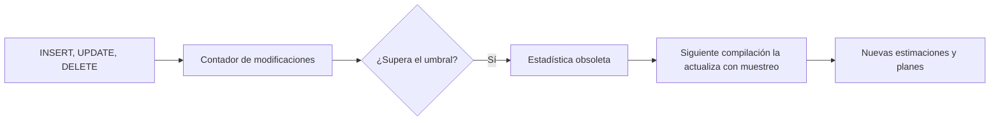

# Estadísticas

Parte de: [[06-SQL-Server/04 Rendimiento/_Índice Rendimiento|Rendimiento]]

> [!info] Cómo avanzar
> `progreso`: **pendiente** → **viendo** (estudiando) → **visto** (contestaste la autoevaluación sin abrir las respuestas) → **dominado** (hiciste el laboratorio o lo aplicaste de verdad).

## Contenido

### Qué es
Las **estadísticas** son objetos que describen **cómo se distribuyen los valores** de una o varias columnas: cuántas filas hay, cuántos valores distintos y un **histograma** con la frecuencia de rangos de valores. El optimizador de consultas las usa para **estimar cuántas filas** devolverá cada paso de un plan (la *cardinalidad*), y con esas estimaciones decide todo lo demás: si hace *seek* o *scan*, qué tipo de join usa, en qué orden une las tablas, cuánta memoria pide. Estadísticas desactualizadas o ausentes son una de las causas más comunes de planes malos.

### Cómo funciona
Cada índice tiene estadísticas sobre sus columnas clave, y SQL Server crea automáticamente estadísticas de una columna cuando una consulta filtra por una columna sin índice (`AUTO_CREATE_STATISTICS`, activado por defecto). Cada objeto de estadísticas tiene:
1. **Encabezado**: fecha de actualización, filas totales y filas muestreadas.
2. **Densidad**: 1 / número de valores distintos, para cada prefijo de columnas; se usa cuando el valor no se conoce (variables locales, `OPTIMIZE FOR UNKNOWN`).
3. **Histograma**: hasta **200 pasos** sobre la primera columna, cada uno con el valor límite superior, filas iguales a ese valor y filas en el rango anterior.

**Actualización automática** (`AUTO_UPDATE_STATISTICS`, activada por defecto): SQL Server cuenta las modificaciones a la columna y, cuando superan un umbral, marca las estadísticas como obsoletas; se actualizan **la próxima vez que una consulta las necesite al compilar** (no en el momento del cambio). Con nivel de compatibilidad 130 o más, el umbral para tablas grandes es dinámico: el menor entre 500 + 20 % de las filas y la raíz cuadrada de 1000 × filas. Para una tabla de 1 millón de filas, el umbral pasa de unas 200,500 modificaciones (regla vieja) a unas 31,600. Por defecto la actualización es **síncrona**: la consulta que la dispara espera; con `AUTO_UPDATE_STATISTICS_ASYNC` la consulta usa las viejas y la actualización ocurre en segundo plano.



### Ejemplo
```sql
-- Ver estadísticas de un índice: encabezado, densidad e histograma
DBCC SHOW_STATISTICS (N'ventas.Pedidos', N'IX_Pedidos_ClienteId_Fecha');

-- Cuándo se actualizaron y cuántos cambios llevan
SELECT s.name, sp.last_updated, sp.rows, sp.rows_sampled, sp.modification_counter
FROM   sys.stats s
CROSS  APPLY sys.dm_db_stats_properties(s.object_id, s.stats_id) sp
WHERE  s.object_id = OBJECT_ID(N'ventas.Pedidos');

-- Actualizar manualmente
UPDATE STATISTICS ventas.Pedidos IX_Pedidos_ClienteId_Fecha WITH FULLSCAN;
UPDATE STATISTICS ventas.Pedidos;               -- todas las de la tabla, con muestreo
```

**El caso de la carga del día** (problema de la *clave ascendente*): tienes una tabla de movimientos con años de datos y cargas 1 millón de filas con fecha de hoy. Las consultas de "hoy" se vuelven lentísimas. ¿Por qué? El histograma se construyó antes de la carga y su último paso termina en la fecha máxima de ese momento, digamos ayer. Para el optimizador, `Fecha = hoy` está **fuera del histograma**, así que estima muy pocas filas (el estimador moderno, desde compatibilidad 120, supone algo basado en la densidad; el antiguo suponía 1 fila). Con una estimación de pocas filas elige *Nested Loops* con *Key Lookups* y pide poca memoria, plan que con 1 millón de filas reales es desastroso, con posibles *spills* a tempdb. Además, dependiendo del tamaño de la tabla, 1 millón de cambios puede no alcanzar el umbral de actualización automática. La solución es **actualizar las estadísticas al terminar la carga** (`UPDATE STATISTICS` como último paso del proceso de carga) y, si el patrón se repite, programar actualizaciones más frecuentes.

### Cuándo usarlo y cuándo no
- **Deja activadas** la creación y actualización automáticas; casi nunca conviene apagarlas.
- **Actualiza manualmente** después de cargas masivas, en tablas con claves ascendentes (fechas, identidades) y cuando el plan muestra grandes diferencias entre filas estimadas y reales (ver [[Plan estimado vs plan real]]).
- **`FULLSCAN`** en tablas donde el muestreo no captura bien distribuciones sesgadas; cuesta más, prográmalo en ventanas de mantenimiento.
- Muchas "consultas que se arreglan solas tras reconstruir índices" en realidad se arreglaron porque la reconstrucción actualizó las estadísticas con `FULLSCAN`.

### Errores comunes
- **Culpar al índice** cuando el problema son estadísticas viejas.
- **Apagar `AUTO_UPDATE_STATISTICS`** "para que no estorbe": los planes se degradan con el tiempo.
- **No actualizar tras cargas** de datos: estimaciones basadas en el pasado.
- **Esperar estadísticas en variables de tabla**: no tienen (ver [[Tablas temporales y variables de tabla]]).
- **Reconstruir índices a diario** solo para refrescar estadísticas: `UPDATE STATISTICS` es mucho más barato.

### Para profundizar
- [Statistics (SQL Server)](https://learn.microsoft.com/en-us/sql/relational-databases/statistics/statistics)
- [DBCC SHOW_STATISTICS](https://learn.microsoft.com/en-us/sql/t-sql/database-console-commands/dbcc-show-statistics-transact-sql)
- [Cardinality estimation (SQL Server)](https://learn.microsoft.com/en-us/sql/relational-databases/performance/cardinality-estimation-sql-server)

## Autoevaluación

Contesta primero en voz alta o en papel; luego despliega la respuesta.

> [!question]- ¿Qué son las estadísticas y para qué las usa el optimizador?
> Resúmenes de la distribución de valores de columnas (un histograma de hasta 200 pasos, densidad). Con ellas estima cuántas filas devolverá cada filtro y elige el plan.

> [!question]- ¿Cuándo se actualizan solas?
> Con `AUTO_UPDATE_STATISTICS` activo, cuando cambia suficiente porcentaje de filas; desde compatibilidad 130 el umbral es dinámico (más bajo en tablas grandes). La actualización ocurre al compilar la siguiente consulta que las necesite.

> [!question]- ¿Cómo ves y actualizas las estadísticas de un índice?
> ```sql
> DBCC SHOW_STATISTICS ('ventas.Movimientos', 'IX_Mov_Cliente');
> UPDATE STATISTICS ventas.Movimientos IX_Mov_Cliente WITH FULLSCAN;
> ```

> [!question]- Caso: tras cargar 1 millón de filas nuevas con fecha de hoy, las consultas de «hoy» van lentísimas. ¿Por qué?
> El histograma no conoce las fechas nuevas (problema de «clave ascendente») y estima casi 0 filas. Actualiza estadísticas después de cargas grandes.

## Práctica

- [[Lab 7 - Índices y planes de ejecución antes y después]]
- [[Lab 8 - Parameter sniffing y Query Store]]

