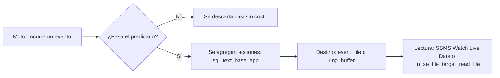

# Extended Events

Parte de: [[06-SQL-Server/04 Rendimiento/_Índice Rendimiento|Rendimiento]]

> [!info] Cómo avanzar
> `progreso`: **pendiente** → **viendo** (estudiando) → **visto** (contestaste la autoevaluación sin abrir las respuestas) → **dominado** (hiciste el laboratorio o lo aplicaste de verdad).

## Contenido

### Qué es
**Extended Events** (XE) es el sistema de **captura de eventos** de SQL Server: un mecanismo ligero para registrar lo que sucede dentro del motor cuando ocurre algo que te interesa, como una instrucción que tarda más de un segundo, un deadlock, un error, una recompilación o una espera larga. Reemplaza a SQL Trace y SQL Server Profiler, que están marcados como obsoletos (*deprecated*) y tienen mucho más impacto en el servidor. A diferencia de las [[DMVs]], que muestran acumulados o el estado actual, XE registra **cada evento individual** con su contexto.

### Cómo funciona
Una **sesión de eventos** combina cuatro piezas:

1. **Eventos**: qué capturar. Por ejemplo `sqlserver.sql_statement_completed` (terminó una instrucción de un lote), `sqlserver.rpc_completed` (terminó una llamada RPC, que es como llegan los procedimientos y las consultas parametrizadas de Dapper/ADO.NET), `sqlserver.xml_deadlock_report`, `sqlserver.error_reported`.
2. **Acciones**: datos extra que se agregan al evento: `sql_text`, `database_name`, `client_app_name`, `username`, `query_hash`.
3. **Predicados** (filtros): condiciones que se evalúan **al momento del evento**, antes de guardarlo, como `duration > 1000000` o `database_name = N'Tienda'`. Filtrar bien es lo que hace barato a XE.
4. **Destinos** (*targets*): dónde se guardan. `event_file` (archivo `.xel` en disco, lo normal), `ring_buffer` (en memoria, circular), `histogram` (cuenta eventos agrupados).



**`system_health`**: es una sesión que viene **creada y activada por defecto** en cada instancia. Captura, entre otras cosas, los **deadlocks** (`xml_deadlock_report`), errores de alta severidad, problemas de memoria, esperas largas por bloqueos y latches, y el estado del servidor de forma periódica. Es el primer lugar donde buscar cuando alguien dice "ayer hubo un deadlock" (ver [[Deadlocks]]): ya quedó registrado sin que hayas configurado nada. Guarda en `event_file` y `ring_buffer` con tamaño limitado, así que la historia es de horas o días según la actividad.

### Ejemplo
Sesión que captura las instrucciones y llamadas de más de 1 segundo en la base Tienda:

```sql
CREATE EVENT SESSION LentasTienda ON SERVER
ADD EVENT sqlserver.sql_statement_completed (
    ACTION (sqlserver.sql_text, sqlserver.client_app_name, sqlserver.username)
    WHERE  duration > 1000000                     -- microsegundos: 1 segundo
      AND  sqlserver.database_name = N'Tienda'),
ADD EVENT sqlserver.rpc_completed (               -- procedimientos y sp_executesql desde Dapper
    ACTION (sqlserver.sql_text, sqlserver.client_app_name, sqlserver.username)
    WHERE  duration > 1000000
      AND  sqlserver.database_name = N'Tienda')
ADD TARGET package0.event_file (SET filename = N'LentasTienda', max_file_size = 50, max_rollover_files = 4)
WITH (STARTUP_STATE = OFF);
GO
ALTER EVENT SESSION LentasTienda ON SERVER STATE = START;

-- Leer el archivo con T-SQL
SELECT x.value('(event/@timestamp)[1]', 'datetime2')                          AS Hora,
       x.value('(event/data[@name="duration"]/value)[1]', 'bigint') / 1000    AS DuracionMs,
       x.value('(event/action[@name="sql_text"]/value)[1]', 'nvarchar(max)')  AS Texto
FROM  (SELECT CAST(event_data AS xml) AS x
       FROM   sys.fn_xe_file_target_read_file(N'LentasTienda*.xel', NULL, NULL, NULL)) t
ORDER BY Hora DESC;

-- Deadlocks recientes desde system_health
SELECT CAST(event_data AS xml) AS Deadlock
FROM   sys.fn_xe_file_target_read_file(N'system_health*.xel', NULL, NULL, NULL)
WHERE  object_name = N'xml_deadlock_report';
```

Los eventos se leen como XML (ver [[XML en SQL Server]]). En SSMS, *Management > Extended Events > Sessions* permite crear sesiones con un asistente y ver los datos en vivo (*Watch Live Data*) con filtros y agrupaciones, lo que suele ser más cómodo para explorar. En Azure SQL Database las sesiones se crean con `ON DATABASE` en lugar de `ON SERVER`, y el destino de archivo apunta a Azure Blob Storage.

Para identificar qué endpoint de la API generó la consulta, configura `Application Name` en la cadena de conexión (por ejemplo `Application Name=Itzamna.Dionisio`) y captura `client_app_name`.

### Cuándo usarlo y cuándo no
- **Úsalo** para encontrar consultas lentas puntuales, capturar deadlocks y errores, investigar recompilaciones, timeouts (`attention`) o esperas específicas, y para medir cuántas veces pasa algo con un destino `histogram`.
- **Query Store** es mejor para tendencias de rendimiento por consulta a lo largo del tiempo, sin configurar nada.
- **DMVs** para lo que está pasando ahora mismo.
- **No dejes sesiones amplias sin filtro** corriendo en producción: capturar todas las instrucciones con `sql_text` genera mucho volumen.

### Errores comunes
- **Unidades de `duration`**: en estos eventos está en microsegundos; `duration > 1000` es 1 milisegundo, no 1 segundo.
- **Capturar solo `sql_statement_completed`**: las llamadas de Dapper llegan como RPC; agrega `rpc_completed`.
- **Sin predicados**: impacto en el servidor y archivos enormes.
- **Seguir usando Profiler** en producción: más pesado y obsoleto.
- **Olvidar detener la sesión** de diagnóstico al terminar.

### Para profundizar
- [Extended Events overview](https://learn.microsoft.com/en-us/sql/relational-databases/extended-events/extended-events)
- [Quickstart: Extended Events](https://learn.microsoft.com/en-us/sql/relational-databases/extended-events/quick-start-extended-events-in-sql-server)
- [Use the system_health session](https://learn.microsoft.com/en-us/sql/relational-databases/extended-events/use-the-system-health-session)

## Autoevaluación

Contesta primero en voz alta o en papel; luego despliega la respuesta.

> [!question]- ¿Qué son los Extended Events (XE)?
> El sistema ligero de rastreo de SQL Server: defines una **sesión** con **eventos** (p. ej. `sql_statement_completed`, `xml_deadlock_report`), filtros y **destinos** (`event_file`, `ring_buffer`). Reemplaza a SQL Trace/Profiler, que está obsoleto.

> [!question]- ¿Qué es la sesión `system_health`?
> Una sesión que viene activa por defecto y guarda, entre otras cosas, deadlocks, errores graves y esperas largas. Es lo primero que revisar después de un incidente.

> [!question]- Crea una sesión que capture las instrucciones de más de 1 segundo en la base Tienda.
> ```sql
> CREATE EVENT SESSION Lentas ON SERVER
> ADD EVENT sqlserver.sql_statement_completed (
>     ACTION (sqlserver.sql_text, sqlserver.session_id)
>     WHERE duration > 1000000 AND sqlserver.database_name = N'Tienda')
> ADD TARGET package0.event_file (SET filename = N'Lentas.xel');
> ALTER EVENT SESSION Lentas ON SERVER STATE = START;
> ```
> `duration` está en microsegundos. En Azure SQL Database se crean con `ON DATABASE` y el destino debe ser un contenedor de Azure Storage o `ring_buffer`.

