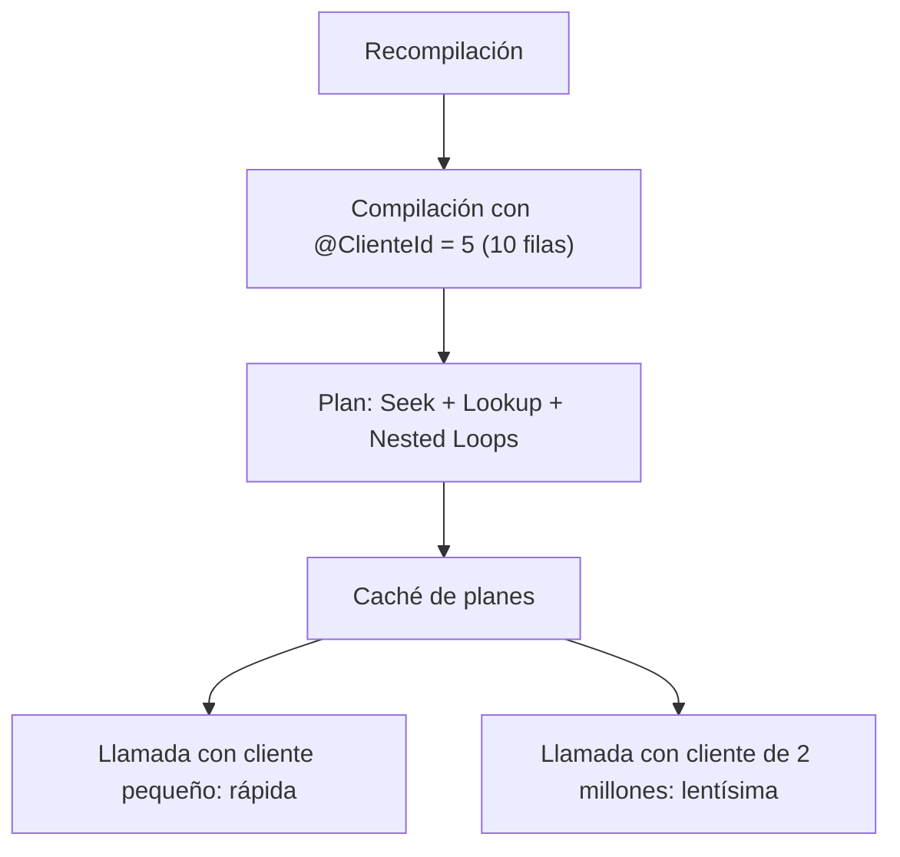

# Parameter sniffing

Parte de: [[06-SQL-Server/04 Rendimiento/_Índice Rendimiento|Rendimiento]]

> [!info] Cómo avanzar
> `progreso`: **pendiente** → **viendo** (estudiando) → **visto** (contestaste la autoevaluación sin abrir las respuestas) → **dominado** (hiciste el laboratorio o lo aplicaste de verdad).

## Contenido

### Qué es
**Parameter sniffing** ("olfateo de parámetros") es el comportamiento por el cual SQL Server, al compilar un procedimiento o una consulta parametrizada, **mira los valores de los parámetros de esa primera ejecución** y optimiza el plan para ellos. Ese plan se guarda en caché y se reutiliza para todas las ejecuciones siguientes, con cualquier valor. Casi siempre es bueno: evita recompilar en cada llamada y el plan es óptimo para valores típicos. Se vuelve un problema cuando los datos están **sesgados** y distintos valores necesitan planes muy distintos.

### Cómo funciona
Imagina `ventas.Pedidos_PorCliente @ClienteId`. La mayoría de los clientes tiene 10 pedidos, pero un cliente corporativo tiene 2 millones.

1. Si la primera llamada después de compilar es con un cliente pequeño, el optimizador estima pocas filas y elige *Index Seek* + *Key Lookup* + *Nested Loops*, con poca memoria. Excelente para 10 filas.
2. Ese plan queda en caché. Cuando llega el cliente corporativo, se reutiliza: 2 millones de *Key Lookups* y operaciones que se derraman a tempdb. La consulta pasa de milisegundos a minutos.
3. Si el plan se recompila (reinicio, cambio de estadísticas, presión de memoria) y la primera llamada es la del cliente grande, ocurre lo contrario: un plan con *scan* y *Hash Match* que es lento para los clientes pequeños.



**Síntomas típicos**:
- "Ayer funcionaba y hoy no", sin cambios de código; o "a veces tarda 50 ms y a veces 30 s" con la misma consulta.
- La consulta va lenta desde la aplicación pero rápida al copiarla en SSMS con los mismos valores. Parte de la explicación es que en SSMS escribes literales o variables locales (otro plan) y que SSMS y ADO.NET usan distintas opciones `SET` (por ejemplo `ARITHABORT`), lo que genera entradas de caché diferentes.
- El problema "se arregla solo" después de un `sp_recompile`, de actualizar estadísticas o de reiniciar, y vuelve días después.
- En el plan real, las filas estimadas difieren enormemente de las reales (ver [[Plan estimado vs plan real]]).

### Ejemplo
```sql
CREATE OR ALTER PROCEDURE ventas.Pedidos_PorCliente @ClienteId int
AS
BEGIN
    SET NOCOUNT ON;
    SELECT PedidoId, Fecha, Estado
    FROM   ventas.Pedidos
    WHERE  ClienteId = @ClienteId
    -- Opción 1: plan nuevo en cada ejecución (cuesta CPU de compilación)
    OPTION (RECOMPILE);
    -- Opción 2: optimizar para un valor representativo
    -- OPTION (OPTIMIZE FOR (@ClienteId = 5));
    -- Opción 3: usar la densidad promedio, ignorando el valor
    -- OPTION (OPTIMIZE FOR UNKNOWN);
END;
```

**Soluciones** (de más a menos recomendadas según el caso):
1. **Mejorar el índice** para que un mismo plan sirva a todos: un índice cubriente elimina los *Key Lookups* y el plan con *seek* deja de ser peligroso para el cliente grande.
2. **`OPTION (RECOMPILE)`** en la instrucción problemática: plan óptimo para cada valor. Bueno para consultas que se ejecutan pocas veces por segundo; caro para las que corren miles de veces.
3. **`OPTIMIZE FOR (@p = valor)`** o **`OPTIMIZE FOR UNKNOWN`**: un plan estable pensado para el caso típico o el promedio.
4. **Separar casos**: un procedimiento para clientes grandes y otro para el resto, o SQL dinámico que genere textos distintos.
5. **Forzar un plan bueno con [[Query Store]]**, o aplicar una sugerencia sin cambiar código con *Query Store hints* (SQL Server 2022 y Azure SQL).
6. **Optimización de planes sensibles a parámetros (PSP)**: en SQL Server 2022 con compatibilidad 160, el motor puede guardar varias variantes de plan para un mismo procedimiento según el rango de valores de un predicado de igualdad, mitigando el problema de forma automática en muchos casos.

**¿Por qué `DBCC FREEPROCCACHE` no es solución?** Porque borra **todos** los planes del servidor: cada consulta de todas las aplicaciones tiene que recompilarse, con un pico de CPU. Y no corrige nada: la siguiente compilación vuelve a olfatear el valor que llegue primero, y si es el "malo", el problema regresa. Es apagar la alarma, no el fuego. Si necesitas una recompilación de emergencia, usa `EXEC sp_recompile N'ventas.Pedidos_PorCliente'` o elimina solo ese plan con su `plan_handle`, y luego aplica una solución de fondo.

### Cuándo usarlo y cuándo no
- Sospecha de parameter sniffing cuando el rendimiento varía mucho según los valores y los datos tienen distribución sesgada.
- No todo problema intermitente es sniffing: descarta bloqueos ([[Bloqueos (locks)]]) y estadísticas desactualizadas ([[Estadísticas]]).
- Evita el truco de copiar el parámetro a una variable local: equivale a `OPTIMIZE FOR UNKNOWN`, pero de forma implícita y difícil de entender para quien lea el código.

### Errores comunes
- **`DBCC FREEPROCCACHE` como "arreglo"** en producción.
- **`WITH RECOMPILE` en todo el procedimiento** cuando solo una instrucción lo necesita: usa `OPTION (RECOMPILE)` en esa instrucción.
- **Probar en SSMS con variables locales** y concluir que "en SQL va rápido": no reproduce el plan de la app.
- **Ignorar el índice**: muchas veces un `INCLUDE` resuelve el problema para todos los valores.

### Para profundizar
- [Parameter Sensitive Plan optimization](https://learn.microsoft.com/en-us/sql/relational-databases/performance/parameter-sensitive-plan-optimization)
- [Query hints: RECOMPILE y OPTIMIZE FOR](https://learn.microsoft.com/en-us/sql/t-sql/queries/hints-transact-sql-query)
- [Query processing architecture guide: parameter sensitivity](https://learn.microsoft.com/en-us/sql/relational-databases/query-processing-architecture-guide)

## Autoevaluación

Contesta primero en voz alta o en papel; luego despliega la respuesta.

> [!question]- ¿Qué es el *parameter sniffing*?
> Al compilar un procedimiento, SQL Server optimiza para los valores de parámetro de **esa primera ejecución** y guarda el plan en caché. Es bueno casi siempre, pero si los datos están sesgados, el plan para un valor raro puede ser pésimo para uno común (o viceversa).

> [!question]- ¿Cuáles son los síntomas típicos?
> «El procedimiento a veces tarda 50 ms y a veces 30 s», «se arregló solo tras reiniciar» o «en SSMS va rápido y desde la app lento» (distintas opciones `SET` como `ARITHABORT` generan planes separados).

> [!question]- ¿Qué soluciones hay?
> `OPTION (RECOMPILE)` (plan por ejecución; cuesta CPU), `OPTIMIZE FOR (@p = valor)` u `OPTIMIZE FOR UNKNOWN`, separar en procedimientos según el caso, forzar un plan con Query Store, o en SQL Server 2022 (compatibilidad 160) la optimización PSP, que guarda varios planes según el valor.

> [!question]- ¿Por qué `DBCC FREEPROCCACHE` no es una solución?
> Solo borra la caché: la siguiente ejecución vuelve a «olfatear» un valor y el problema regresa cuando toque el valor malo. Además en producción recompila todo el servidor de golpe.

## Práctica

- [[Lab 8 - Parameter sniffing y Query Store]]

