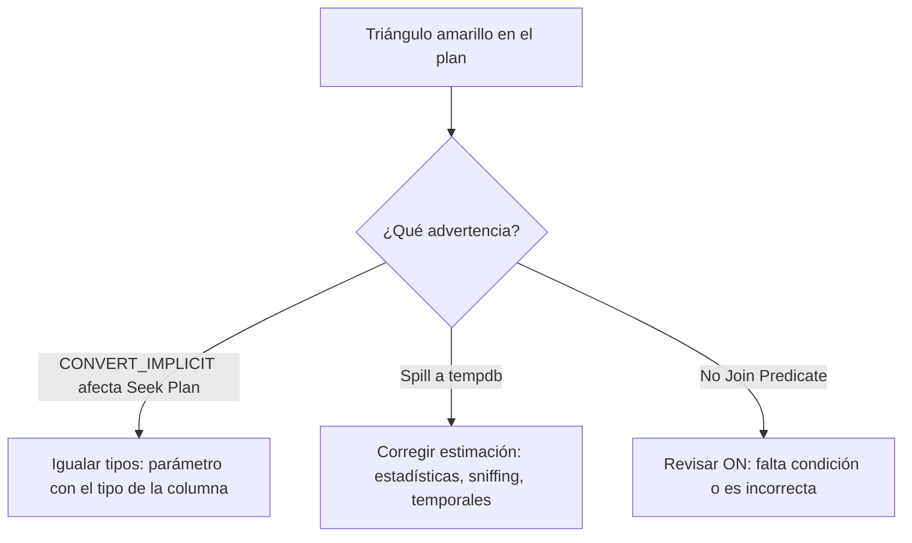

# Advertencias del plan (conversiones implícitas y spills)

Parte de: [[Planes de ejecución]]

> [!info] Cómo avanzar
> `progreso`: **pendiente** → **viendo** (estudiando) → **visto** (contestaste la autoevaluación sin abrir las respuestas) → **dominado** (hiciste el laboratorio o lo aplicaste de verdad).

## Contenido

### Qué es
Las **advertencias** son los triángulos amarillos con signo de exclamación que SSMS dibuja sobre algunos operadores de un [[Planes de ejecución|plan de ejecución]], y que también aparecen en el elemento `Warnings` del XML del plan. Señalan situaciones que el optimizador detectó como potencialmente problemáticas. Las tres más importantes para un desarrollador son las **conversiones implícitas** (`CONVERT_IMPLICIT`), los **spills a tempdb** y la falta de **predicado de join** (*No Join Predicate*). Otras que verás: columnas sin estadísticas, concesiones de memoria excesivas y operaciones con muchas filas leídas para pocas devueltas.

### Cómo funciona
**Conversión implícita (`CONVERT_IMPLICIT`)**. Cuando comparas valores de tipos distintos, SQL Server convierte uno al tipo del otro según la **precedencia de tipos** (el de menor precedencia se convierte al de mayor). `nvarchar` tiene mayor precedencia que `varchar`; si comparas una columna `varchar` con un parámetro `nvarchar`, la **columna** es la que se convierte. Convertir la columna equivale a aplicarle una función: el predicado deja de ser [[SARGability|SARGable]] y en lugar de un *Index Seek* puede haber un *Index Scan* que lee todo el índice (con algunas intercalaciones de Windows el motor todavía logra un *seek* por rango, pero con estimaciones peores; con intercalaciones SQL el *seek* se pierde). La advertencia dice algo como "Type conversion in expression (CONVERT_IMPLICIT(nvarchar(20), [Referencia], 0)) may affect *Seek Plan* / *CardinalityEstimate*". La de "Seek Plan" es la grave; la de "CardinalityEstimate" en una columna de la lista de salida suele ser inofensiva.

La causa más común en aplicaciones .NET: **Dapper y ADO.NET envían los `string` como `nvarchar`** por defecto. Si la columna es `varchar` (códigos, referencias, estados), se produce la conversión. Otras causas: comparar una columna `int` con un texto, unir columnas de tipos distintos entre tablas (`varchar(10)` con `int`) o declarar mal los parámetros de un procedimiento.

**Spill a tempdb**. Operadores como *Sort* y *Hash Match* necesitan memoria de trabajo; antes de ejecutar, el motor les concede una cantidad (*memory grant*) calculada con las **filas estimadas**. Si llegan más filas de las estimadas, los datos no caben y el operador escribe parte en **tempdb** (disco) y la vuelve a leer: eso es un *spill*. Aparece como advertencia *Operator used tempdb to spill data during execution with spill level N* (solo en el **plan real**, porque se conoce al ejecutar). Un *spill* puede convertir una consulta de 200 ms en una de 20 s. La causa de fondo casi siempre es una **subestimación**: [[Estadísticas]] viejas, [[Parameter sniffing]], variables de tabla. Desde SQL Server 2017 (modo batch) y 2019 (modo fila), la *retroalimentación de concesión de memoria* (*memory grant feedback*) ajusta la concesión en ejecuciones posteriores de la misma consulta.

**No Join Predicate**. Indica que el optimizador está uniendo dos tablas **sin condición de unión**: un producto cartesiano, donde cada fila de una se combina con todas las de la otra. Casi siempre es un error de escritura: un `JOIN` con un `ON` que compara la tabla consigo misma, una condición olvidada, o la sintaxis antigua de comas (`FROM A, B WHERE ...`) sin la condición en el `WHERE`. Con tablas de 10,000 filas cada una, el resultado intermedio tiene 100 millones.



### Ejemplo
```sql
-- Columna varchar(20) con índice
-- CREATE INDEX IX_Movimientos_Referencia ON ventas.Movimientos (Referencia);

DECLARE @RefN nvarchar(4000) = N'REF-0042';   -- lo que manda Dapper por defecto
SELECT MovimientoId FROM ventas.Movimientos WHERE Referencia = @RefN;  -- CONVERT_IMPLICIT

DECLARE @RefA varchar(20) = 'REF-0042';       -- mismo tipo que la columna
SELECT MovimientoId FROM ventas.Movimientos WHERE Referencia = @RefA;  -- Index Seek limpio

-- No Join Predicate: el ON compara la tabla consigo misma
SELECT c.Nombre, p.PedidoId
FROM   ventas.Clientes c
JOIN   ventas.Pedidos  p ON c.ClienteId = c.ClienteId;   -- debía ser p.ClienteId
```

```csharp
// Dapper: indicar que el parámetro es varchar (ANSI) y su longitud
var movs = await conn.QueryAsync<Movimiento>(
    "SELECT MovimientoId, Fecha, Monto FROM ventas.Movimientos WHERE Referencia = @Ref",
    new { Ref = new DbString { Value = referencia, IsAnsi = true, Length = 20 } });
```

Otra opción de fondo es declarar los parámetros con el tipo exacto en un procedimiento almacenado (`@Ref varchar(20)`): la conversión ocurre una sola vez sobre el parámetro, no sobre la columna.

### Cuándo usarlo y cuándo no
- **Revisa siempre las advertencias** cuando analices un plan, empezando por las de los operadores con más filas.
- **Atiende con prioridad** `CONVERT_IMPLICIT` que afecte *Seek Plan*, cualquier *spill* en consultas frecuentes y todo *No Join Predicate*.
- **No toda advertencia es grave**: una conversión implícita en la lista de columnas de salida o un *spill* de nivel 1 pequeño en un reporte nocturno pueden no merecer cambios.

### Errores comunes
- **Mezclar `varchar` y `nvarchar`** entre columnas y parámetros; define una convención (por ejemplo, `nvarchar` para textos de personas y `varchar` para códigos) y respétala en C#.
- **Buscar *spills* en el plan estimado**: solo aparecen en el real.
- **"Arreglar" un *spill* con más memoria del servidor** en lugar de corregir la estimación.
- **Usar sintaxis de comas** en el `FROM`, que facilita olvidar condiciones de unión.

### Para profundizar
- [Data type precedence (Transact-SQL)](https://learn.microsoft.com/en-us/sql/t-sql/data-types/data-type-precedence-transact-sql)
- [Memory grant feedback](https://learn.microsoft.com/en-us/sql/relational-databases/performance/intelligent-query-processing-memory-grant-feedback)
- [Showplan logical and physical operators reference](https://learn.microsoft.com/en-us/sql/relational-databases/showplan-logical-and-physical-operators-reference)

## Autoevaluación

Contesta primero en voz alta o en papel; luego despliega la respuesta.

> [!question]- ¿Qué significa el triángulo amarillo de `CONVERT_IMPLICIT` en un plan?
> SQL Server tuvo que convertir tipos (p. ej. columna `varchar` comparada con parámetro `nvarchar`); si la conversión es sobre la columna, puede impedir el seek. Corrige el tipo del parámetro (Dapper: `DbString { IsAnsi = true }`).

> [!question]- ¿Qué es un *spill* a tempdb?
> Un Sort o Hash que no cupo en la memoria concedida y escribió a tempdb, mucho más lento. Causa típica: estimación de filas baja. Se ve como advertencia en el plan real.

> [!question]- ¿Qué indica la advertencia «No join predicate»?
> Un join sin condición (producto cartesiano), casi siempre un error en la consulta.

## Práctica

- [[Lab 7 - Índices y planes de ejecución antes y después]]

