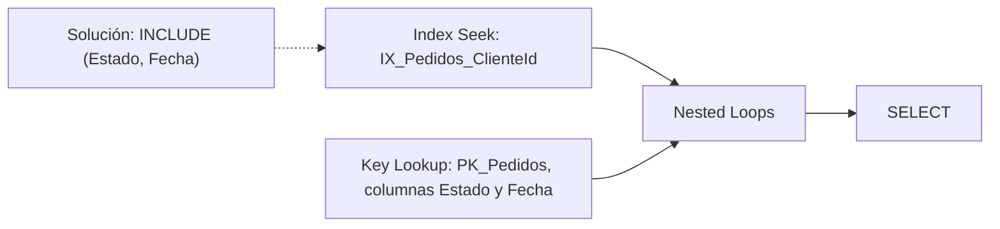

# Operadores de acceso (Scan, Seek y Key Lookup)

Parte de: [[Planes de ejecución]]

> [!info] Cómo avanzar
> `progreso`: **pendiente** → **viendo** (estudiando) → **visto** (contestaste la autoevaluación sin abrir las respuestas) → **dominado** (hiciste el laboratorio o lo aplicaste de verdad).

## Contenido

### Qué es
Los **operadores de acceso** son los que aparecen a la derecha de un [[Planes de ejecución|plan de ejecución]] y leen datos de tablas e índices. Entenderlos te dice **cuánto** leyó la consulta y **cómo**:

- **Table Scan**: lee todo un *heap* (tabla sin índice clustered).
- **Clustered Index Scan** / **Index Scan**: lee todo (o casi todo) un índice, página por página.
- **Clustered Index Seek** / **Index Seek**: navega el árbol B hasta un valor o rango y lee solo esa parte.
- **Key Lookup**: por cada fila encontrada en un índice nonclustered, va al índice clustered a buscar las columnas que faltan.
- **RID Lookup**: lo mismo, pero cuando la tabla es un heap: busca por el identificador físico de la fila (archivo, página, ranura).

### Cómo funciona
**Scan frente a Seek**. Un *Index Seek* usa el orden del índice para saltar al lugar correcto: con un índice en `ClienteId`, `WHERE ClienteId = 3` baja por el árbol y lee solo las filas de ese cliente. Un *Index Scan* recorre el índice de principio a fin (salvo que haya un `TOP` que lo detenga antes). Reglas para interpretarlos:
- Un *seek* no siempre es bueno: un *seek* cuyo rango abarca el 90 % de la tabla lee casi todo. Revisa las filas leídas.
- Un *scan* no siempre es malo: si necesitas la mayoría de las filas o la tabla es pequeña, escanear es lo más eficiente.
- En las propiedades del operador distingue **Seek Predicates** (lo que se usó para navegar el índice) de **Predicate** (filtro residual que se evalúa sobre cada fila leída). Un *seek* por `ClienteId` con un predicado residual sobre una columna sin índice puede leer muchas más filas de las que devuelve.
- Un *scan* donde esperabas un *seek* suele indicar un predicado no [[SARGability|SARGable]], una conversión implícita o la falta de un índice adecuado.

**Key Lookup**. Un índice nonclustered guarda sus columnas clave, las incluidas y la clave clustered (ver [[Índice nonclustered]]). Si la consulta pide columnas que no están ahí, el plan muestra un *Index Seek* seguido de un *Key Lookup* unido con *Nested Loops*: una búsqueda adicional **por cada fila**. Con 5 filas no importa; con 50,000 son 50,000 búsquedas aleatorias. Cuando el optimizador estima muchas filas, prefiere escanear el clustered para evitar los lookups; cuando estima pocas y en realidad son muchas, el lookup se vuelve el cuello de botella (ver [[Plan estimado vs plan real]]).

**Cómo eliminar un Key Lookup costoso**:
1. **Cubrir la consulta**: agrega las columnas que faltan al índice con `INCLUDE` (ver [[Columnas incluidas y filtered indexes]]). El *Output List* del operador *Key Lookup* te dice exactamente qué columnas faltan, y su *Predicate* si además filtra.
2. **Pedir menos columnas**: quita `SELECT *` y las columnas que la API no usa. Con Dapper es tentador mapear la entidad completa; un DTO específico por consulta (una interfaz por consulta) evita columnas innecesarias.
3. **Reconsiderar el clustered** si muchas consultas buscan por esa columna y piden toda la fila.

**RID Lookup** aparece solo en **heaps**. Además del costo por fila, los heaps sufren *forwarded records* cuando una fila crece y se mueve, lo que agrega lecturas. La solución de fondo suele ser crear un [[Índice clustered]].



### Ejemplo
```sql
SET STATISTICS IO ON;

-- Con IX_Pedidos_ClienteId (ClienteId) solamente:
SELECT PedidoId, Fecha, Estado
FROM   ventas.Pedidos
WHERE  ClienteId = 3;
-- Plan: Index Seek (IX_Pedidos_ClienteId) + Key Lookup (PK_Pedidos) para Fecha y Estado

-- Cubrir la consulta
CREATE INDEX IX_Pedidos_ClienteId_Cubre
    ON ventas.Pedidos (ClienteId) INCLUDE (Fecha, Estado);
-- Plan: solo Index Seek; menos lecturas lógicas

-- Predicado no SARGable: Scan aunque exista el índice
SELECT PedidoId FROM ventas.Pedidos WHERE ClienteId + 0 = 3;
```

Con las pocas filas del laboratorio de [[Lab 1 - Base de práctica Tienda en SQL Server]] las lecturas lógicas apenas cambian; para ver la diferencia real, genera datos de volumen como en [[Lab 7 - Índices y planes de ejecución antes y después]].

### Cuándo usarlo y cuándo no
- Busca *Key Lookups* con muchas ejecuciones en consultas frecuentes: son de las optimizaciones más rentables.
- No cubras todas las consultas: cada `INCLUDE` agranda el índice y encarece escrituras; prioriza las críticas.
- Acepta *scans* en tablas pequeñas y en consultas que de verdad necesitan casi todo.

### Errores comunes
- **Pensar que todo *scan* es malo** y forzar *seeks* con sugerencias (`FORCESEEK`) sin entender el volumen.
- **Ignorar el predicado residual** de un *seek*.
- **`SELECT *`**: casi garantiza *Key Lookups* o *scans* del clustered.
- **Heaps en tablas consultadas con frecuencia**: RID Lookups y *forwarded records*.

### Para profundizar
- [Showplan logical and physical operators reference](https://learn.microsoft.com/en-us/sql/relational-databases/showplan-logical-and-physical-operators-reference)
- [SQL Server index architecture and design guide](https://learn.microsoft.com/en-us/sql/relational-databases/sql-server-index-design-guide)

## Autoevaluación

Contesta primero en voz alta o en papel; luego despliega la respuesta.

> [!question]- ¿Qué diferencia hay entre *Index Scan* e *Index Seek*?
> *Scan* recorre todo el índice (o la tabla); *Seek* navega el B-tree hasta el rango que cumple el predicado. Un seek no siempre es mejor: un seek que devuelve el 90 % de la tabla equivale a un scan.

> [!question]- ¿Cómo eliminas un *Key Lookup* costoso?
> Agregando como `INCLUDE` al índice las columnas que la consulta pide (índice cubriente), o pidiendo menos columnas.

> [!question]- ¿Qué es un *RID Lookup*?
> El equivalente al Key Lookup cuando la tabla es heap (sin clustered): va a la fila por su identificador físico. Suele indicar que falta un índice clustered.

## Práctica

- [[Lab 7 - Índices y planes de ejecución antes y después]]

