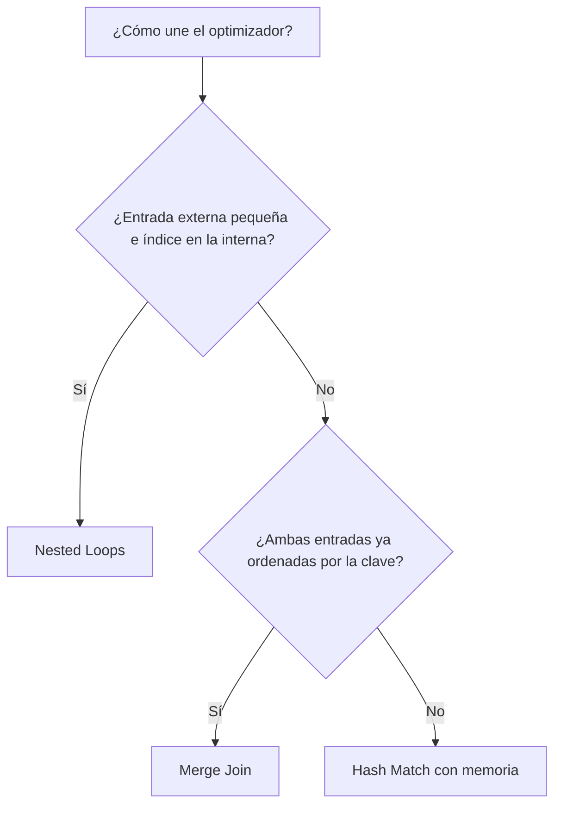

# Operadores de join (Nested Loops, Hash Match y Merge Join)

Parte de: [[Planes de ejecución]]

> [!info] Cómo avanzar
> `progreso`: **pendiente** → **viendo** (estudiando) → **visto** (contestaste la autoevaluación sin abrir las respuestas) → **dominado** (hiciste el laboratorio o lo aplicaste de verdad).

## Contenido

### Qué es
Cuando una consulta une dos conjuntos de filas (un `JOIN`, un `EXISTS`, un `IN`, un `APPLY`), el optimizador elige uno de tres **algoritmos físicos** para hacerlo, y cada uno aparece como un operador en el [[Planes de ejecución|plan de ejecución]]:

- **Nested Loops**: por cada fila de la entrada externa, busca coincidencias en la interna.
- **Hash Match**: construye una tabla hash en memoria con una entrada y la recorre con la otra.
- **Merge Join**: recorre ambas entradas **ya ordenadas** por la clave del join, avanzando en paralelo como al intercalar dos listas.

Ninguno es "el bueno": cada uno gana en ciertas condiciones. Lo importante es reconocer cuándo el elegido no corresponde al volumen real de datos.

### Cómo funciona
**Nested Loops**. La entrada de arriba en el plan es la **externa**; la de abajo, la **interna**, que se ejecuta una vez por cada fila externa. Es excelente cuando la externa tiene **pocas filas** y la interna tiene un **índice** que permite un *seek* por la clave del join: pocas búsquedas baratas. Arranca rápido, devuelve las primeras filas de inmediato y casi no usa memoria. Es el operador típico de las consultas OLTP de una API ("este pedido con sus líneas"). También es el único que soporta joins sin igualdad (`ON a.Fecha BETWEEN b.Inicio AND b.Fin`) y es como se implementa normalmente `APPLY`.

**Hash Match**. Tiene dos fases: *build*, donde lee la entrada de arriba (idealmente la más pequeña) y construye una tabla hash por la clave del join; y *probe*, donde lee la otra y busca cada fila en la tabla hash. El optimizador lo elige cuando las entradas son **grandes**, **no están ordenadas** y no hay índices útiles, o en consultas de tipo reporte. Solo sirve para joins de **igualdad**. Necesita una **concesión de memoria** (*memory grant*) calculada a partir de las filas estimadas; si llegan más filas de las estimadas, la tabla hash no cabe y se derrama a tempdb (*spill*; ver [[Advertencias del plan (conversiones implícitas y spills)]]). Es un operador bloqueante en la fase de construcción: no devuelve nada hasta terminarla. El mismo operador también se usa para agregaciones (`GROUP BY`) y `DISTINCT`.

**Merge Join**. Necesita que **ambas entradas estén ordenadas por la clave del join**, ya sea porque vienen de índices con ese orden o porque el plan agrega un *Sort* antes (lo cual puede salir caro). Con eso, recorre las dos una sola vez: muy eficiente para entradas grandes ya ordenadas, con poca memoria. Requiere al menos un predicado de igualdad. Si la relación es de uno a muchos es directo; si es **muchos a muchos**, necesita una tabla de trabajo en tempdb y pierde eficiencia (la propiedad *Many to Many* del operador lo indica).



Desde SQL Server 2017, en modo batch (y desde 2019 también sobre rowstore con compatibilidad 150), existe el **Adaptive Join**, que decide entre *Hash Match* y *Nested Loops* **durante la ejecución**, según cuántas filas llegan realmente de la entrada de construcción.

### Ejemplo
```sql
-- OLTP: un cliente con sus pedidos -> Nested Loops con Seek
SELECT c.Nombre, p.PedidoId, p.Fecha
FROM   ventas.Clientes c
JOIN   ventas.Pedidos  p ON p.ClienteId = c.ClienteId
WHERE  c.ClienteId = 3;

-- Reporte sobre toda la tabla -> probablemente Hash Match
SELECT pr.Categoria, SUM(d.Cantidad * d.PrecioUnitario) AS Importe
FROM   ventas.PedidoDetalle d
JOIN   ventas.Productos pr ON pr.ProductoId = d.ProductoId
GROUP  BY pr.Categoria;

-- Para aprender: forzar cada algoritmo y comparar lecturas y tiempos (no en producción)
SELECT c.Nombre, p.PedidoId
FROM   ventas.Clientes c JOIN ventas.Pedidos p ON p.ClienteId = c.ClienteId
OPTION (MERGE JOIN);   -- o (HASH JOIN), (LOOP JOIN)
```

**Caso: un Nested Loops con 200 mil ejecuciones en la tabla interna**. Lo primero a sospechar es una **subestimación** de la entrada externa: el optimizador creyó que llegarían pocas filas (por ejemplo, 10) y eligió *Nested Loops*, pero llegaron 200,000, así que la entrada interna (a menudo con un *Key Lookup*) se ejecutó 200,000 veces. Revisa en el plan real las filas estimadas frente a las reales de la entrada externa. Las causas habituales: [[Estadísticas]] desactualizadas, [[Parameter sniffing]], una variable de tabla, o un predicado difícil de estimar. Si además la interna no tiene un índice adecuado y hace un *scan* por ejecución, el problema es doble. La solución no es forzar un *Hash Join* con sugerencias, sino corregir la estimación (actualizar estadísticas, `OPTION (RECOMPILE)`, cambiar la variable de tabla por una temporal) y asegurar el índice correcto; con una estimación correcta, el optimizador elegirá el algoritmo apropiado.

### Cuándo usarlo y cuándo no
- **No fuerces algoritmos** con `OPTION (LOOP JOIN)` o `INNER HASH JOIN` en código de producción salvo como último recurso documentado: congelas una decisión que dependía de los datos.
- **Úsalos para diagnosticar**: un *Hash Match* en una consulta OLTP que debería tocar pocas filas sugiere un índice faltante; un *Nested Loops* con ejecuciones masivas sugiere una mala estimación.
- **Un *Sort* caro antes de un *Merge Join*** puede indicar que falta un índice con el orden adecuado.

### Errores comunes
- **Suponer que *Hash Match* es siempre malo**: en reportes es lo correcto.
- **Ignorar el número de ejecuciones** del lado interno de *Nested Loops*.
- **Forzar sugerencias de join** en lugar de arreglar estimaciones e índices.
- **Pasar por alto *spills*** del *Hash Match* por concesiones de memoria insuficientes.

### Para profundizar
- [Joins (SQL Server)](https://learn.microsoft.com/en-us/sql/relational-databases/performance/joins)
- [Showplan logical and physical operators reference](https://learn.microsoft.com/en-us/sql/relational-databases/showplan-logical-and-physical-operators-reference)
- [Intelligent query processing: adaptive joins](https://learn.microsoft.com/en-us/sql/relational-databases/performance/intelligent-query-processing-details)

## Autoevaluación

Contesta primero en voz alta o en papel; luego despliega la respuesta.

> [!question]- ¿Cuándo es bueno *Nested Loops*?
> Cuando la entrada externa es pequeña y la interna tiene un índice para buscar cada fila (seek). Es el típico de OLTP. Con una entrada externa grande, se vuelve muy caro.

> [!question]- ¿Cuándo elige el optimizador *Hash Match*?
> Con entradas grandes sin orden útil: construye una tabla hash con la menor y la recorre con la mayor. Necesita memoria; si se queda corto, hace *spill* a tempdb.

> [!question]- ¿Qué necesita *Merge Join*?
> Ambas entradas ordenadas por la clave del join (por índices o por un Sort explícito). Es muy eficiente con entradas grandes ya ordenadas.

> [!question]- Ves un Nested Loops con 200 mil ejecuciones en la tabla interna. ¿Qué sospechas?
> Que la estimación de la entrada externa fue muy baja (esperaba pocas filas) y el plan no era para tantas: revisa estadísticas o parameter sniffing.

