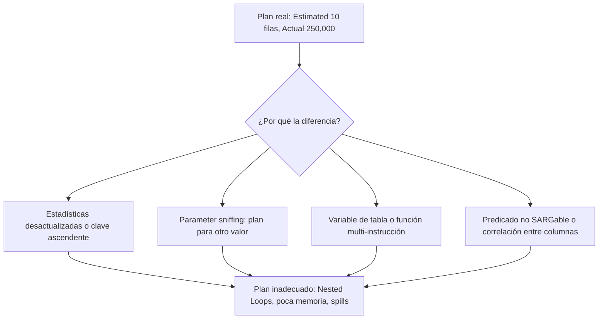

# Plan estimado vs plan real

Parte de: [[Planes de ejecución]]

> [!info] Cómo avanzar
> `progreso`: **pendiente** → **viendo** (estudiando) → **visto** (contestaste la autoevaluación sin abrir las respuestas) → **dominado** (hiciste el laboratorio o lo aplicaste de verdad).

## Contenido

### Qué es
SQL Server puede mostrarte dos versiones del [[Planes de ejecución|plan de ejecución]] de una consulta:

- **Plan estimado**: el plan que el optimizador **elegiría**, generado **sin ejecutar** la consulta. Contiene solo estimaciones: filas esperadas por operador, costos y memoria solicitada.
- **Plan real** (*actual execution plan*): el **mismo plan**, pero capturado **después de ejecutar**, enriquecido con datos medidos: filas reales que pasaron por cada operador, número de ejecuciones de cada operador, memoria concedida y usada, tiempos por operador (en versiones recientes) y advertencias que solo se conocen en ejecución, como los *spills* a tempdb.

Lo importante: la **forma** del plan normalmente es la misma; lo que cambia es que el real te dice si las suposiciones del optimizador eran correctas.

### Cómo funciona
En SSMS, **Ctrl+L** muestra el plan estimado y **Ctrl+M** activa la captura del plan real para la siguiente ejecución. En T-SQL, `SET SHOWPLAN_XML ON` devuelve el estimado sin ejecutar y `SET STATISTICS XML ON` ejecuta y devuelve el real. Los planes que obtienes de la caché (`sys.dm_exec_query_plan`) y de [[Query Store]] son **estimados**: no guardan las filas reales de cada ejecución. Desde SQL Server 2019 existe además el "último plan real conocido" (`sys.dm_exec_query_plan_stats`, con la opción de base `LAST_QUERY_PLAN_STATS`), y *Live Query Statistics* en SSMS muestra el progreso del plan mientras la consulta corre.

La comparación clave está en las propiedades de cada operador: **Estimated Number of Rows** frente a **Actual Number of Rows** (en planes recientes también *Actual Rows Read* y *Estimated Number of Rows to be Read*). Recuerda que, en operadores dentro de un *Nested Loops*, la estimación es **por ejecución** y el real es el **total** de todas las ejecuciones; compáralos considerando el número de ejecuciones.



**¿Qué indica una gran diferencia entre filas estimadas y reales?** Que el optimizador tomó sus decisiones con información equivocada, y casi siempre ese es el origen del plan malo. Si estimó 10 filas y llegaron 250,000, probablemente eligió *Nested Loops* con *Key Lookups* (bueno para 10, terrible para 250,000) y pidió poca memoria para ordenar o hacer hash, lo que provoca *spills*. Si estimó muchas y fueron pocas, quizá pidió demasiada memoria o escaneó cuando podía buscar. Diferencias de 10× o más merecen investigación; busca el operador **más a la derecha** donde empieza la diferencia, porque el error se propaga hacia la izquierda. Las causas típicas: [[Estadísticas]] viejas, [[Parameter sniffing]], [[Tablas temporales y variables de tabla|variables de tabla]], [[Funciones escalares y de tabla|funciones multi-instrucción]], predicados con funciones o conversiones y columnas correlacionadas que el estimador supone independientes.

### Ejemplo
```sql
-- Plan real en XML para una ejecución concreta
SET STATISTICS XML ON;
EXEC ventas.Pedidos_PorCliente @ClienteId = 2;
SET STATISTICS XML OFF;

-- Plan estimado sin ejecutar (útil con un DELETE masivo)
SET SHOWPLAN_XML ON;
GO
DELETE FROM ventas.Movimientos WHERE Fecha < '2020-01-01';
GO
SET SHOWPLAN_XML OFF;
GO
```

`SET SHOWPLAN_XML` debe ser la única instrucción de su lote; por eso los `GO` (ver [[Lotes con GO, sqlcmd e Invoke-Sqlcmd]]). Mientras está activo, las instrucciones **no se ejecutan**: el `DELETE` no borra nada.

### Cuándo usarlo y cuándo no
**Usa el plan real** casi siempre que diagnostiques una consulta: es el único que muestra si las estimaciones fallaron, cuántas veces se ejecutó cada operador y si hubo *spills*.

**Usa solo el plan estimado** cuando:
- La consulta **tarda demasiado** (minutos u horas) y no puedes esperar a que termine.
- La consulta **modifica datos** (`UPDATE`, `DELETE`, `MERGE`) y no quieres ejecutarla en ese ambiente, o necesitas revisarla antes de un despliegue.
- Quieres revisar rápidamente qué índices usaría o si el plan cambió tras crear un índice.
- Estás en producción y ejecutar la consulta tendría impacto (bloqueos, carga).

Si necesitas números reales de algo que modifica datos, ejecútalo en una copia o dentro de una transacción que reviertes con `ROLLBACK`, sabiendo que aun así toma bloqueos.

### Errores comunes
- **Diagnosticar solo con el estimado**: no ves dónde se equivocó el optimizador.
- **Comparar estimado por ejecución contra real total** en el lado interno de un *Nested Loops* sin dividir entre ejecuciones.
- **Creer que el plan de Query Store o de la caché tiene filas reales**: son estimados.
- **Ejecutar un `DELETE` "para ver el plan real"** en producción.
- **Atribuir la diferencia de filas siempre a estadísticas**: también puede ser sniffing o un predicado no SARGable.

### Para profundizar
- [Display the estimated execution plan](https://learn.microsoft.com/en-us/sql/relational-databases/performance/display-the-estimated-execution-plan)
- [Display an actual execution plan](https://learn.microsoft.com/en-us/sql/relational-databases/performance/display-an-actual-execution-plan)
- [Live Query Statistics](https://learn.microsoft.com/en-us/sql/relational-databases/performance/live-query-statistics)

## Autoevaluación

Contesta primero en voz alta o en papel; luego despliega la respuesta.

> [!question]- ¿Qué diferencia hay entre plan estimado y plan real?
> El estimado se genera sin ejecutar (solo estimaciones). El real (*actual*) es el mismo plan más datos de la ejecución: filas reales, ejecuciones, advertencias en tiempo de ejecución (spills) y memoria concedida.

> [!question]- ¿Qué indica una gran diferencia entre filas estimadas y reales?
> Que el optimizador se equivocó de cardinalidad (estadísticas viejas, funciones, variables de tabla, parameter sniffing), y por eso pudo elegir un join o una concesión de memoria inadecuados. Es la primera pista a investigar.

> [!question]- ¿Cuándo usarías solo el plan estimado?
> Cuando la consulta tarda mucho o modifica datos y no quieres ejecutarla, o para revisar rápido índices usados. Para afinar de verdad, el real (o *Live Query Statistics* mientras corre).

## Práctica

- [[Lab 7 - Índices y planes de ejecución antes y después]]

