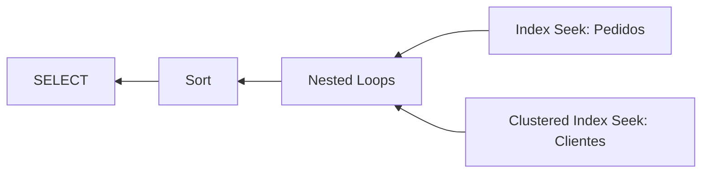

# Planes de ejecución

Parte de: [[06-SQL-Server/04 Rendimiento/_Índice Rendimiento|Rendimiento]]

> [!info] Cómo avanzar
> `progreso`: **pendiente** → **viendo** (estudiando) → **visto** (contestaste la autoevaluación sin abrir las respuestas) → **dominado** (hiciste el laboratorio o lo aplicaste de verdad).

## Contenido

### Qué es
Un **plan de ejecución** es la "receta" que el optimizador de consultas de SQL Server elige para resolver una consulta: qué índices lee, en qué orden une las tablas, con qué algoritmo hace cada join, dónde ordena, filtra o agrega y cuánta memoria reserva. SQL es declarativo (dices **qué** quieres, no **cómo**), y el plan es el **cómo**. Leer planes es la habilidad central para entender por qué una consulta es lenta y qué cambio la haría rápida.

### Cómo funciona
Cuando llega una consulta, el motor la analiza, la convierte en un árbol lógico y el optimizador genera planes alternativos, estimando el costo de cada uno con las [[Estadísticas]]. Elige el más barato que encuentre en un tiempo razonable (no necesariamente el óptimo absoluto) y lo guarda en la **caché de planes** para reutilizarlo. Esa reutilización explica fenómenos como el [[Parameter sniffing]].

El plan se puede ver de dos formas, que se explican en [[Plan estimado vs plan real]]: el **estimado** (lo que el optimizador piensa hacer, sin ejecutar) y el **real** (lo que hizo, con conteos de filas reales). En SSMS:
- **Ctrl+L**: muestra el plan estimado.
- **Ctrl+M** (*Include Actual Execution Plan*) y luego ejecutar: muestra el plan real en una pestaña.
- También existen el XML del plan (`SET SHOWPLAN_XML ON`, `SET STATISTICS XML ON`), los planes guardados en [[Query Store]] y los de la caché vía [[DMVs]] (`sys.dm_exec_query_plan`).

**Cómo se lee un plan gráfico**:
1. **De derecha a izquierda y de arriba abajo**: los operadores de la derecha leen datos (accesos a tablas e índices) y los pasan hacia la izquierda, hasta el operador raíz (`SELECT`, `INSERT`...). Los datos fluyen en el sentido de las flechas.
2. **El grosor de las flechas** es proporcional al número de filas que pasan; una flecha gruesa que de repente se vuelve delgada indica dónde se filtra mucho (o dónde se leyó de más).
3. **El porcentaje de costo** de cada operador es **estimado**, incluso en el plan real. Úsalo como pista, no como verdad.
4. **Las propiedades** (F4 o clic derecho) de cada operador muestran filas estimadas y reales, número de ejecuciones, predicados de búsqueda (*Seek Predicate*) frente a predicados residuales (*Predicate*), columnas de salida y advertencias.
5. **Los triángulos amarillos** son advertencias que merecen atención (ver [[Advertencias del plan (conversiones implícitas y spills)]]).



Los operadores más comunes se agrupan en dos familias: los de **acceso a datos** (*Scan*, *Seek*, *Key Lookup*; ver [[Operadores de acceso (Scan, Seek y Key Lookup)]]) y los de **join** (*Nested Loops*, *Hash Match*, *Merge Join*; ver [[Operadores de join (Nested Loops, Hash Match y Merge Join)]]). Además están *Sort*, *Stream/Hash Aggregate*, *Filter*, *Compute Scalar* y los de paralelismo.

**`SET STATISTICS IO, TIME ON`** complementa el plan con números objetivos en la pestaña *Messages*:
- **IO**: por cada tabla, las **lecturas lógicas** (páginas de 8 KB leídas desde memoria), lecturas físicas (desde disco) y de lectura anticipada. Las lecturas lógicas son la mejor medida para comparar dos versiones de una consulta, porque no dependen de si los datos ya estaban en caché.
- **TIME**: tiempo de análisis y compilación, y tiempo de **CPU** y **transcurrido** de la ejecución.

### Ejemplo
```sql
SET STATISTICS IO, TIME ON;

SELECT c.Nombre, p.PedidoId, p.Fecha
FROM   ventas.Clientes c
JOIN   ventas.Pedidos  p ON p.ClienteId = c.ClienteId
WHERE  c.Ciudad = N'Guadalajara'
ORDER  BY p.Fecha DESC;

SET STATISTICS IO, TIME OFF;
-- Messages, por ejemplo:
-- Table 'Pedidos'. Scan count 2, logical reads 4, ...
-- Table 'Clientes'. Scan count 1, logical reads 2, ...
-- SQL Server Execution Times: CPU time = 0 ms, elapsed time = 1 ms.
```

El flujo de trabajo típico, como en [[Lab 7 - Índices y planes de ejecución antes y después]]: activar el plan real y `STATISTICS IO`, ejecutar, anotar lecturas lógicas y operadores caros, crear o ajustar un índice, volver a ejecutar y comparar. Para una consulta de la API con Dapper, copia el texto del archivo `.sql` a SSMS y **declara los parámetros con los mismos tipos** que manda Dapper (por ejemplo `nvarchar(4000)` para strings), o captura el plan real desde Query Store, para no analizar un plan distinto al de producción.

### Cuándo usarlo y cuándo no
- **Revisa el plan** de toda consulta frecuente o lenta, y antes de crear un índice.
- **Usa lecturas lógicas** para comparar alternativas; el tiempo transcurrido varía con la carga y la caché.
- **No optimices por porcentajes de costo**: son estimados; un operador con 2 % puede ser el verdadero problema si la estimación de filas está mal.
- Para planes complejos, herramientas gratuitas como la vista de planes de Azure Data Studio o visores de terceros ayudan, pero el plan de SSMS es suficiente para aprender.

### Errores comunes
- **Leer de izquierda a derecha**: los datos fluyen de derecha a izquierda.
- **Confiar en el costo %** del plan real como si fuera medido.
- **Medir con el tiempo** en lugar de lecturas lógicas.
- **Analizar en SSMS con literales** una consulta que en la app usa parámetros: el plan puede ser otro.
- **Olvidar desactivar** `STATISTICS IO` o el plan real al medir tiempos, ya que añaden sobrecarga.

### Para profundizar
- [Display and save execution plans](https://learn.microsoft.com/en-us/sql/relational-databases/performance/display-and-save-execution-plans)
- [Display an actual execution plan](https://learn.microsoft.com/en-us/sql/relational-databases/performance/display-an-actual-execution-plan)
- [SET STATISTICS IO (Transact-SQL)](https://learn.microsoft.com/en-us/sql/t-sql/statements/set-statistics-io-transact-sql)
- [Showplan logical and physical operators reference](https://learn.microsoft.com/en-us/sql/relational-databases/showplan-logical-and-physical-operators-reference)

## Subtemas

- [[Plan estimado vs plan real]]
- [[Operadores de acceso (Scan, Seek y Key Lookup)]]
- [[Operadores de join (Nested Loops, Hash Match y Merge Join)]]
- [[Advertencias del plan (conversiones implícitas y spills)]]

## Autoevaluación

Contesta primero en voz alta o en papel; luego despliega la respuesta.

> [!question]- ¿Qué es un plan de ejecución y cómo lo ves?
> El conjunto de operadores que eligió el optimizador para resolver la consulta. En SSMS: «Display Estimated Execution Plan» (Ctrl+L) o «Include Actual Execution Plan» (Ctrl+M) antes de ejecutar.

> [!question]- ¿Cómo se lee un plan gráfico?
> De derecha a izquierda (los datos fluyen hacia el `SELECT`) y de arriba abajo. Fíjate en las flechas gruesas (muchas filas), operadores con mayor costo y diferencias entre filas estimadas y reales.

> [!question]- ¿Qué te dan `SET STATISTICS IO, TIME ON`?
> Las lecturas lógicas por tabla (páginas leídas de memoria; la mejor métrica para comparar antes/después) y el tiempo de CPU y transcurrido. El porcentaje de costo del plan es **estimado**, no medido.

## Práctica

- [[Lab 7 - Índices y planes de ejecución antes y después]]
- [[Lab 8 - Parameter sniffing y Query Store]]

## Progreso de los subtemas

```base
filters:
  and:
    - file.inFolder("06-SQL-Server/04 Rendimiento/Planes de ejecución")
    - file.name != "Planes de ejecución"
views:
  - type: table
    name: Progreso
    order:
      - file.name
      - progreso
      - nivel
```
